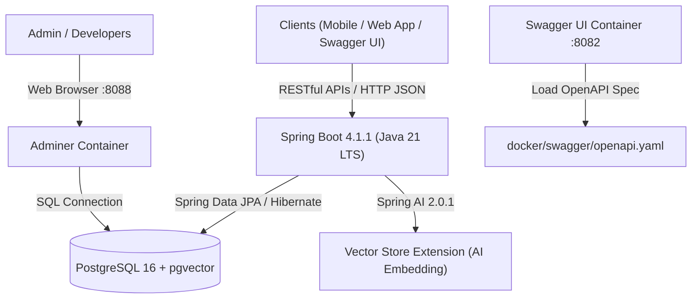

# Kiến Trúc Hệ Thống & Hạ Tầng (System Architecture)

Tài liệu này mô tả kiến trúc tổng thể, công nghệ nền tảng và môi trường hạ tầng của hệ thống **Family Management Backend** (`familyfund-api`).

---

## 1. Bối Cảnh Nghiệp Vụ & Mục Tiêu

Hệ thống **Family Management Backend** giải quyết bài toán chuyển đổi số công tác quản trị dòng họ và quỹ tài chính gia đình, bao gồm:
- **Quản lý phả hệ đa cấp**: Lưu trữ cây phả hệ qua nhiều thế hệ, phân chia chi/nhánh với mô hình đa dòng họ (Multi-tenant).
- **Quản lý sự kiện & Phân quyền động**: Tổ chức các ngày giỗ tổ, lễ hội, mừng thọ với cơ chế phân quyền ngữ cảnh (Contextual RBAC) tự động thu hồi khi sự kiện kết thúc.
- **Minh bạch hóa tài chính**: Quy trình cấp phát tạm ứng, thanh quyết toán hóa đơn thực tế và chốt sổ quỹ sự kiện.
- **Sổ cái Quỹ chung bất biến (Immutable Ledger)**: Lưu vết toàn bộ biến động tài chính dòng họ, ngăn chặn sửa/xóa dữ liệu lịch sử và chỉ cho phép giao dịch bù trừ (Audit Trail NFR-01).
- **Huy động đóng góp đa hình**: Tiếp nhận tiền mặt/chuyển khoản và hiện vật/lễ vật cúng tiến, quy đổi giá trị và chuyển vào danh mục tài sản lâu dài của dòng họ.

---

## 2. Công Nghệ Nền Tảng (Tech Stack)



| Thành phần | Công nghệ / Phiên bản | Vai trò & Đặc điểm kỹ thuật |
| :--- | :--- | :--- |
| **Ngôn ngữ & Runtime** | Java 21 (LTS) | Khóa cứng qua Gradle Toolchain (`languageVersion.set(21)`), tận dụng Virtual Threads và tính năng hiện đại của Java. |
| **Framework cốt lõi** | Spring Boot 4.1.1 | Nền tảng Spring Boot thế hệ mới với hiệu năng cao, Spring Data JPA, Spring Security, Validation. |
| **Công nghệ AI** | Spring AI 2.0.1 (`spring-ai-starter-vector-store-pgvector`) | Hỗ trợ lưu trữ vector embedding gia phả, nghị quyết họ tộc phục vụ trợ lý AI thông minh. |
| **Cơ sở dữ liệu** | PostgreSQL 16 (`pgvector/pgvector:pg16`) | RDBMS hỗ trợ ACID nghiêm ngặt, JSONB, và mở rộng `vector` cho AI. |
| **Build & Dependency** | Gradle Wrapper 9.x (Kotlin DSL) | Quản lý build nhất quán qua `build.gradle.kts`, độc lập môi trường nhờ wrapper. |
| **Quản trị CSDL Web** | Adminer (Latest) | Giao diện web trực quan để kiểm tra dữ liệu và truy vấn SQL trên container. |
| **Đặc tả & Giao diện API** | Swagger UI (`swaggerapi/swagger-ui:latest`) | Hiển thị và tương tác trực tiếp với API thông qua tài liệu OpenAPI 3.0. |

---

## 3. Kiến Trúc Phân Lớp (Layered Architecture)

Mã nguồn backend tuân thủ nghiêm ngặt mô hình phân tầng phân định rõ ranh giới trách nhiệm:

```text
src/main/java/com/familyfund/
├── FamilyfundApiApplication.java    # Điểm khởi chạy ứng dụng Spring Boot
├── core/                           # Các thành phần dùng chung toàn hệ thống
│   ├── config/                     # Cấu hình Spring (Security, JPA, Swagger, AI)
│   ├── exception/                  # Xử lý ngoại lệ tập trung (Global Exception Handler)
│   ├── security/                   # Xác thực JWT, Authorization filters
│   └── utils/                      # Helper, Date formatters, Crypto utils
└── modules/                        # Các phân hệ nghiệp vụ độc lập
    ├── clan/                       # Phân hệ Cây gia phả & Quản lý dòng họ
    ├── event/                      # Phân hệ Quản lý Sự kiện & Nhân sự
    ├── finance/                    # Phân hệ Tạm ứng, Quyết toán & Sổ cái bất biến
    └── contribution/               # Phân hệ Đóng góp & Quản lý tài sản dòng họ
```

Mỗi phân hệ (module) được tổ chức theo cấu trúc chuẩn:
- **`controller/`**: Tiếp nhận HTTP Request, validate dữ liệu đầu vào (`@Valid`), ánh xạ sang DTO response.
- **`service/`**: Xử lý logic nghiệp vụ, quản lý transaction boundary (`@Transactional`), đảm bảo tính toàn vẹn dữ liệu.
- **`repository/`**: Giao tiếp cơ sở dữ liệu qua Spring Data JPA (`JpaRepository`), định nghĩa query tối ưu.
- **`model/entity/`**: Ánh xạ bảng cơ sở dữ liệu sang các JPA Entity.
- **`model/dto/`**: Request/Response DTOs tách biệt hoàn toàn khỏi Entity nhằm bảo mật và đóng gói dữ liệu.

---

## 4. Môi Trường Vận Hành Docker (Docker Compose)

Dự án cung cấp bộ kịch bản [`docker-compose.yml`](file:///d:/WorkSpace/Family-Management/family-management-backend/docker-compose.yml) để khởi chạy các dịch vụ phụ trợ cục bộ độc lập:

### Phân Bổ Cổng Dịch Vụ
- **5432**: PostgreSQL (`familyfund-postgres`)
- **8088**: Adminer Web GUI (`familyfund-adminer`) - Chọn cổng `8088` để tránh xung đột cổng `8080` của Spring Boot API.
- **8082**: Swagger UI (`familyfund-swagger`) - Cổng tài liệu API.
- **8080**: Ứng dụng Spring Boot Backend (`familyfund-api`).

### Cấu Hình Biến Môi Trường ([`.env`](file:///d:/WorkSpace/Family-Management/family-management-backend/.env))
```env
POSTGRES_DB=familyfund_db
POSTGRES_USER=familyfund_user
POSTGRES_PASSWORD=familyfund_secret
POSTGRES_PORT=5432
ADMINER_PORT=8088
SWAGGER_PORT=8082
```

---

## 5. Giải Quyết Ràng Buộc Phụ Thuộc Vòng (Circular Dependencies)

Trong mô hình thực tế của phân hệ Gia phả và Định danh, tồn tại 2 chu trình phụ thuộc vòng ở mức cơ sở dữ liệu:
1. `clans.founder_account_id` $\rightarrow$ `user_accounts.account_id`, nhưng `user_accounts.member_id` $\rightarrow$ `members.member_id` và `members.clan_id` $\rightarrow$ `clans.clan_id`.
2. `family_branches.representative_id` $\rightarrow$ `members.member_id`, nhưng `members.branch_id` $\rightarrow$ `family_branches.branch_id`.

### Giải Pháp Kiến Trúc Triển Khai
- Trong kịch bản DDL [`docker/postgres/init.sql`](file:///d:/WorkSpace/Family-Management/family-management-backend/docker/postgres/init.sql), các bảng `clans` và `family_branches` được khởi tạo trước với cột khóa ngoại cho phép giá trị `NULL`.
- Sau khi toàn bộ các bảng `members` và `user_accounts` được tạo, các ràng buộc khóa ngoại được bổ sung bằng câu lệnh `ALTER TABLE ... ADD CONSTRAINT` kèm tùy chọn `ON DELETE SET NULL`.
- Ở tầng ứng dụng Spring Boot, quy trình đăng ký dòng họ mới sẽ chia thành 2 bước nguyên tử (atomic transaction): Tạo Clan $\rightarrow$ Tạo Member & Account $\rightarrow$ Cập nhật `founder_account_id` vào Clan.

