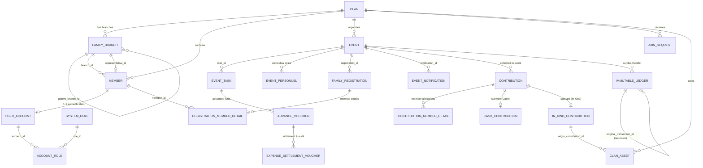

# Đặc Tả Cơ Sở Dữ Liệu PostgreSQL (Database Schema Specification)

Tài liệu này đặc tả chi tiết toàn bộ cấu trúc 21 bảng dữ liệu, ràng buộc toàn vẹn, chỉ mục tối ưu hóa truy vấn và dữ liệu khởi tạo mẫu của hệ thống **Family Management Backend** được định nghĩa trong [`docker/postgres/init.sql`](file:///d:/WorkSpace/Family-Management/family-management-backend/docker/postgres/init.sql).

---

## 1. Sơ Đồ Thực Thể Liên Kết Tổng Quan (ERD)



---

## 2. Chi Tiết 4 Phân Hệ & 21 Bảng Cốt Lõi

### PHÂN HỆ 1: CÂY GIA PHẢ & ĐỊNH DANH (7 BẢNG)

#### 1. Bảng `clans` (Quản lý dòng họ - Multi-tenant)
Lưu trữ thông tin gốc của từng dòng họ, phục vụ phân lập dữ liệu đa người dùng.
- `clan_id VARCHAR(20) PRIMARY KEY`: Mã định danh duy nhất của dòng họ (VD: `CLAN_NGUYENTRONG`).
- `clan_name VARCHAR(100) NOT NULL`: Tên hiển thị dòng họ.
- `established_date DATE NULL`: Ngày ghi nhận nguồn gốc dòng họ.
- `invite_code VARCHAR(50) UNIQUE NULL`: Mã mời chung để các thành viên nhập khi xin gia nhập.
- `founder_account_id VARCHAR(20) NULL`: FK trỏ tới `user_accounts.account_id` (Người khởi tạo dòng họ).
- `created_at / updated_at TIMESTAMP WITH TIME ZONE DEFAULT CURRENT_TIMESTAMP`.

#### 2. Bảng `family_branches` (Cấu trúc phân cấp Chi/Nhánh)
Mô hình Adjacency List cho phép quản lý cấu trúc cây phân nhánh dòng họ nhiều cấp.
- `branch_id VARCHAR(20) PRIMARY KEY`: Mã định danh chi/nhánh (VD: `BRANCH_CHI1`).
- `clan_id VARCHAR(20) NOT NULL`: FK trỏ tới `clans.clan_id` (CASCADE).
- `branch_name VARCHAR(100) NOT NULL`: Tên nhánh/chi (VD: Chi Trưởng, Chi Thứ 2).
- `generation_level INTEGER NOT NULL CHECK (generation_level >= 1)`: Cấp đời/thế hệ bắt đầu của nhánh.
- `parent_branch_id VARCHAR(20) NULL`: FK tự tham chiếu đệ quy trỏ về `family_branches.branch_id` (`NULL` ở nhánh tổ khởi sinh).
- `representative_id VARCHAR(20) NULL`: FK trỏ tới `members.member_id` (Trưởng chi/đại diện nhánh).

#### 3. Bảng `members` (Hồ sơ phả hệ cá nhân)
Lưu thông tin phả hệ của từng cá nhân (cả người còn sống và người đã mất).
- `member_id VARCHAR(20) PRIMARY KEY`: Mã thành viên (VD: `MEM_001`).
- `clan_id VARCHAR(20) NOT NULL`: FK trỏ tới `clans.clan_id` (CASCADE).
- `full_name VARCHAR(100) NOT NULL`: Họ và tên đầy đủ.
- `phone_number VARCHAR(20) NULL`: Số điện thoại liên lạc thực tế.
- `email VARCHAR(100) NULL`: Địa chỉ email.
- `date_of_birth DATE NULL`: Ngày tháng năm sinh.
- `gender VARCHAR(10) NOT NULL CHECK (gender IN ('Male', 'Female', 'Other'))`: Giới tính.
- `generation INTEGER NOT NULL CHECK (generation >= 1)`: Thế hệ / đời thứ mấy trong dòng họ.
- `status VARCHAR(20) NOT NULL DEFAULT 'Living' CHECK (status IN ('Living', 'Deceased'))`: Tình trạng sống/mất.
- `branch_id VARCHAR(20) NULL`: FK trỏ tới `family_branches.branch_id` (SET NULL).
- `claim_code VARCHAR(50) UNIQUE NULL`: Mã liên kết bảo mật cấp cho hồ sơ để người dùng sau này nhận diện tài khoản.

#### 4. Bảng `user_accounts` (Tài khoản đăng nhập hệ thống)
Chỉ cấp cho người dùng thực tế đăng ký/tải ứng dụng và đã định danh vào một hồ sơ thành viên.
- `account_id VARCHAR(20) PRIMARY KEY`: Mã tài khoản (VD: `ACC_001`).
- `member_id VARCHAR(20) NOT NULL UNIQUE`: FK liên kết 1-1 với `members.member_id` (CASCADE).
- `login_identifier VARCHAR(100) NOT NULL UNIQUE`: Tên đăng nhập (Số điện thoại hoặc Email).
- `password_hash VARCHAR(255) NOT NULL`: Mật khẩu mã hóa BCrypt.
- `is_active BOOLEAN NOT NULL DEFAULT TRUE`: Trạng thái hoạt động của tài khoản.

#### 5. Bảng `system_roles` (Danh mục vai trò toàn cục - Global Roles)
- `role_id VARCHAR(50) PRIMARY KEY`: Mã vai trò tĩnh (`ROLE_ADMIN`, `ROLE_CLAN_HEAD`, `ROLE_BRANCH_HEAD`, `ROLE_MEMBER`).
- `role_name VARCHAR(100) NOT NULL`: Tên hiển thị vai trò.
- `description VARCHAR(255) NULL`: Mô tả quyền hạn.

#### 6. Bảng `account_roles` (Bảng trung gian phân quyền toàn cục)
- `account_id VARCHAR(20) NOT NULL`: FK trỏ tới `user_accounts.account_id` (CASCADE).
- `role_id VARCHAR(50) NOT NULL`: FK trỏ tới `system_roles.role_id` (CASCADE).
- `assigned_at TIMESTAMP WITH TIME ZONE DEFAULT CURRENT_TIMESTAMP`.
- `PRIMARY KEY (account_id, role_id)`.

#### 7. Bảng `join_requests` (Yêu cầu xin gia nhập dòng họ)
- `request_id VARCHAR(20) PRIMARY KEY`: Mã yêu cầu.
- `clan_id VARCHAR(20) NOT NULL`: FK trỏ tới `clans.clan_id` (CASCADE).
- `applicant_name VARCHAR(100) NOT NULL`: Tên người xin gia nhập.
- `applicant_phone VARCHAR(20) NOT NULL`: Số điện thoại xác minh.
- `proposed_branch_id VARCHAR(20) NULL`: FK trỏ tới `family_branches.branch_id` (Nhánh xin vào).
- `status VARCHAR(20) NOT NULL DEFAULT 'Pending' CHECK (status IN ('Pending', 'Approved', 'Rejected'))`.
- `note TEXT NULL`: Lời nhắn / thông tin đối chiếu nguồn gốc.

---

### PHÂN HỆ 2: QUẢN LÝ SỰ KIỆN, ĐĂNG KÝ & NHÂN SỰ (6 BẢNG)

#### 8. Bảng `events` (Khởi tạo và quản lý sự kiện)
- `event_id VARCHAR(20) PRIMARY KEY`: Mã sự kiện (VD: `EVENT_GIOTO2026`).
- `clan_id VARCHAR(20) NOT NULL`: FK trỏ tới `clans.clan_id` (CASCADE).
- `event_name VARCHAR(100) NOT NULL`: Tên sự kiện.
- `event_datetime TIMESTAMP WITH TIME ZONE NOT NULL`: Thời gian tổ chức.
- `location VARCHAR(255) NOT NULL`: Địa điểm tổ chức.
- `estimated_budget NUMERIC(18, 2) NOT NULL DEFAULT 0 CHECK (estimated_budget >= 0)`: Dự toán chi phí.
- `description TEXT NULL`: Kế hoạch và nội dung chi tiết.
- `status VARCHAR(20) NOT NULL DEFAULT 'Draft' CHECK (status IN ('Draft', 'RegistrationOpen', 'Ongoing', 'Closed'))`.
- `created_by VARCHAR(20) NOT NULL`: FK trỏ tới `user_accounts.account_id`.

#### 9. Bảng `event_tasks` (Hạng mục công việc sự kiện)
- `task_id VARCHAR(20) PRIMARY KEY`: Mã công việc sự kiện.
- `event_id VARCHAR(20) NOT NULL`: FK trỏ tới `events.event_id` (CASCADE).
- `task_name VARCHAR(150) NOT NULL`: Tên hạng mục (Mua sắm lễ vật, âm thanh, tiếp tân...).
- `assigned_member_id VARCHAR(20) NULL`: FK trỏ tới `members.member_id` (Người phụ trách).
- `status VARCHAR(20) NOT NULL DEFAULT 'Pending' CHECK (status IN ('Pending', 'InProgress', 'Completed', 'Cancelled'))`.

#### 10. Bảng `event_personnel` (Phân quyền động theo sự kiện - Contextual RBAC)
- `event_id VARCHAR(20) NOT NULL`: FK trỏ tới `events.event_id` (CASCADE).
- `member_id VARCHAR(20) NOT NULL`: FK trỏ tới `members.member_id` (CASCADE).
- `event_role VARCHAR(50) NOT NULL CHECK (event_role IN ('HeadOfOrganizer', 'OrganizerMember', 'EventTreasurer'))`.
- `assigned_date TIMESTAMP WITH TIME ZONE DEFAULT CURRENT_TIMESTAMP`.
- `PRIMARY KEY (event_id, member_id, event_role)`: Đảm bảo không phân công trùng vai trò trong cùng 1 sự kiện.

#### 11. Bảng `family_registrations` (Đơn đăng ký tham dự của hộ gia đình)
- `registration_id VARCHAR(20) PRIMARY KEY`: Mã đơn đăng ký.
- `event_id VARCHAR(20) NOT NULL`: FK trỏ tới `events.event_id` (CASCADE).
- `representative_member_id VARCHAR(20) NOT NULL`: FK trỏ tới `members.member_id` (Đại diện hộ).
- `total_attendees INTEGER NOT NULL DEFAULT 1 CHECK (total_attendees > 0)`: Tổng số suất tham dự.
- `dietary_requirements VARCHAR(255) NULL`: Yêu cầu ăn kiêng / ăn chay / trẻ em.
- `transportation_notes VARCHAR(255) NULL`: Nhu cầu xe đưa đón, gửi xe.

#### 12. Bảng `registration_member_details` (Danh sách chi tiết cá nhân đi dự)
- `registration_id VARCHAR(20) NOT NULL`: FK trỏ tới `family_registrations.registration_id` (CASCADE).
- `member_id VARCHAR(20) NOT NULL`: FK trỏ tới `members.member_id` (RESTRICT).
- `PRIMARY KEY (registration_id, member_id)`: Phục vụ xuất danh sách điểm danh đích danh tại sự kiện.

#### 13. Bảng `event_notifications` (Nhật ký thông báo biến động sự kiện)
- `notification_id VARCHAR(20) PRIMARY KEY`: Mã thông báo.
- `event_id VARCHAR(20) NOT NULL`: FK trỏ tới `events.event_id` (CASCADE).
- `title VARCHAR(200) NOT NULL`: Tiêu đề thông báo.
- `content_changes TEXT NOT NULL`: Nội dung thay đổi (thời gian, địa điểm, chương trình).
- `sent_time TIMESTAMP WITH TIME ZONE DEFAULT CURRENT_TIMESTAMP`.
- `triggered_by VARCHAR(20) NOT NULL`: FK trỏ tới `user_accounts.account_id`.

---

### PHÂN HỆ 3: TẠM ỨNG, QUYẾT TOÁN & SỔ CÁI BẤT BIẾN (3 BẢNG)

#### 14. Bảng `advance_vouchers` (Phiếu cấp phát kinh phí tạm ứng)
- `advance_voucher_id VARCHAR(20) PRIMARY KEY`: Mã phiếu tạm ứng.
- `task_id VARCHAR(20) NOT NULL`: FK trỏ tới `event_tasks.task_id` (RESTRICT).
- `recipient_member_id VARCHAR(20) NOT NULL`: FK trỏ tới `members.member_id` (Người nhận tiền).
- `advance_amount NUMERIC(18, 2) NOT NULL CHECK (advance_amount > 0)`: Số tiền cấp tạm ứng.
- `received_date TIMESTAMP WITH TIME ZONE NOT NULL`: Ngày nhận tiền.
- `settlement_deadline TIMESTAMP WITH TIME ZONE NOT NULL`: Hạn nộp chứng từ quyết toán.
- `commitment_notes TEXT NULL`: Cam kết thanh toán.

#### 15. Bảng `expense_settlement_vouchers` (Phiếu chi quyết toán & đối soát)
- `settlement_voucher_id VARCHAR(20) PRIMARY KEY`: Mã phiếu quyết toán.
- `advance_voucher_id VARCHAR(20) NOT NULL`: FK trỏ tới `advance_vouchers.advance_voucher_id` (RESTRICT).
- `actual_expense_amount NUMERIC(18, 2) NOT NULL CHECK (actual_expense_amount >= 0)`: Chi phí thực tế theo hóa đơn hợp lệ.
- `difference_amount NUMERIC(18, 2) NOT NULL`: Chênh lệch = `actual_expense_amount - advance_amount` (Dương: Chi bù; Âm: Thu hồi tiền thừa).
- `treasurer_account_id VARCHAR(20) NOT NULL`: FK trỏ tới `user_accounts.account_id` (Thủ quỹ đối soát).
- `status VARCHAR(30) NOT NULL CHECK (status IN ('Valid', 'NeedsExplanation'))`: Nếu mang cờ `NeedsExplanation`, **hệ thống tự động chặn khóa sổ sự kiện**.
- `rejection_reason TEXT NULL`: Lý do yêu cầu giải trình hoặc từ chối chứng từ.

#### 16. Bảng `immutable_ledgers` (Sổ cái Quỹ chung bất biến - Audit Trail NFR-01)
Bảng tuân thủ nguyên tắc **Append-Only** (Chỉ ghi bản ghi mới, tuyệt đối không UPDATE / DELETE).
- `transaction_id VARCHAR(20) PRIMARY KEY`: Mã giao dịch sổ cái.
- `event_id VARCHAR(20) NULL`: FK trỏ tới `events.event_id` (SET NULL - khi kết chuyển thặng dư sự kiện).
- `transaction_type VARCHAR(50) NOT NULL CHECK (transaction_type IN ('SurplusTransfer', 'AdjustmentTransaction', 'InitialFund', 'DirectDonation'))`.
- `amount NUMERIC(18, 2) NOT NULL`: Số tiền biến động quỹ chung (Dương: tăng quỹ; Âm: giảm quỹ).
- `original_transaction_id VARCHAR(20) NULL`: FK tự tham chiếu trỏ về `immutable_ledgers.transaction_id` gốc khi lập giao dịch bù trừ sửa sai.
- `adjustment_reason TEXT NULL`: Diễn giải lý do lập giao dịch bù trừ.
- `created_by_account_id VARCHAR(20) NOT NULL`: FK trỏ tới `user_accounts.account_id` (Thủ quỹ lập).
- `approved_by_account_id VARCHAR(20) NULL`: FK trỏ tới `user_accounts.account_id` (Trưởng tộc duyệt).
- `created_at TIMESTAMP WITH TIME ZONE DEFAULT CURRENT_TIMESTAMP`: Mốc thời gian kiểm toán chính thức.

---

### PHÂN HỆ 4: ĐÓNG GÓP QUỸ HỌ & HIỆN VẬT (5 BẢNG)

#### 17. Bảng `contributions` (Thực thể gốc ghi nhận đóng góp/cúng tiến)
- `contribution_id VARCHAR(20) PRIMARY KEY`: Mã khoản đóng góp gốc.
- `event_id VARCHAR(20) NOT NULL`: FK trỏ tới `events.event_id` (RESTRICT).
- `payer_member_id VARCHAR(20) NOT NULL`: FK trỏ tới `members.member_id` (Người trực tiếp bàn giao tiền/vật phẩm).
- `receiver_account_id VARCHAR(20) NOT NULL`: FK trỏ tới `user_accounts.account_id` (Thủ quỹ tiếp nhận).
- `contribution_date TIMESTAMP WITH TIME ZONE DEFAULT CURRENT_TIMESTAMP`.
- `contribution_type VARCHAR(20) NOT NULL CHECK (contribution_type IN ('Cash', 'InKind'))`.

#### 18. Bảng `contribution_member_details` (Danh tính cá nhân cùng đứng tên)
Lưu trữ việc chia nhỏ khoản tiền/giá trị quy đổi cho từng thành viên trong gia đình để phục vụ thuật toán đệ quy `TinhTongDongGop()` theo nhánh phả hệ.
- `contribution_id VARCHAR(20) NOT NULL`: FK trỏ tới `contributions.contribution_id` (CASCADE).
- `member_id VARCHAR(20) NOT NULL`: FK trỏ tới `members.member_id` (RESTRICT).
- `recorded_amount NUMERIC(18, 2) NOT NULL CHECK (recorded_amount >= 0)`: Số tiền phân bổ cho thành viên.
- `PRIMARY KEY (contribution_id, member_id)`: Đảm bảo không ghi trùng một cá nhân trong cùng một khoản đóng góp.

#### 19. Bảng `cash_contributions` (Đóng góp tiền mặt / chuyển khoản)
Kế thừa mô hình 1-1 từ bảng `contributions`.
- `contribution_id VARCHAR(20) PRIMARY KEY`: Vừa là PK vừa là FK trỏ tới `contributions.contribution_id` (CASCADE).
- `amount NUMERIC(18, 2) NOT NULL CHECK (amount > 0)`: Số tiền nộp thực tế.
- `payment_method VARCHAR(20) NOT NULL CHECK (payment_method IN ('Cash', 'BankTransfer'))`.
- `receipt_number VARCHAR(50) NOT NULL UNIQUE`: Số biên lai tài chính duy nhất.

#### 20. Bảng `in_kind_contributions` (Đóng góp lễ vật / hiện vật cúng tiến)
Kế thừa mô hình 1-1 từ bảng `contributions`.
- `contribution_id VARCHAR(20) PRIMARY KEY`: Vừa là PK vừa là FK trỏ tới `contributions.contribution_id` (CASCADE).
- `item_name VARCHAR(100) NOT NULL`: Tên hiện vật (Lợn quay, bộ lư hương, đèn thờ...).
- `quantity NUMERIC(10, 2) NOT NULL CHECK (quantity > 0)`: Số lượng hiện vật.
- `unit VARCHAR(20) NOT NULL`: Đơn vị tính (Con, Chiếc, Bộ, Kg...).
- `estimated_value NUMERIC(18, 2) NOT NULL DEFAULT 0 CHECK (estimated_value >= 0)`: Giá ước tính ban đầu do người cúng khai báo.
- `conversion_method VARCHAR(255) NULL`: Căn cứ quy đổi giá trị.
- `converted_monetary_value NUMERIC(18, 2) NOT NULL CHECK (converted_monetary_value >= 0)`: Giá trị quy đổi chính thức đưa vào báo cáo thu chi.
- `processing_status VARCHAR(30) NOT NULL CHECK (processing_status IN ('Consumed', 'Returned', 'AddedToCommonAssets'))`: Hướng xử lý tài sản (Tiêu hao trong sự kiện, Trả lại, hoặc Nhập vào tài sản chung dòng họ).

#### 21. Bảng `clan_assets` (Danh mục tài sản chung dòng họ)
- `asset_id VARCHAR(20) PRIMARY KEY`: Mã tài sản dòng họ.
- `clan_id VARCHAR(20) NOT NULL`: FK trỏ tới `clans.clan_id` (CASCADE).
- `asset_name VARCHAR(100) NOT NULL`: Tên tài sản (Bát hương cổ, Bàn ghế nhà thờ tổ...).
- `quantity INTEGER NOT NULL CHECK (quantity >= 0)`: Số lượng lưu kho / tại nhà thờ.
- `unit VARCHAR(20) NOT NULL`: Đơn vị tính.
- `assessed_value NUMERIC(18, 2) NOT NULL DEFAULT 0 CHECK (assessed_value >= 0)`: Giá trị định giá tài sản tích lũy.
- `origin_contribution_id VARCHAR(20) NULL`: FK trỏ tới `in_kind_contributions.contribution_id` (SET NULL) nếu tài sản có nguồn gốc từ cúng tiến.
- `acquired_date DATE DEFAULT CURRENT_DATE`.
- `created_at TIMESTAMP WITH TIME ZONE DEFAULT CURRENT_TIMESTAMP`.

---

## 3. Chiến Lược Chỉ Mục (Indexing Strategy)

Các chỉ mục được tạo để tăng tốc độ JOIN và lọc cây dữ liệu:

```sql
-- Tìm kiếm thành viên theo dòng họ, nhánh, SĐT và tình trạng
CREATE INDEX idx_members_clan ON members(clan_id);
CREATE INDEX idx_members_branch ON members(branch_id);
CREATE INDEX idx_members_phone ON members(phone_number);
CREATE INDEX idx_members_status ON members(status);
CREATE INDEX idx_family_branches_parent ON family_branches(parent_branch_id);
CREATE INDEX idx_user_accounts_login ON user_accounts(login_identifier);

-- Lọc sự kiện theo dòng họ, trạng thái và mốc thời gian
CREATE INDEX idx_events_clan ON events(clan_id);
CREATE INDEX idx_events_status ON events(status);
CREATE INDEX idx_events_datetime ON events(event_datetime);
CREATE INDEX idx_event_tasks_event ON event_tasks(event_id);
CREATE INDEX idx_family_reg_event ON family_registrations(event_id);

-- Đối soát tạm ứng và truy vấn Sổ cái bất biến
CREATE INDEX idx_advance_task ON advance_vouchers(task_id);
CREATE INDEX idx_settlement_advance ON expense_settlement_vouchers(advance_voucher_id);
CREATE INDEX idx_ledger_event ON immutable_ledgers(event_id);
CREATE INDEX idx_ledger_orig_tx ON immutable_ledgers(original_transaction_id);
CREATE INDEX idx_ledger_created_at ON immutable_ledgers(created_at);

-- Tính toán công đức và thống kê tài sản
CREATE INDEX idx_contributions_event ON contributions(event_id);
CREATE INDEX idx_contributions_payer ON contributions(payer_member_id);
CREATE INDEX idx_contrib_detail_member ON contribution_member_details(member_id);
CREATE INDEX idx_clan_assets_clan ON clan_assets(clan_id);
```

---

## 4. Hỗ Trợ Vector Search (`pgvector`)

Kịch bản khởi tạo tự động kích hoạt extension `vector`:
```sql
CREATE EXTENSION IF NOT EXISTS "vector";
```
Sẵn sàng tích hợp bảng chứa vector embeddings cho tài liệu gia phả, quy ước hương ước dòng họ phục vụ công nghệ tìm kiếm ngữ nghĩa thông minh với Spring AI 2.0.1.

