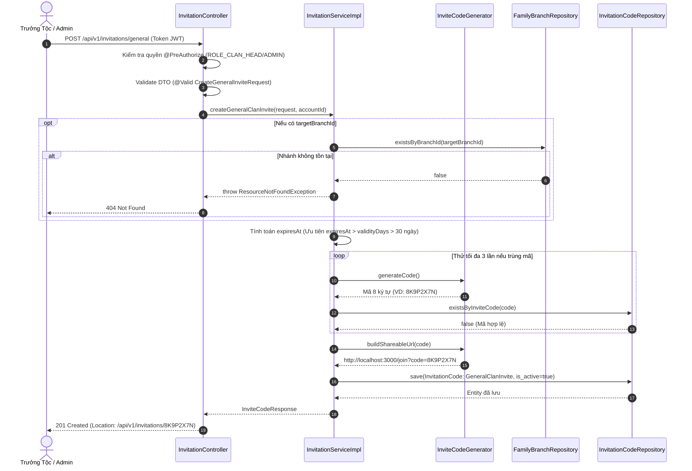
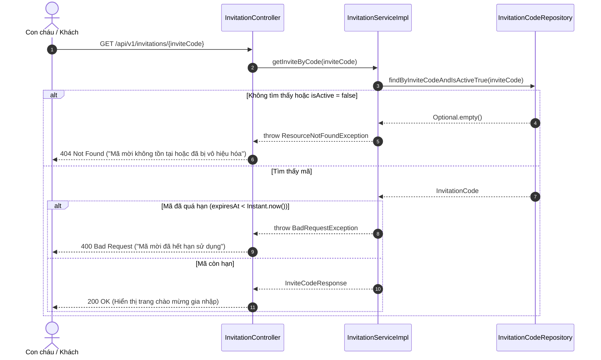

# Đặc Tả Kỹ Thuật & Hướng Dẫn Vận Hành US-16: Tạo Mã Mời Chung Gia Phả

Tài liệu này đặc tả toàn diện thiết kế kiến trúc, mô hình dữ liệu, các giải pháp kỹ thuật, luồng nghiệp vụ chi tiết và quy trình kiểm thử End-to-End (E2E) cho tính năng **[US-16] Tạo mã mời (Invite Code) hoặc đường dẫn liên kết chung của gia phả**.

---

## 1. Tổng Quan Nghiệp Vụ (User Story & Acceptance Criteria)

### Mô tả User Story
* **Mã User Story:** `US-16`
* **Đối tượng sử dụng (Actor):** Trưởng tộc (`ROLE_CLAN_HEAD`) hoặc Quản trị viên hệ thống (`ROLE_ADMIN`).
* **Mục tiêu (Goal):** Chủ động tạo mã mời định danh hoặc đường dẫn liên kết (`shareable_url`) chung của dòng họ kèm số lượt sử dụng tối đa và thời hạn hiệu lực.
* **Giá trị mang lại (Value):** Giúp chia sẻ cho con cháu để họ chủ động truy cập, khai báo thông tin và nộp đơn đề xuất gia nhập dòng họ (tiền đề cho **US-17**).
* **Mức độ ưu tiên:** Bắt buộc (Must-Have).

### Tiêu chí chấp nhận (Acceptance Criteria - AC)
1. **AC-01 (Phân quyền):** Chỉ người dùng có vai trò `ROLE_CLAN_HEAD` hoặc `ROLE_ADMIN` mới được phép tạo hoặc hủy mã mời chung gia phả.
2. **AC-02 (Sinh mã độc nhất):** Hệ thống tự động sinh ra mã mời ngẫu nhiên có độ dài 8 ký tự, không trùng lặp, an toàn mật mã và tự động cấu thành đường dẫn chia sẻ đầy đủ (`shareableUrl`).
3. **AC-03 (Bất biến nghiệp vụ):** Mã mời chung luôn có thuộc tính `invite_type = 'GeneralClanInvite'`, `target_member_id = NULL`, khởi tạo `used_count = 0` và `is_active = TRUE`.
4. **AC-04 (Hạn dùng linh hoạt):** Hỗ trợ thiết lập ngày hết hạn cụ thể (`expiresAt`) hoặc số ngày có hiệu lực (`validityDays`). Nếu không điền, hệ thống áp dụng thời hạn mặc định là 30 ngày.
5. **AC-05 (Kiểm soát nhánh):** Nếu chỉ định nhánh mục tiêu (`targetBranchId`), hệ thống phải xác thực nhánh đó tồn tại trên cây phả hệ trước khi cấp mã.
6. **AC-06 (Vô hiệu hóa an toàn):** Cho phép Trưởng tộc đóng mã mời sớm bằng cơ chế Soft Deactivate (`is_active = FALSE`), không xóa vật lý để bảo toàn lịch sử kiểm toán.

---

## 2. Kiến Trúc Phân Tầng & Thành Phần Kỹ Thuật (Architecture Design)

Tính năng được tổ chức theo chuẩn kiến trúc phân tầng Spring Boot (Layered Architecture):

```
[Client / Frontend Web & Mobile]
               │  HTTP Requests (JSON)
               ▼
┌────────────────────────────────────────────────────────────────────────┐
│ 1. API BOUNDARY & SECURITY LAYER                                       │
│    • SecurityConfig: Method Security (@EnableMethodSecurity)           │
│    • InvitationController: Mapping /api/v1/invitations/**             │
│    • Bean Validation: @Valid (CreateGeneralInviteRequest)              │
│    • GlobalExceptionHandler: Chuẩn hóa ApiResponse<T> & Error Mapping  │
└────────────────────────────────────────────────────────────────────────┘
               │  Validated DTO + Principal
               ▼
┌────────────────────────────────────────────────────────────────────────┐
│ 2. BUSINESS LOGIC SERVICE LAYER                                        │
│    • InvitationService / InvitationServiceImpl (@Transactional)        │
│    • Kiểm soát bất biến: GeneralClanInvite, targetMemberId = null      │
│    • Xác thực nhánh: FamilyBranchRepository.existsByBranchId()         │
│    • Sinh mã & URL: InviteCodeGenerator (SecureRandom + Crockford B32) │
└────────────────────────────────────────────────────────────────────────┘
               │  Entity State
               ▼
┌────────────────────────────────────────────────────────────────────────┐
│ 3. PERSISTENCE & DATA LAYER                                            │
│    • InvitationCodeRepository / FamilyBranchRepository (Spring Data)  │
│    • InvitationCode Entity (@Table: invitation_codes)                  │
│    • PostgreSQL 16+ Database (Local Docker / Neon Serverless Postgres) │
│    • Flyway Migration: V1__init_clan_genealogy_and_events_schema.sql   │
└────────────────────────────────────────────────────────────────────────┘
```

### Danh mục các file mã nguồn cốt lõi:
* **Controller:** [`InvitationController.java`](file:///d:/WorkSpace/Family-Management/family-management-backend/src/main/java/com/familyfund/modules/invitation/controller/InvitationController.java)
* **Service:** [`InvitationService.java`](file:///d:/WorkSpace/Family-Management/family-management-backend/src/main/java/com/familyfund/modules/invitation/service/InvitationService.java), [`InvitationServiceImpl.java`](file:///d:/WorkSpace/Family-Management/family-management-backend/src/main/java/com/familyfund/modules/invitation/service/impl/InvitationServiceImpl.java)
* **Utility Component:** [`InviteCodeGenerator.java`](file:///d:/WorkSpace/Family-Management/family-management-backend/src/main/java/com/familyfund/modules/invitation/util/InviteCodeGenerator.java)
* **Repository:** [`InvitationCodeRepository.java`](file:///d:/WorkSpace/Family-Management/family-management-backend/src/main/java/com/familyfund/modules/invitation/repository/InvitationCodeRepository.java), [`FamilyBranchRepository.java`](file:///d:/WorkSpace/Family-Management/family-management-backend/src/main/java/com/familyfund/modules/genealogy/repository/FamilyBranchRepository.java)
* **Entity & Enums:** [`InvitationCode.java`](file:///d:/WorkSpace/Family-Management/family-management-backend/src/main/java/com/familyfund/modules/invitation/entity/InvitationCode.java), [`InviteType.java`](file:///d:/WorkSpace/Family-Management/family-management-backend/src/main/java/com/familyfund/modules/invitation/entity/InviteType.java), [`FamilyBranch.java`](file:///d:/WorkSpace/Family-Management/family-management-backend/src/main/java/com/familyfund/modules/genealogy/entity/FamilyBranch.java)
* **DTOs & Common:** [`CreateGeneralInviteRequest.java`](file:///d:/WorkSpace/Family-Management/family-management-backend/src/main/java/com/familyfund/modules/invitation/dto/CreateGeneralInviteRequest.java), [`InviteCodeResponse.java`](file:///d:/WorkSpace/Family-Management/family-management-backend/src/main/java/com/familyfund/modules/invitation/dto/InviteCodeResponse.java), [`ApiResponse.java`](file:///d:/WorkSpace/Family-Management/family-management-backend/src/main/java/com/familyfund/core/dto/ApiResponse.java)
* **Configuration:** [`SecurityConfig.java`](file:///d:/WorkSpace/Family-Management/family-management-backend/src/main/java/com/familyfund/core/config/SecurityConfig.java), [`GlobalExceptionHandler.java`](file:///d:/WorkSpace/Family-Management/family-management-backend/src/main/java/com/familyfund/core/exception/GlobalExceptionHandler.java)

---

## 3. Thiết Kế Cơ Sở Dữ Liệu (Database Schema)

Dữ liệu của US-16 được lưu trữ tại bảng `invitation_codes`, đã được khởi tạo qua Flyway migration:

### Cấu trúc Bảng `invitation_codes`
```sql
CREATE TABLE IF NOT EXISTS invitation_codes (
    invite_code VARCHAR(30) PRIMARY KEY,
    invite_type VARCHAR(30) NOT NULL 
        CHECK (invite_type IN ('GeneralClanInvite', 'PositionLinkCode')),
    shareable_url VARCHAR(255),
    target_branch_id VARCHAR(20) REFERENCES family_branches(branch_id) ON DELETE SET NULL,
    target_member_id VARCHAR(20) UNIQUE REFERENCES members(member_id) ON DELETE CASCADE,
    max_uses INT DEFAULT 1,
    used_count INT DEFAULT 0 CHECK (used_count >= 0),
    expires_at TIMESTAMPTZ,
    is_active BOOLEAN DEFAULT TRUE,
    created_by_account_id VARCHAR(20) NOT NULL REFERENCES user_accounts(account_id) ON DELETE RESTRICT,
    created_at TIMESTAMPTZ DEFAULT CURRENT_TIMESTAMP
);
```

### Quy tắc lưu trữ cho US-16:
* `invite_code`: Khóa chính, chuỗi ký tự sinh ngẫu nhiên 8 ký tự (VD: `8K9P2X7N`).
* `invite_type`: Bắt buộc là `'GeneralClanInvite'`.
* `target_member_id`: Luôn luôn là `NULL` (không gán đích danh cá nhân).
* `target_branch_id`: `NULL` nếu mời vào dòng họ chung; hoặc chứa `branch_id` nếu mời con cháu của một chi cụ thể.
* `max_uses`: Số lượt dùng tối đa (mặc định 100 nếu không chỉ định).
* `used_count`: Khởi tạo bằng `0`, tăng dần khi người dùng hoàn tất đăng ký tại US-17.
* `expires_at`: Mốc thời gian `TIMESTAMPTZ` (UTC Instant), tự động so khớp để chặn khi hết hạn.
* `is_active`: `TRUE` khi tạo mới; chuyển thành `FALSE` khi bị Trưởng tộc vô hiệu hóa.

---

## 4. Các Giải Pháp Kỹ Thuật Đã Áp Dụng (Technical Solutions)

### 4.1. Giải pháp sinh mã ngẫu nhiên bảo mật cao (Cryptographically Secure Code Generator)
* **Vấn đề:** Các thuật toán `Math.random()` hoặc `java.util.Random` sử dụng bộ sinh số giả ngẫu nhiên tuyến tính (LCG), kẻ tấn công có thể suy luận chuỗi mã tiếp theo để brute-force link gia phả.
* **Giải pháp:** Sử dụng `java.security.SecureRandom` thu thập entropy từ hệ điều hành.
* **Bảng ký tự Crockford's Base32:** 
  $$\text{Alphabet} = \text{"23456789ABCDEFGHJKLMNPQRSTUVWXYZ" (32 ký tự)}$$
  * Đã loại bỏ hoàn toàn các ký tự dễ nhầm lẫn thị giác: số `0` và chữ `O`, số `1` và chữ `I`/`l`.
  * Không gian mẫu với 8 ký tự: $32^8 \approx 1.099.511.627.776$ tổ hợp khả thi, triệt tiêu nguy cơ đoán mò.

### 4.2. Cơ chế phòng thủ va chạm mã (Collision Defense with Retry Loop)
Hệ thống kết hợp kiểm tra `existsByInviteCode()` trong repository với vòng lặp thử lại tối đa 3 lần (`MAX_GENERATION_ATTEMPTS = 3`). Trường hợp hy hữu mã bị trùng khóa chính, hệ thống tự động sinh lại mã mới ngay lập tức.

### 4.3. Externalized Shareable URL Configuration
Đường dẫn chia sẻ không bị hardcode trong mã nguồn Java mà được cấu hình trong `src/main/resources/application.yaml`:
```yaml
app:
  invitation:
    base-url: ${APP_INVITE_BASE_URL:http://localhost:3000/join}
```
Khi triển khai môi trường Production / Cloud (Neon + Vercel Frontend), chỉ cần cấu hình biến môi trường `APP_INVITE_BASE_URL` mà không cần build lại mã nguồn.

### 4.4. Vô hiệu hóa mềm (Soft Deactivate Pattern)
Thay vì thực thi lệnh `DELETE FROM invitation_codes`, hệ thống cập nhật `is_active = FALSE`. Điều này giúp:
* Bảo toàn toàn vẹn dữ liệu: Bảng `branch_join_requests` (ở US-17) tham chiếu khóa ngoại tới `invite_code`, việc xóa vật lý sẽ gây lỗi FK constraint.
* Giữ nguyên lịch sử kiểm toán: Biết được ai đã tạo mã, tạo lúc nào và đã có bao nhiêu lượt sử dụng trước khi bị hủy.

---

## 5. Luồng Nghiệp Vụ Chi Tiết (Detailed Business Flows)

### 5.1. Luồng Tạo Mã Mời Chung (`POST /api/v1/invitations/general`)



---

### 5.2. Luồng Xem Chi Tiết Mã Mời Công Khai (`GET /api/v1/invitations/{inviteCode}`)

Dành cho con cháu khi click vào link chia sẻ trên điện thoại (Public Access không cần đăng nhập):



---

## 6. Hướng Dẫn Kiểm Thử Toàn Diện (Testing & End-to-End Guide)

Hệ thống cung cấp đầy đủ cả kiểm thử tự động (Automated Unit/Controller Tests) và kịch bản kiểm thử tích hợp thực tế (End-to-End manual testing).

### 6.1. Kiểm thử Tự Động (Automated Tests)

Chạy bộ kiểm thử tự động cho module Lời mời bằng Gradle:
```powershell
.\gradlew.bat test --tests "com.familyfund.modules.invitation.*"
```

| Tên Test Class | Số Test Cases | Mục Tiêu Kiểm Thử |
| :--- | :---: | :--- |
| [`InviteCodeGeneratorTest`](file:///d:/WorkSpace/Family-Management/family-management-backend/src/test/java/com/familyfund/modules/invitation/util/InviteCodeGeneratorTest.java) | 5 | - Định dạng mã 8 ký tự thuộc bảng Crockford Base32.<br/>- **Sinh 10.000 mã liên tiếp không xảy ra va chạm (0 collision)**.<br/>- Tạo đúng định dạng URL chia sẻ cả khi base-url có hoặc không có dấu gạch chéo cuối (`/`). |
| [`CreateGeneralInviteRequestTest`](file:///d:/WorkSpace/Family-Management/family-management-backend/src/test/java/com/familyfund/modules/invitation/dto/CreateGeneralInviteRequestTest.java) | 3 | - Bắt lỗi `@Min(1)` khi `maxUses = 0`.<br/>- Bắt lỗi `@Future` khi ngày hết hạn ở quá khứ.<br/>- Dữ liệu hợp lệ vượt qua validation. |
| [`InvitationServiceTest`](file:///d:/WorkSpace/Family-Management/family-management-backend/src/test/java/com/familyfund/modules/invitation/service/InvitationServiceTest.java) | 8 | - Mockito test nghiệp vụ tạo mã, gán cờ mặc định.<br/>- Báo lỗi khi chi nhánh mục tiêu không tồn tại.<br/>- Tính đúng ngày hết hạn khi dùng `validityDays`.<br/>- Hủy mã mời chuyển cờ `isActive = false`.<br/>- Tra cứu mã mời hết hạn ném `BadRequestException`. |
| [`InvitationControllerTest`](file:///d:/WorkSpace/Family-Management/family-management-backend/src/test/java/com/familyfund/modules/invitation/controller/InvitationControllerTest.java) | 6 | - MockMvc gọi `POST /api/v1/invitations/general` trả về `201 Created` và Location header.<br/>- Bắt lỗi validation trả về `400 Bad Request` dạng JSON chuẩn.<br/>- Tra cứu danh sách và chi tiết mã trả về `200 OK`.<br/>- Vô hiệu hóa mã qua `PATCH` trả về `200 OK`. |

---

### 6.2. Kịch Bản Kiểm Thử Thực Tế End-to-End (E2E Manual Testing)

Để kiểm thử thực tế toàn bộ luồng hoạt động từ Controller qua Service vào PostgreSQL:

#### Bước 1: Khởi động Hạ tầng Docker (Postgres, Adminer, Swagger)
```powershell
# Khởi chạy các container
docker compose up -d

# Xác nhận cả 3 container đang healthy
docker compose ps
```

#### Bước 2: Khởi chạy Ứng dụng Backend
```powershell
.\gradlew.bat bootRun
```
*Sau khi khởi động, Flyway sẽ tự động kích hoạt tạo toàn bộ bảng `invitation_codes` và nạp master roles.*

#### Bước 3: Tạo Mã Mời Chung Mới (POST)
Sử dụng cURL hoặc Postman gửi request tạo mã mời:
```bash
curl -X POST http://localhost:8080/api/v1/invitations/general \
  -H "Content-Type: application/json" \
  -d '{
    "maxUses": 100,
    "validityDays": 30
  }'
```

**Kết quả kỳ vọng (HTTP 201 Created):**
```json
{
  "success": true,
  "message": "Tạo mã mời chung gia phả thành công",
  "data": {
    "inviteCode": "8K9P2X7N",
    "inviteType": "GeneralClanInvite",
    "shareableUrl": "http://localhost:3000/join?code=8K9P2X7N",
    "targetBranchId": null,
    "targetMemberId": null,
    "maxUses": 100,
    "usedCount": 0,
    "expiresAt": "2026-11-16T10:00:00Z",
    "isActive": true,
    "createdByAccountId": "ACC_ANONYMOUS",
    "createdAt": "2026-10-17T10:00:00Z"
  },
  "timestamp": "2026-10-17T10:00:00Z"
}
```

#### Bước 4: Kiểm tra bản ghi trong Cơ Sở Dữ Liệu qua Adminer
1. Truy cập giao diện quản trị Adminer: `http://localhost:8088`.
2. Đăng nhập: Hệ quản trị: `PostgreSQL` | Máy chủ: `postgres` | User: `familyfund_user` | Pass: `familyfund_secret` | DB: `familyfund_db`.
3. Bấm vào bảng `invitation_codes` $\rightarrow$ Chọn **Select data**:
   * Xác nhận có dòng bản ghi với `invite_code = '8K9P2X7N'`.
   * Cột `invite_type = 'GeneralClanInvite'`, `is_active = TRUE`, `used_count = 0`.

#### Bước 5: Tra cứu thông tin mã mời (Public GET)
Mô phỏng con cháu click vào đường link chia sẻ:
```bash
curl -X GET http://localhost:8080/api/v1/invitations/8K9P2X7N
```
**Kết quả kỳ vọng (HTTP 200 OK):** Trả về thông tin mã mời để hiển thị giao diện đăng ký gia nhập dòng họ.

#### Bước 6: Vô hiệu hóa mã mời (PATCH)
Trưởng tộc quyết định đóng đường link:
```bash
curl -X PATCH http://localhost:8080/api/v1/invitations/8K9P2X7N/deactivate
```
**Kết quả kỳ vọng (HTTP 200 OK):**
```json
{
  "success": true,
  "message": "Vô hiệu hóa mã mời thành công",
  "timestamp": "2026-10-17T10:05:00Z"
}
```
*Sau khi vô hiệu hóa, nếu gọi lại bước 5 sẽ nhận mã lỗi `404 Not Found` với thông báo: "Mã mời không tồn tại hoặc đã bị vô hiệu hóa".*

#### Bước 7: Trực quan hóa và Test trên Swagger UI
Truy cập giao diện Swagger UI: `http://localhost:8082`.
Tại nhóm thẻ **Invitations & Onboarding**, bạn có thể bấm **Try it out** để gửi trực tiếp các request trên trình duyệt.
