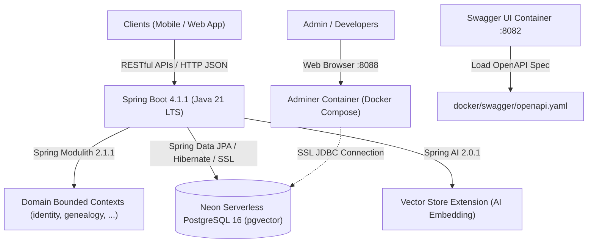

# Kiến Trúc Hệ Thống & Hạ Tầng (System Architecture)

Tài liệu này mô tả kiến trúc tổng thể, mô hình Modular Monolith, ranh giới module với Spring Modulith, công nghệ nền tảng và môi trường hạ tầng của hệ thống **Family Management Backend** (`familyfund-api`).

---

## 1. Bối Cảnh Nghiệp Vụ & Mục Tiêu

Hệ thống **Family Management Backend** giải quyết bài toán chuyển đổi số công tác quản trị dòng họ và quỹ tài chính gia đình, bao gồm:
- **Quản lý phả hệ đa cấp (US-04)**: Lưu trữ cây phả hệ qua nhiều thế hệ, phân chia chi/nhánh với mô hình đa dòng họ (Multi-tenant), chống chu trình, tối ưu dựng cây in-memory không N+1.
- **Tiếp nhận thành viên & Mã mời (US-16)**: Cung cấp mã mời chung gia phả CSPRNG Base32 bảo mật, xem trước công khai và quy trình nộp đơn gia nhập.
- **Quản lý sự kiện & Phân quyền động**: Tổ chức các ngày giỗ tổ, lễ hội, mừng thọ với cơ chế phân quyền ngữ cảnh (Contextual RBAC) tự động thu hồi khi sự kiện kết thúc.
- **Minh bạch hóa tài chính**: Quy trình cấp phát tạm ứng, thanh quyết toán hóa đơn thực tế và chốt sổ quỹ sự kiện.
- **Sổ cái Quỹ chung bất biến (Immutable Ledger)**: Lưu vết toàn bộ biến động tài chính dòng họ, ngăn chặn sửa/xóa dữ liệu lịch sử và chỉ cho phép giao dịch bù trừ (Audit Trail NFR-01).
- **Huy động đóng góp đa hình**: Tiếp nhận tiền mặt/chuyển khoản và hiện vật/lễ vật cúng tiến, quy đổi giá trị và chuyển vào danh mục tài sản lâu dài của dòng họ.

---

## 2. Công Nghệ Nền Tảng (Tech Stack)



| Thành phần | Công nghệ / Phiên bản | Vai trò & Đặc điểm kỹ thuật |
| :--- | :--- | :--- |
| **Ngôn ngữ & Runtime** | Java 21 (LTS) | Khóa cứng qua Gradle Toolchain (`languageVersion.set(21)`), tận dụng Virtual Threads và tính năng hiện đại của Java. |
| **Framework cốt lõi** | Spring Boot 4.1.1 | Nền tảng Spring Boot thế hệ mới với hiệu năng cao, Spring Data JPA, Spring Security, Validation. |
| **Kiến trúc Module** | Spring Modulith 2.1.1 | Quản lý và kiểm soát ranh giới module (Modular Monolith), đóng gói package nội bộ và kiểm thử kiến trúc tự động (`ArchitectureTest.verifyModularity()`). |
| **Cơ chế Multi-Tenancy** | `TenantFilter` + `TenantContext` | Tự động phân giải `clanId` qua HTTP Header `X-Clan-Id` hoặc query param `clanId`, lưu trữ ThreadLocal và cô lập dữ liệu theo từng dòng họ. |
| **Mapping Object/DTO** | MapStruct 1.6.3 + Lombok Binding | Ánh xạ kiểu dữ liệu compile-time an toàn giữa Entity JPA và Java Record DTOs (`BranchMapper`). |
| **Công nghệ AI** | Spring AI 2.0.1 (`spring-ai-starter-vector-store-pgvector`) | Hỗ trợ lưu trữ vector embedding gia phả, nghị quyết họ tộc phục vụ trợ lý AI thông minh (module `com.familyfund.ai`). |
| **Cơ sở dữ liệu** | Neon Serverless PostgreSQL 16 (`pgvector`) | RDBMS đám mây hỗ trợ ACID nghiêm ngặt, JSONB, và mở rộng `vector` cho AI. Quản lý schema bằng Flyway Migrations (V1 $\rightarrow$ V4). |
| **Build & Dependency** | Gradle Wrapper 9.x (Kotlin DSL) | Quản lý build nhất quán qua `build.gradle.kts`, tự động nạp biến môi trường từ `.env` khi chạy `bootRun` và `test`. |
| **Quản trị CSDL Web** | Adminer (Latest via Docker) | Giao diện web trực quan tại cổng `8088` để kiểm tra dữ liệu và truy vấn SQL. |
| **Đặc tả & Giao diện API** | Swagger UI (`swaggerapi/swagger-ui:latest`) | Hiển thị và tương tác trực tiếp với API tại cổng `8082` thông qua tài liệu OpenAPI 3.0 (`docker/swagger/openapi.yaml`). |

---

## 3. Kiến Trúc Modular Monolith & Ranh Giới Bounded Contexts

Hệ thống được thiết kế theo mô hình **Modular Monolith**, phân chia ranh giới theo các Bounded Context của Domain-Driven Design (DDD) và được kiểm soát biên giới bằng **Spring Modulith 2.1.1**.

### 3.1. Danh Mục Các Bounded Contexts & Cấu Trúc Mã Nguồn

```text
src/main/java/com/familyfund/
├── FamilyfundApiApplication.java    # Điểm khởi chạy ứng dụng Spring Boot
│
├── core/                           # Shared Kernel: Cấu hình chung, Security, Exception, Tenant, DTO
│   ├── config/                     # SecurityConfig (@EnableMethodSecurity)
│   ├── dto/                        # ApiResponse<T> chuẩn hóa envelope response toàn hệ thống
│   ├── exception/                  # GlobalExceptionHandler, BadRequestException, ResourceNotFoundException,...
│   ├── tenant/                     # TenantContext (ThreadLocal) & TenantFilter (OncePerRequestFilter)
│   └── package-info.java           # @ApplicationModule(type = OPEN) - Shared Kernel
│
├── identity/                       # Bounded Context: Định danh, Tài khoản, Mã mời (US-16) & Tiếp nhận
│   ├── api/                        # Public Contract: InvitationService, CreateGeneralInviteRequest, InviteCodeResponse
│   │   └── package-info.java       # @NamedInterface("api")
│   ├── internal/                   # Private Implementation
│   │   ├── controller/             # InvitationController (/api/v1/invitations)
│   │   ├── entity/                 # InvitationCode, InviteType
│   │   ├── repository/             # InvitationCodeRepository
│   │   ├── service/                # InvitationServiceImpl
│   │   └── util/                   # InviteCodeGenerator (Base32 CSPRNG)
│   └── package-info.java           # @ApplicationModule(allowedDependencies = {"core", "genealogy::api"})
│
├── genealogy/                      # Bounded Context: Quản lý Dòng họ, Chi nhánh (US-04), Cây phả hệ & Thành viên
│   ├── api/                        # Public Contract: GenealogyQueryService
│   │   └── package-info.java       # @NamedInterface("api")
│   ├── internal/                   # Private Implementation
│   │   ├── controller/             # GenealogyController (/api/v1/branches), MemberController (/api/v1/members)
│   │   ├── dto/                    # Request & Response Records (CreateChildBranchRequest, BranchTreeNodeResponse,...)
│   │   ├── entity/                 # Clan, FamilyBranch, Member
│   │   ├── mapper/                 # BranchMapper (MapStruct)
│   │   ├── repository/             # ClanRepository, FamilyBranchRepository, MemberRepository
│   │   ├── service/                # GenealogyService, GenealogyServiceImpl, GenealogyQueryServiceImpl
│   │   └── validator/              # GenealogyValidator (kiemTraChuTrinh)
│   └── package-info.java           # @ApplicationModule(allowedDependencies = {"core"})
│
├── event/                          # Bounded Context: Quản lý Sự kiện & Contextual RBAC
│   └── package-info.java           # @ApplicationModule(allowedDependencies = {"core", "identity::api", "genealogy::api"})
│
├── finance/                        # Bounded Context: Tài chính, Tạm ứng, Quyết toán & Sổ cái bất biến
│   └── package-info.java           # @ApplicationModule(allowedDependencies = {"core", "event::api"})
│
├── contribution/                   # Bounded Context: Đóng góp Quỹ họ & Quản lý Tài sản dòng họ
│   └── package-info.java           # @ApplicationModule(allowedDependencies = {"core", "genealogy::api", "finance::api"})
│
└── ai/                             # Bounded Context: Trợ lý AI & Vector Store (Tách biệt tương lai)
    └── package-info.java           # @ApplicationModule(allowedDependencies = {"core"})
```

### 3.2. Quy Tắc Quy Hoạch Package Chuẩn Hóa
1. **Quy tắc Public API (`*.api.*`)**:
   - Chứa interface dịch vụ dùng để gọi giữa các module (ví dụ: `GenealogyQueryService`), public DTOs, hoặc domain events.
   - Được đánh dấu `@NamedInterface("api")` trong `package-info.java`.
   - Các module bên ngoài CHỈ ĐƯỢC PHÉP phụ thuộc vào package `api` này.
2. **Quy tắc Internal Implementation (`*.internal.*`)**:
   - Chứa Controllers, Entity JPA, Spring Data Repositories, Service Implementations, và tiện ích nội bộ.
   - **Nghiêm cấm** các module khác import trực tiếp các class trong `internal`.
   - **Xóa bỏ triệt để rò rỉ Repository**: Ví dụ `InvitationServiceImpl` (thuộc `identity`) không được phép inject `FamilyBranchRepository` (thuộc `genealogy`), mà phải gọi qua `GenealogyQueryService` trong `genealogy.api`.
3. **Shared Kernel (`com.familyfund.core`)**:
   - Được đánh dấu `type = ApplicationModule.Type.OPEN` để tất cả các module có thể truy cập các tiện ích bảo mật, DTO phản hồi chung (`ApiResponse<T>`), bộ lọc đa người dùng `TenantFilter` và ngoại lệ toàn cục.

### 3.3. Tự Động Kiểm Tra Kiến Trúc (Architecture Verification Test)
Ranh giới và quy tắc phụ thuộc được kiểm tra tự động thông qua Spring Modulith trong class test [`ArchitectureTest`](file:///d:/WorkSpace/Family-Management/family-management-backend/src/test/java/com/familyfund/ArchitectureTest.java):

```java
@Test
@DisplayName("Verify Spring Modulith modular architecture boundaries and dependencies")
void verifyModularity() {
    modules.verify();
}
```
Nếu bất kỳ thành viên nào trong nhóm vô tình gọi xuyên module hoặc truy cập vào package `internal` trái phép, lệnh build `.\gradlew.bat test` sẽ lập tức báo lỗi và chặn commit.

---

## 4. Môi Trường Vận Hành Docker & Neon Cloud Database

Dự án kết hợp cơ sở dữ liệu đám mây **Neon Serverless PostgreSQL** và bộ công cụ **Docker Compose** cục bộ:

### Phân Bổ Môi Trường & Cổng Dịch Vụ
- **Neon Cloud PostgreSQL**: CSDL PostgreSQL 16 trên Neon Cloud, kết nối trực tiếp từ Spring Boot qua JDBC SSL (`${SPRING_DATASOURCE_URL}`).
- **8088**: Adminer Web GUI (`familyfund-adminer`) qua Docker Compose - Dùng để xem và truy vấn trực quan CSDL.
- **8082**: Swagger UI (`familyfund-swagger`) qua Docker Compose - Dùng để kiểm thử REST APIs qua OpenAPI spec.
- **8080**: Ứng dụng Spring Boot Backend (`familyfund-api`).

### Cấu Hình Biến Môi Trường ([`.env`](file:///d:/WorkSpace/Family-Management/family-management-backend/.env))
```env
# Neon Serverless PostgreSQL Configuration
SPRING_DATASOURCE_URL=jdbc:postgresql://ep-your-project-id.region.aws.neon.tech/neondb?sslmode=require
DB_USER=neondb_owner
DB_PASSWORD=your_neon_password

# Adminer Web DB Manager Configuration (Optional)
ADMINER_PORT=8088

# Swagger UI API Documentation Configuration
SWAGGER_PORT=8082
```

---

## 5. Giải Quyết Ràng Buộc Phụ Thuộc Vòng (Circular Dependencies)

Trong mô hình thực tế của phân hệ Gia phả và Định danh, tồn tại 2 chu trình phụ thuộc vòng ở mức cơ sở dữ liệu:
1. `clans.founder_account_id` $\rightarrow$ `user_accounts.account_id`, nhưng `user_accounts.member_id` $\rightarrow$ `members.member_id` và `members.clan_id` $\rightarrow$ `clans.clan_id`.
2. `family_branches.representative_id` $\rightarrow$ `members.member_id`, nhưng `members.branch_id` $\rightarrow$ `family_branches.branch_id`.

### Giải Pháp Kiến Trúc Triển Khai
- Trong kịch bản Flyway Migrations (V1 $\rightarrow$ V4), các bảng `clans` và `family_branches` được khởi tạo trước với cột khóa ngoại cho phép giá trị `NULL`.
- Sau khi toàn bộ các bảng `members` và `user_accounts` được tạo, các ràng buộc khóa ngoại được bổ sung bằng câu lệnh `ALTER TABLE ... ADD CONSTRAINT` kèm tùy chọn `ON DELETE SET NULL`.
- Ở tầng ứng dụng Spring Boot, quy trình đăng ký dòng họ mới sẽ chia thành 2 bước nguyên tử (atomic transaction): Tạo Clan $\rightarrow$ Tạo Member & Account $\rightarrow$ Cập nhật `founder_account_id` vào Clan.
