# Đặc Tả Cơ Sở Dữ Liệu PostgreSQL & Flyway Migrations (23 Bảng Chuẩn Hóa)

Tài liệu này đặc tả toàn bộ kiến trúc 23 bảng cơ sở dữ liệu, các ràng buộc toàn vẹn, chỉ mục tối ưu, và cơ chế chuyển đổi sang **Flyway Database Migration** phục vụ môi trường phát triển cục bộ (Local Docker + Adminer) cũng như sẵn sàng triển khai đám mây **Neon Serverless PostgreSQL**.

Bản thiết kế chuẩn hóa đáp ứng 100% User Stories (US-00 đến US-20).

---

## 1. Sơ Đồ Thực Thể Liên Kết Tổng Quan (ERD)

```mermaid
erDiagram
    FAMILY_BRANCH ||--o{ FAMILY_BRANCH : "parent_branch_id (Cây phân cấp)"
    FAMILY_BRANCH ||--o{ MEMBER : "branch_id"
    FAMILY_BRANCH ||--o| MEMBER : "representative_id (Trưởng chi)"
    
    MEMBER ||--o| USER_ACCOUNT : "1-1 (Khi đã kích hoạt tài khoản)"
    USER_ACCOUNT ||--o{ ACCOUNT_ROLE : "account_id"
    SYSTEM_ROLE ||--o{ ACCOUNT_ROLE : "role_id"
    
    FAMILY_BRANCH ||--o{ INVITATION_CODE : "target_branch_id"
    MEMBER ||--o| INVITATION_CODE : "target_member_id (PositionLinkCode)"
    USER_ACCOUNT ||--o{ INVITATION_CODE : "created_by_account_id"
    
    USER_ACCOUNT ||--o| BRANCH_JOIN_REQUEST : "account_id (1-1 request)"
    INVITATION_CODE ||--o{ BRANCH_JOIN_REQUEST : "invite_code"
    FAMILY_BRANCH ||--o{ BRANCH_JOIN_REQUEST : "target_branch_id"
    USER_ACCOUNT ||--o{ BRANCH_JOIN_REQUEST : "reviewed_by_account_id"
    
    USER_ACCOUNT ||--o{ EVENT : "created_by"
    EVENT ||--o{ EVENT_PERSONNEL : "event_id"
    MEMBER ||--o{ EVENT_PERSONNEL : "member_id (Contextual RBAC)"
    
    EVENT ||--o{ FAMILY_REGISTRATION : "event_id"
    MEMBER ||--o{ FAMILY_REGISTRATION : "representative_member_id"
    FAMILY_REGISTRATION ||--o{ REGISTRATION_MEMBER_DETAIL : "registration_id"
    MEMBER ||--o{ REGISTRATION_MEMBER_DETAIL : "member_id"
    
    EVENT ||--o{ EVENT_NOTIFICATION : "event_id"
    USER_ACCOUNT ||--o{ EVENT_NOTIFICATION : "triggered_by"
    
    EVENT ||--o{ EVENT_TASK : "event_id"
    FAMILY_BRANCH ||--o{ EVENT_TASK : "assigned_branch_id"
    MEMBER ||--o{ EVENT_TASK : "assigned_member_id"
    USER_ACCOUNT ||--o{ EVENT_TASK : "created_by"
    
    EVENT_TASK ||--o{ TASK_PROGRESS_ALERT : "task_id"
    USER_ACCOUNT ||--o{ TASK_PROGRESS_ALERT : "recipient_account_id"
    
    EVENT ||--o{ CONTRIBUTION : "event_id"
    MEMBER ||--o{ CONTRIBUTION : "payer_member_id"
    USER_ACCOUNT ||--o{ CONTRIBUTION : "receiver_account_id"
    
    CONTRIBUTION ||--o{ CONTRIBUTION_MEMBER_DETAIL : "contribution_id"
    MEMBER ||--o{ CONTRIBUTION_MEMBER_DETAIL : "member_id"
    
    CONTRIBUTION ||--o| CASH_CONTRIBUTION : "1-1 (Subtype Cash)"
    CONTRIBUTION ||--o| IN_KIND_CONTRIBUTION : "1-1 (Subtype In-Kind)"
    IN_KIND_CONTRIBUTION ||--o{ CLAN_ASSET : "origin_contribution_id"
    
    EVENT_TASK ||--o{ ADVANCE_VOUCHER : "task_id"
    MEMBER ||--o{ ADVANCE_VOUCHER : "recipient_member_id"
    USER_ACCOUNT ||--o{ ADVANCE_VOUCHER : "created_by_account_id"
    
    ADVANCE_VOUCHER ||--o| EXPENSE_SETTLEMENT_VOUCHER : "1-1 advance_voucher_id"
    USER_ACCOUNT ||--o{ EXPENSE_SETTLEMENT_VOUCHER : "treasurer_account_id"
    
    IMMUTABLE_LEDGER ||--o{ LEDGER_ADJUSTMENT_REQUEST : "original_transaction_id"
    USER_ACCOUNT ||--o{ LEDGER_ADJUSTMENT_REQUEST : "proposed_by & reviewed_by"
    
    EVENT ||--o{ IMMUTABLE_LEDGER : "event_id (SurplusTransfer)"
    LEDGER_ADJUSTMENT_REQUEST ||--o| IMMUTABLE_LEDGER : "adjustment_request_id (Offset)"
    IMMUTABLE_LEDGER ||--o{ IMMUTABLE_LEDGER : "original_transaction_id (Audit chain)"
    USER_ACCOUNT ||--o{ IMMUTABLE_LEDGER : "created_by & approved_by"
```



---

## 2. Chi Tiết 5 Phân Hệ & 23 Bảng Chuẩn Hóa

### Phân Hệ 1: Cây Gia Phả, Định Danh & Lời Mời (8 Bảng)
1. **`clans`**: Quản lý thông tin từng dòng họ / gia tộc (Tenant). Lưu trữ tên dòng họ (`clan_name`), thủy tổ, quê quán gốc, năm thành lập (V3).
2. **`family_branches`**: Quản lý cấu trúc cây phả hệ (Adjacency List). Nhánh gốc có `generation_level = 1` và `parent_branch_id = NULL`. Đã chuẩn hóa 3NF loại bỏ `clan_name` ở V4 để `clans.clan_name` là Single Source of Truth (US-04).
3. **`members`**: Hồ sơ gia phả cá nhân (gồm cả hồ sơ ảo `is_placeholder = true` chờ gán tài khoản - US-18).
4. **`user_accounts`**: Tài khoản người dùng (quan hệ 1-1 với `members` sau khi được phê duyệt).
5. **`system_roles`**: Danh mục vai trò (`ROLE_CLAN_HEAD`, `ROLE_BRANCH_HEAD`, `ROLE_MEMBER`, `ROLE_ADMIN`).
6. **`account_roles`**: Bảng nối nhiều-nhiều giữa tài khoản và vai trò.
7. **`invitation_codes`**: Quản lý mã mời chung (`GeneralClanInvite` - US-16) và mã liên kết vị trí (`PositionLinkCode` - US-18, US-19).
8. **`branch_join_requests`**: Hồ sơ xin gia nhập dòng họ tự đề xuất vị trí (lá có sẵn hoặc tạo nhánh con mới - US-17).

### Phân Hệ 2: Sự Kiện, Đăng Ký & Nhân Sự (5 Bảng)
9. **`events`**: Quản lý sự kiện giỗ tổ, chạp mã, lễ hội truyền thống kèm ngân sách ước tính và ngày âm lịch.
10. **`event_personnel`**: Phân quyền theo ngữ cảnh từng sự kiện (`HeadOfOrganizer`, `OrganizerMember`, `EventTreasurer`). Khóa đọc `is_read_only = true` khi sự kiện đóng (US-13).
11. **`family_registrations`**: Đăng ký tham gia theo hộ gia đình (số suất ăn chay/mặn, nhu cầu đi lại - US-06).
12. **`registration_member_details`**: Chi tiết thành viên gia đình tham gia và điểm danh thực tế (`is_checked_in`).
13. **`event_notifications`**: Ghi nhận biến động lịch trình, địa điểm và gửi thông báo tới các thành viên.

### Phân Hệ 3: Phân Công & Tiến Độ Công Việc (2 Bảng)
14. **`event_tasks`**: Hạng mục công việc chuẩn bị sự kiện, phân công linh hoạt cho cả Chi/Nhánh hoặc đích danh cá nhân (US-07).
15. **`task_progress_alerts`**: Cảnh báo nhắc việc 24h và tự động leo thang cảnh báo quá hạn 12h tới Trưởng nhánh (US-08).

### Phân Hệ 4: Đóng Góp & Tài Sản Dòng Họ (5 Bảng)
16. **`contributions`**: Bảng cha lưu vết mọi khoản công đức (Tiền mặt hoặc Hiện vật quy đổi - US-09, US-10).
17. **`contribution_member_details`**: Ghi nhận công đức chia nhỏ cho từng cá nhân phục vụ hàm `TinhTongDongGop()` (US-11).
18. **`cash_contributions`**: Bảng con lưu thông tin chi tiết đóng góp tiền mặt / chuyển khoản + mã biên lai tự sinh (US-09).
19. **`in_kind_contributions`**: Bảng con lưu chi tiết hiện vật, đơn vị tính, phương pháp quy đổi giá trị và trạng thái xử lý (US-10).
20. **`clan_assets`**: Tài sản tích lũy dòng họ lưu trữ tại từ đường, chuyển giao từ hiện vật sau sự kiện.

### Phân Hệ 5: Tạm Ứng, Quyết Toán & Sổ Cái Bất Biến (4 Bảng)
21. **`advance_vouchers`**: Phiếu tạm ứng kinh phí thực hiện công việc cho người phụ trách (US-12).
22. **`expense_settlement_vouchers`**: Quyết toán hoàn ứng kèm đường dẫn ảnh hóa đơn/chứng từ. Trạng thái `NeedsExplanation` sẽ chặn đóng sự kiện (US-12, US-13).
23. **`ledger_adjustment_requests`**: Quy trình đề xuất bù trừ sai sót sổ cái trước khi chốt ghi nhận (US-15).
24. **`immutable_ledgers`**: Sổ cái quỹ chung bất biến (chỉ cho phép `INSERT`, cấm `UPDATE`/`DELETE`), tích hợp chuỗi băm mật mã SHA-256 (`record_hash`) chống giả mạo (US-13, US-15).

---

## 3. Kiến Trúc Flyway Migrations & Triển Khai

### Cấu trúc file Migration
Toàn bộ kịch bản DDL và dữ liệu khởi tạo được quản lý trong thư mục `src/main/resources/db/migration`:
- [`V1__init_clan_genealogy_and_events_schema.sql`](../../src/main/resources/db/migration/V1__init_clan_genealogy_and_events_schema.sql): Tạo toàn bộ các bảng ban đầu, khóa chính, khóa ngoại, ràng buộc CHECK và Indexes.
- [`V2__seed_system_roles_and_master_data.sql`](../../src/main/resources/db/migration/V2__seed_system_roles_and_master_data.sql): Khởi tạo 4 nhóm quyền hệ thống (`ROLE_CLAN_HEAD`, `ROLE_BRANCH_HEAD`, `ROLE_MEMBER`, `ROLE_ADMIN`).
- [`V3__create_clans_and_add_multitenancy_support.sql`](../../src/main/resources/db/migration/V3__create_clans_and_add_multitenancy_support.sql): Khởi tạo bảng `clans` và thiết lập quan hệ Multi-tenancy phân tách các dòng họ độc lập.
- [`V4__drop_clan_name_from_family_branches.sql`](../../src/main/resources/db/migration/V4__drop_clan_name_from_family_branches.sql): Chuẩn hóa dữ liệu 3NF, loại bỏ cột dư thừa `clan_name` khỏi `family_branches`, quy tụ tên dòng họ về `clans` (Single Source of Truth - US-04).

### Khởi chạy môi trường Local
```bash
# 1. Khởi động PostgreSQL 16 và Adminer
docker compose up -d

# 2. Khởi chạy ứng dụng Spring Boot (Flyway tự động chạy migration vào Postgres container)
.\gradlew.bat bootRun

# 3. Mở Adminer tại http://localhost:8088
# - Hệ quản trị: PostgreSQL
# - Máy chủ: postgres
# - Người dùng: familyfund_user
# - Mật khẩu: familyfund_secret
# - Cơ sở dữ liệu: familyfund_db
```

### Triển khai lên Neon Serverless PostgreSQL
Khi chuyển sang Neon Cloud, không cần thay đổi bất kỳ dòng mã nguồn hay script DDL nào:
1. Đăng ký database trên [neon.tech](https://neon.tech).
2. Lấy chuỗi kết nối JDBC (chế độ SSL): `jdbc:postgresql://ep-xxxx.neon.tech/neondb?sslmode=require`.
3. Cung cấp biến môi trường cho Spring Boot:
   ```bash
   SPRING_DATASOURCE_URL="jdbc:postgresql://ep-xxxx.neon.tech/neondb?sslmode=require"
   DB_USER="neondb_owner"
   DB_PASSWORD="your_neon_secret_password"
   ```
4. Khi ứng dụng khởi chạy trên Cloud, Flyway sẽ tự động kết nối và tạo toàn bộ 23 bảng cùng bảng quản lý `flyway_schema_history` trên Neon.
