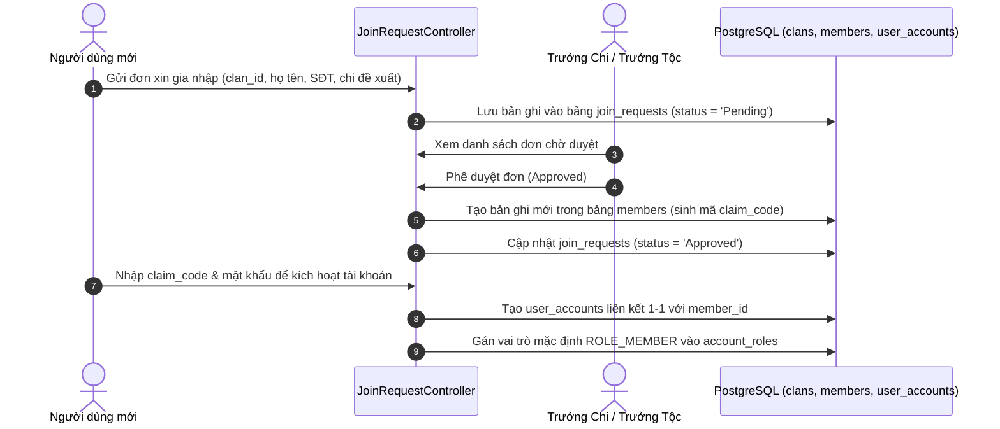
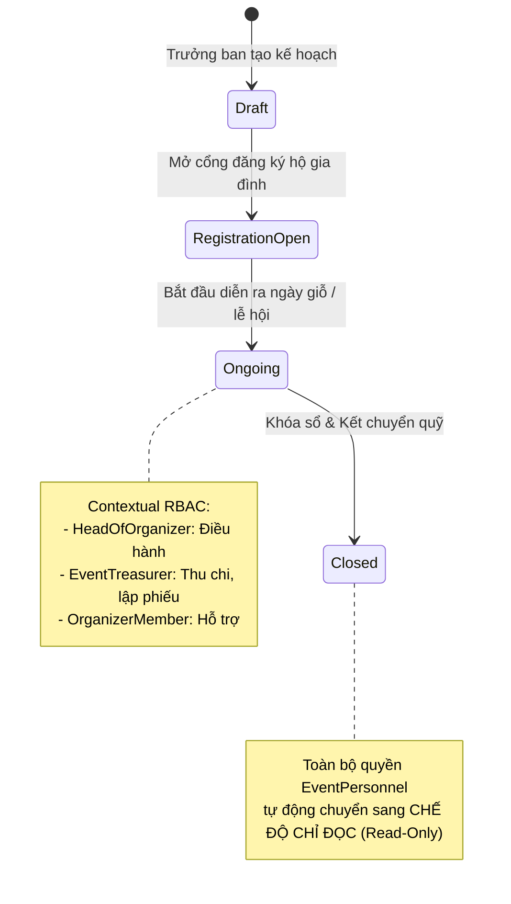
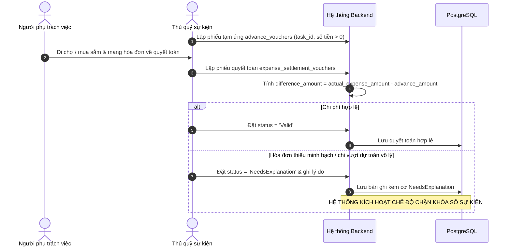
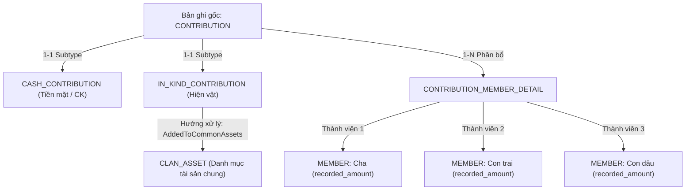
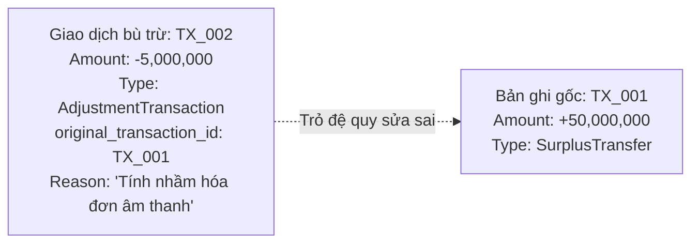
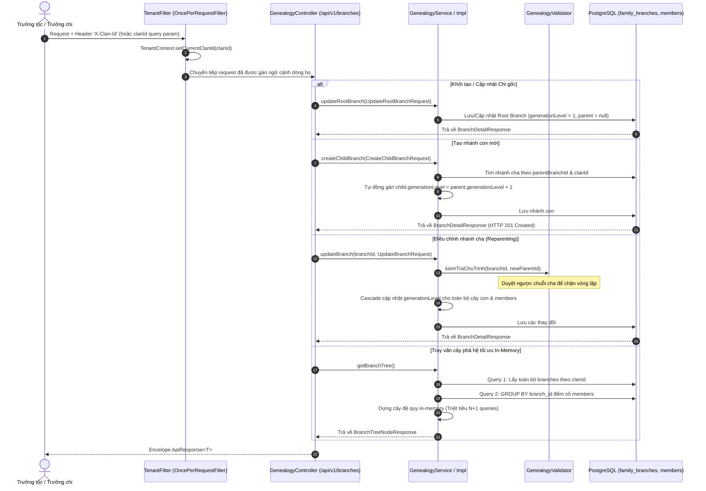

# Các Luồng Nghiệp Vụ Cốt Lõi (Core Business Flows)

Tài liệu này mô tả chi tiết các luồng dữ liệu và quy trình nghiệp vụ xuyên suốt các phân hệ của hệ thống **Family Management Backend**.

---

## 1. Luồng 1: Xin Gia Nhập Dòng Họ & Định Danh Tài Khoản



### Các bước thực thi:
1. **Tiếp nhận yêu cầu**: Người dùng tải ứng dụng, tìm kiếm dòng họ qua tên hoặc mã mời (`invite_code`), gửi yêu cầu gia nhập kèm số điện thoại liên lạc.
2. **Xác minh & Phê chuẩn**: Trưởng họ hoặc Trưởng chi đối chiếu phả hệ thực tế và chấp thuận đơn.
3. **Liên kết hồ sơ (Claim Profile)**: Hệ thống sinh hồ sơ thành viên `members` với mã `claim_code`. Người dùng hoàn tất đăng ký tài khoản `user_accounts` gắn liền với hồ sơ phả hệ của mình.

---

## 2. Luồng 2: Quản Lý Sự Kiện & Phân Quyền Động (Contextual RBAC)

Khác với quyền toàn cục (Global Role), quyền hạn trong sự kiện được cấp phát linh hoạt và gắn chặt với trạng thái vòng đời sự kiện:



- **Chỉ định nhân sự**: Bảng `event_personnel` lưu các vai trò `HeadOfOrganizer`, `OrganizerMember`, `EventTreasurer` cho từng sự kiện.
- **Tự động thu hồi quyền**: Khi sự kiện chuyển trạng thái sang `Closed`, hệ thống chặn toàn bộ thao tác thêm/sửa/xóa phiếu chi, phiếu thu, phiếu tạm ứng của sự kiện đó, bảo toàn tính toàn vẹn số liệu.

---

## 3. Luồng 3: Tạm Ứng, Quyết Toán & Cơ Chế Chặn Khóa Sổ

Quy trình quản lý chi tiêu nghiêm ngặt giúp ngăn chặn thất thoát quỹ và đảm bảo mọi khoản tạm ứng đều được đối soát:



### Cơ chế Chặn Khóa Sổ Sự Kiện (Business Invariant):
- Khi Trưởng ban tổ chức thực hiện lệnh đóng sự kiện (`PUT /events/{id}/close`), hệ thống thực thi truy vấn kiểm tra:
  ```sql
  SELECT COUNT(*) FROM expense_settlement_vouchers esv
  JOIN advance_vouchers av ON esv.advance_voucher_id = av.advance_voucher_id
  JOIN event_tasks et ON av.task_id = et.task_id
  WHERE et.event_id = :eventId AND esv.status = 'NeedsExplanation';
  ```
- Nếu kết quả $> 0$, API lập tức trả về mã lỗi `400 Bad Request` kèm thông báo: *"Sự kiện còn khoản chi chưa giải trình hợp lệ, không thể khóa sổ"*.

---

## 4. Luồng 4: Đóng Góp Quỹ Họ & Phân Bổ Công Đức Đệ Quy

Hệ thống hỗ trợ 2 hình thức đóng góp qua mô hình đa hình (Polymorphism / Class Table Inheritance):



### Thuật toán Tính Tổng Đóng Góp Theo Nhánh Phả Hệ (`TinhTongDongGop`):
- Khi một hộ gia đình cúng tiến, người đại diện có thể đăng ký chia đều hoặc ghi nhận cho từng cá nhân trong gia đình qua bảng `contribution_member_details`.
- Khi tính tổng công đức của một Chi nhánh, hệ thống dùng truy vấn đệ quy CTE (Common Table Expression) duyệt toàn bộ nhánh con cháu và cộng dồn `recorded_amount` của tất cả thành viên thuộc nhánh đó.

---

## 5. Luồng 5: Sổ Cái Bất Biến (Audit Trail) & Giao Dịch Bù Trừ

Nhằm đáp ứng yêu cầu kiểm toán tối cao NFR-01, bảng `immutable_ledgers` vận hành theo mô hình chuỗi ghi bất biến:



### Quy tắc bất biến:
1. **Không Update / Delete**: Mọi hành vi cập nhật hay xóa bản ghi đều bị cấm ở cả tầng database trigger và repository layer.
2. **Giao dịch bù trừ (Adjustment Transaction)**: Khi phát hiện sai lệch số liệu sau khi sự kiện đã khóa sổ, Thủ quỹ lập một bút toán điều chỉnh mới mang giá trị chênh lệch (âm hoặc dương) và liên kết với `original_transaction_id` của giao dịch gốc.
3. **Phê duyệt 2 lớp**: Bút toán điều chỉnh chỉ có hiệu lực khi có chữ ký duyệt của Trưởng tộc (`approved_by_account_id IS NOT NULL`).

---

## 6. Luồng 6: Tạo Mã Mời Chung Gia Phả & Xem Trước Công Khai (US-16)

Để đơn giản hóa việc quy tụ con cháu xa quê gia nhập dòng họ, hệ thống cung cấp luồng sinh mã mời chung gia phả (`GeneralClanInvite`) có khả năng chia sẻ diện rộng:


Chi tiết kiến trúc, giải thuật sinh mã an toàn mật mã, và quy trình kiểm thử E2E: xem tại **[`docs/user-stories/US-16-general-clan-invite.md`](../user-stories/US-16-general-clan-invite.md)**.

---

## 7. Luồng 7: Quản Lý Chi Phái, Phân Nhánh & Cấu Trúc Phân Cấp Gia Phả (US-04)

Phân hệ quản lý cây gia phả vận hành theo mô hình phân cấp đệ quy Adjacency List với ranh giới multi-tenancy nghiêm ngặt được tiêm tự động bởi `TenantFilter`:



### Các nguyên tắc toàn vẹn nghiệp vụ (Business Invariants):
1. **Duy nhất Chi gốc**: Mỗi dòng họ có duy nhất một chi gốc với `generation_level = 1` và `parent_branch_id = NULL`.
2. **Chống chu trình**: Thuật toán `kiemTraChuTrinh` ngăn chặn tuyệt đối tình huống nhánh cha trở thành nhánh con của chính nó.
3. **Xóa an toàn**: Chặn xóa Chi gốc, chặn xóa nhánh đang có nhánh con hoặc đang có thành viên liên kết.
4. **Không N+1 Queries**: Lấy trọn vẹn cây gia phả chỉ trong đúng 2 truy vấn SQL và dựng cây trên RAM.

Chi tiết kiến trúc, thuật toán dựng cây và kịch bản kiểm thử: xem tại **[`docs/user-stories/US-04-child-branches-and-hierarchy.md`](../user-stories/US-04-child-branches-and-hierarchy.md)**.
