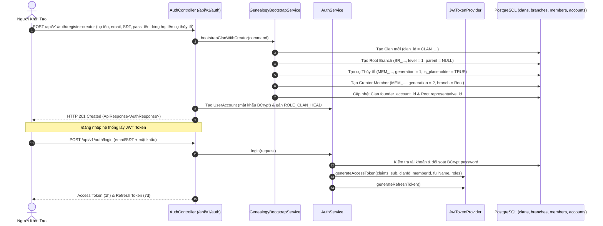
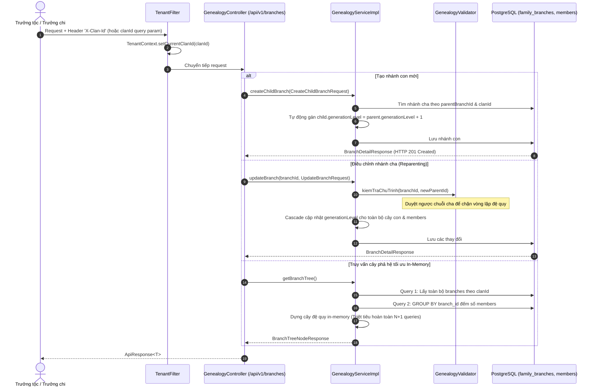
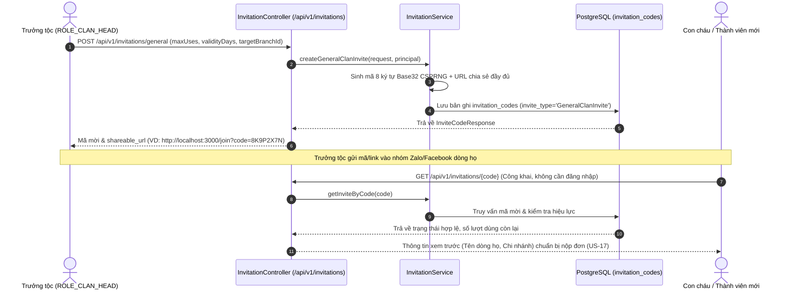
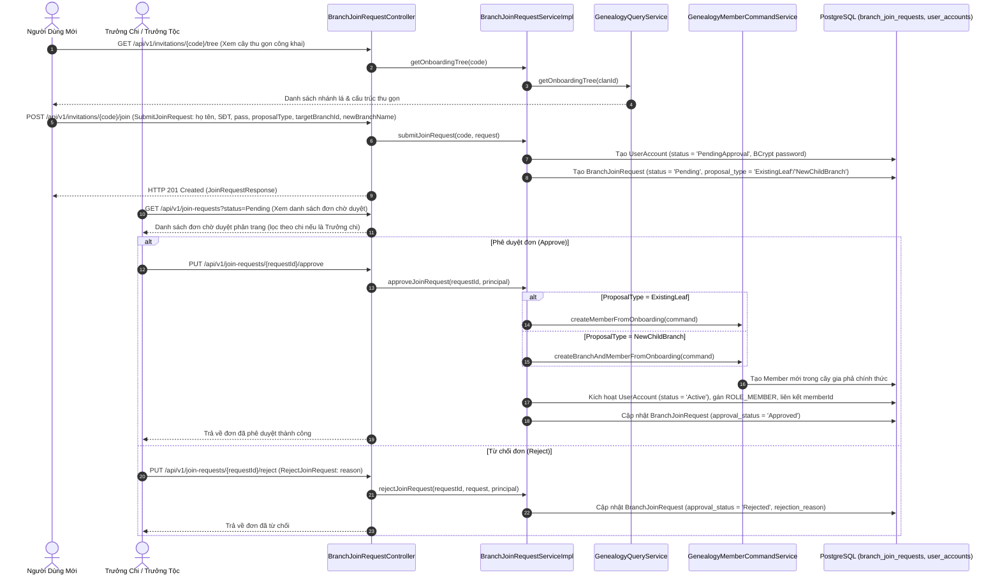
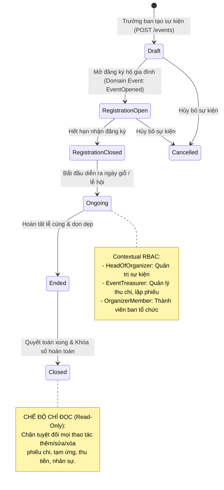
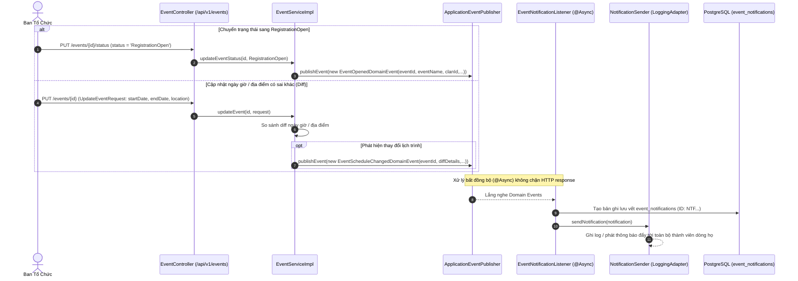
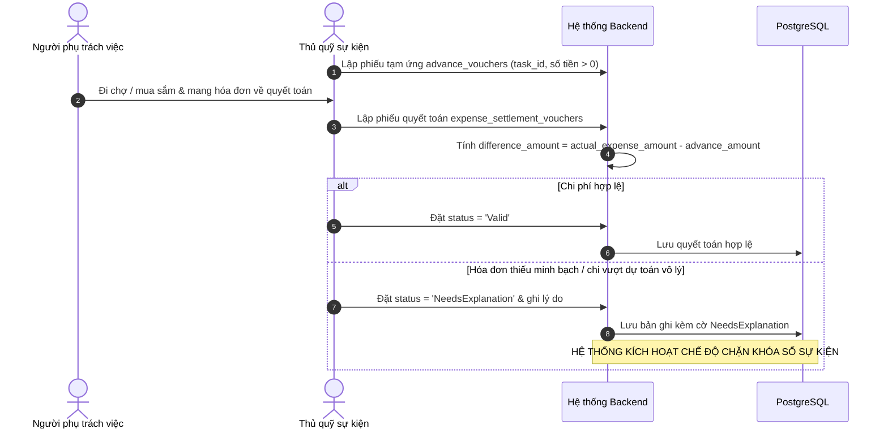
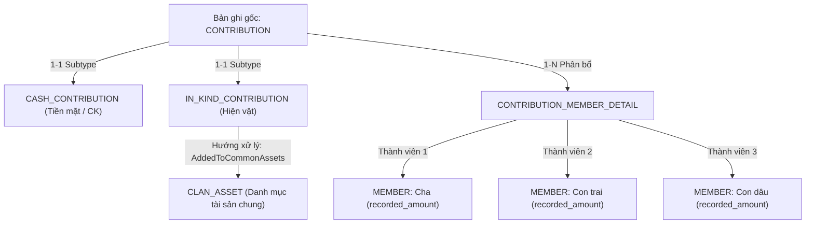
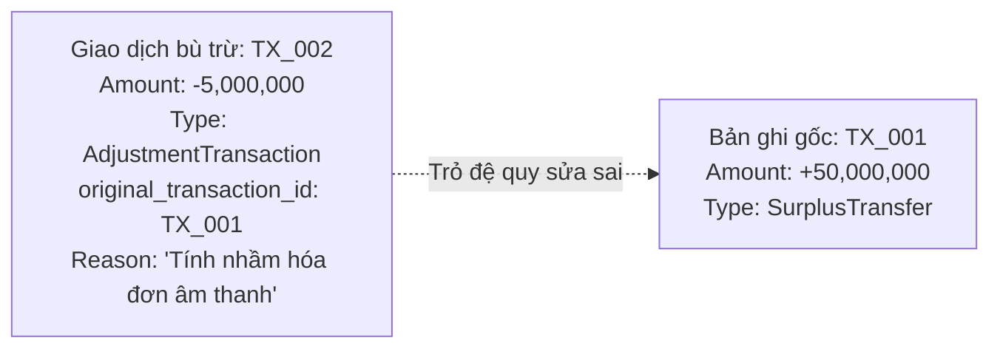

# Các Luồng Nghiệp Vụ Cốt Lõi (Core Business Flows)

Tài liệu này mô tả chi tiết các luồng dữ liệu và quy trình nghiệp vụ xuyên suốt các phân hệ của hệ thống **Family Management Backend** (`familyfund-api`).

---

## 1. Luồng 1: Khởi Tạo Dòng Họ (US-01) & Xác Thực JWT Token (US-10)

Luồng cho phép Người khởi tạo thiết lập dòng họ mới một cách nguyên tử (atomic transaction) và đăng nhập hệ thống không trạng thái:



---

## 2. Luồng 2: Tạo Hồ Sơ Thành Viên Gia Phả & Chống Trùng (US-03)

Luồng thêm hồ sơ thành viên mới vào một chi nhánh cụ thể, bảo đảm tính toàn vẹn thế hệ và chống tạo trùng:

```mermaid
sequenceDiagram
    autonumber
    actor Head as Trưởng Tộc / Trưởng Chi
    participant Filter as TenantFilter & JwtAuthenticationFilter
    participant API as MemberController (/api/v1/branches/{branchId}/members)
    participant Svc as MemberServiceImpl
    participant DB as PostgreSQL (clans, family_branches, members)

    Head->>Filter: POST /branches/{branchId}/members + Bearer JWT
    Filter->>Filter: Xác thực JWT, nạp ROLE & clanId vào SecurityContext & TenantContext
    Filter->>API: Chuyển tiếp request đã xác thực
    API->>Svc: createMember(branchId, CreateMemberRequest, principal)
    Svc->>DB: SELECT * FROM clans WHERE clan_id = :clanId FOR UPDATE (Khóa bi quan chống race condition)
    Svc->>DB: Kiểm tra branchId thuộc về clanId
    Svc->>Svc: Kiểm tra quyền: CLAN_HEAD được thêm mọi chi; BRANCH_HEAD chỉ chi mình phụ trách
    Svc->>DB: Kiểm tra chống trùng (họ tên + năm sinh + giới tính + chi)
    Svc->>Svc: Gán generation = branch.generationLevel, is_placeholder = TRUE
    Svc->>DB: INSERT INTO members
    DB-->>API: Hồ sơ Member hoàn chỉnh
    API-->>Head: HTTP 201 Created (ApiResponse<MemberResponse>)
```

---

## 3. Luồng 3: Quản Lý Chi Phái, Phân Nhánh & Cấu Trúc Phân Cấp (US-04)

Phân hệ quản lý cây gia phả vận hành theo mô hình phân cấp đệ quy Adjacency List với thuật toán chống chu trình và dựng cây in-memory tối ưu không N+1:



---

## 4. Luồng 4: Tạo Mã Mời Chung Gia Phả & Xem Trước Công Khai (US-16)



---

## 5. Luồng 5: Đăng Ký Gia Nhập Dòng Họ Qua Mã Mời (Onboarding - US-17)

Quy trình tự do đăng ký tham gia dòng họ dành cho con cháu từ bên ngoài kèm cây thu gọn và xét duyệt vị trí phả hệ:



---

## 6. Luồng 6: Quản Lý Vòng Đời Sự Kiện & Phân Quyền Theo Ngữ Cảnh (US-21)

Vòng đời sự kiện được quản lý theo máy trạng thái hữu hạn (FSM) kết hợp cơ chế kiểm soát quyền truy cập linh hoạt theo ngữ cảnh (`NhanSuSuKien`):



- **Xác thực quyền theo ngữ cảnh**: Middleware `@Component("nhanSuSuKien")` với hàm `xacThucQuyenTheoNguCanh(#eventId, 'HeadOfOrganizer', 'EventTreasurer')` được nhúng trực tiếp vào `@PreAuthorize` trên các controller methods.
- **Ràng buộc nhân sự**: Mỗi sự kiện có tối đa 1 Trưởng ban tổ chức (`HeadOfOrganizer`) và 1 Thủ quỹ sự kiện (`EventTreasurer`). Danh tính nhân sự được kiểm tra hợp lệ với hồ sơ gia phả qua `GenealogyQueryService`.

---

## 7. Luồng 7: Thông Báo Sự Kiện Đa Kênh & Tự Động So Sánh Lịch Trình (US-22)



---

## 8. Luồng 8: Tạm Ứng, Quyết Toán & Cơ Chế Chặn Khóa Sổ

Quy trình quản lý chi tiêu nghiêm ngặt giúp ngăn chặn thất thoát quỹ và đảm bảo mọi khoản tạm ứng đều được đối soát:



### Cơ chế Chặn Khóa Sổ Sự Kiện (Business Invariant):
- Khi Trưởng ban tổ chức thực hiện lệnh đóng sự kiện (`PUT /events/{id}/close`), hệ thống thực thi truy vấn kiểm tra:
  ```sql
  SELECT COUNT(*) FROM expense_settlement_vouchers esv
  JOIN advance_vouchers av ON esv.advance_voucher_id = av.advance_voucher_id
  JOIN event_tasks et ON av.task_id = et.task_id
  WHERE et.event_id = :eventId AND esv.status = 'NeedsExplanation';
  ```
- Nếu kết quả $> 0$, API lập tức trả về mã lỗi `400 Bad Request` kèm thông báo: *"Sự kiện còn khoản chi chưa giải trình hợp lệ, không thể khóa sổ"*.

---

## 9. Luồng 9: Đóng Góp Quỹ Họ & Phân Bổ Công Đức Đệ Quy

Hệ thống hỗ trợ 2 hình thức đóng góp qua mô hình đa hình (Polymorphism / Class Table Inheritance):



### Thuật toán Tính Tổng Đóng Góp Theo Nhánh Phả Hệ (`TinhTongDongGop`):
- Khi một hộ gia đình cúng tiến, người đại diện có thể đăng ký chia đều hoặc ghi nhận cho từng cá nhân trong gia đình qua bảng `contribution_member_details`.
- Khi tính tổng công đức của một Chi nhánh, hệ thống dùng truy vấn đệ quy CTE (Common Table Expression) duyệt toàn bộ nhánh con cháu và cộng dồn `recorded_amount` của tất cả thành viên thuộc nhánh đó.

---

## 10. Luồng 10: Sổ Cái Bất Biến (Audit Trail) & Giao Dịch Bù Trừ

Nhằm đáp ứng yêu cầu kiểm toán tối cao NFR-01, bảng `immutable_ledgers` vận hành theo mô hình chuỗi ghi bất biến:



### Quy tắc bất biến:
1. **Không Update / Delete**: Mọi hành vi cập nhật hay xóa bản ghi đều bị cấm ở cả tầng database trigger và repository layer.
2. **Giao dịch bù trừ (Adjustment Transaction)**: Khi phát hiện sai lệch số liệu sau khi sự kiện đã khóa sổ, Thủ quỹ lập một bút toán điều chỉnh mới mang giá trị chênh lệch (âm hoặc dương) và liên kết với `original_transaction_id` của giao dịch gốc.
3. **Phê duyệt 2 lớp**: Bút toán điều chỉnh chỉ có hiệu lực khi có chữ ký duyệt của Trưởng tộc (`approved_by_account_id IS NOT NULL`).
