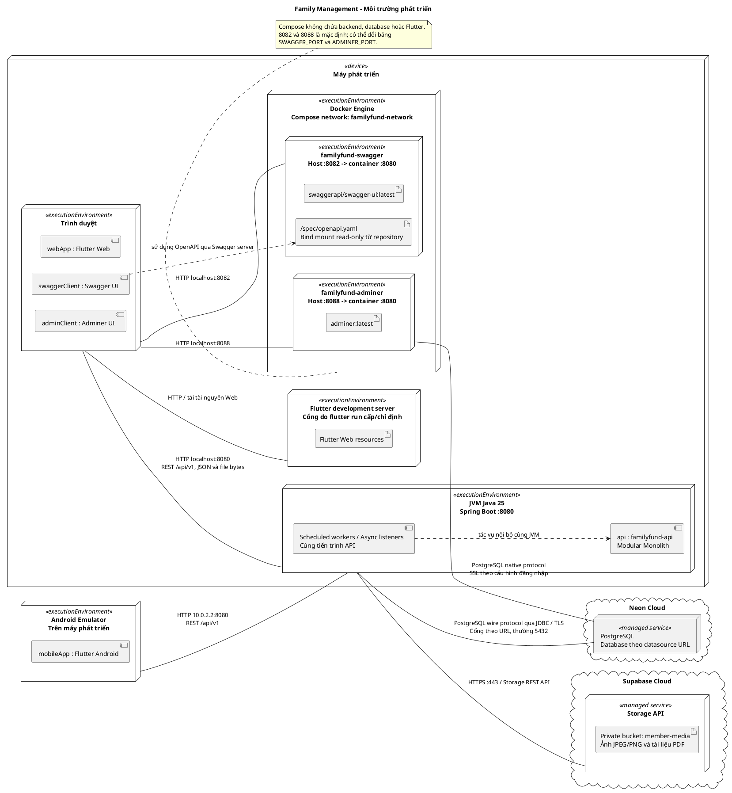
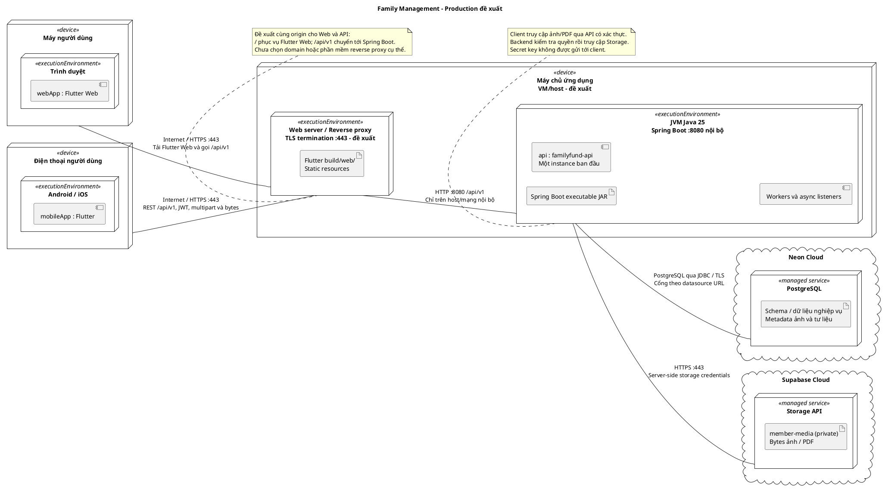
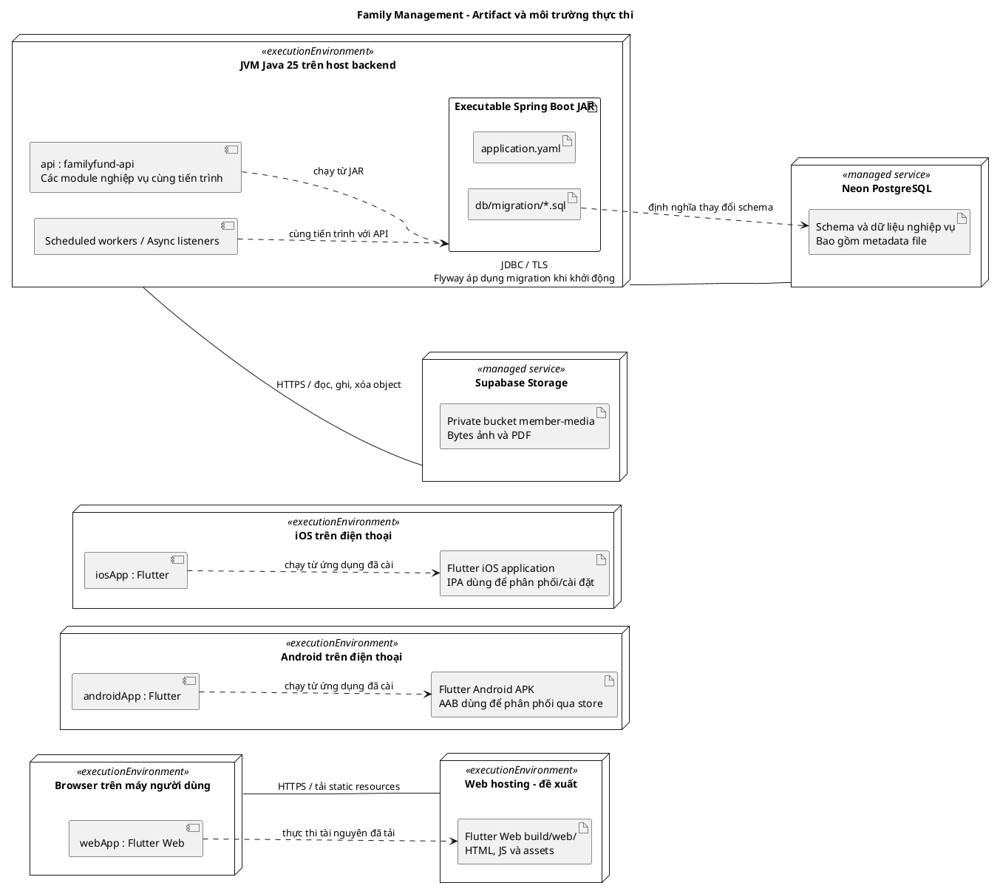

# Sơ đồ triển khai hệ thống Family Management

## 1. Mục đích và phạm vi

Tài liệu mô tả vị trí triển khai phần mềm, môi trường thực thi và các kết nối của toàn project: **Flutter Web/Android/iOS**, **Spring Boot API**, **Neon PostgreSQL** và **Supabase Storage**.

Tài liệu được đối chiếu với mã nguồn ngày **12/11/2026**. Sơ đồ môi trường phát triển phản ánh cấu hình trong repository; sơ đồ production là **phương án đề xuất**, chưa phải bằng chứng hệ thống đã được triển khai online. Repository chưa có cấu hình triển khai backend/frontend production hoặc Dockerfile cho backend.

Thư mục `architecture` được dùng theo cấu trúc tài liệu hiện có của project.

## 2. Cơ sở lý thuyết và quy ước

Tham khảo **Ch6. Thiết kế hướng đối tượng (p1-Kiến trúc).pdf**, phần *Deployment diagram*, trang 26–37:

- **Trang 26:** deployment diagram biểu diễn kiến trúc cài đặt vật lý, sự tương tác và mối liên hệ giữa phần mềm với phần cứng.
- **Trang 28–30:** node biểu diễn tài nguyên triển khai; stereotype mô tả loại node. Node có thể chứa môi trường thực thi và nhiều thành phần phần mềm.
- **Trang 31:** component instance là thể hiện của thành phần được cài đặt trên node.
- **Trang 32:** có quan hệ giữa node với node, node với component instance và giữa các component instance; sử dụng association và dependency.
- **Trang 34–37:** các ví dụ đặt phần mềm bên trong node và thể hiện kết nối tới client/database server.

Áp dụng vào project:

- `<<device>>`: máy phát triển, máy người dùng, điện thoại hoặc máy chủ đề xuất.
- `<<executionEnvironment>>`: trình duyệt, JVM, Docker Engine, container hoặc hệ điều hành mobile.
- `<<artifact>>`: gói Flutter, executable JAR, OpenAPI YAML, migration SQL và file ảnh/PDF. Artifact là sản phẩm được triển khai; component instance là phần mềm đang chạy từ sản phẩm đó.
- `<<component>>`: thể hiện ứng dụng đang chạy trong môi trường thực thi.
- `<<managed service>>`: dịch vụ cloud do nhà cung cấp quản lý. Không suy đoán máy vật lý, vùng mạng hoặc số instance bên trong Neon/Supabase.
- Khối lồng nhau biểu diễn **phần mềm nằm trên node/môi trường nào**; không biểu diễn kế thừa lớp.
- Đường liền `--` biểu diễn communication path, ghi giao thức/cổng khi xác định được. Mũi tên nét đứt `..>` biểu diễn dependency, không phải kết nối mạng độc lập.

Các sơ đồ dùng **PlantUML** để giữ ký pháp UML deployment với node, artifact và component. Mở Markdown bằng trình xem hỗ trợ PlantUML hoặc dùng extension PlantUML trong IDE để preview/export SVG/PNG từng khối `plantuml`. Trình xem Markdown chỉ hỗ trợ Mermaid sẽ hiển thị mã nguồn các khối này.

## 3. Sơ đồ triển khai môi trường phát triển

**Trạng thái: theo cấu hình hiện có.** Máy phát triển chạy API bằng Gradle/JVM; Docker Compose chỉ cung cấp hai công cụ Swagger UI và Adminer. Database và object storage nằm trên cloud, kể cả khi chạy local.

**Diễn giải kết nối:**

- Flutter Web dùng mặc định `http://localhost:8080/api/v1/`; Android Emulator dùng `http://10.0.2.2:8080/api/v1/`. Có thể ghi đè bằng `API_BASE_URL` tại thời điểm chạy/build Flutter.
- Swagger UI tải đặc tả từ container, nhưng thao tác “Try it out” gọi API từ **trình duyệt**. Vì vậy `localhost:8080` trong đặc tả hiện tại là địa chỉ nhìn từ máy mở trình duyệt.
- Adminer xử lý truy vấn ở container, kết nối tới PostgreSQL bằng driver PostgreSQL của Adminer, không dùng JDBC. SSL phải được thiết lập/kiểm chứng cho kết nối Adminer riêng; Compose chưa khai báo điều đó.
- Backend dùng PostgreSQL JDBC; mẫu datasource URL của project yêu cầu `sslmode=require`. Cổng và tên database thực tế lấy từ `SPRING_DATASOURCE_URL`.
- Thiết bị Android/iOS thật cần `API_BASE_URL` trỏ tới địa chỉ máy backend có thể truy cập qua mạng. `localhost` trên điện thoại là chính điện thoại; `10.0.2.2` chỉ áp dụng cho Android Emulator.
- Supabase chỉ lưu bytes ảnh/PDF trong mô hình này. Tài khoản, JWT, phân quyền và dữ liệu nghiệp vụ vẫn do backend cùng Neon PostgreSQL quản lý.

## 4. Sơ đồ triển khai production đề xuất

**Trạng thái: thiết kế đề xuất, chưa có cấu hình triển khai tương ứng trong repository.** Chọn một máy chủ ứng dụng chạy web server/reverse proxy và một JVM backend làm phương án ban đầu. Chưa giả định Kubernetes, load balancer, cache, message broker hay nhiều backend replica.

**Các quyết định cần thực hiện khi triển khai phương án này:**

1. Cấp domain/chứng chỉ TLS và cấu hình proxy phục vụ Flutter Web, chuyển tiếp `/api/v1`, đồng thời hỗ trợ điều hướng SPA khi truy cập trực tiếp URL trong ứng dụng.
2. Build Flutter với `API_BASE_URL=https://<domain>/api/v1`. Web và Android/iOS dùng cùng API công khai; artifact mobile được phân phối/cài lên thiết bị riêng.
3. Chỉ công khai HTTPS `443`; giới hạn API `8080` trong host hoặc mạng nội bộ. Swagger UI/Adminer là công cụ phát triển, không nằm trong phương án truy cập công khai này.
4. Cấp biến môi trường runtime cho JAR: `SPRING_DATASOURCE_URL`, `DB_USER`, `DB_PASSWORD`, `JWT_SECRET`, `SUPABASE_URL`, `SUPABASE_SERVICE_ROLE_KEY` và bucket tương ứng. `java -jar` không tự hưởng cơ chế nạp `.env` của task Gradle `bootRun`.
5. Cấu hình proxy phù hợp với multipart tối đa `10MB/file`, `12MB/request` trong Spring và timeout Storage `60s`. Rà soát CORS theo origin thực tế; cấu hình hiện tại đang cho phép mọi origin pattern.
6. Sao lưu cả PostgreSQL và object storage; backup database không chứa bytes của ảnh/PDF. Nếu tăng số instance backend, kiểm tra cơ chế phối hợp của từng scheduled worker và việc xử lý async khi tiến trình dừng trước khi áp dụng.

## 5. Sơ đồ phân bổ artifact và component instance

Sơ đồ này giải thích **phần mềm nào được đặt vào môi trường thực thi nào**, bổ sung cho góc nhìn kết nối ở trên. Các artifact build là đầu ra dự kiến của toolchain hiện có, không khẳng định đã phát hành các bản build production.

**Ranh giới triển khai:** các module Spring Modulith là các phần của cùng backend, không phải các server/microservice độc lập. Worker dọn file, nhắc hạn và async listener chạy trong JVM của API; repository chưa cấu hình một worker service hoặc message broker riêng. Dependency Spring AI/pgvector có trong build nhưng auto-configuration vector store đang bị loại trừ trong `application.yaml`, nên không vẽ một AI server đang hoạt động.

## 6. Nguồn đối chiếu và giới hạn

- **Tài liệu lý thuyết do người dùng cung cấp:** *Ch6. Thiết kế hướng đối tượng (p1-Kiến trúc).pdf*, trang 26–37. File nằm ngoài repository; các số trang giúp đối chiếu bản gốc mà không phụ thuộc đường dẫn máy cá nhân.
- [Kiến trúc hệ thống](./01-system-architecture.md): bối cảnh Modular Monolith; chi tiết triển khai được đối chiếu lại với cấu hình hiện tại bên dưới.
- [Gradle build](../../build.gradle.kts): Java 25, Spring Boot, dependencies và cơ chế nạp `.env` cho `bootRun`/`test`.
- [Application configuration](../../src/main/resources/application.yaml): API `8080`, datasource, Flyway, multipart và storage.
- [Docker Compose](../../docker-compose.yml): hai container công cụ, port mapping, network và mount OpenAPI.
- [Datasource mẫu](../../.env.example): JDBC tới Neon với `sslmode=require`; chỉ dùng cấu hình mẫu, không đưa thông tin bí mật vào sơ đồ.
- [OpenAPI](../../docker/swagger/openapi.yaml): API server local `/api/v1` dùng bởi Swagger UI.
- [SecurityConfig](../../src/main/java/com/familyfund/core/config/SecurityConfig.java): CORS và cấu hình bảo vệ API.
- [Vận hành storage US-32](../storage-us32.md), [SupabaseStorageAdapter](../../src/main/java/com/familyfund/core/storage/SupabaseStorageAdapter.java): bucket private, backend truy cập object qua HTTPS, không có fallback lưu file local.
- [Flutter EnvConfig](../../../family-management-frontend/lib/core/config/env_config.dart): cách xác định API URL theo nền tảng và `API_BASE_URL`.

Đường dẫn Flutter ở trên đi từ `backend/docs/architecture` sang repo frontend cùng cấp trong workspace; khi chỉ clone repo backend, cần mở repo frontend riêng để tra cứu. Tài liệu không xác nhận domain, IP, cloud region, SLA, cấu hình firewall thực tế hoặc số máy vật lý của dịch vụ cloud. Cập nhật các sơ đồ khi thêm Dockerfile, pipeline triển khai, đổi nhà cung cấp hoặc tách tiến trình.
