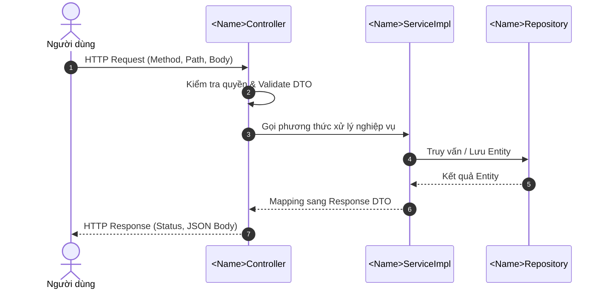

# Đặc Tả Kỹ Thuật & Hướng Dẫn Vận Hành [US-XX]: <Tên Tính Năng>

Tài liệu này đặc tả toàn diện thiết kế kiến trúc, mô hình dữ liệu, các giải pháp kỹ thuật, luồng nghiệp vụ chi tiết và quy trình kiểm thử End-to-End (E2E) cho tính năng **[US-XX] <Mô tả ngắn gọn tính năng>**.

---

## 1. Tổng Quan Nghiệp Vụ (User Story & Acceptance Criteria)

### Mô tả User Story
* **Mã User Story:** `US-XX`
* **Đối tượng sử dụng (Actor):** <Ví dụ: Trưởng tộc (`ROLE_CLAN_HEAD`), Quản trị viên (`ROLE_ADMIN`), Thành viên (`ROLE_MEMBER`)...>
* **Mục tiêu (Goal):** <Mục tiêu người dùng muốn thực hiện>
* **Giá trị mang lại (Value):** <Lợi ích nghiệp vụ hoặc giá trị hệ thống đem lại>
* **Mức độ ưu tiên:** <Bắt buộc (Must-Have) / Nên có (Should-Have) / Tùy chọn (Nice-to-Have)>

### Tiêu chí chấp nhận (Acceptance Criteria - AC)
1. **AC-01 (Phân quyền):** <Quy tắc kiểm tra quyền và xác thực người dùng>
2. **AC-02 (Quy tắc nghiệp vụ chính):** <Xử lý dữ liệu đầu vào, ràng buộc nghiệp vụ bắt buộc>
3. **AC-03 (Bất biến nghiệp vụ & Trạng thái):** <Trạng thái mặc định của entity, các trường dữ liệu bắt buộc>
4. **AC-04 (Xử lý ngoại lệ & Biên độ lỗi):** <Quy định lỗi khi dữ liệu không hợp lệ hoặc tài nguyên không tồn tại>

---

## 2. Thiết Kế Kiến Trúc & Ranh Giới Bounded Context (Architecture Design)

Tính năng thuộc Bounded Context: `com.familyfund.<module_name>`

```
[Client / Frontend Web & Mobile]
               │  HTTP Requests (JSON)
               ▼
┌────────────────────────────────────────────────────────────────────────┐
│ 1. API BOUNDARY & CONTROLLER LAYER                                     │
│    • Controller: <ControllerName> (Mapping /api/v1/...)                │
│    • Validation: @Valid (<RequestDTO>)                                 │
│    • Security: @PreAuthorize("hasRole(...)")                           │
└────────────────────────────────────────────────────────────────────────┘
               │  Validated DTO + Principal
               ▼
┌────────────────────────────────────────────────────────────────────────┐
│ 2. APPLICATION & DOMAIN SERVICE LAYER                                  │
│    • Service Interface: com.familyfund.<module>.api.<ServiceName>      │
│    • Service Impl: com.familyfund.<module>.internal.service.<ImplName> │
│    • Cross-Module Calls: Giao tiếp qua public service của module khác  │
└────────────────────────────────────────────────────────────────────────┘
               │  Entity State
               ▼
┌────────────────────────────────────────────────────────────────────────┐
│ 3. PERSISTENCE & DATA LAYER                                            │
│    • Repository: com.familyfund.<module>.internal.repository.<Repo>    │
│    • Entity: com.familyfund.<module>.internal.entity.<Entity>          │
│    • Database: PostgreSQL 16+ / Flyway Migration V...                  │
└────────────────────────────────────────────────────────────────────────┘
```

### Danh mục các file mã nguồn cốt lõi:
* **Controller (internal):** [`<Name>Controller.java`](file:///d:/WorkSpace/Family-Management/family-management-backend/src/main/java/com/familyfund/...)
* **Service API (public):** [`<Name>Service.java`](file:///d:/WorkSpace/Family-Management/family-management-backend/src/main/java/com/familyfund/...)
* **Service Impl (internal):** [`<Name>ServiceImpl.java`](file:///d:/WorkSpace/Family-Management/family-management-backend/src/main/java/com/familyfund/...)
* **Repository (internal):** [`<Name>Repository.java`](file:///d:/WorkSpace/Family-Management/family-management-backend/src/main/java/com/familyfund/...)
* **Entity & Enums (internal):** [`<Name>.java`](file:///d:/WorkSpace/Family-Management/family-management-backend/src/main/java/com/familyfund/...)
* **DTOs (public/internal):** [`<Name>Request.java`](file:///d:/WorkSpace/Family-Management/family-management-backend/src/main/java/com/familyfund/...)

---

## 3. Thiết Kế Cơ Sở Dữ Liệu (Database Schema)

### Cấu trúc Bảng liên quan
```sql
-- Trích dẫn schema DDL từ Flyway migration hoặc docker/postgres/init.sql
```

### Quy tắc lưu trữ & Ràng buộc:
* Khóa chính, khóa ngoại, chỉ mục (Index) hỗ trợ tra cứu.
* Ràng buộc toàn vẹn: `NOT NULL`, `CHECK`, `UNIQUE`.

---

## 4. Luồng Nghiệp Vụ Chi Tiết (Detailed Business Flows)

### Sơ đồ tuần tự (Sequence Diagram)


---

## 5. Hướng Dẫn Kiểm Thử (Testing & End-to-End Guide)

### 5.1. Kiểm thử Tự Động (Automated Tests)
Chạy bộ kiểm thử tự động của tính năng bằng Gradle:
```powershell
.\gradlew.bat test --tests "com.familyfund.<module>.*"
```

| Tên Test Class | Số Test Cases | Mục Tiêu Kiểm Thử |
| :--- | :---: | :--- |
| `<Name>Test` | ... | Kiểm thử đơn vị các phương thức nghiệp vụ, xử lý ngoại lệ |
| `<Name>ControllerTest` | ... | MockMvc kiểm tra HTTP status, headers, format JSON trả về |

### 5.2. Kịch Bản Kiểm Thử Thực Tế (E2E Manual Testing)
Hướng dẫn các bước gọi cURL / Postman / Swagger UI để kiểm thử thực tế trên hệ thống đang chạy:

```bash
# Ví dụ lệnh curl gửi request
curl -X POST http://localhost:8080/api/v1/... \
  -H "Content-Type: application/json" \
  -d '{ ... }'
```

**Kết quả kỳ vọng (HTTP Status & JSON Response):**
```json
{
  "success": true,
  "data": { ... }
}
```

