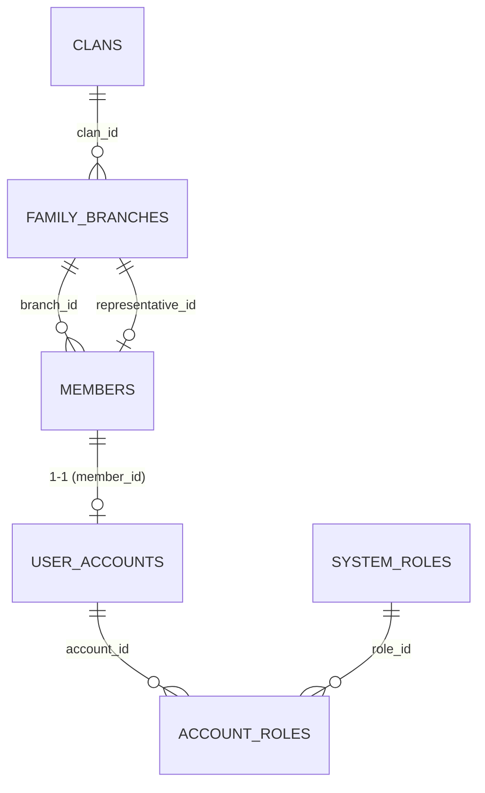
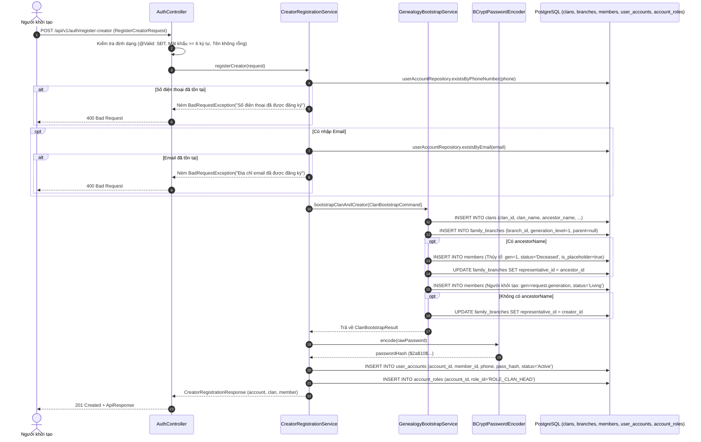

# Đặc Tả Kỹ Thuật & Hướng Dẫn Vận Hành [US-01]: Đăng Ký Người Khởi Tạo & Tạo Cây Gia Phả Mới

Tài liệu này đặc tả toàn diện thiết kế kiến trúc, mô hình dữ liệu, các giải pháp kỹ thuật, luồng nghiệp vụ chi tiết và quy trình kiểm thử End-to-End (E2E) cho tính năng **[US-01] Đăng ký tài khoản người khởi tạo & Tạo dòng họ mới (Bootstrap Clan & Family Tree)**.

---

## 1. Tổng Quan Nghiệp Vụ (User Story & Acceptance Criteria)

### Mô tả User Story
* **Mã User Story:** `US-01`
* **Đối tượng sử dụng (Actor):** Khách vãng lai / Người khởi tạo dòng họ (Creator / Future Clan Head)
* **Mục tiêu (Goal):** Người khởi tạo có thể đăng ký tài khoản mới đồng thời tạo lập một dòng họ mới (Tenant độc lập), tự động dựng nhánh gốc của cây gia phả và thiết lập hồ sơ thành viên ban đầu.
* **Giá trị mang lại (Value):** Giúp người khởi tạo nhanh chóng số hóa gia tộc mình trong 1 bước thao tác duy nhất, tự động nhận quyền cao nhất `ROLE_CLAN_HEAD` để quản trị toàn bộ hệ thống dòng họ.
* **Mức độ ưu tiên:** Bắt buộc (Must-Have - Điểm khởi đầu của toàn bộ hệ thống đa dòng họ).

### Tiêu chí chấp nhận (Acceptance Criteria - AC)
1. **AC-01 (Công khai không cần token):** Endpoint `POST /api/v1/auth/register-creator` là API công khai (`permitAll()`), không đòi hỏi Bearer Token khi gọi.
2. **AC-02 (Tính nguyên tử - Atomic Transaction):** Toàn bộ thao tác tạo dòng họ (`clans`), tạo nhánh gốc (`family_branches`), tạo hồ sơ Thủy tổ (nếu có `ancestorName`), tạo hồ sơ phả hệ người khởi tạo (`members`), tạo tài khoản (`user_accounts`), và gán vai trò (`account_roles`) phải nằm trong một `@Transactional` duy nhất. Nếu bất kỳ bước nào thất bại, toàn bộ dữ liệu phải được rollback sạch sẽ.
3. **AC-03 (Chống trùng lặp tài khoản):** Kiểm tra số điện thoại (`phoneNumber`) và email (nếu có) trước khi tạo; nếu đã tồn tại trong bảng `user_accounts`, trả về ngay mã lỗi `400 Bad Request` kèm thông báo rõ ràng.
4. **AC-04 (Linh hoạt thế hệ & Thủy tổ):**
   - Nếu người dùng nhập `ancestorName`: Hệ thống tạo một hồ sơ thành viên Thủy tổ đời 1 (`generation = 1`, `status = 'Deceased'`, `is_placeholder = true`) và gán làm Người đại diện (`representative_id`) của Nhánh gốc.
   - Thế hệ của người khởi tạo: Sử dụng giá trị `generation` do người dùng truyền vào; nếu không truyền, mặc định là đời 2 (nếu có Thủy tổ) hoặc đời 1 (nếu không có Thủy tổ). Nếu không có Thủy tổ, người khởi tạo sẽ là Người đại diện của Nhánh gốc.
5. **AC-05 (Bảo mật mật khẩu & Gán vai trò tối cao):** Mật khẩu người dùng bắt buộc phải được băm an toàn bằng `BCryptPasswordEncoder`. Tài khoản được tự động kích hoạt (`account_status = 'Active'`) và gán vai trò `ROLE_CLAN_HEAD` (Trưởng Tộc).
6. **AC-06 (Phản hồi chuẩn mực):** Trả về HTTP Status `201 Created` bọc trong `ApiResponse<CreatorRegistrationResponse>` chứa đầy đủ thông tin `account`, `clan`, `member`.

---

## 2. Thiết Kế Kiến Trúc & Ranh Giới Bounded Context (Spring Modulith)

Tính năng tương tác giữa 2 Bounded Contexts tuân thủ nghiêm ngặt quy tắc của **Spring Modulith**:
- `com.familyfund.identity`: Bounded Context điều phối tiếp nhận đăng ký, quản lý tài khoản `user_accounts`, phân quyền `system_roles`.
- `com.familyfund.genealogy`: Bounded Context quản lý dữ liệu `clans`, `family_branches`, và `members`.
- `com.familyfund.core`: Shared Kernel cung cấp `SecurityConfig`, `ApiResponse`, `GlobalExceptionHandler`.

```
[Client / Frontend Flutter & Web]
               │  POST /api/v1/auth/register-creator (JSON)
               ▼
┌────────────────────────────────────────────────────────────────────────┐
│ 1. BOUNDED CONTEXT: identity (REST Controller Layer)                   │
│    • Controller: com.familyfund.identity.internal.controller.         │
│                  AuthController                                        │
│    • DTO Request: RegisterCreatorRequest (@Valid)                      │
│    • Validation: @NotBlank, @Pattern, @Size, @Email                    │
└────────────────────────────────────────────────────────────────────────┘
               │  Delegation
               ▼
┌────────────────────────────────────────────────────────────────────────┐
│ 2. BOUNDED CONTEXT: identity (Application Service Layer)               │
│    • Service: CreatorRegistrationServiceImpl                           │
│    • Validation: Kiểm tra trùng phoneNumber, email                     │
│    • Password: BCryptPasswordEncoder.encode(...)                       │
└────────────────────────────────────────────────────────────────────────┘
               │  ClanBootstrapCommand
               ▼
┌────────────────────────────────────────────────────────────────────────┐
│ 3. PUBLIC CONTRACT: genealogy::api                                     │
│    • Interface: GenealogyBootstrapService                              │
│    • DTOs: ClanBootstrapCommand, ClanBootstrapResult                   │
└────────────────────────────────────────────────────────────────────────┘
               │  Internal Implementation
               ▼
┌────────────────────────────────────────────────────────────────────────┐
│ 4. BOUNDED CONTEXT: genealogy (Domain Implementation)                  │
│    • Service: GenealogyBootstrapServiceImpl                            │
│    • Entities: Clan, FamilyBranch, Member                              │
│    • Repositories: ClanRepository, FamilyBranchRepository,             │
│                    MemberRepository                                    │
└────────────────────────────────────────────────────────────────────────┘
               │  ClanBootstrapResult
               ▼
┌────────────────────────────────────────────────────────────────────────┐
│ 5. PERSISTENCE LAYER: identity (Save Account & Roles)                  │
│    • Entity: UserAccount, SystemRole (ROLE_CLAN_HEAD)                  │
│    • Repository: UserAccountRepository, SystemRoleRepository           │
│    • Return: 201 Created + ApiResponse<CreatorRegistrationResponse>   │
└────────────────────────────────────────────────────────────────────────┘
```

### Danh mục các file mã nguồn liên quan:
* **Controller (identity):** [`AuthController.java`](file:///d:/Family%20Management/family-management-backend/src/main/java/com/familyfund/identity/internal/controller/AuthController.java)
* **Service (identity):** [`CreatorRegistrationService.java`](file:///d:/Family%20Management/family-management-backend/src/main/java/com/familyfund/identity/internal/service/CreatorRegistrationService.java) & [`CreatorRegistrationServiceImpl.java`](file:///d:/Family%20Management/family-management-backend/src/main/java/com/familyfund/identity/internal/service/CreatorRegistrationServiceImpl.java)
* **Public Contract (genealogy::api):** [`GenealogyBootstrapService.java`](file:///d:/Family%20Management/family-management-backend/src/main/java/com/familyfund/genealogy/api/GenealogyBootstrapService.java), [`ClanBootstrapCommand.java`](file:///d:/Family%20Management/family-management-backend/src/main/java/com/familyfund/genealogy/api/dto/ClanBootstrapCommand.java), [`ClanBootstrapResult.java`](file:///d:/Family%20Management/family-management-backend/src/main/java/com/familyfund/genealogy/api/dto/ClanBootstrapResult.java)
* **Service Impl (genealogy):** [`GenealogyBootstrapServiceImpl.java`](file:///d:/Family%20Management/family-management-backend/src/main/java/com/familyfund/genealogy/internal/service/GenealogyBootstrapServiceImpl.java)
* **Entities (identity):** [`UserAccount.java`](file:///d:/Family%20Management/family-management-backend/src/main/java/com/familyfund/identity/internal/entity/UserAccount.java), [`SystemRole.java`](file:///d:/Family%20Management/family-management-backend/src/main/java/com/familyfund/identity/internal/entity/SystemRole.java), [`AccountStatus.java`](file:///d:/Family%20Management/family-management-backend/src/main/java/com/familyfund/identity/internal/entity/AccountStatus.java)
* **Repositories (identity):** [`UserAccountRepository.java`](file:///d:/Family%20Management/family-management-backend/src/main/java/com/familyfund/identity/internal/repository/UserAccountRepository.java), [`SystemRoleRepository.java`](file:///d:/Family%20Management/family-management-backend/src/main/java/com/familyfund/identity/internal/repository/SystemRoleRepository.java)
* **DTOs (identity):** [`RegisterCreatorRequest.java`](file:///d:/Family%20Management/family-management-backend/src/main/java/com/familyfund/identity/internal/dto/request/RegisterCreatorRequest.java), [`CreatorRegistrationResponse.java`](file:///d:/Family%20Management/family-management-backend/src/main/java/com/familyfund/identity/internal/dto/response/CreatorRegistrationResponse.java)
* **Security (core):** [`SecurityConfig.java`](file:///d:/Family%20Management/family-management-backend/src/main/java/com/familyfund/core/config/SecurityConfig.java)

---

## 3. Thiết Kế Cơ Sở Dữ Liệu (Database Schema Mapping)

Luồng đăng ký này thao tác trên 6 bảng trong CSDL:



1. **`clans`**: Tạo bản ghi mới đại diện cho dòng họ độc lập.
   - `clan_id`: `CLAN_` + 8 ký tự Hex/UUID in hoa.
   - `clan_name`: Tên dòng họ (bắt buộc).
   - `ancestor_name`, `origin_location`, `established_year`, `description`: Thông tin lịch sử.
2. **`family_branches`**: Tạo nhánh gốc ban đầu.
   - `branch_id`: `BR_` + 8 ký tự in hoa.
   - `branch_name`: Mặc định đặt là `"Nhánh Gốc"`.
   - `generation_level`: `1`.
   - `parent_branch_id`: `NULL` (Dấu hiệu nhận biết Root Branch).
   - `representative_id`: Trỏ tới Thủy tổ (nếu có) hoặc Người khởi tạo.
3. **`members`**: Tạo 1 hoặc 2 hồ sơ phả hệ.
   - `member_id`: `MEM_` + 8 ký tự in hoa.
   - Hồ sơ Thủy tổ: `generation = 1`, `status = 'Deceased'`, `is_placeholder = true`.
   - Hồ sơ Người khởi tạo: `generation = request.generation`, `status = 'Living'`, `is_placeholder = false`.
4. **`user_accounts`**: Tài khoản hệ thống cho người khởi tạo.
   - `account_id`: `ACC_` + 8 ký tự in hoa.
   - `member_id`: Trỏ 1-1 tới hồ sơ phả hệ của người khởi tạo.
   - `phone_number`: Duy nhất, dùng làm số định danh đăng nhập.
   - `password_hash`: Mã hóa một chiều bằng thuật toán BCrypt.
   - `account_status`: Mặc định kích hoạt `"Active"`.
5. **`account_roles`**: Gán vai trò quản trị dòng họ.
   - `account_id` liên kết với `role_id = 'ROLE_CLAN_HEAD'`.

---

## 4. Luồng Xử Lý Chi Tiết (Sequence Diagram)



---

## 5. Từ Điển Dữ Liệu (Data Dictionary)

### Request Payload (`RegisterCreatorRequest`)
| Tên Trường | Kiểu Dữ Liệu | Ràng Buộc | Bắt Buộc | Mô Tả |
| :--- | :--- | :--- | :---: | :--- |
| `clanName` | `String` | Tối đa 150 ký tự, không rỗng | Có | Tên dòng họ (VD: "Dòng họ Vũ") |
| `ancestorName` | `String` | Tối đa 100 ký tự | Không | Tên cụ Thủy tổ khai sáng dòng họ |
| `originLocation`| `String` | Tối đa 255 ký tự | Không | Quê quán gốc / Từ đường dòng họ |
| `establishedYear`| `Integer`| Năm dương lịch hợp lệ | Không | Năm thành lập / định cư đầu tiên |
| `description` | `String` | Văn bản tự do | Không | Lịch sử tóm tắt, xuất xứ dòng họ |
| `fullName` | `String` | Tối đa 100 ký tự, không rỗng | Có | Họ và tên đầy đủ của người khởi tạo |
| `phoneNumber` | `String` | 8-15 ký tự số, định dạng chuẩn | Có | Số điện thoại đăng nhập, duy nhất hệ thống |
| `password` | `String` | Tối thiểu 6 ký tự | Có | Mật khẩu truy cập |
| `gender` | `String` | `Male`, `Female`, `Other` | Có | Giới tính người khởi tạo |
| `email` | `String` | Đúng định dạng email, tối đa 100 ký tự | Không | Email khôi phục tài khoản, duy nhất |
| `dateOfBirth` | `LocalDate` | `YYYY-MM-DD` | Không | Ngày sinh dương lịch |
| `generation` | `Integer` | $\ge 1$ | Không | Thế hệ của người khởi tạo (Mặc định 1 hoặc 2) |

### Response Body (`CreatorRegistrationResponse`)
| Phân Nhóm | Tên Trường | Kiểu Dữ Liệu | Mô Tả |
| :--- | :--- | :--- | :--- |
| **`account`** | `accountId` | `String` | Mã định danh tài khoản (`ACC_...`) |
| | `phoneNumber` | `String` | Số điện thoại tài khoản |
| | `email` | `String` | Email tài khoản |
| | `accountStatus`| `String` | Trạng thái (`Active`) |
| | `roles` | `Set<String>` | Tập vai trò hệ thống (`ROLE_CLAN_HEAD`) |
| | `createdAt` | `Instant` | Thời điểm tạo tài khoản |
| **`clan`** | `clanId` | `String` | Mã định danh dòng họ (`CLAN_...`) |
| | `clanName` | `String` | Tên dòng họ vừa khởi tạo |
| | `ancestorName` | `String` | Tên Thủy tổ |
| | `originLocation`| `String` | Quê quán gốc |
| | `establishedYear`| `Integer` | Năm thành lập |
| | `description` | `String` | Mô tả dòng họ |
| **`member`** | `memberId` | `String` | Mã định danh hồ sơ phả hệ (`MEM_...`) |
| | `fullName` | `String` | Họ tên thành viên người khởi tạo |
| | `gender` | `String` | Giới tính |
| | `generation` | `Integer` | Thế hệ trong dòng họ |
| | `dateOfBirth` | `LocalDate` | Ngày sinh |
| | `branchId` | `String` | Mã nhánh gốc (`BR_...`) mà thành viên trực thuộc |

---

## 6. Hướng Dẫn Kiểm Thử Tự Động (Automated Test Execution)

### Lệnh chạy kiểm thử tự động:
Chạy kiểm thử cho tính năng đăng ký người khởi tạo và kiểm tra toàn vẹn kiến trúc:
```powershell
cd family-management-backend
.\gradlew.bat test --tests "com.familyfund.identity.internal.controller.AuthControllerTest" `
                   --tests "com.familyfund.identity.internal.service.CreatorRegistrationServiceImplTest" `
                   --tests "com.familyfund.genealogy.internal.service.GenealogyBootstrapServiceImplTest" `
                   --tests "com.familyfund.ArchitectureTest"
```

### Kết quả kiểm chứng thực tế:
- **`AuthControllerTest`**: 3/3 tests passed (Đăng ký thành công trả về 201 Created, dữ liệu thiếu trường bắt buộc trả về 400 Bad Request, số điện thoại trùng lặp trả về 400 Bad Request).
- **`CreatorRegistrationServiceImplTest`**: 3/3 tests passed (Mã hóa mật khẩu BCrypt, kiểm tra trùng lặp phone, email, phân quyền `ROLE_CLAN_HEAD`).
- **`GenealogyBootstrapServiceImplTest`**: 2/2 tests passed (Khởi tạo cây kèm Thủy tổ và không kèm Thủy tổ, phân định thế hệ và người đại diện nhánh gốc).
- **`ArchitectureTest`**: 3/3 tests passed (Xác nhận 100% tuân thủ ranh giới Spring Modulith không có vi phạm).

---

## 7. Hướng Dẫn Kiểm Thử E2E Bằng cURL

### 1. Đăng ký thành công người khởi tạo & tạo dòng họ mới:
```bash
curl -X POST http://localhost:8080/api/v1/auth/register-creator \
  -H "Content-Type: application/json" \
  -d '{
    "clanName": "Dòng họ Nguyễn Văn",
    "ancestorName": "Cụ Tổ Nguyễn Văn Khởi",
    "originLocation": "Hà Nam, Việt Nam",
    "establishedYear": 1820,
    "description": "Chi họ khởi tổ tại Hà Nam",
    "fullName": "Nguyễn Văn An",
    "phoneNumber": "0987654321",
    "password": "SecurePassword123",
    "gender": "Male",
    "email": "nguyenvanan@example.com",
    "dateOfBirth": "1985-05-15",
    "generation": 6
  }'
```

**Kỳ vọng Response (HTTP 201 Created):**
```json
{
  "success": true,
  "message": "Đăng ký người khởi tạo và tạo dòng họ mới thành công",
  "data": {
    "account": {
      "accountId": "ACC_A1B2C3D4",
      "phoneNumber": "0987654321",
      "email": "nguyenvanan@example.com",
      "accountStatus": "Active",
      "roles": ["ROLE_CLAN_HEAD"],
      "createdAt": "2026-10-22T16:20:00Z"
    },
    "clan": {
      "clanId": "CLAN_F5E6D7C8",
      "clanName": "Dòng họ Nguyễn Văn",
      "ancestorName": "Cụ Tổ Nguyễn Văn Khởi",
      "originLocation": "Hà Nam, Việt Nam",
      "establishedYear": 1820,
      "description": "Chi họ khởi tổ tại Hà Nam"
    },
    "member": {
      "memberId": "MEM_9Z8Y7X6W",
      "fullName": "Nguyễn Văn An",
      "gender": "Male",
      "generation": 6,
      "dateOfBirth": "1985-05-15",
      "branchId": "BR_3K4J5H6G"
    }
  }
}
```

### 2. Kiểm thử lỗi khi trùng số điện thoại:
Thực hiện lại request trên một lần nữa với cùng `phoneNumber = "0987654321"`.

**Kỳ vọng Response (HTTP 400 Bad Request):**
```json
{
  "success": false,
  "message": "Số điện thoại '0987654321' đã được đăng ký tài khoản",
  "data": null
}
```
