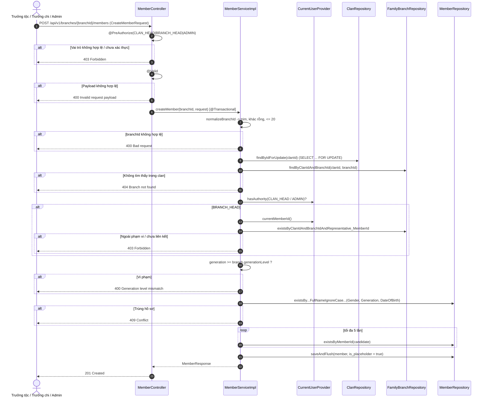

# Đặc Tả Kỹ Thuật & Hướng Dẫn Vận Hành US-03: Trưởng tộc / Trưởng chi trực tiếp tạo hồ sơ thành viên trên cây gia phả

Tài liệu này đặc tả thiết kế, mô hình dữ liệu, giải pháp kỹ thuật, luồng nghiệp vụ và quy trình kiểm thử cho tính năng **[US-03] Trưởng tộc / Trưởng chi tạo hồ sơ thành viên (Member) gắn với chi/nhánh gia phả (`family_branches`), với mã `member_id` sinh tự động không trùng lặp, chống trùng hồ sơ và phân quyền theo phạm vi chi/nhánh**.

> **Điểm vào của API:** `POST /api/v1/branches/{branchId}/members`. Chi/nhánh nằm trong **đường dẫn** (không nằm trong body), phản ánh đúng quan hệ tài nguyên `members.branch_id → family_branches.branch_id` và khớp với đặc tả OpenAPI tại [`docker/swagger/openapi.yaml`](../../docker/swagger/openapi.yaml) (Swagger UI chạy ở cổng `8082`).

---

## 1. Tổng Quan Nghiệp Vụ (User Story & Acceptance Criteria)

### Mô tả User Story
* **Mã User Story:** `US-03`
* **Đối tượng sử dụng (Actor):** Trưởng tộc (`ROLE_CLAN_HEAD`), Trưởng chi (`ROLE_BRANCH_HEAD`), Quản trị viên (`ROLE_ADMIN`)
* **Mục tiêu (Goal):** Là người quản lý gia phả, tôi muốn thêm hồ sơ một thành viên vào đúng chi/nhánh của dòng họ, để cây phả hệ phản ánh đầy đủ các thế hệ.
* **Giá trị mang lại (Value):** Hồ sơ `members` là nền tảng cho tài khoản người dùng (`user_accounts`), mã liên kết vị trí (US-18), sự kiện, đóng góp và tạm ứng.
* **Mức độ ưu tiên:** Bắt buộc (Must-Have)

### Tiêu chí chấp nhận (Acceptance Criteria - AC)
1. **AC-01 (Phân quyền theo vai trò):** Chỉ `CLAN_HEAD`, `BRANCH_HEAD`, `ADMIN` được gọi `POST /api/v1/branches/{branchId}/members` (`@PreAuthorize`). Vai trò khác (ví dụ `ROLE_MEMBER`) và người gọi chưa xác thực nhận `403`.
2. **AC-02 (Phân quyền theo phạm vi chi/nhánh):**
   * `ROLE_CLAN_HEAD` và `ROLE_ADMIN`: được thêm thành viên vào **bất kỳ** chi/nhánh nào của dòng họ hiện tại.
   * `ROLE_BRANCH_HEAD`: **chỉ** được thêm vào chi/nhánh mà mình đang quản lý, tức `family_branches.representative_id` = `member_id` của tài khoản đang đăng nhập. Ngoài phạm vi hoặc tài khoản chưa liên kết hồ sơ thành viên ⇒ `403 Forbidden`.
3. **AC-03 (Validate theo schema):** Payload bị từ chối với HTTP `400` nếu vi phạm bất kỳ ràng buộc nào của bảng `members`:
   * `fullName` bắt buộc, không rỗng, tối đa 100 ký tự.
   * `gender` bắt buộc, chỉ nhận `Male` | `Female` | `Other` (phân biệt hoa thường, khớp `CHECK`).
   * `generation` bắt buộc, `>= 1`.
   * `status` tùy chọn, chỉ nhận `Living` | `Deceased`; bỏ trống thì mặc định `Living`.
   * `deathDateLunar` tùy chọn, tối đa 50 ký tự.
   * `dateOfBirth` tùy chọn, không được ở tương lai.
   * **`branchId` (path variable)** bắt buộc, không rỗng, tối đa 20 ký tự (`VARCHAR(20)`). Không hợp lệ ⇒ `400` (`BadRequestException`) và không có bản ghi nào được ghi.
   * `branchId` **không** được khai báo trong body: nguồn duy nhất là đường dẫn (xem AC-10).
4. **AC-04 (Tồn tại chi/nhánh & đa dòng họ):** `branchId` phải tồn tại trong `family_branches` **thuộc đúng `clanId` hiện tại** (`TenantContext`); nếu không trả `404`. Chi/nhánh của dòng họ khác không bao giờ được nhìn thấy.
5. **AC-05 (Bất biến thế hệ):** `generation` của thành viên không được nhỏ hơn `generation_level` của chi/nhánh; vi phạm trả `400` (`InvalidGenerationException`).
6. **AC-06 (Chống trùng hồ sơ):** Không lưu hồ sơ trùng trong cùng dòng họ. Hai hồ sơ được coi là trùng khi có cùng `full_name` (không phân biệt hoa thường, đã trim), `gender`, `generation` và `date_of_birth` (hai giá trị `NULL` được coi là bằng nhau). Trùng ⇒ `409 Conflict`, không có bản ghi nào được lưu.
7. **AC-07 (Hồ sơ ảo):** Mọi hồ sơ do quản lý tạo qua API này luôn có `is_placeholder = true` (chờ tài khoản người dùng nhận liên kết ở US-18). Client không được truyền `isPlaceholder`.
8. **AC-08 (Mã thành viên duy nhất):** `member_id` do server sinh, dạng `MEM` + timestamp + hậu tố ngẫu nhiên, **luôn <= 20 ký tự**, **không bao giờ trùng**. Client không được truyền `member_id`.
9. **AC-09 (Toàn vẹn giao dịch):** Toàn bộ thao tác chạy trong một `@Transactional`; mọi lỗi (403/404/400/409) xảy ra **trước** khi ghi và không để lại dữ liệu.
10. **AC-10 (Hợp đồng OpenAPI):** Endpoint được đặc tả đầy đủ trong [`docker/swagger/openapi.yaml`](../../docker/swagger/openapi.yaml) (`/branches/{branchId}/members`, `201` + schema `MemberResponse` trong `ApiResponse`, và `400/403/404/409`), hiển thị và gọi thử được trên Swagger UI (`http://localhost:8082`).

---

## 2. Thiết Kế Kiến Trúc & Ranh Giới Bounded Context

Tính năng thuộc Bounded Context: `com.familyfund.genealogy` (toàn bộ nằm trong `internal`). Hạ tầng bảo mật dùng chung đặt tại `com.familyfund.core.security` (module `core` là `OPEN`), nên `ArchitectureTest` vẫn hợp lệ.

```
[Client / Frontend]
        │  POST /api/v1/branches/{branchId}/members (JSON) + Authentication
        ▼
┌──────────────────────────────────────────────────────────────┐
│ 1. CONTROLLER: MemberController                              │
│    • @PreAuthorize("hasAnyRole('CLAN_HEAD','BRANCH_HEAD',    │
│                                'ADMIN')")   -> 403 sớm       │
│    • @Valid CreateMemberRequest            -> 400            │
│    • 201 Created + ApiResponse<MemberResponse>               │
└──────────────────────────────────────────────────────────────┘
        │
        ▼
┌──────────────────────────────────────────────────────────────┐
│ 2. SERVICE: MemberServiceImpl#createMember  (@Transactional) │
│    0. Khóa hàng clans (SELECT ... FOR UPDATE)                │
│    1. Branch tồn tại trong clan              -> 404          │
│    2. Phạm vi vai trò (CurrentUserProvider)  -> 403          │
│    3. Bất biến thế hệ                        -> 400          │
│    4. Chống trùng hồ sơ                      -> 409          │
│    5. Sinh member_id duy nhất, is_placeholder = true         │
│    6. saveAndFlush -> MemberMapper -> MemberResponse         │
└──────────────────────────────────────────────────────────────┘
        │
        ▼
┌──────────────────────────────────────────────────────────────┐
│ 3. PERSISTENCE                                               │
│    • MemberRepository / FamilyBranchRepository / ClanRepo    │
│    • Entity Member ──@ManyToOne──▶ FamilyBranch ──▶ clan_id  │
│    • PostgreSQL / Flyway V1 (members), V3-V5 (clan_id)       │
└──────────────────────────────────────────────────────────────┘
```

### Danh mục các file mã nguồn
| Lớp | File |
| :--- | :--- |
| Entity | `src/main/java/com/familyfund/genealogy/internal/entity/Member.java` |
| Repository | `genealogy/internal/repository/MemberRepository.java`, `FamilyBranchRepository.java`, `ClanRepository.java` |
| Request DTO | `genealogy/internal/dto/request/CreateMemberRequest.java` |
| Response DTO | `genealogy/internal/dto/response/MemberResponse.java` |
| Mapper | `genealogy/internal/mapper/MemberMapper.java` |
| ID Generator | `genealogy/internal/util/MemberIdGenerator.java` |
| Service | `genealogy/internal/service/MemberService.java`, `MemberServiceImpl.java` |
| Controller | `genealogy/internal/controller/MemberController.java` |
| Security (core) | `core/security/SystemRoles.java`, `CurrentUserProvider.java`, `MemberLinkedPrincipal.java` |
| Exception (core) | `core/exception/BadRequestException.java`, `DuplicateResourceException.java`, `GlobalExceptionHandler.java` |
| OpenAPI | `docker/swagger/openapi.yaml` (`/branches/{branchId}/members`, `components.schemas.*`) |

(Các đường dẫn rút gọn đều nằm dưới `src/main/java/com/familyfund/`.)

---

## 3. Thiết Kế Cơ Sở Dữ Liệu (Database Schema)

### Bảng `members` (Flyway `V1__init_clan_genealogy_and_events_schema.sql`)
```sql
CREATE TABLE IF NOT EXISTS members (
    member_id VARCHAR(20) PRIMARY KEY,
    full_name VARCHAR(100) NOT NULL,
    date_of_birth DATE,
    gender VARCHAR(10) NOT NULL CHECK (gender IN ('Male', 'Female', 'Other')),
    generation INT NOT NULL CHECK (generation >= 1),
    status VARCHAR(20) NOT NULL DEFAULT 'Living' CHECK (status IN ('Living', 'Deceased')),
    death_date_lunar VARCHAR(50),
    branch_id VARCHAR(20) NOT NULL REFERENCES family_branches(branch_id) ON DELETE RESTRICT,
    is_placeholder BOOLEAN DEFAULT FALSE,
    created_at TIMESTAMPTZ DEFAULT CURRENT_TIMESTAMP
);
CREATE INDEX IF NOT EXISTS idx_member_branch ON members(branch_id);
CREATE INDEX IF NOT EXISTS idx_member_status ON members(status);
```

> `members` **không có** cột `clan_id`. Việc cô lập đa dòng họ đi qua quan hệ `members.branch_id -> family_branches.clan_id` (V3/V5). Phạm vi của Trưởng chi dựa trên `family_branches.representative_id -> members.member_id`. Tính năng này **không thêm migration mới**.

### Ánh xạ 1-1 Schema ⇄ Entity ⇄ DTO
| Cột DB | Ràng buộc DB | `Member` (Entity) | `CreateMemberRequest` | `MemberResponse` |
| :--- | :--- | :--- | :--- | :--- |
| `member_id` | `VARCHAR(20) PK` | `String`, `@Id`, `length=20`, `updatable=false` | *(server sinh)* | `memberId` |
| `full_name` | `VARCHAR(100) NOT NULL` | `String`, `length=100`, `nullable=false` | `@NotBlank @Size(max=100)` | `fullName` |
| `date_of_birth` | `DATE` | `LocalDate` | `@PastOrPresent` | `dateOfBirth` |
| `gender` | `VARCHAR(10) NOT NULL CHECK` | `String`, `length=10`, `nullable=false` | `@NotBlank @Size(max=10) @Pattern(Male\|Female\|Other)` | `gender` |
| `generation` | `INT NOT NULL CHECK >= 1` | `Integer`, `nullable=false` | `@NotNull @Min(1)` | `generation` |
| `status` | `VARCHAR(20) NOT NULL DEFAULT 'Living' CHECK` | `String`, `length=20`, mặc định `Living` | `@Size(max=20) @Pattern(Living\|Deceased)` | `status` |
| `death_date_lunar` | `VARCHAR(50)` | `String`, `length=50` | `@Size(max=50)` | `deathDateLunar` |
| `branch_id` | `VARCHAR(20) NOT NULL FK` | `@ManyToOne(optional=false) FamilyBranch branch` | *(path variable, `MemberServiceImpl#normalizeBranchId`: không rỗng, ≤ 20)* | `branchId` (+ `branchName`, `clanId`) |
| `is_placeholder` | `BOOLEAN DEFAULT FALSE` | `Boolean`, mặc định `false` | *(server đặt `true`)* | `isPlaceholder` |
| `created_at` | `TIMESTAMPTZ DEFAULT CURRENT_TIMESTAMP` | `Instant`, `@CreationTimestamp`, `updatable=false` | *(server sinh)* | `createdAt` |

`gender` và `status` được giữ là `String` (không dùng Java enum) để giá trị lưu xuống khớp chính xác với `CHECK` constraint; tập giá trị hợp lệ được khóa ở tầng DTO bằng `@Pattern`.

Ứng dụng chạy với `spring.jpa.hibernate.ddl-auto: validate`, nên khi khởi động Hibernate kiểm tra entity với schema Flyway thật (`FamilyfundApiApplicationTests`, `DatabaseMigrationTest`, `MemberServiceIntegrationTest`).

---

## 4. Giải Pháp Kỹ Thuật

### 4.1. Thiết kế đường dẫn lồng theo tài nguyên (Nested Resource)
* Endpoint: `POST /api/v1/branches/{branchId}/members` ⇒ `201 Created`.
* `branchId` là **path variable**, là nguồn duy nhất xác định chi/nhánh; `CreateMemberRequest` **không còn** trường `branchId`. Nhờ vậy không thể xảy ra mâu thuẫn giữa body và URL, và Swagger UI mô tả đúng một nguồn sự thật.
* `MemberController` không đặt `@RequestMapping` ở cấp lớp vì hai endpoint của nó thuộc hai gốc tài nguyên khác nhau: `/api/v1/branches/{branchId}/members` (tạo) và `/api/v1/members/{memberId}/assign-branch` (gán chi/nhánh, US-04).
* Vì `branchId` không còn đi qua Bean Validation, `MemberServiceImpl#normalizeBranchId` tự kiểm tra: trim, không rỗng, `<= 20` ký tự ⇒ nếu sai ném `BadRequestException` (`400`) **trước** khi mở khóa clan hay truy vấn DB.

### 4.2. Phân quyền hai lớp (Role + Branch Scope)
1. **Lớp controller (`@PreAuthorize`):** chặn sớm mọi vai trò không phải `CLAN_HEAD` / `BRANCH_HEAD` / `ADMIN`; người gọi chưa xác thực cũng nhận `403` qua `GlobalExceptionHandler`.
2. **Lớp service (`MemberServiceImpl#authorizeBranchScope`):** áp dụng phạm vi theo dữ liệu, vì `@PreAuthorize` không biết chi/nhánh nào thuộc về ai:
   * `CurrentUserProvider.hasAuthority(ROLE_CLAN_HEAD | ROLE_ADMIN)` ⇒ cho phép.
   * `ROLE_BRANCH_HEAD` ⇒ lấy `member_id` của người gọi qua `MemberLinkedPrincipal`, rồi kiểm tra `FamilyBranchRepository#existsByClanIdAndBranchIdAndRepresentative_MemberId(clanId, branchId, callerMemberId)`.
   * Còn lại ⇒ ném `AccessDeniedException` ⇒ `GlobalExceptionHandler` trả `403`.

Kiểm tra phạm vi đặt ở service (không chỉ controller) để mọi luồng gọi `createMember` đều được bảo vệ, kể cả khi sau này có caller khác ngoài REST.

`MemberLinkedPrincipal` (`core.security`) là hợp đồng mà tầng xác thực (BE-Task 3, module `identity`) phải hiện thực, ánh xạ `user_accounts.account_id` / `user_accounts.member_id`. Nhờ vậy `genealogy` không phụ thuộc vào phần nội bộ của `identity`.

### 4.3. Chống trùng hồ sơ trong điều kiện đồng thời
* Bảng `members` không có ràng buộc `UNIQUE` theo dòng họ (và không có `clan_id`), nên cơ sở dữ liệu không tự chặn được hồ sơ trùng.
* Giải pháp: đầu transaction gọi `ClanRepository#findByIdForUpdate(clanId)` (`@Lock(PESSIMISTIC_WRITE)` ⇒ `SELECT ... FOR UPDATE` trên hàng `clans`). Các yêu cầu tạo thành viên **cùng dòng họ** được tuần tự hóa, nên bước "kiểm tra trùng rồi chèn" không thể bị race condition. Các dòng họ khác không bị ảnh hưởng.
* Truy vấn trùng có hai biến thể vì `date_of_birth = NULL` không bao giờ đúng trong SQL:
  * `existsByBranch_ClanIdAndFullNameIgnoreCaseAndGenderAndGenerationAndDateOfBirth(...)`
  * `existsByBranch_ClanIdAndFullNameIgnoreCaseAndGenderAndGenerationAndDateOfBirthIsNull(...)`
* Trùng ⇒ `DuplicateResourceException` ⇒ `409 Conflict`. Phạm vi kiểm tra là **toàn dòng họ**, không phải từng chi: cùng một hồ sơ khai ở hai chi khác nhau vẫn bị chặn.
* Lưới an toàn cuối: `DataIntegrityViolationException` (PK/FK/CHECK) được map sang `409` với thông điệp chung, không lộ chi tiết SQL.

### 4.4. Sinh `member_id` duy nhất
```
MEM  K4F8ZQ1M  7XB3QP      => 17 ký tự (<= 20)
│    │         └─ 6 ký tự ngẫu nhiên CSPRNG (Crockford Base32, bỏ 0/O/1/I/L)
│    └─────────── epoch millis dạng Base36, cố định 8 ký tự, sắp xếp được theo thời gian
└──────────────── tiền tố cố định
```
* 8 ký tự Base36 biểu diễn được tới ~năm 2059; vượt quá thì cắt lấy 8 ký tự thấp, độ dài vẫn cố định.
* Mỗi mili-giây có `32^6 ≈ 1.07 tỷ` tổ hợp hậu tố.

Ba lớp phòng thủ:
1. **Thuật toán:** timestamp + hậu tố `SecureRandom` khiến xác suất trùng gần như bằng 0.
2. **Kiểm tra ứng dụng:** `MemberServiceImpl#generateUniqueMemberId()` gọi `MemberRepository#existsByMemberId` (toàn cục vì PK là toàn cục), thử lại tối đa `5` lần; hết lượt thì ném `IllegalStateException` (HTTP `400`).
3. **Ràng buộc DB:** `PRIMARY KEY (member_id)`. `saveAndFlush` đẩy lỗi ra ngay trong transaction để rollback sạch.

### 4.5. Thứ tự kiểm tra
Chuẩn hóa/validate `branchId` (400) → khóa clan → branch tồn tại (404) → phạm vi (403) → thế hệ (400) → trùng hồ sơ (409) → sinh ID → ghi. Kiểm tra tồn tại đứng trước phân quyền để Trưởng chi nhận `404` cho mã chi/nhánh không có thật, và `403` cho chi/nhánh có thật nhưng ngoài phạm vi. Mọi lỗi đều xảy ra trước khi ghi.

---

## 5. Luồng Nghiệp Vụ Chi Tiết



### Bảng mã phản hồi
| HTTP | Nguyên nhân | Exception |
| :---: | :--- | :--- |
| `201` | Tạo thành công | - |
| `400` | Payload sai schema / `branchId` sai định dạng / sai thế hệ / hết lượt sinh ID | `MethodArgumentNotValidException`, `BadRequestException`, `InvalidGenerationException`, `IllegalStateException` |
| `403` | Vai trò không đủ / chưa xác thực / Trưởng chi ngoài phạm vi / chưa liên kết hồ sơ | `AccessDeniedException`, `AuthorizationDeniedException` |
| `404` | Clan hoặc chi/nhánh không tồn tại trong dòng họ hiện tại | `ResourceNotFoundException` |
| `409` | Trùng hồ sơ / vi phạm toàn vẹn DB | `DuplicateResourceException`, `DataIntegrityViolationException` |

---

## 6. Hướng Dẫn Kiểm Thử

### 6.1. Kiểm thử Tự Động
```powershell
.\gradlew.bat test --tests "com.familyfund.genealogy.*" --tests "com.familyfund.core.security.*"
```

| Test Class | Số Test | Mục Tiêu |
| :--- | :---: | :--- |
| `CreateMemberRequestTest` | 6 | Bean Validation khớp `NOT NULL`, độ dài `VARCHAR`, `CHECK`, ngày sinh; khẳng định `branchId`/`memberId`/`isPlaceholder` **không** nằm trong payload |
| `MemberIdGeneratorTest` | 2 | Tiền tố `MEM`, độ dài <= 20, không trùng trong 5.000 mã |
| `MemberServiceImplTest` | 17 | Phạm vi vai trò (CLAN_HEAD/ADMIN mọi chi, BRANCH_HEAD đúng/sai chi, chưa liên kết, MEMBER), placeholder, trim `branchId`, `branchId` rỗng/quá 20 ⇒ 400, 404, thế hệ, trùng hồ sơ (có/không DOB, chéo chi), va chạm ID, cô lập dòng họ |
| `MemberServiceIntegrationTest` | 4 | Chạy trên schema Flyway/PostgreSQL thật (rollback sau mỗi test): lưu đúng mặc định DB, BRANCH_HEAD 403 ngoài phạm vi, trùng hồ sơ không phân biệt hoa thường, `@PreAuthorize` chặn `ROLE_MEMBER` |
| `MemberControllerIntegrationTest` | 14 | Integration + Security với **full context** (`@SpringBootTest` + `@AutoConfigureMockMvc`, security filter chain thật, `TenantFilter` qua header `X-Clan-Id`, DB thật, rollback): `201` cho CLAN_HEAD/ADMIN/BRANCH_HEAD đúng chi, `403` cho MEMBER / BRANCH_HEAD sai chi / ẩn danh, `400` cho payload sai & `branchId` quá 20, `404` cho chi không tồn tại & chi của dòng họ khác, `409` khi trùng hồ sơ, và khẳng định không để lại bản ghi khi lỗi |
| `MemberMapperTest` | 1 | Ánh xạ đủ cột, lấy `branchName`/`clanId` qua quan hệ `family_branches` |
| `MemberControllerTest` | 7 | MockMvc standalone: `201`, `403`, `404`, `409`, `400` khi tên rỗng / gender sai / thiếu `generation` |
| `CurrentUserProviderTest` | 2 | Đọc vai trò và `member_id` từ `SecurityContext`, principal không liên kết / ẩn danh |
| `GlobalExceptionHandlerIntegrationTest` | 4 | Contract 4xx của endpoint: JSON hỏng ⇒ `400` (`Malformed JSON request body`), route lạ ⇒ `404`, sai method ⇒ `405`, sai `Content-Type` ⇒ `415` (không còn trả `500`) |

### 6.2. Kịch Bản E2E Thủ Công
> **Lưu ý:** Hiện chưa có xác thực JWT (BE-Task 3) và `SecurityConfig` vẫn đặt `anyRequest().permitAll()`. Cho tới khi tầng xác thực cung cấp principal hiện thực `MemberLinkedPrincipal` kèm vai trò từ `account_roles`, mọi lời gọi thực tế sẽ bị `@PreAuthorize` trả `403`. Kịch bản dưới đây áp dụng sau khi BE-Task 3 hoàn thành.

```bash
curl -X POST http://localhost:8080/api/v1/branches/BR_XXXXXXXX/members \
  -H "Content-Type: application/json" \
  -H "Authorization: Bearer <token>" \
  -H "X-Clan-Id: CLAN_DEFAULT" \
  -d '{
        "fullName": "Nguyễn Văn An",
        "dateOfBirth": "1990-05-20",
        "gender": "Male",
        "generation": 3
      }'
```

**Kết quả kỳ vọng (`201 Created`):**
```json
{
  "success": true,
  "message": "Member created successfully",
  "data": {
    "memberId": "MEMK4F8ZQ1M7XB3QP",
    "fullName": "Nguyễn Văn An",
    "dateOfBirth": "1990-05-20",
    "gender": "Male",
    "generation": 3,
    "status": "Living",
    "branchId": "BR_XXXXXXXX",
    "branchName": "Chi Hai",
    "clanId": "CLAN_DEFAULT",
    "isPlaceholder": true,
    "createdAt": "2026-10-22T15:00:00Z"
  }
}
```

**Các kịch bản lỗi cần kiểm tra:**
| Kịch bản | Kỳ vọng |
| :--- | :--- |
| Gửi lại đúng payload trên lần thứ hai (kể cả ở chi khác, khác hoa thường) | `409 Conflict` |
| Trưởng chi gửi `branchId` của chi khác | `403 Forbidden` |
| `branchId` không tồn tại trong dòng họ | `404 Not Found` |
| `branchId` dài hơn 20 ký tự | `400 Bad Request` |
| Tài khoản `ROLE_MEMBER` hoặc không gửi token | `403 Forbidden` |
| `generation` nhỏ hơn `generation_level` của chi | `400 Bad Request` |

**Kiểm tra trong DB (Adminer `:8088`):**
```sql
SELECT member_id, length(member_id) AS len, full_name, status, is_placeholder, branch_id
FROM members ORDER BY created_at DESC LIMIT 5;
```
`len` luôn `<= 20`, `status = 'Living'`, `is_placeholder = true`, không có hai dòng trùng `full_name`/`gender`/`generation`/`date_of_birth` trong cùng dòng họ.

### 6.3. Kiểm Tra Hợp Đồng Trên Swagger UI
1. Khởi động backend (`.\gradlew.bat bootRun`) và Swagger UI: `docker compose up -d swagger`.
2. Mở `http://localhost:8082`, mở nhóm **Clan & Family Tree** → `POST /branches/{branchId}/members`.
3. Bấm **Try it out**, nhập `branchId` (ví dụ `BR_CHILD_1`) và body mẫu (`fullName`, `gender`, `generation`).
4. Kỳ vọng: `201` với schema `ApiResponseMember`; gửi body sai (ví dụ `gender: "male"`) nhận `400` kèm `errors.gender`.
5. Trước khi BE-Task 3 xong, response thực tế là `403` (không có principal) — đúng như mô tả trong `securitySchemes.BearerAuth`.
