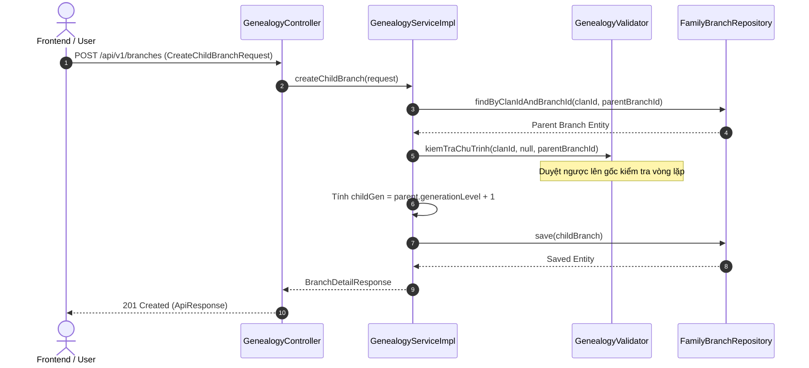
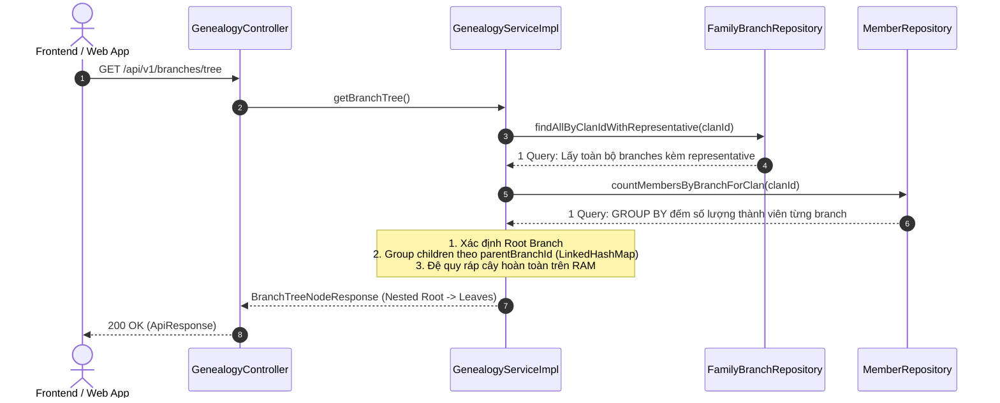

# Đặc Tả Kỹ Thuật & Hướng Dẫn Vận Hành US-04: Quản Lý Chi Phái, Phân Nhánh & Cấu Trúc Phân Cấp Gia Phả

Tài liệu này đặc tả toàn diện thiết kế kiến trúc, mô hình dữ liệu, các giải pháp kỹ thuật, luồng nghiệp vụ chi tiết và quy trình kiểm thử End-to-End (E2E) cho tính năng **[US-04] Quản lý chi phái, phân nhánh và cấu trúc phân cấp cây gia phả (Child Branches & Hierarchy Management)**.

---

## 1. Tổng Quan Nghiệp Vụ (User Story & Acceptance Criteria)

### Mô tả User Story
* **Mã User Story:** `US-04`
* **Đối tượng sử dụng (Actor):** Trưởng tộc (`ROLE_CLAN_HEAD`), Trưởng chi/nhánh (`ROLE_BRANCH_HEAD`), hoặc Quản trị viên (`ROLE_ADMIN`).
* **Mục tiêu (Goal):** 
  - Khởi tạo và cập nhật Chi gốc (Root Branch - Chi Đại Tôn) của dòng họ.
  - Tạo mới các chi/nhánh con (Child Branches) phân cấp nhiều thế hệ theo cấu trúc cây (Tree Hierarchy).
  - Điều chỉnh nhánh cha (Reparenting), cập nhật tên/mô tả/người đại diện nhánh và tự động cascade tính lại đời thế hệ.
  - Truy vấn toàn bộ cây phả hệ lồng nhau (Tree Node Response) với số lượng thành viên từng chi được tổng hợp tối ưu.
  - Xóa nhánh an toàn (chặn xóa nhánh gốc, nhánh đang có con hoặc nhánh đang có thành viên liên kết).
* **Giá trị mang lại (Value):** Thiết lập nền móng cấu trúc tổ chức gia tộc cho toàn bộ hệ thống, làm gốc rễ để tiếp nhận thành viên, phân bổ tài chính, giao việc sự kiện và kết nối con cháu.
* **Mức độ ưu tiên:** Bắt buộc (Must-Have - Core Foundation).

### Tiêu chí chấp nhận (Acceptance Criteria - AC)
1. **AC-01 (Quản lý Chi gốc):** Mỗi dòng họ (`clan_id`) có duy nhất một chi gốc với `generation_level = 1` và `parent_branch_id = NULL`. Cho phép Trưởng tộc cập nhật tên chi gốc, mô tả và người đại diện/thủy tổ chi gốc.
2. **AC-02 (Tạo nhánh con & Tự động sinh đời):** Khi tạo nhánh con trực thuộc một nhánh cha, hệ thống tự động gán thế hệ `child.generation_level = parent.generation_level + 1`. Người dùng không được phép nhập sai lệch đời thế hệ.
3. **AC-03 (Chống chu trình phả hệ - Cycle Prevention):** Ngăn chặn triệt để vòng lặp cha-con khép kín (ví dụ: nhánh A trỏ cha về chính nó, hoặc A là cha của B nhưng lại chọn B làm cha của A). Thuật toán duyệt ngược đảm bảo cây luôn là Đồ thị có hướng không chu trình (DAG / Tree).
4. **AC-04 (Điều chỉnh nhánh cha & Cascade thế hệ):** Khi đổi nhánh cha (Reparenting), hệ thống tính độ lệch thế hệ $\Delta = generation_{mới} - generation_{cũ}$ và tự động cascade cập nhật `generation_level` của toàn bộ các nhánh con cháu bên dưới cũng như `generation` của các thành viên trực thuộc.
5. **AC-05 (Truy vấn Cây phân cấp In-Memory):** API `GET /api/v1/branches/tree` lấy toàn bộ cấu trúc cây phân cấp của dòng họ trong đúng 1 query lấy danh sách branch và 1 query `GROUP BY` đếm số thành viên, sau đó dựng cây đệ quy hoàn toàn trên bộ nhớ (In-Memory Assembly), triệt tiêu bài toán N+1 database queries.
6. **AC-06 (Xóa nhánh an toàn - Safe Deletion):** 
   - Cấm xóa Chi gốc (`generationLevel = 1`).
   - Cấm xóa nhánh nếu đang tồn tại nhánh con (`childBranches`).
   - Cấm xóa nhánh nếu đang có thành viên gia đình trực thuộc (`members`).
7. **AC-07 (Gán thành viên vào nhánh):** Khi gán thành viên vào chi nhánh, đời của thành viên không được nhỏ hơn đời của chi nhánh ($generation_{member} \ge generationLevel_{branch}$).
8. **AC-08 (Cô lập dữ liệu Multi-tenancy & Chuẩn hóa 3NF):** 
   - Mọi thao tác truy vấn và kiểm tra đều phải giới hạn nghiêm ngặt theo `clan_id` (Defense-in-Depth).
   - Tên dòng họ (`clan_name`) được chuẩn hóa lưu trữ duy nhất tại bảng `clans` (Single Source of Truth), loại bỏ hoàn toàn việc lưu dư thừa ở bảng `family_branches`.

---

## 2. Thiết Kế Kiến Trúc & Ranh Giới Bounded Context (Architecture Design)

Tính năng thuộc Bounded Context: `com.familyfund.genealogy`

```
[Client / Frontend Web & Mobile]
               │  HTTP Requests (JSON)
               ▼
┌────────────────────────────────────────────────────────────────────────┐
│ 1. API BOUNDARY & CONTROLLER LAYER                                     │
│    • Controller: GenealogyController (Mapping /api/v1/branches/**)     │
│    • MemberController: (Mapping /api/v1/members/{id}/assign-branch)    │
│    • Bean Validation: @Valid (CreateChildBranchRequest, Update...)     │
│    • Envelope Response: ApiResponse<T>                                 │
└────────────────────────────────────────────────────────────────────────┘
               │  Validated DTO + TenantContext (clanId)
               ▼
┌────────────────────────────────────────────────────────────────────────┐
│ 2. APPLICATION & DOMAIN SERVICE LAYER                                  │
│    • Service: GenealogyService / GenealogyServiceImpl (@Transactional) │
│    • Cycle Validator: GenealogyValidator.kiemTraChuTrinh()            │
│    • Public Cross-Module Contract: GenealogyQueryService               │
│    • Object Mapper: BranchMapper (MapStruct)                           │
└────────────────────────────────────────────────────────────────────────┘
               │  Entity State
               ▼
┌────────────────────────────────────────────────────────────────────────┐
│ 3. PERSISTENCE & DATA LAYER                                            │
│    • FamilyBranchRepository, MemberRepository, ClanRepository          │
│    • Entity: FamilyBranch, Member, Clan                                │
│    • PostgreSQL 16+ Database                                           │
│    • Flyway Migrations: V1, V3, V4__drop_clan_name_from_family_branches│
└────────────────────────────────────────────────────────────────────────┘
```

### Danh mục các file mã nguồn cốt lõi:
* **Controllers:** 
  - [`GenealogyController.java`](file:///d:/family-management-backend/src/main/java/com/familyfund/genealogy/internal/controller/GenealogyController.java)
  - [`MemberController.java`](file:///d:/family-management-backend/src/main/java/com/familyfund/genealogy/internal/controller/MemberController.java)
* **Service:** 
  - [`GenealogyService.java`](file:///d:/family-management-backend/src/main/java/com/familyfund/genealogy/internal/service/GenealogyService.java)
  - [`GenealogyServiceImpl.java`](file:///d:/family-management-backend/src/main/java/com/familyfund/genealogy/internal/service/GenealogyServiceImpl.java)
* **Validator:** 
  - [`GenealogyValidator.java`](file:///d:/family-management-backend/src/main/java/com/familyfund/genealogy/internal/validator/GenealogyValidator.java)
* **Cross-Module API Contract:** 
  - [`GenealogyQueryService.java`](file:///d:/family-management-backend/src/main/java/com/familyfund/genealogy/api/GenealogyQueryService.java)
* **Repositories:** 
  - [`FamilyBranchRepository.java`](file:///d:/family-management-backend/src/main/java/com/familyfund/genealogy/internal/repository/FamilyBranchRepository.java)
  - [`MemberRepository.java`](file:///d:/family-management-backend/src/main/java/com/familyfund/genealogy/internal/repository/MemberRepository.java)
  - [`ClanRepository.java`](file:///d:/family-management-backend/src/main/java/com/familyfund/genealogy/internal/repository/ClanRepository.java)
* **Entities:** 
  - [`FamilyBranch.java`](file:///d:/family-management-backend/src/main/java/com/familyfund/genealogy/internal/entity/FamilyBranch.java)
  - [`Member.java`](file:///d:/family-management-backend/src/main/java/com/familyfund/genealogy/internal/entity/Member.java)
  - [`Clan.java`](file:///d:/family-management-backend/src/main/java/com/familyfund/genealogy/internal/entity/Clan.java)
* **Mapper:** 
  - [`BranchMapper.java`](file:///d:/family-management-backend/src/main/java/com/familyfund/genealogy/internal/mapper/BranchMapper.java)
* **DTOs:** 
  - [`CreateChildBranchRequest.java`](file:///d:/family-management-backend/src/main/java/com/familyfund/genealogy/internal/dto/request/CreateChildBranchRequest.java)
  - [`UpdateBranchRequest.java`](file:///d:/family-management-backend/src/main/java/com/familyfund/genealogy/internal/dto/request/UpdateBranchRequest.java)
  - [`UpdateRootBranchRequest.java`](file:///d:/family-management-backend/src/main/java/com/familyfund/genealogy/internal/dto/request/UpdateRootBranchRequest.java)
  - [`BranchDetailResponse.java`](file:///d:/family-management-backend/src/main/java/com/familyfund/genealogy/internal/dto/response/BranchDetailResponse.java)
  - [`BranchTreeNodeResponse.java`](file:///d:/family-management-backend/src/main/java/com/familyfund/genealogy/internal/dto/response/BranchTreeNodeResponse.java)

---

## 3. Thiết Kế Cơ Sở Dữ Liệu (Database Schema)

### Cấu trúc Bảng `family_branches` (Đã chuẩn hóa sau Migration V4)
```sql
CREATE TABLE IF NOT EXISTS family_branches (
    branch_id VARCHAR(20) PRIMARY KEY,
    clan_id VARCHAR(20) NOT NULL REFERENCES clans(clan_id) ON DELETE CASCADE,
    branch_name VARCHAR(100) NOT NULL,
    generation_level INT NOT NULL,
    parent_branch_id VARCHAR(20) REFERENCES family_branches(branch_id) ON DELETE RESTRICT,
    representative_id VARCHAR(20) REFERENCES members(member_id) ON DELETE SET NULL,
    description TEXT,
    created_at TIMESTAMPTZ DEFAULT CURRENT_TIMESTAMP
);

-- Chỉ mục tối ưu hóa truy vấn phân cấp và phân tách dòng họ
CREATE INDEX IF NOT EXISTS idx_family_branches_clan_parent ON family_branches(clan_id, parent_branch_id);
```

### Điểm nhấn thiết kế kỹ thuật CSDL:
1. **Chuẩn hóa 3NF (Data Normalization):**
   - Trước đây bảng `family_branches` lưu cột `clan_name`. Khi đổi tên dòng họ, các nhánh con bị lệch dữ liệu cũ.
   - Migration `V4__drop_clan_name_from_family_branches.sql` đã loại bỏ hoàn toàn cột `clan_name`. Bảng `clans` là nguồn chân lý duy nhất (Single Source of Truth).
2. **Quan hệ Adjacency List an toàn:**
   - Trường `parent_branch_id` trỏ về chính `branch_id`.
   - Ràng buộc `ON DELETE RESTRICT` ngăn chặn việc vô tình xóa nhánh cha làm mồ côi nhánh con.
3. **Loại bỏ nguy cơ Cascade Delete trong JPA Entity:**
   - Trong `FamilyBranch.java`, thuộc tính `childBranches` và `members` đã loại bỏ `CascadeType.ALL` (đặc biệt là `CascadeType.REMOVE`), loại trừ rủi ro Hibernate tự ý xóa sạch dữ liệu thành viên khi xóa một chi nhánh.

---

## 4. Luồng Nghiệp Vụ Chi Tiết (Detailed Business Flows)

### 4.1. Tạo Nhánh Con & Chống Chu Trình Phả Hệ


### 4.2. Dựng Cây Gia Phả In-Memory (Zero N+1 Queries)


---

## 5. Hướng Dẫn Kiểm Thử (Testing & End-to-End Guide)

### 5.1. Kiểm thử Tự Động (Automated Tests)
Chạy bộ kiểm thử tự động của phân hệ Gia phả bằng Gradle:
```powershell
.\gradlew.bat test --tests "com.familyfund.genealogy.*"
```

| Tên Test Class | Số Test Cases | Mục Tiêu Kiểm Thử |
| :--- | :---: | :--- |
| [`GenealogyRootBranchTest`](file:///d:/family-management-backend/src/test/java/com/familyfund/genealogy/internal/service/GenealogyRootBranchTest.java) | 6 | Cập nhật Chi gốc, gán thủy tổ đại diện, kiểm soát lỗi khi Clan không tồn tại |
| [`GenealogyHierarchyTest`](file:///d:/family-management-backend/src/test/java/com/familyfund/genealogy/internal/service/GenealogyHierarchyTest.java) | 12 | Tạo nhánh con, reparenting cascade đời, gán đại diện, xóa nhánh an toàn, dựng cây in-memory |
| [`GenealogyMultiTenantSecurityTest`](file:///d:/family-management-backend/src/test/java/com/familyfund/genealogy/internal/service/GenealogyMultiTenantSecurityTest.java) | 5 | Phòng thủ bảo mật chéo tenant giữa các Clan độc lập |
| [`GenealogyValidatorTest`](file:///d:/family-management-backend/src/test/java/com/familyfund/genealogy/internal/validator/GenealogyValidatorTest.java) | 5 | Kiểm thử thuật toán chống chu trình 1 cấp, 2 cấp và chuỗi nhiều cấp gián tiếp |
| [`BranchMapperTest`](file:///d:/family-management-backend/src/test/java/com/familyfund/genealogy/internal/mapper/BranchMapperTest.java) | 3 | Chuyển đổi dữ liệu Entity sang DTO phẳng và DTO cây phân cấp lồng nhau |

### 5.2. Kịch Bản Kiểm Thử Thực Tế (E2E Manual Testing)

#### 1. Lấy thông tin Chi gốc của Dòng họ:
```bash
curl -X GET http://localhost:8080/api/v1/branches/root \
  -H "X-Clan-Id: CLAN_DEFAULT"
```

#### 2. Cập nhật Chi gốc:
```bash
curl -X PUT http://localhost:8080/api/v1/branches/root \
  -H "Content-Type: application/json" \
  -H "X-Clan-Id: CLAN_DEFAULT" \
  -d '{
    "branchName": "Chi Đại Tôn (Chi Trưởng)",
    "description": "Chi gốc đầu tiên phát tích tại Cổ Am",
    "representativeId": "MEM_ROOT_01"
  }'
```

#### 3. Tạo mới một Chi nhánh con:
```bash
curl -X POST http://localhost:8080/api/v1/branches \
  -H "Content-Type: application/json" \
  -H "X-Clan-Id: CLAN_DEFAULT" \
  -d '{
    "branchName": "Chi Giáp Tiền Phương",
    "parentBranchId": "BR_ROOT_001",
    "description": "Phân chi định cư tại Hải Phòng"
  }'
```

#### 4. Lấy toàn bộ cây gia phả đệ quy:
```bash
curl -X GET http://localhost:8080/api/v1/branches/tree \
  -H "X-Clan-Id: CLAN_DEFAULT"
```

**Kết quả JSON kỳ vọng:**
```json
{
  "success": true,
  "message": "Thao tác thành công",
  "data": {
    "branchId": "BR_ROOT_001",
    "clanId": "CLAN_DEFAULT",
    "clanName": "Dòng Họ Nguyễn Đại Tộc",
    "branchName": "Chi Đại Tôn",
    "generationLevel": 1,
    "parentBranchId": null,
    "representativeId": "MEM_001",
    "representativeName": "Cụ Tổ Khởi Tổ",
    "memberCount": 15,
    "children": [
      {
        "branchId": "BR_CHILD_001",
        "clanId": "CLAN_DEFAULT",
        "clanName": "Dòng Họ Nguyễn Đại Tộc",
        "branchName": "Chi Giáp Tiền Phương",
        "generationLevel": 2,
        "parentBranchId": "BR_ROOT_001",
        "representativeId": null,
        "representativeName": null,
        "memberCount": 8,
        "children": []
      }
    ]
  },
  "timestamp": "2026-10-19T14:15:00Z"
}
```
