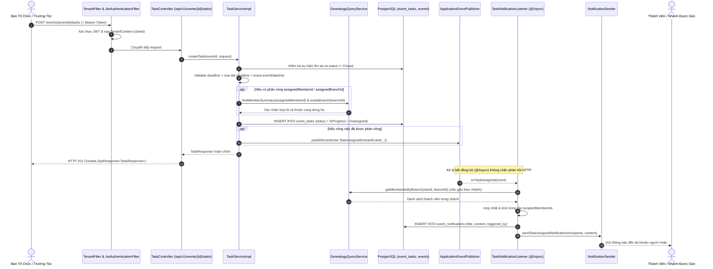

# Đặc Tả Kỹ Thuật & Hướng Dẫn Vận Hành US-07: Phân Hệ Công Việc & Phân Công Nhiệm Vụ Sự Kiện

Tài liệu này đặc tả thiết kế kiến trúc, mô hình dữ liệu, cơ chế phân quyền ngữ cảnh, quy trình thông báo bất đồng bộ và kịch bản kiểm thử cho tính năng **[US-07] Khởi tạo hạng mục công việc chuẩn bị sự kiện (hậu cần, mua sắm...), phân công linh hoạt cho cá nhân hoặc nhánh gia phả, chuyển trạng thái tự động (`Unassigned` $\rightarrow$ `InProgress`) và phát thông báo bất đồng bộ tới toàn thể thành viên liên quan**.

> **Điểm vào API chính:**
> - `POST /api/v1/events/{eventId}/tasks`: Tạo hạng mục công việc mới (Ban tổ chức, Trưởng tộc, Admin).
> - `POST /api/v1/events/{eventId}/tasks/{taskId}/assign`: Phân công hoặc điều chuyển công việc cho cá nhân và/hoặc chi nhánh gia phả.
> - `GET /api/v1/events/{eventId}/tasks`: Tra cứu danh sách công việc của sự kiện kèm bộ lọc (`status`, `assignedMemberId`, `assignedBranchId`).
> - `GET /api/v1/events/{eventId}/tasks/{taskId}`: Xem chi tiết một hạng mục công việc.
>
> Hợp đồng API được cập nhật trong [`docker/swagger/openapi.yaml`](../../docker/swagger/openapi.yaml) (Swagger UI cổng `8082`).

---

## 1. Tổng Quan Nghiệp Vụ (User Story & Acceptance Criteria)

### Mô tả User Story
* **Mã User Story:** `US-07`
* **Phân hệ:** Công việc & Tạm ứng (Event Tasks & Advance Planning)
* **Đối tượng sử dụng (Actors):** Ban tổ chức sự kiện (`HeadOfOrganizer`, `OrganizerMember`), Trưởng tộc (`ROLE_CLAN_HEAD`), Quản trị viên hệ thống (`ROLE_ADMIN`), Thành viên gia phả (`ROLE_MEMBER`).
* **Mục tiêu (Goal):** Với vai trò Ban tổ chức / Quản lý dòng họ, tôi muốn tạo các hạng mục công việc (hậu cần, mua sắm, chuẩn bị lễ vật...) và gán cho cá nhân/nhánh gia đình phụ trách, để minh bạch hóa trách nhiệm và đảm bảo tiến độ chuẩn bị sự kiện.
* **Tiền điều kiện (Preconditions):**
  1. Sự kiện đã được khởi tạo trong dòng họ và chưa bị khóa sổ (`event.status != Closed`).
  2. Đối tượng nhận việc (thành viên hoặc chi nhánh gia đình) phải tồn tại trong cây gia phả thuộc cùng dòng họ (`clan_id`).

### Tiêu chí chấp nhận (Acceptance Criteria - AC)
1. **AC-01 (Khởi tạo hạng mục công việc):**
   - Chỉ `ROLE_CLAN_HEAD`, `ROLE_ADMIN` hoặc nhân sự ban tổ chức sự kiện (`HeadOfOrganizer`, `OrganizerMember`) qua cơ chế phân quyền ngữ cảnh `@eventSecurity.hasContextualRole(#eventId, 'HeadOfOrganizer', 'OrganizerMember')` mới có quyền gọi `POST /api/v1/events/{eventId}/tasks`.
   - Các trường dữ liệu:
     - `taskName`: Bắt buộc, không được để trống, độ dài $\le 100$ ký tự.
     - `details`: Tùy chọn, tối đa 4000 ký tự.
     - `advanceBudget`: Ngân sách tạm ứng dự kiến, $\ge 0$, mặc định `0.0`.
     - `deadline`: Bắt buộc, phải là thời điểm trong tương lai (`@Future`), đồng thời phải trước thời gian diễn ra sự kiện (`deadline < event.eventDatetime`).
     - `assignedMemberId`: Tùy chọn, mã thành viên phụ trách ($\le 20$ ký tự).
     - `assignedBranchId`: Tùy chọn, mã chi nhánh phụ trách ($\le 20$ ký tự).
   - Mã `taskId` được phát sinh tự động duy nhất (dạng `TSK` + 8 ký tự Base36 + 6 ký tự Base32, độ dài $\le 20$).
   - Trạng thái công việc: Nếu đã chỉ định người/nhánh nhận việc khi tạo thì trạng thái là `InProgress`; nếu chưa chỉ định thì trạng thái là `Unassigned`.

2. **AC-02 (Phân công và điều chuyển công việc):**
   - Gọi endpoint `POST /api/v1/events/{eventId}/tasks/{taskId}/assign`.
   - Hỗ trợ phân công linh hoạt theo 3 hình thức:
     - Gán riêng cho một cá nhân (`assignedMemberId`).
     - Gán riêng cho một chi/nhánh gia phả (`assignedBranchId`).
     - Gán kết hợp cho cả cá nhân đại diện và chi nhánh gia đình.
   - Khi được phân công, trạng thái công việc tự động chuyển từ `Unassigned` sang `InProgress`.
   - Nếu công việc đã ở trạng thái `Completed`, hệ thống từ chối phân công lại với lỗi `400 Bad Request` (`BusinessRuleException`).
   - Nếu sự kiện đã chuyển sang `Closed`, hệ thống từ chối mọi thao tác chỉnh sửa hoặc phân công với lỗi `400 Bad Request`.

3. **AC-03 (Xác thực đối tượng nhận việc theo cây gia phả):**
   - Nếu có `assignedMemberId`: Phải tồn tại trong cây gia phả và thuộc đúng `clan_id` của sự kiện (xác minh qua `GenealogyQueryService.findMemberSummary()`).
   - Nếu có `assignedBranchId`: Phải tồn tại trong dòng họ hiện tại (xác minh qua `GenealogyQueryService.existsBranch(clanId, branchId)`).

4. **AC-04 (Thông báo bất đồng bộ đa thành viên - Async Notification):**
   - Khi một công việc được phân công (lúc tạo hoặc khi gọi API assign), hệ thống kích hoạt `TaskAssignedDomainEvent`.
   - Listener `TaskNotificationListener` lắng nghe sự kiện bất đồng bộ (`@Async @EventListener`), không làm chậm phản hồi HTTP.
   - Phân giải danh sách người nhận thông báo:
     - Cá nhân được chỉ định (`assignedMemberId`).
     - Toàn bộ thành viên đang sống trong chi/nhánh gia phả (`GenealogyQueryService.getMemberIdsByBranch(clanId, assignedBranchId)`).
     - Khử trùng lặp danh sách nhận (`LinkedHashSet`).
   - Lưu trữ bản ghi thông báo vào bảng `event_notifications` (mã `NTF...`, tiêu đề tối đa 200 ký tự, nội dung tóm tắt chi tiết hạn chót, ngân sách, người phụ trách).
   - Phát thông báo đến người nhận qua cổng `NotificationSender.sendTaskAssignedNotification()`.

5. **AC-05 (Tra cứu và lọc công việc):**
   - `GET /api/v1/events/{eventId}/tasks`: Cho phép mọi thành viên trong dòng họ (`CLAN_HEAD`, `BRANCH_HEAD`, `MEMBER`, `ADMIN`) tra cứu danh sách công việc.
   - Hỗ trợ lọc theo query parameters: `status`, `assignedMemberId`, `assignedBranchId`.
   - Danh sách trả về được sắp xếp theo thời hạn hoàn thành tăng dần (`deadline ASC`).
   - Tự động map tên chi nhánh (`assignedBranchName`) và tên thành viên (`assignedMemberName`) để người dùng dễ theo dõi.

---

## 2. Thiết Kế Kiến Trúc & Ranh Giới Bounded Context

Tính năng thuộc Bounded Context: `com.familyfund.event`.
Giao tiếp liên module tuân thủ 100% nguyên tắc Spring Modulith:
- Xác thực thành viên và chi nhánh qua `com.familyfund.genealogy.api.GenealogyQueryService` (Public Interface).
- Lấy thông tin tài khoản đang đăng nhập qua `com.familyfund.core.security.CurrentUserProvider`.
- Quản lý đa dòng họ (Multi-tenancy) qua `com.familyfund.core.tenant.TenantContext`.
- Gửi thông báo bất đồng bộ qua Spring Event Publisher `ApplicationEventPublisher`.

```
[Client / Mobile / Web]
        │
        ├─▶ POST /api/v1/events/{eventId}/tasks (Tạo công việc)
        ├─▶ POST /api/v1/events/{eventId}/tasks/{taskId}/assign (Phân công việc)
        ├─▶ GET  /api/v1/events/{eventId}/tasks (Danh sách & Lọc công việc)
        └─▶ GET  /api/v1/events/{eventId}/tasks/{taskId} (Chi tiết công việc)
        │
        ▼
┌────────────────────────────────────────────────────────────────┐
│ CONTROLLER: TaskController                                     │
│   • @PreAuthorize: CLAN_HEAD, ADMIN hoặc @eventSecurity        │
└────────────────────────────────────────────────────────────────┘
        │
        ▼
┌────────────────────────────────────────────────────────────────┐
│ SERVICE: TaskServiceImpl (@Transactional)                      │
│   • Kiểm tra hạn chót: deadline > now && deadline < eventTime  │
│   • Kiểm tra tính hợp lệ thành viên & chi nhánh qua            │
│     GenealogyQueryService                                      │
│   • Cập nhật trạng thái: Unassigned -> InProgress              │
│   • Sinh mã taskId dạng TSK...                                 │
│   • Bắn TaskAssignedDomainEvent qua ApplicationEventPublisher  │
└────────────────────────────────────────────────────────────────┘
        │
        ├─────────────────────────────┬──────────────────────────┐
        ▼                             ▼                          ▼
┌───────────────────────┐   ┌───────────────────────────┐  ┌───────────────────────┐
│ PERSISTENCE           │   │ ASYNC LISTENER            │  │ GENEALOGY QUERY       │
│ • Table: event_tasks  │   │ • TaskNotificationListener│  │ • GenealogyQuery      │
│ • EventTaskRepository │   │   (@Async @EventListener) │  │   Service             │
└───────────────────────┘   │ • EventNotificationRepo   │  │   (Member / Branch)   │
                            │ • NotificationSender      │  └───────────────────────┘
                            └───────────────────────────┘
```

### Danh Mục File Mã Nguồn
| Lớp / Vai trò | File |
| :--- | :--- |
| Public Domain Event | `src/main/java/com/familyfund/event/api/event/TaskAssignedDomainEvent.java` |
| Public Enum | `src/main/java/com/familyfund/event/api/dto/TaskStatus.java` |
| NamedInterface Spec | `src/main/java/com/familyfund/event/api/package-info.java` |
| JPA Entity | `src/main/java/com/familyfund/event/internal/entity/EventTask.java` |
| Repository | `src/main/java/com/familyfund/event/internal/repository/EventTaskRepository.java` |
| ID Generator | `src/main/java/com/familyfund/event/internal/util/TaskIdGenerator.java` |
| Service Interface | `src/main/java/com/familyfund/event/internal/service/TaskService.java` |
| Service Implementation | `src/main/java/com/familyfund/event/internal/service/TaskServiceImpl.java` |
| Async Listener | `src/main/java/com/familyfund/event/internal/notification/TaskNotificationListener.java` |
| REST Controller | `src/main/java/com/familyfund/event/internal/controller/TaskController.java` |
| Request DTOs | `src/main/java/com/familyfund/event/internal/dto/request/CreateTaskRequest.java`, `AssignTaskRequest.java` |
| Response DTO | `src/main/java/com/familyfund/event/internal/dto/response/TaskResponse.java` |
| Mapper | `src/main/java/com/familyfund/event/internal/mapper/TaskMapper.java` |
| OpenAPI Specification | `docker/swagger/openapi.yaml` |

---

## 3. Thiết Kế Cơ Sở Dữ Liệu (Database Schema)

### Bảng `event_tasks` (Flyway V1 DDL)
```sql
CREATE TABLE IF NOT EXISTS event_tasks (
    task_id VARCHAR(20) PRIMARY KEY,
    event_id VARCHAR(20) NOT NULL REFERENCES events(event_id) ON DELETE CASCADE,
    task_name VARCHAR(100) NOT NULL,
    details TEXT,
    advance_budget DECIMAL(18,2) DEFAULT 0 CHECK (advance_budget >= 0),
    deadline TIMESTAMPTZ NOT NULL,
    status VARCHAR(20) NOT NULL DEFAULT 'Unassigned'
        CHECK (status IN ('Unassigned', 'InProgress', 'Completed', 'Overdue')),
    assigned_branch_id VARCHAR(20) REFERENCES family_branches(branch_id) ON DELETE SET NULL,
    assigned_member_id VARCHAR(20) REFERENCES members(member_id) ON DELETE SET NULL,
    created_by VARCHAR(20) NOT NULL REFERENCES user_accounts(account_id) ON DELETE RESTRICT
);

CREATE INDEX IF NOT EXISTS idx_task_event ON event_tasks(event_id);
CREATE INDEX IF NOT EXISTS idx_task_deadline ON event_tasks(deadline);
```

### Trạng Thái Công Việc (`TaskStatus`)
* `Unassigned`: Công việc mới được tạo, chưa được gán cho cá nhân hoặc nhánh nào.
* `InProgress`: Công việc đã được phân công và đang trong tiến trình chuẩn bị.
* `Completed`: Công việc đã hoàn tất nhiệm vụ.
* `Overdue`: Công việc quá hạn chót mà chưa hoàn thành.

---

## 4. Sơ Đồ Tuần Tự Nghiệp Vụ (Mermaid Sequence Diagram)

### Luồng Khởi Tạo & Phân Công Công Việc Kèm Gửi Thông Báo



---

## 5. Hướng Dẫn Gọi REST API & Kịch Bản cURL

### 5.1. Khởi Tạo Công Việc Mới (Chưa Gán Người Phụ Trách)
```bash
curl -X POST "http://localhost:8080/api/v1/events/EVT20260426001/tasks" \
  -H "Authorization: Bearer $ORGANIZER_TOKEN" \
  -H "Content-Type: application/json" \
  -d '{
    "taskName": "Mua sắm hoa quả, trầu cau và hương đèn",
    "details": "Mua 5 mâm ngũ quả, 100 quả cau, 100 lá trầu và hương trầm loại tốt",
    "advanceBudget": 3500000.00,
    "deadline": "2027-04-20T10:00:00Z"
  }'
```
*Phản hồi mẫu (`201 Created`):*
```json
{
  "success": true,
  "message": "Khởi tạo công việc thành công",
  "data": {
    "taskId": "TSKABC12345DEF",
    "eventId": "EVT20260426001",
    "taskName": "Mua sắm hoa quả, trầu cau và hương đèn",
    "details": "Mua 5 mâm ngũ quả, 100 quả cau, 100 lá trầu và hương trầm loại tốt",
    "advanceBudget": 3500000.00,
    "deadline": "2027-04-20T10:00:00Z",
    "status": "Unassigned",
    "assignedBranchId": null,
    "assignedBranchName": null,
    "assignedMemberId": null,
    "assignedMemberName": null,
    "createdBy": "ACC10000001"
  }
}
```

### 5.2. Phân Công Công Việc Cho Nhánh Và Thành Viên Phụ Trách
```bash
curl -X POST "http://localhost:8080/api/v1/events/EVT20260426001/tasks/TSKABC12345DEF/assign" \
  -H "Authorization: Bearer $ORGANIZER_TOKEN" \
  -H "Content-Type: application/json" \
  -d '{
    "assignedBranchId": "BR10000001",
    "assignedMemberId": "MEM10000002"
  }'
```
*Phản hồi mẫu (`200 OK`):*
```json
{
  "success": true,
  "message": "Phân công công việc thành công",
  "data": {
    "taskId": "TSKABC12345DEF",
    "eventId": "EVT20260426001",
    "taskName": "Mua sắm hoa quả, trầu cau và hương đèn",
    "details": "Mua 5 mâm ngũ quả, 100 quả cau, 100 lá trầu và hương trầm loại tốt",
    "advanceBudget": 3500000.00,
    "deadline": "2027-04-20T10:00:00Z",
    "status": "InProgress",
    "assignedBranchId": "BR10000001",
    "assignedBranchName": "Chi Trưởng - Phái Giáp",
    "assignedMemberId": "MEM10000002",
    "assignedMemberName": "Nguyễn Văn Tuấn",
    "createdBy": "ACC10000001"
  }
}
```

### 5.3. Tra Cứu Danh Sách Công Việc Có Bộ Lọc
```bash
# Lọc các công việc đang thực hiện của một cá nhân
curl -X GET "http://localhost:8080/api/v1/events/EVT20260426001/tasks?status=InProgress&assignedMemberId=MEM10000002" \
  -H "Authorization: Bearer $MEMBER_TOKEN"
```

---

## 6. Kết Quả Kiểm Thử & Xác Minh Tự Động

Toàn bộ tính năng đã được kiểm thử tự động toàn diện qua các test suites sau:

```powershell
# 1. Kiểm thử kiến trúc Spring Modulith cho US-07
cd family-management-backend; .\gradlew.bat test --tests "com.familyfund.event.TaskArchitectureTest"

# 2. Kiểm thử bảo mật Contextual RBAC cho TaskController
cd family-management-backend; .\gradlew.bat test --tests "com.familyfund.event.internal.security.TaskContextualSecurityTest"

# 3. Kiểm thử REST Controller MockMvc
cd family-management-backend; .\gradlew.bat test --tests "com.familyfund.event.internal.controller.TaskControllerTest"

# 4. Kiểm thử nghiệp vụ Service Layer
cd family-management-backend; .\gradlew.bat test --tests "com.familyfund.event.internal.service.TaskServiceImplTest"

# 5. Kiểm thử luồng thông báo bất đồng bộ
cd family-management-backend; .\gradlew.bat test --tests "com.familyfund.event.internal.notification.TaskNotificationListenerTest"

# 6. Kiểm thử luồng tích hợp E2E Workflow
cd family-management-backend; .\gradlew.bat test --tests "com.familyfund.event.internal.service.TaskWorkflowIntegrationTest"

# 7. Chạy toàn bộ test suites của module event
cd family-management-backend; .\gradlew.bat test --tests "com.familyfund.event.*"
```

### Kết Quả Đạt Được:
- **Architecture Verification**: `TaskArchitectureTest` vượt qua 100%, bảo đảm không có phụ thuộc trái phép hay rò rỉ ranh giới module.
- **Contextual Security Verification**: Kiểm chứng đầy đủ quyền `ROLE_ADMIN`, `ROLE_CLAN_HEAD`, `HeadOfOrganizer`, `OrganizerMember` (được cấp phép) và từ chối `EventTreasurer`, `ROLE_MEMBER` khi tạo hoặc phân công việc (`403 Forbidden`).
- **End-to-End Workflow**: Tạo việc $\rightarrow$ Phân công cá nhân/nhánh $\rightarrow$ Chuyển trạng thái `InProgress` $\rightarrow$ Lắng nghe phát sinh domain event $\rightarrow$ Ghi log notification thành công.
- **Tất cả test cases** của module `event` đều passed 100%.

