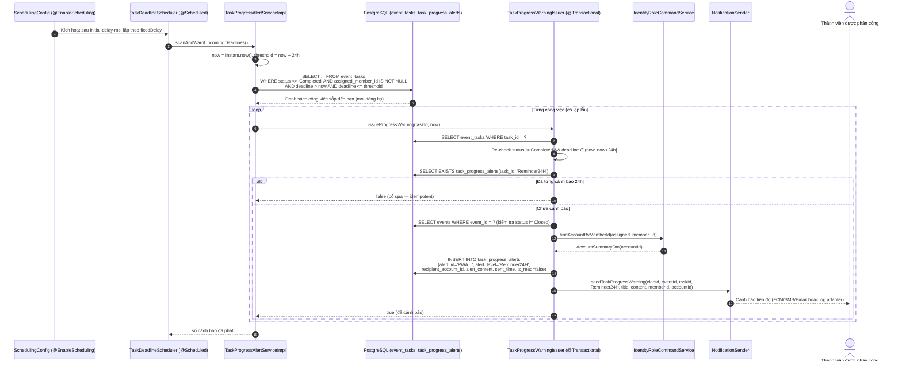

# Đặc Tả Kỹ Thuật & Hướng Dẫn Vận Hành US-08: Cảnh Báo Tiến Độ Công Việc Tự Động (Background Worker 24h)

Tài liệu này đặc tả thiết kế kiến trúc, mô hình dữ liệu, cơ chế quét nền định kỳ, quy trình ghi vết cảnh báo tiến độ và kịch bản kiểm thử cho tính năng **[US-08] Background worker quét định kỳ các hạng mục công việc chưa hoàn thành, tự động tạo vết cảnh báo tiến độ (`ProgressWarning`) và gửi thông báo tới thành viên được phân công (`assigned_member_id`) khi hạn chót còn lại ≤ 24 giờ**.

> **Điểm vào hệ thống (không có HTTP endpoint):**
> - Tính năng vận hành như một **background worker** trong tiến trình Spring Boot, kích hoạt bởi `@Scheduled` trên `TaskDeadlineScheduler`.
> - Chu kỳ quét cấu hình qua `app.task.deadline-warning.interval-ms` (mặc định `900000` ms = 15 phút) và `app.task.deadline-warning.initial-delay-ms` (mặc định `60000` ms).
> - Vết cảnh báo được tra cứu trực tiếp trên bảng `task_progress_alerts`; không mở thêm API công khai nên `docker/swagger/openapi.yaml` giữ nguyên.

---

## 1. Tổng Quan Nghiệp Vụ (User Story & Acceptance Criteria)

### Mô tả User Story
* **Mã User Story:** `US-08`
* **Phân hệ:** Phân Công & Tiến Độ Công Việc (Event Tasks & Progress Tracking)
* **Đối tượng sử dụng (Actors):** Hệ thống (Scheduler/Background Worker); người thụ hưởng là thành viên được phân công công việc (`assigned_member_id`), Ban tổ chức sự kiện và Trưởng tộc theo dõi tiến độ.
* **Mục tiêu (Goal):** Với vai trò Thành viên được phân công, tôi muốn **tự động nhận được cảnh báo tiến độ trước khi công việc hết hạn 24 giờ**, để kịp hoàn thành nhiệm vụ chuẩn bị sự kiện mà không cần Ban tổ chức nhắc thủ công.
* **Giá trị mang lại (Value):** Giảm rủi ro trễ hạn hậu cần sự kiện, tạo vết kiểm toán bất biến cho mọi lần nhắc việc, và loại bỏ hoàn toàn thao tác nhắc việc thủ công của Ban tổ chức.
* **Mức độ ưu tiên:** Bắt buộc (Must-Have).
* **Tiền điều kiện (Preconditions):**
  1. Công việc (`event_tasks`) đã được khởi tạo theo US-07 và đã được phân công cho một cá nhân (`assigned_member_id` khác rỗng).
  2. Thành viên được phân công có tài khoản người dùng liên kết (`user_accounts.member_id`) — điều kiện bắt buộc vì `task_progress_alerts.recipient_account_id` là `NOT NULL`.
  3. Ứng dụng đã bật `@EnableScheduling` (`com.familyfund.core.config.SchedulingConfig`).

### Tiêu chí chấp nhận (Acceptance Criteria - AC)
1. **AC-01 (Cơ chế quét nền định kỳ):**

   - Worker chạy theo `fixedDelay` (lượt quét sau bắt đầu sau khi lượt trước kết thúc), không phụ thuộc bất kỳ request HTTP nào.
   - Lượt quét đầu tiên bị trễ có chủ đích (`initial-delay-ms`) để không cạnh tranh tài nguyên với giai đoạn khởi động ứng dụng.
   - Vì chạy trên scheduler thread, **không có `TenantContext`**: truy vấn quét **toàn bộ các dòng họ (multi-tenant)** và tự phân giải `clan_id` từ sự kiện của từng công việc trước khi phát thông báo.
   - Mọi ngoại lệ phát sinh trong một lượt quét đều bị bắt và ghi log; không được làm chết scheduled task.
   - Worker có công tắc `app.task.deadline-warning.enabled` (mặc định `true`) để tắt khẩn cấp trong môi trường không mong muốn (ví dụ: bộ test dùng chung CSDL).

2. **AC-02 (Điều kiện xác định công việc cần cảnh báo):**
   - `event_tasks.status <> 'Completed'` (**bỏ qua công việc đã hoàn thành**).
   - `event_tasks.assigned_member_id IS NOT NULL` (không có người nhận thì không có nơi gửi).
   - `now < deadline <= now + 24 giờ` — biên đúng 24 giờ **được tính là trong ngưỡng**; deadline đã trôi qua hoặc còn hơn 24 giờ đều bị bỏ qua.
   - Công việc thuộc sự kiện đã `Closed` bị bỏ qua (nhất quán với bất biến "sự kiện khóa sổ là read-only" của US-21).

3. **AC-03 (Ghi vết `ProgressWarning` — bảng `task_progress_alerts`):**
   - Mỗi cảnh báo tạo một bản ghi append-only:
     - `alert_id`: sinh tự động dạng `PWA` + 8 ký tự Base36 (timestamp) + 6 ký tự Crockford Base32 (CSPRNG), độ dài ≤ 20.
     - `alert_level = 'Reminder24H'` — đây chính là mức cảnh báo tiến độ (`ProgressWarning`) khớp `CHECK` constraint của Flyway V1.
     - `recipient_account_id`: tài khoản người dùng tra được từ `assigned_member_id` qua `IdentityRoleCommandService.findAccountByMemberId()` (cross-module đúng ranh giới `event → identity::api`).
     - `alert_content`: nội dung cảnh báo (tên công việc, sự kiện, hạn chót, thời gian còn lại, ngân sách tạm ứng, nhánh/cá nhân phụ trách).
     - `sent_time`, `is_read = false`.
   - **Tính bất biến (idempotency):** mỗi công việc chỉ nhận **đúng một** cảnh báo `Reminder24H`; điều kiện bỏ qua được kiểm tra bằng `existsByTaskIdAndAlertLevel()` trước khi ghi vết.

4. **AC-04 (Gửi thông báo tới `assigned_member_id`):**
   - Sau khi ghi vết, worker gọi cổng thông báo **`NotificationSender.sendTaskProgressWarning(...)`** (đây là `NotificationService` của hệ thống, đã được US-07/US-22 sử dụng) với các tham số `clanId`, `eventId`, `taskId`, `alertLevel`, `title`, `content`, `recipientMemberId = assigned_member_id`, `recipientAccountId`.
   - Tiêu đề dạng `Cảnh báo tiến độ: <task_name>`, bị cắt còn ≤ 200 ký tự (kèm `...`) để không vỡ giới hạn tiêu đề của các kênh thông báo.
   - Adapter mặc định `LoggingNotificationSender` ghi log `[ThongBao ProgressWarning]`, sẵn sàng thay bằng FCM/SMS/Email mà không đổi domain logic.

5. **AC-05 (Bất biến nghiệp vụ, xử lý ngoại lệ & khả năng chịu lỗi):**
   - Mỗi công việc được xử lý trong **một transaction riêng** (`TaskProgressWarningIssuer#issueProgressWarning`): ghi vết trước, gửi sau. Nếu bước gửi ném ngoại lệ, transaction rollback → **không** đánh dấu "đã cảnh báo" và công việc sẽ được thử lại ở lượt quét kế tiếp (at-least-once, không mất cảnh báo).
   - Một công việc lỗi **không** làm dừng cả lượt quét: các công việc còn lại vẫn được xử lý, lỗi được log ở mức `ERROR`.
   - Thành viên chưa có tài khoản liên kết: bỏ qua và log `WARN` (không thể ghi vết vì `recipient_account_id NOT NULL`).
   - **Không** ghi vào `event_notifications`: bảng đó phục vụ thông báo cấp sự kiện và yêu cầu `triggered_by` là FK `NOT NULL` tới `user_accounts`, trong khi worker chạy không có tác nhân người dùng.

---

## 2. Thiết Kế Kiến Trúc & Ranh Giới Bounded Context

Tính năng thuộc Bounded Context: `com.familyfund.event` (worker được bật bởi Shared Kernel `com.familyfund.core`).
Giao tiếp liên module tuân thủ 100% nguyên tắc Spring Modulith:

- Phân giải tài khoản người nhận qua `com.familyfund.identity.api.IdentityRoleCommandService` (Public Interface).
- Xác thực thành viên/chi nhánh (nếu cần mở rộng) qua `com.familyfund.genealogy.api.GenealogyQueryService`.
- Không truy cập repository/entity của module khác; không có phụ thuộc vòng.

```
┌──────────────────────────────────────────────────────────────────────┐
│ SCHEDULER THREAD (không có TenantContext, không có HTTP request)     │
│   core.config.SchedulingConfig  → @EnableScheduling                  │
└──────────────────────────────────────────────────────────────────────┘
                              │ fixedDelay = app.task.deadline-warning.interval-ms
                              ▼
┌──────────────────────────────────────────────────────────────────────┐
│ TaskDeadlineScheduler (@Scheduled)                                   │
│   • try/catch toàn lượt: lỗi được log, scheduled task vẫn sống       │
└──────────────────────────────────────────────────────────────────────┘
                              │
                              ▼
┌──────────────────────────────────────────────────────────────────────┐
│ TaskProgressAlertService#scanAndWarnUpcomingDeadlines()              │
│   • now = Instant.now(); threshold = now + 24h                       │
│   • EventTaskRepository.findUnfinishedTasksDueWithin(now, threshold) │
│   • Lặp từng công việc, cô lập lỗi từng công việc                    │
└──────────────────────────────────────────────────────────────────────┘
                              │ (1 transaction / công việc)
                              ▼
┌──────────────────────────────────────────────────────────────────────┐
│ TaskProgressWarningIssuer#issueProgressWarning(taskId, now)          │
│   • Re-check: status != Completed, deadline ∈ (now, now+24h]         │
│   • Idempotency: existsByTaskIdAndAlertLevel(taskId, Reminder24H)    │
│   • Skip event Closed / member thiếu tài khoản                       │
│   • INSERT task_progress_alerts (ProgressWarning)                    │
│   • NotificationSender.sendTaskProgressWarning(...)                  │
└──────────────────────────────────────────────────────────────────────┘
        │                        │                          │
        ▼                        ▼                          ▼
┌───────────────┐   ┌─────────────────────────┐   ┌──────────────────────┐
│ PERSISTENCE   │   │ IDENTITY::API           │   │ NOTIFICATION PORT    │
│ event_tasks   │   │ findAccountByMemberId   │   │ NotificationSender   │
│ task_progress_│   │ (member → account)      │   │ ↳ LoggingNotif.Sender │
│ alerts        │   └─────────────────────────┘   └──────────────────────┘
└───────────────┘
```

### Danh Mục File Mã Nguồn
| Lớp / Vai trò | File |
| :--- | :--- |
| Bật scheduling | `src/main/java/com/familyfund/core/config/SchedulingConfig.java` |
| Background worker (`@Scheduled`) | `src/main/java/com/familyfund/event/internal/scheduler/TaskDeadlineScheduler.java` |
| Service Interface | `src/main/java/com/familyfund/event/internal/service/TaskProgressAlertService.java` |
| Service Implementation (scan pass) | `src/main/java/com/familyfund/event/internal/service/TaskProgressAlertServiceImpl.java` |
| Issuer (1 transaction / công việc) | `src/main/java/com/familyfund/event/internal/service/TaskProgressWarningIssuer.java` |
| Public Enum | `src/main/java/com/familyfund/event/api/dto/TaskAlertLevel.java` |
| JPA Entity | `src/main/java/com/familyfund/event/internal/entity/TaskProgressAlert.java` |
| Repository | `src/main/java/com/familyfund/event/internal/repository/TaskProgressAlertRepository.java`, `EventTaskRepository.java` |
| ID Generator | `src/main/java/com/familyfund/event/internal/util/AlertIdGenerator.java` |
| Notification Port | `src/main/java/com/familyfund/event/internal/notification/NotificationSender.java`, `LoggingNotificationSender.java` |
| Flyway Migration | Không cần — bảng `task_progress_alerts` đã có từ `V1__init_clan_genealogy_and_events_schema.sql` |
| Cấu hình chạy | `src/main/resources/application.yaml` (`app.task.deadline-warning.*`) |

---

## 3. Thiết Kế Cơ Sở Dữ Liệu (Database Schema)

### Bảng `task_progress_alerts` (Flyway V1)
```sql
CREATE TABLE IF NOT EXISTS task_progress_alerts (
    alert_id VARCHAR(20) PRIMARY KEY,
    task_id VARCHAR(20) NOT NULL REFERENCES event_tasks(task_id) ON DELETE CASCADE,
    alert_level VARCHAR(25) NOT NULL
        CHECK (alert_level IN ('Reminder24H', 'OverdueAlert12H')),
    recipient_account_id VARCHAR(20) NOT NULL REFERENCES user_accounts(account_id) ON DELETE CASCADE,
    alert_content TEXT NOT NULL,
    sent_time TIMESTAMPTZ DEFAULT CURRENT_TIMESTAMP,
    is_read BOOLEAN DEFAULT FALSE
);
```

### Index sẵn có (Flyway V1)
Không cần migration mới cho US-08: worker dùng lại các index đã có của V1.
```sql
-- V1: idx_task_deadline — hỗ trợ truy vấn quét theo hạn chót
CREATE INDEX IF NOT EXISTS idx_task_deadline ON event_tasks(deadline);
```

> **Ghi chú thiết kế:** phiên bản đầu của tính năng có kèm một Flyway `V15` bổ sung
> partial unique index `ux_task_progress_alert_reminder_24h` (chốt chặn CSDL chống ghi vết trùng)
> cùng 2 index tra cứu. Migration này đã được **gỡ bỏ** để không phát sinh version schema mới:
> tính đúng đắn của nghiệp vụ chỉ phụ thuộc vào kiểm tra `existsByTaskIdAndAlertLevel()` ở tầng
> service, và bảng `task_progress_alerts` đã tồn tại từ V1. Hệ quả cần biết: khi chạy **nhiều
> instance** cùng bật worker, hai lượt quét chồng lấn có thể cùng ghi một cảnh báo (không còn
> chốt chặn ở tầng CSDL). Với triển khai một instance, hành vi không thay đổi.

### Ánh Xạ Enum ↔ Ràng Buộc CSDL
| Giá trị Java (`TaskAlertLevel`) | Giá trị `alert_level` trong CSDL | Ý nghĩa |
| :--- | :--- | :--- |
| `Reminder24H` | `Reminder24H` | **`ProgressWarning`**: cảnh báo tiến độ khi hạn chót ≤ 24 giờ (phạm vi US-08) |
| `OverdueAlert12H` | `OverdueAlert12H` | Dự phòng cho luồng leo thang cảnh báo quá hạn 12h tới Trưởng nhánh (chưa phát sinh bởi worker 24h) |

---

## 4. Sơ Đồ Tuần Tự Nghiệp Vụ (Mermaid Sequence Diagram)

### Luồng quét nền, ghi vết cảnh báo và gửi thông báo



### Máy trạng thái vết cảnh báo
```
[Chưa có vết] --deadline ≤ 24h & status != Completed--> [Reminder24H đã ghi + đã gửi]
[Reminder24H đã ghi] --quét lại--> (bỏ qua: existsByTaskIdAndAlertLevel = true)
[Ghi vết] --NotificationSender ném lỗi--> (rollback) --> [Chưa có vết] (lượt quét sau thử lại)
```

---

## 5. Cấu Hình Vận Hành & Hướng Dẫn Kiểm Thử

### 5.1. Cấu hình worker (`application.yaml`)
```yaml
app:
  task:
    deadline-warning:
      # US-08: background worker scanning unfinished tasks whose deadline is 24h away or less
      enabled: ${APP_TASK_DEADLINE_WARNING_ENABLED:true}                 # công tắc tắt/mở worker
      interval-ms: ${APP_TASK_DEADLINE_WARNING_INTERVAL_MS:900000}      # 15 phút
      initial-delay-ms: ${APP_TASK_DEADLINE_WARNING_INITIAL_DELAY_MS:60000}  # 60 giây
```

Có thể rút ngắn chu kỳ khi kiểm thử E2E bằng biến môi trường:
```bash
APP_TASK_DEADLINE_WARNING_INTERVAL_MS=15000 \
APP_TASK_DEADLINE_WARNING_INITIAL_DELAY_MS=5000 \
  ./gradlew bootRun
```

> **Lưu ý kiểm thử:** `src/test/resources/application.properties` đặt
> `app.task.deadline-warning.enabled=false` để worker **không bao giờ** quét trong lúc chạy test
> (các test suite dùng chung CSDL PostgreSQL thật, một lượt quét có thể ghi vết ngoài transaction
> của test). Các test US-08 gọi trực tiếp `TaskProgressAlertService` để kiểm chứng logic.

### 5.2. Kiểm chứng vết cảnh báo trong CSDL
```sql
-- 1. Các công việc lẽ ra phải được cảnh báo (còn ≤ 24h, chưa hoàn thành, có người nhận)
SELECT task_id, task_name, deadline, status, assigned_member_id
FROM event_tasks
WHERE status <> 'Completed'
  AND assigned_member_id IS NOT NULL
  AND deadline > NOW()
  AND deadline <= NOW() + INTERVAL '24 hours';

-- 2. Vết ProgressWarning đã ghi
SELECT alert_id, task_id, alert_level, recipient_account_id, sent_time, is_read
FROM task_progress_alerts
WHERE alert_level = 'Reminder24H'
ORDER BY sent_time DESC;

-- 3. Bất biến: mỗi công việc tối đa 1 cảnh báo 24h (kỳ vọng: 0 dòng)
SELECT task_id, COUNT(*) FROM task_progress_alerts
WHERE alert_level = 'Reminder24H'
GROUP BY task_id HAVING COUNT(*) > 1;
```

### 5.3. Log kỳ vọng
```
US-08 deadline scan: 2 unfinished task(s) due within 24h
US-08: progress warning [PWA...] issued for task [TSK...] (deadline 2026-04-20T10:00:00Z) to member [MEM...]
[ThongBao ProgressWarning] Cảnh báo tiến độ [Reminder24H] công việc [TSK...] sự kiện [EVT...] ...
US-08 deadline scan: issued 1 progress warning(s)
```
Các log bỏ qua hợp lệ (mức `DEBUG`/`WARN`):
```
US-08: task [TSK...] is completed, skipping
US-08: task [TSK...] already received a 24h progress warning, skipping
US-08: event [EVT...] of task [TSK...] is closed or missing, skipping
US-08: assigned member [MEM...] of task [TSK...] has no linked user account, cannot warn
```

### 5.4. Kiểm thử tự động
```powershell
# 1. Unit test: điều kiện cảnh báo, ghi vết, gọi NotificationSender, idempotency
cd family-management-backend; .\gradlew.bat test --tests "com.familyfund.event.internal.service.TaskProgressWarningIssuerTest"

# 2. Unit test: một lượt quét (cửa sổ 24h, cô lập lỗi từng công việc)
cd family-management-backend; .\gradlew.bat test --tests "com.familyfund.event.internal.service.TaskProgressAlertServiceImplTest"

# 3. Unit test: scheduled entry point (delegate + nuốt ngoại lệ)
cd family-management-backend; .\gradlew.bat test --tests "com.familyfund.event.internal.scheduler.TaskDeadlineSchedulerTest"

# 4. Unit test: sinh mã alert_id
cd family-management-backend; .\gradlew.bat test --tests "com.familyfund.event.internal.util.AlertIdGeneratorTest"

# 5. Integration test (Spring context + PostgreSQL thật, rollback): ghi vết, idempotency, quét xuyên dòng họ
cd family-management-backend; .\gradlew.bat test --tests "com.familyfund.event.internal.service.TaskProgressAlertWorkerIntegrationTest"

# 6. Kiểm thử kiến trúc Spring Modulith (không rò rỉ internal, không phụ thuộc vòng)
cd family-management-backend; .\gradlew.bat test --tests "com.familyfund.event.TaskArchitectureTest"

# 7. Xác minh bảng task_progress_alerts tồn tại sau khi migrate (Flyway V1)
cd family-management-backend; .\gradlew.bat test --tests "com.familyfund.DatabaseMigrationTest"

# 8. Toàn bộ test suites của module event
cd family-management-backend; .\gradlew.bat test --tests "com.familyfund.event.*"
```

---

## 6. Kết Quả Kiểm Thử & Xác Minh Tự Động

```powershell
.\gradlew.bat test --tests "com.familyfund.event.internal.service.TaskProgressWarningIssuerTest" `
                   --tests "com.familyfund.event.internal.service.TaskProgressAlertServiceImplTest" `
                   --tests "com.familyfund.event.internal.scheduler.TaskDeadlineSchedulerTest" `
                   --tests "com.familyfund.event.internal.util.AlertIdGeneratorTest"
```

| Test Class | Số Test Cases | Mục Tiêu Kiểm Thử |
| :--- | :---: | :--- |
| `TaskProgressWarningIssuerTest` | 10 | Cảnh báo khi hạn chót ≤ 24h, biên đúng 24h, bỏ qua `Completed`, bỏ qua ngoài cửa sổ, bỏ qua thiếu người nhận, idempotency, bỏ qua sự kiện `Closed`, bỏ qua thành viên không có tài khoản, xử lý taskId rỗng/không tồn tại, cắt tiêu đề ≤ 200 ký tự |
| `TaskProgressAlertServiceImplTest` | 4 | Đếm đúng số cảnh báo phát sinh, cửa sổ quét đúng 24 giờ, cô lập lỗi từng công việc, lượt quét rỗng trả `0` |
| `TaskDeadlineSchedulerTest` | 2 | Ủy quyền cho service mỗi lượt, nuốt ngoại lệ để scheduled task tiếp tục chạy |
| `AlertIdGeneratorTest` | 2 | Định dạng `PWA...` ≤ 20 ký tự, duy nhất trên 10.000 lần sinh |
| `TaskProgressAlertWorkerIntegrationTest` | 4 | Spring context + PostgreSQL thật (rollback): ghi vết `Reminder24H` và phân giải tài khoản từ `assigned_member_id`; idempotency (không cảnh báo 2 lần); bỏ qua `Completed`/ngoài 24h/sự kiện `Closed`/thành viên không có tài khoản; lượt quét phủ **cả hai dòng họ** khi không có `TenantContext` |

### Kết Quả Đạt Được:
- **22/22 test cases mới pass 100%** (`BUILD SUCCESSFUL`): 18 unit tests + 4 integration tests trên PostgreSQL thật.
- **`DatabaseMigrationTest`**: xác minh bảng `task_progress_alerts` tồn tại sau khi migrate (schema V1, không phát sinh migration mới cho US-08).
- **Architecture Verification**: `TaskArchitectureTest` / `ArchitectureTest` vẫn xanh — worker chỉ phụ thuộc `core`, `identity::api`, `genealogy::api`; không rò rỉ `internal`.
- **Idempotency**: kiểm tra tồn tại `(task_id, Reminder24H)` ở tầng service trước khi ghi vết; phù hợp triển khai một instance.
- **Khả năng chịu lỗi**: transaction theo từng công việc, ghi vết trước – gửi sau, rollback khi gửi thất bại để lượt quét sau thử lại; một công việc lỗi không chặn cả lượt.