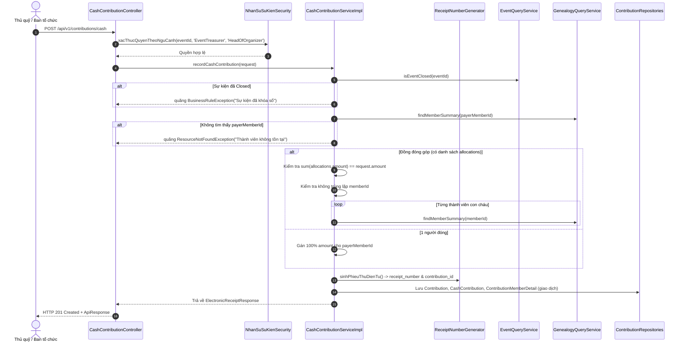

# Đặc Tả Kỹ Thuật & Hướng Dẫn Vận Hành US-09: Ghi Nhận Khoản Đóng Góp Tiền Mặt/Chuyển Khoản & Cấp Phiếu Thu Điện Tử

Tài liệu này đặc tả toàn diện thiết kế kiến trúc, mô hình dữ liệu, các giải pháp kỹ thuật, luồng nghiệp vụ chi tiết và quy trình kiểm thử cho tính năng **[US-09] Ghi nhận các khoản đóng góp bằng tiền mặt/chuyển khoản và cấp phiếu thu điện tử**, bao gồm các nhiệm vụ cốt lõi:
- **#68:** API ghi nhận khoản đóng góp bằng tiền mặt (`Cash`) hoặc chuyển khoản (`BankTransfer`).
- **#69:** Tự động sinh mã phiếu thu điện tử duy nhất (`sinhPhieuThuDienTu()` / `receipt_number` / `soBienLai`).
- **#70:** Tự động ghi nhận tỷ lệ phân bổ vào bảng `ChiTietDongGop` (`contribution_member_details` - `phanBoGiaTri`) cho cả trường hợp 1 người đóng hoặc nhiều con cháu đồng đóng góp, làm nguồn dữ liệu chuẩn cho thuật toán đệ quy ở **US-11**.

> **Điểm vào API chính:**
> - `POST /api/v1/contributions/cash`: Tiếp nhận đóng góp tiền mặt / chuyển khoản và cấp phiếu thu điện tử.
>
> Hợp đồng API được cập nhật trong [`docker/swagger/openapi.yaml`](../../docker/swagger/openapi.yaml) (Swagger UI cổng `8082`).

---

## 1. Tổng Quan Nghiệp Vụ (User Story & Acceptance Criteria)

### Mô tả User Story
* **Mã User Story:** `US-09` (Backlog #45)
* **Đối tượng sử dụng (Actor):** Thủ quỹ sự kiện (`EventTreasurer`), Trưởng ban tổ chức (`HeadOfOrganizer`), Trưởng tộc (`ROLE_CLAN_HEAD`), Quản trị viên (`ROLE_ADMIN`).
* **Mục tiêu (Goal):** Là Thủ quỹ sự kiện hoặc Ban tổ chức, tôi muốn ghi nhận các khoản công đức đóng góp của con cháu bằng tiền mặt hoặc chuyển khoản tại bàn tiếp nhận sự kiện, tự động sinh phiếu thu điện tử duy nhất và phân bổ tỷ lệ công đức cho từng người (hoặc chia cho các con cháu đồng đóng góp) để đảm bảo tính minh bạch và dữ liệu vinh danh sau này.
* **Giá trị mang lại (Value):**
  - Số hóa tức thời quy trình thu tiền công đức tại ngày hội/giỗ tổ.
  - Cấp phiếu thu điện tử có mã biên lai duy nhất, minh bạch, chống thất thoát.
  - Tạo bảng phân bổ chi tiết `contribution_member_details` làm nguồn dữ liệu chuẩn mực (`ground truth`) cho hàm đệ quy `TinhTongDongGopDeQuy()` ở US-11.
* **Mức độ ưu tiên:** Bắt buộc (Must-Have).

### Tiêu chí chấp nhận (Acceptance Criteria - AC)

1. **AC-01 (Phân quyền & Kiểm tra ngữ cảnh sự kiện - Task #68):**
   - Người gọi API phải có quyền tĩnh toàn cục (`ROLE_CLAN_HEAD`, `ROLE_ADMIN`) hoặc quyền động theo ngữ cảnh sự kiện: vai trò `EventTreasurer` hoặc `HeadOfOrganizer` được chỉ định trong bảng `event_personnel` của sự kiện đó thông qua middleware `@nhanSuSuKien.xacThucQuyenTheoNguCanh(#request.eventId, 'EventTreasurer', 'HeadOfOrganizer')`.
   - Sự kiện phải tồn tại, thuộc đúng dòng họ (`TenantContext.getClanId()`), và **KHÔNG** ở trạng thái `Closed`. Nếu sự kiện đã đóng, từ chối với mã lỗi `400 Bad Request` hoặc `403 Forbidden`.
   - `receiver_account_id` tự động trích xuất từ JWT của người dùng đang đăng nhập (`CurrentUserProvider.currentAccountId()`), không cho phép giả mạo người thu tiền.

2. **AC-02 (Tự động sinh mã phiếu thu điện tử duy nhất - Task #69):**
   - Tự động sinh `contribution_id` duy nhất có độ dài $\le 20$ ký tự (tiền tố `CTB...`).
   - Tự động sinh số biên lai phiếu thu điện tử (`receipt_number` / `soBienLai`) duy nhất theo định dạng `PT-yyyyMMdd-XXXXX` (hoặc tiền tố `PT-` kết hợp ngày và chuỗi định danh ngẫu nhiên chống trùng).
   - Ràng buộc `UNIQUE` trên cột `receipt_number` của bảng `cash_contributions` được đảm bảo tuyệt đối.
   - Phiếu thu điện tử trả về đầy đủ các thông tin: số biên lai, mã khoản đóng góp, sự kiện, thời gian thu, người nộp tiền, thủ quỹ tiếp nhận, số tiền (bằng số & bằng chữ tiếng Việt), hình thức thanh toán và danh sách chi tiết phân bổ công đức cho các thành viên.

3. **AC-03 (Phân bổ công đức vào bảng `contribution_member_details` - Task #70):**
   - **Trường hợp 1 (Một người đóng):** Nếu request không truyền danh sách `allocations` (hoặc danh sách chỉ có 1 phần tử là chính `payerMemberId` hoặc rỗng), hệ thống tự động tạo 1 bản ghi trong `contribution_member_details` phân bổ 100% số tiền cho `payerMemberId`.
   - **Trường hợp 2 (Đồng đóng góp - Nhiều con cháu):** Nếu người nộp đại diện đóng cho nhiều thành viên trong gia đình/hộ:
     - Request cung cấp danh sách `allocations` gồm `memberId` và `amount`.
     - **Ràng buộc cứng:** Tổng số tiền phân bổ $\sum (\text{allocation.amount})$ **BẮT BUỘC bằng chính xác** tổng tiền đóng góp (`request.amount`). Nếu có chênh lệch $\rightarrow$ Quăng lỗi `BusinessRuleException` (HTTP 400).
     - Mỗi `memberId` phải tồn tại trong cây gia phả và thuộc đúng dòng họ (xác thực qua `GenealogyQueryService`).
     - Chống trùng lặp: Không được phép có hai phần tử cùng `memberId` trong danh sách phân bổ.
     - Số tiền phân bổ cho mỗi thành viên phải $> 0$.

4. **AC-04 (Toàn vẹn giao dịch & Tính bất biến):**
   - Thao tác ghi dữ liệu vào 3 bảng (`contributions`, `cash_contributions`, `contribution_member_details`) phải được bọc trong `@Transactional(rollbackFor = Exception.class)`. Nếu bất kỳ bước nào thất bại, toàn bộ giao dịch phải được rollback.

---

## 2. Thiết Kế Kiến Trúc & Ranh Giới Bounded Context

Tính năng thuộc Bounded Context: `com.familyfund.contribution`.

```
[Client / Flutter Web / Mobile]
               │  HTTP POST /api/v1/contributions/cash (JSON)
               ▼
┌────────────────────────────────────────────────────────────────────────┐
│ 1. API BOUNDARY & CONTROLLER LAYER                                     │
│    • Controller: CashContributionController                            │
│    • Validation: @Valid (RecordCashContributionRequest)                │
│    • Security: @PreAuthorize("hasAnyRole('CLAN_HEAD', 'ADMIN') or      │
│                  @nhanSuSuKien.xacThucQuyenTheoNguCanh(...)")          │
└────────────────────────────────────────────────────────────────────────┘
               │  Validated DTO + CurrentUser
               ▼
┌────────────────────────────────────────────────────────────────────────┐
│ 2. APPLICATION & DOMAIN SERVICE LAYER                                  │
│    • Service Interface: CashContributionService                        │
│    • Service Impl: CashContributionServiceImpl                         │
│    • Generators: ReceiptNumberGenerator, ContributionIdGenerator       │
│    • Cross-Module Calls:                                               │
│        - EventQueryService (Kiểm tra trạng thái sự kiện)               │
│        - GenealogyQueryService (Xác thực thành viên gia phả)           │
│        - CurrentUserProvider (Lấy account_id của thủ quỹ)              │
└────────────────────────────────────────────────────────────────────────┘
               │  Entity State
               ▼
┌────────────────────────────────────────────────────────────────────────┐
│ 3. PERSISTENCE & DATA LAYER                                            │
│    • Repositories: ContributionRepository,                             │
│                    CashContributionRepository,                         │
│                    ContributionMemberDetailRepository                  │
│    • Entities: Contribution, CashContribution,                         │
│                ContributionMemberDetail                                │
│    • Database: PostgreSQL 16+ (contributions, cash_contributions,      │
│                contribution_member_details)                            │
└────────────────────────────────────────────────────────────────────────┘
```

### Danh mục các file mã nguồn cốt lõi:
* **Controller (internal):** [`CashContributionController.java`](file:///d:/family-management-backend/src/main/java/com/familyfund/contribution/internal/controller/CashContributionController.java)
* **Service API (public):** [`ContributionQueryService.java`](file:///d:/family-management-backend/src/main/java/com/familyfund/contribution/api/ContributionQueryService.java)
* **Service Impl (internal):** [`CashContributionServiceImpl.java`](file:///d:/family-management-backend/src/main/java/com/familyfund/contribution/internal/service/CashContributionServiceImpl.java)
* **Repositories (internal):**
  - [`ContributionRepository.java`](file:///d:/family-management-backend/src/main/java/com/familyfund/contribution/internal/repository/ContributionRepository.java)
  - [`CashContributionRepository.java`](file:///d:/family-management-backend/src/main/java/com/familyfund/contribution/internal/repository/CashContributionRepository.java)
  - [`ContributionMemberDetailRepository.java`](file:///d:/family-management-backend/src/main/java/com/familyfund/contribution/internal/repository/ContributionMemberDetailRepository.java)
* **Entities (internal):**
  - [`Contribution.java`](file:///d:/family-management-backend/src/main/java/com/familyfund/contribution/internal/entity/Contribution.java)
  - [`CashContribution.java`](file:///d:/family-management-backend/src/main/java/com/familyfund/contribution/internal/entity/CashContribution.java)
  - [`ContributionMemberDetail.java`](file:///d:/family-management-backend/src/main/java/com/familyfund/contribution/internal/entity/ContributionMemberDetail.java)
* **Generators & Utils (internal):**
  - [`ReceiptNumberGenerator.java`](file:///d:/family-management-backend/src/main/java/com/familyfund/contribution/internal/util/ReceiptNumberGenerator.java)
  - [`ContributionIdGenerator.java`](file:///d:/family-management-backend/src/main/java/com/familyfund/contribution/internal/util/ContributionIdGenerator.java)
  - [`MoneyToWordsConverter.java`](file:///d:/family-management-backend/src/main/java/com/familyfund/contribution/internal/util/MoneyToWordsConverter.java)
* **DTOs (public/internal):**
  - [`RecordCashContributionRequest.java`](file:///d:/family-management-backend/src/main/java/com/familyfund/contribution/internal/dto/RecordCashContributionRequest.java)
  - [`MemberAllocationRequest.java`](file:///d:/family-management-backend/src/main/java/com/familyfund/contribution/internal/dto/MemberAllocationRequest.java)
  - [`ElectronicReceiptResponse.java`](file:///d:/family-management-backend/src/main/java/com/familyfund/contribution/internal/dto/ElectronicReceiptResponse.java)

---

## 3. Thiết Kế Cơ Sở Dữ Liệu (Database Schema)

Trích dẫn từ `src/main/resources/db/migration/V1__init_clan_genealogy_and_events_schema.sql`:

```sql
-- 15. CONTRIBUTION
CREATE TABLE IF NOT EXISTS contributions (
    contribution_id VARCHAR(20) PRIMARY KEY,
    event_id VARCHAR(20) NOT NULL REFERENCES events(event_id) ON DELETE CASCADE,
    payer_member_id VARCHAR(20) NOT NULL REFERENCES members(member_id) ON DELETE RESTRICT,
    receiver_account_id VARCHAR(20) NOT NULL REFERENCES user_accounts(account_id) ON DELETE RESTRICT,
    contribution_date TIMESTAMPTZ DEFAULT CURRENT_TIMESTAMP,
    contribution_type VARCHAR(20) NOT NULL CHECK (contribution_type IN ('Cash', 'InKind')),
    total_monetary_value DECIMAL(18,2) NOT NULL CHECK (total_monetary_value >= 0)
);

-- 16. CONTRIBUTION_MEMBER_DETAIL
CREATE TABLE IF NOT EXISTS contribution_member_details (
    contribution_id VARCHAR(20) NOT NULL REFERENCES contributions(contribution_id) ON DELETE CASCADE,
    member_id VARCHAR(20) NOT NULL REFERENCES members(member_id) ON DELETE RESTRICT,
    recorded_amount DECIMAL(18,2) NOT NULL CHECK (recorded_amount >= 0),
    PRIMARY KEY (contribution_id, member_id)
);

-- 17. CASH_CONTRIBUTION
CREATE TABLE IF NOT EXISTS cash_contributions (
    contribution_id VARCHAR(20) PRIMARY KEY REFERENCES contributions(contribution_id) ON DELETE CASCADE,
    amount DECIMAL(18,2) NOT NULL CHECK (amount > 0),
    payment_method VARCHAR(20) NOT NULL CHECK (payment_method IN ('Cash', 'BankTransfer')),
    receipt_number VARCHAR(30) UNIQUE NOT NULL
);
```

---

## 4. Luồng Nghiệp Vụ Chi Tiết (Detailed Business Flows)

### Sơ đồ tuần tự ghi nhận đóng góp và cấp phiếu thu:



---

## 5. Hướng Dẫn Kiểm Thử (Testing Guide)

### Chạy kiểm thử tự động với Gradle:
```powershell
# Chạy Unit Tests của module contribution
.\gradlew.bat test --tests "com.familyfund.contribution.*"

# Chạy kiểm tra kiến trúc Spring Modulith
.\gradlew.bat test --tests "com.familyfund.ArchitectureTest"
```
