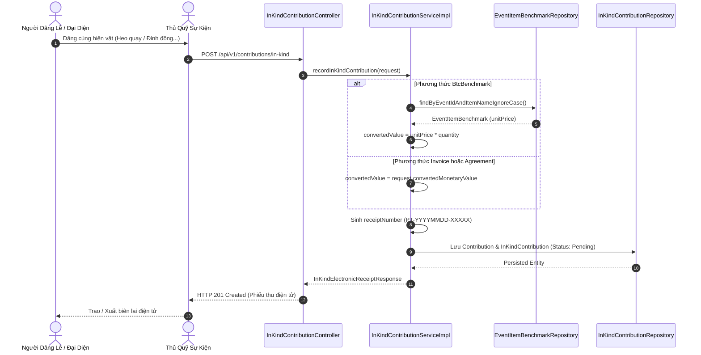
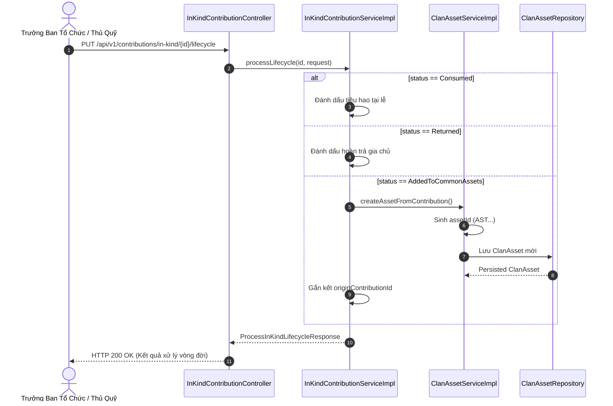

# Đặc Tả Kỹ Thuật & Hướng Dẫn Vận Hành US-10: Ghi Nhận Hiện Vật Cúng Tiến, Quy Đổi Giá Trị & Quản Lý Vòng Đời Tài Sản Dòng Họ

Tài liệu này đặc tả toàn diện thiết kế kiến trúc, mô hình dữ liệu, các giải pháp kỹ thuật, luồng nghiệp vụ chi tiết và quy trình kiểm thử cho tính năng **[US-10 / Backlog #46] Ghi nhận hiện vật cúng tiến, quy đổi giá trị và quản lý vòng đời tài sản dòng họ**, bao gồm các nhiệm vụ cốt lõi:
- **#72:** API tiếp nhận hiện vật cúng tiến (`HienVatCongDuc`: heo quay, mâm quả, đồ thờ...), tính giá trị tiền mặt quy đổi tương đương (`tinhGiaTriQuyDoi()`) theo định mức BTC (`BtcBenchmark`), hóa đơn thực tế (`Invoice`) hoặc thỏa thuận (`Agreement`).
- **#73:** API xử lý vòng đời hiện vật sau sự kiện (`phanLoaiVongDoiTaiSan`): đánh dấu tiêu hao (`Consumed`), hoàn trả (`Returned`) hoặc tự động kết chuyển vào danh mục tài sản chung của dòng họ (`AddedToCommonAssets` $\rightarrow$ `clan_assets`).
- **#74:** Cung cấp API phục vụ in/xuất phiếu thu điện tử (`InKindElectronicReceipt`) và quản lý kho hiện vật – tài sản dòng họ (`ClanAsset`).

> **Điểm vào API chính:**
> - `POST /api/v1/events/{eventId}/benchmarks`: Thiết lập định mức giá hiện vật sự kiện do BTC ban hành.
> - `GET /api/v1/events/{eventId}/benchmarks`: Lấy danh sách định mức hiện vật theo sự kiện.
> - `DELETE /api/v1/events/{eventId}/benchmarks/{benchmarkId}`: Xóa định mức hiện vật.
> - `POST /api/v1/contributions/in-kind`: Tiếp nhận hiện vật cúng tiến & cấp biên lai điện tử.
> - `GET /api/v1/contributions/in-kind/{id}`: Xem chi tiết hiện vật cúng tiến.
> - `GET /api/v1/contributions/in-kind/receipts/{receiptNumber}`: Tra cứu phiếu thu điện tử theo mã biên lai.
> - `GET /api/v1/contributions/in-kind/events/{eventId}`: Danh sách hiện vật cúng tiến theo sự kiện.
> - `PUT /api/v1/contributions/in-kind/{id}/lifecycle`: Phân loại vòng đời hiện vật sau sự kiện (Tiêu hao, Hoàn trả, Nhập kho tài sản chung).
> - `GET /api/v1/clan-assets`: Danh sách tài sản tích lũy chung của dòng họ (phân trang & tìm kiếm).
> - `GET /api/v1/clan-assets/{id}`: Chi tiết tài sản tích lũy của dòng họ.
>
> Hợp đồng API được cập nhật trong [`docker/swagger/openapi.yaml`](../../docker/swagger/openapi.yaml) (Swagger UI cổng `8082`).

---

## 1. Tổng Quan Nghiệp Vụ (User Story & Acceptance Criteria)

### Mô tả User Story
* **Mã User Story:** `US-10` (Backlog #46)
* **Đối tượng sử dụng (Actor):** Thủ quỹ sự kiện (`EventTreasurer`), Trưởng ban tổ chức (`HeadOfOrganizer`), Trưởng tộc (`ROLE_CLAN_HEAD`), Quản trị viên (`ROLE_ADMIN`).
* **Mục tiêu (Goal):** Tiếp nhận và định giá các hiện vật cúng tiến dâng lên tổ tiên (heo quay, mâm quả, lư hương, hoành phi câu đối...), tự động cấp phiếu thu điện tử có giá trị quy đổi tiền mặt để ghi nhận công đức minh bạch; sau sự kiện phân loại vòng đời hiện vật: đồ tiêu hao dùng cho tiệc cỗ, đồ mượn hoàn trả lại gia chủ, hoặc đồ thờ tự/tài sản bền vững được tự động kết chuyển lưu vào kho tài sản chung của dòng tộc.
* **Giá trị mang lại (Value):**
  - Minh bạch hóa đóng góp phi tiền mặt (in-kind contributions) trong các dịp lễ giỗ tổ, khánh thành từ đường.
  - Tự động hóa quy đổi giá trị theo 3 phương thức linh hoạt (Định mức BTC, Hóa đơn thực tế, Thỏa thuận gia tộc).
  - Quản lý vòng đời hiện vật khép kín, chống thất thoát hiện vật sau lễ, tự động tích lũy tài sản cho dòng họ.
* **Mức độ ưu tiên:** Bắt buộc (Must-Have).

### Tiêu chí chấp nhận (Acceptance Criteria - AC)

1. **AC-01 (Phân quyền & Kiểm tra ngữ cảnh sự kiện - Task #72):**
   - Quyền thiết lập định mức BTC (`POST/DELETE /benchmarks`): Yêu cầu quyền tĩnh (`ROLE_CLAN_HEAD`, `ROLE_ADMIN`) hoặc quyền ngữ cảnh sự kiện `HeadOfOrganizer` / `EventTreasurer`.
   - Quyền tiếp nhận hiện vật (`POST /contributions/in-kind`): Yêu cầu quyền `ROLE_CLAN_HEAD`, `ROLE_ADMIN` hoặc `EventTreasurer`, `HeadOfOrganizer` của sự kiện.
   - Quyền phân loại vòng đời (`PUT /contributions/in-kind/{id}/lifecycle`): Yêu cầu quyền `ROLE_CLAN_HEAD`, `ROLE_ADMIN` hoặc `HeadOfOrganizer`, `EventTreasurer`.
   - Sự kiện tiếp nhận phải thuộc dòng họ của người dùng (`TenantContext.getClanId()`) và không ở trạng thái `Closed`.

2. **AC-02 (Quy đổi giá trị tương đương `tinhGiaTriQuyDoi()` - Task #72):**
   - Đơn vị tính hiện vật `unit` là chuỗi tự do (`VARCHAR(20)`: `con`, `mâm`, `bộ`, `đôi`, `chiếc`...).
   - **Phương thức `BtcBenchmark`:** Hệ thống tự động tra cứu bảng `event_item_benchmarks` theo `eventId` và `itemName` (không phân biệt hoa thường). Giá trị quy đổi = `unit_price * quantity`. Báo lỗi nếu BTC chưa ban hành định mức cho vật phẩm này.
   - **Phương thức `Invoice`:** Thủ quỹ kiểm tra hóa đơn giấy trực tiếp ngoài đời, nhập trực tiếp số tiền `convertedMonetaryValue` vào hệ thống (không yêu cầu upload ảnh).
   - **Phương thức `Agreement`:** Nhập số tiền `convertedMonetaryValue` theo sự thống nhất giữa ban tổ chức và gia đình dâng lễ.
   - `convertedMonetaryValue` bắt buộc $> 0$.

3. **AC-03 (Cấp phiếu thu điện tử duy nhất - Task #72, #74):**
   - Tự động sinh `contribution_id` duy nhất (`CTB` + timestamp + random, $\le 20$ ký tự).
   - Tự động sinh mã phiếu thu `receipt_number` duy nhất định dạng `PT-YYYYMMDD-XXXXX` lưu vào `in_kind_contributions`.
   - Trạng thái vòng đời khởi tạo ban đầu luôn là `Pending`.
   - Biên lai điện tử phản ánh đầy đủ thông tin: Mã biên lai, Sự kiện, Người cúng tiến (Thành viên hoặc Khách ngoài họ), Hiện vật, Số lượng, Đơn vị tính, Phương thức quy đổi, Giá trị quy đổi tương đương, Thủ quỹ tiếp nhận, Thời gian tiếp nhận.

4. **AC-04 (Xử lý vòng đời sau sự kiện `phanLoaiVongDoiTaiSan` - Task #73):**
   - Chỉ hiện vật ở trạng thái `Pending` mới được phân loại vòng đời. Nếu đã xử lý trước đó $\rightarrow$ Báo lỗi `400 Bad Request`.
   - **Trường hợp `Consumed`:** Hiện vật tiêu hao phục vụ cỗ/tiệc của sự kiện (heo quay, xôi gấc, bánh kẹo). Trạng thái chuyển thành `Consumed`.
   - **Trường hợp `Returned`:** Hiện vật mượn hoàn trả gia chủ sau lễ (bàn ghế, đồ trang trí). Trạng thái chuyển thành `Returned`.
   - **Trường hợp `AddedToCommonAssets`:** Hiện vật lưu niệm, đồ thờ cúng (đỉnh đồng, lư hương, bát hương, bàn thờ, tượng tổ...).
     - Bắt buộc cung cấp `storageLocation` (Vị trí lưu kho / đặt tại nhà thờ tổ).
     - Hệ thống **tự động kết chuyển** tạo một bản ghi mới trong bảng `clan_assets` với `asset_id` duy nhất (`AST...`), `clan_id`, `asset_name`, `quantity`, `unit`, `assessed_value` (lấy từ giá trị quy đổi hoặc giá trị đánh giá lại), `storage_location`, và `origin_contribution_id` trỏ về khoản đóng góp gốc.
     - Trạng thái của hiện vật cập nhật thành `AddedToCommonAssets`.

5. **AC-05 (Tra cứu & Quản lý danh mục tài sản dòng họ - Task #73, #74):**
   - API `GET /api/v1/clan-assets` hỗ trợ tìm kiếm theo từ khóa (`keyword` trên `asset_name`) và phân trang (`page`, `size`).
   - Dữ liệu tài sản chỉ giới hạn trong phạm vi dòng họ hiện hành (`TenantContext.getClanId()`).

---

## 2. Thiết Kế Kiến Trúc & Ranh Giới Bounded Context

Tính năng thuộc Bounded Context: `com.familyfund.contribution`.

```
[Client / Flutter App / Admin Web]
               │  HTTP Requests (JSON)
               ▼
┌────────────────────────────────────────────────────────────────────────┐
│ 1. API BOUNDARY & CONTROLLER LAYER                                     │
│    • EventItemBenchmarkController (/api/v1/events/{eventId}/benchmarks)│
│    • InKindContributionController (/api/v1/contributions/in-kind)      │
│    • ClanAssetController (/api/v1/clan-assets)                         │
│    • Method Security: @PreAuthorize with Contextual RBAC               │
└────────────────────────────────────────────────────────────────────────┘
               │  Validated DTO + CurrentUser
               ▼
┌────────────────────────────────────────────────────────────────────────┐
│ 2. APPLICATION & DOMAIN SERVICE LAYER                                  │
│    • InKindContributionService / InKindContributionServiceImpl         │
│    • EventItemBenchmarkService / EventItemBenchmarkServiceImpl         │
│    • ClanAssetService / ClanAssetServiceImpl                           │
│    • ID Generators: BenchmarkIdGenerator (BM...), AssetIdGenerator     │
│      (AST...), ReceiptNumberGenerator (PT-...), ContributionIdGenerator│
│    • Cross-Module Query Services:                                      │
│        - EventQueryService (Kiểm tra trạng thái & dòng họ sự kiện)     │
│        - GenealogyQueryService (Xác thực thành viên dâng lễ)           │
│        - CurrentUserProvider (Lấy account_id thủ quỹ tiếp nhận)        │
└────────────────────────────────────────────────────────────────────────┘
               │  Entity State
               ▼
┌────────────────────────────────────────────────────────────────────────┐
│ 3. PERSISTENCE & DATA LAYER                                            │
│    • Repositories: InKindContributionRepository,                       │
│                    EventItemBenchmarkRepository,                       │
│                    ClanAssetRepository, ContributionRepository         │
│    • Entities: InKindContribution, EventItemBenchmark, ClanAsset,      │
│                Contribution                                            │
│    • PostgreSQL Tables: in_kind_contributions, event_item_benchmarks,  │
│                         clan_assets, contributions                     │
└────────────────────────────────────────────────────────────────────────┘
```

### Danh mục các file mã nguồn cốt lõi:
* **Controllers (internal):**
  - [`EventItemBenchmarkController.java`](file:///d:/family-management-backend/src/main/java/com/familyfund/contribution/internal/controller/EventItemBenchmarkController.java)
  - [`InKindContributionController.java`](file:///d:/family-management-backend/src/main/java/com/familyfund/contribution/internal/controller/InKindContributionController.java)
  - [`ClanAssetController.java`](file:///d:/family-management-backend/src/main/java/com/familyfund/contribution/internal/controller/ClanAssetController.java)
* **Services (public/internal):**
  - [`InKindContributionService.java`](file:///d:/family-management-backend/src/main/java/com/familyfund/contribution/internal/service/InKindContributionService.java) / [`InKindContributionServiceImpl.java`](file:///d:/family-management-backend/src/main/java/com/familyfund/contribution/internal/service/InKindContributionServiceImpl.java)
  - [`EventItemBenchmarkService.java`](file:///d:/family-management-backend/src/main/java/com/familyfund/contribution/internal/service/EventItemBenchmarkService.java) / [`EventItemBenchmarkServiceImpl.java`](file:///d:/family-management-backend/src/main/java/com/familyfund/contribution/internal/service/EventItemBenchmarkServiceImpl.java)
  - [`ClanAssetService.java`](file:///d:/family-management-backend/src/main/java/com/familyfund/contribution/internal/service/ClanAssetService.java) / [`ClanAssetServiceImpl.java`](file:///d:/family-management-backend/src/main/java/com/familyfund/contribution/internal/service/ClanAssetServiceImpl.java)
* **Repositories (internal):**
  - [`InKindContributionRepository.java`](file:///d:/family-management-backend/src/main/java/com/familyfund/contribution/internal/repository/InKindContributionRepository.java)
  - [`EventItemBenchmarkRepository.java`](file:///d:/family-management-backend/src/main/java/com/familyfund/contribution/internal/repository/EventItemBenchmarkRepository.java)
  - [`ClanAssetRepository.java`](file:///d:/family-management-backend/src/main/java/com/familyfund/contribution/internal/repository/ClanAssetRepository.java)
* **Entities & Enums:**
  - [`InKindContribution.java`](file:///d:/family-management-backend/src/main/java/com/familyfund/contribution/internal/entity/InKindContribution.java)
  - [`EventItemBenchmark.java`](file:///d:/family-management-backend/src/main/java/com/familyfund/contribution/internal/entity/EventItemBenchmark.java)
  - [`ClanAsset.java`](file:///d:/family-management-backend/src/main/java/com/familyfund/contribution/internal/entity/ClanAsset.java)
  - [`ConversionMethod.java`](file:///d:/family-management-backend/src/main/java/com/familyfund/contribution/api/dto/ConversionMethod.java) (`BtcBenchmark`, `Invoice`, `Agreement`)
  - [`InKindProcessingStatus.java`](file:///d:/family-management-backend/src/main/java/com/familyfund/contribution/api/dto/InKindProcessingStatus.java) (`Pending`, `Consumed`, `Returned`, `AddedToCommonAssets`)
* **ID Generators:**
  - [`BenchmarkIdGenerator.java`](file:///d:/family-management-backend/src/main/java/com/familyfund/contribution/internal/generator/BenchmarkIdGenerator.java)
  - [`AssetIdGenerator.java`](file:///d:/family-management-backend/src/main/java/com/familyfund/contribution/internal/generator/AssetIdGenerator.java)

---

## 3. Thiết Kế Cơ Sở Dữ Liệu (Database Schema)

### Schema DDL (Migrations V1, V3, V7, V8, V9)

```sql
-- 1. Bảng hiện vật cúng tiến chuyên biệt
CREATE TABLE in_kind_contributions (
    contribution_id VARCHAR(20) PRIMARY KEY REFERENCES contributions(contribution_id) ON DELETE CASCADE,
    item_name VARCHAR(100) NOT NULL,
    quantity DECIMAL(10,2) NOT NULL CHECK (quantity > 0),
    unit VARCHAR(20) NOT NULL,
    estimated_value DECIMAL(18,2) DEFAULT 0 CHECK (estimated_value >= 0),
    conversion_method VARCHAR(255) NOT NULL,
    converted_monetary_value DECIMAL(18,2) NOT NULL CHECK (converted_monetary_value >= 0),
    processing_status VARCHAR(30) NOT NULL DEFAULT 'Pending'
        CHECK (processing_status IN ('Pending', 'Consumed', 'Returned', 'AddedToCommonAssets')),
    receipt_number VARCHAR(30) UNIQUE
);

-- 2. Bảng định mức giá hiện vật do Ban tổ chức ban hành
CREATE TABLE event_item_benchmarks (
    benchmark_id VARCHAR(20) PRIMARY KEY,
    event_id VARCHAR(20) NOT NULL REFERENCES events(event_id) ON DELETE CASCADE,
    clan_id VARCHAR(20) NOT NULL REFERENCES clans(clan_id) ON DELETE RESTRICT,
    item_name VARCHAR(100) NOT NULL,
    unit VARCHAR(20) NOT NULL,
    unit_price DECIMAL(18,2) NOT NULL CHECK (unit_price >= 0),
    note VARCHAR(255),
    created_at TIMESTAMPTZ DEFAULT CURRENT_TIMESTAMP
);

CREATE INDEX idx_benchmarks_event ON event_item_benchmarks(event_id);
CREATE INDEX idx_benchmarks_clan ON event_item_benchmarks(clan_id);

-- 3. Bảng tài sản chung của dòng họ (kết chuyển từ hiện vật sau sự kiện)
CREATE TABLE clan_assets (
    asset_id VARCHAR(20) PRIMARY KEY,
    clan_id VARCHAR(20) NOT NULL REFERENCES clans(clan_id) ON DELETE RESTRICT,
    asset_name VARCHAR(100) NOT NULL,
    quantity INT NOT NULL CHECK (quantity > 0),
    unit VARCHAR(20) NOT NULL,
    assessed_value DECIMAL(18,2) DEFAULT 0 CHECK (assessed_value >= 0),
    storage_location VARCHAR(255),
    origin_contribution_id VARCHAR(20) REFERENCES in_kind_contributions(contribution_id) ON DELETE SET NULL,
    created_at TIMESTAMPTZ DEFAULT CURRENT_TIMESTAMP
);

CREATE INDEX idx_asset_clan ON clan_assets(clan_id);
CREATE INDEX idx_clan_assets_search ON clan_assets(clan_id, asset_name);
```

---

## 4. Luồng Nghiệp Vụ Chi Tiết (Detailed Business Flows)

### Sơ đồ 1: Luồng tiếp nhận hiện vật cúng tiến & Quy đổi giá trị



### Sơ đồ 2: Luồng xử lý vòng đời hiện vật sau sự kiện & Kết chuyển tài sản chung



---

## 5. Danh Sách API Endpoints & Mẫu cURL Kiểm Thử

### 1. Ban hành định mức giá hiện vật (`POST /api/v1/events/{eventId}/benchmarks`)
```bash
curl -X POST http://localhost:8080/api/v1/events/EVT20261029ABC/benchmarks \
  -H "Authorization: Bearer <ACCESS_TOKEN>" \
  -H "Content-Type: application/json" \
  -d '{
    "itemName": "Heo quay nguyên con",
    "unit": "Con",
    "unitPrice": 3500000,
    "note": "Heo sữa quay giòn bì 12-15kg"
  }'
```

### 2. Tiếp nhận hiện vật cúng tiến (`POST /api/v1/contributions/in-kind`)
```bash
curl -X POST http://localhost:8080/api/v1/contributions/in-kind \
  -H "Authorization: Bearer <ACCESS_TOKEN>" \
  -H "Content-Type: application/json" \
  -d '{
    "eventId": "EVT20261029ABC",
    "contributorMemberId": "MEM01J0001",
    "itemName": "Đôi đỉnh đồng khảm tam khí",
    "quantity": 1,
    "unit": "Đôi",
    "conversionMethod": "Agreement",
    "convertedMonetaryValue": 15000000,
    "note": "Cúng tiến đặt tại gian chính Nhà thờ tổ"
  }'
```

### 3. Tra cứu phiếu thu điện tử (`GET /api/v1/contributions/in-kind/receipts/{receiptNumber}`)
```bash
curl -X GET http://localhost:8080/api/v1/contributions/in-kind/receipts/PT-20261031-K9L8M7 \
  -H "Authorization: Bearer <ACCESS_TOKEN>"
```

### 4. Xử lý vòng đời kết chuyển vào tài sản chung (`PUT /api/v1/contributions/in-kind/{id}/lifecycle`)
```bash
curl -X PUT http://localhost:8080/api/v1/contributions/in-kind/CTB20261031ABC12345/lifecycle \
  -H "Authorization: Bearer <ACCESS_TOKEN>" \
  -H "Content-Type: application/json" \
  -d '{
    "status": "AddedToCommonAssets",
    "storageLocation": "Gian Tiền bái - Nhà thờ họ",
    "assessedValue": 15000000,
    "note": "Bàn giao chìa khóa cho ban khánh tiết"
  }'
```

### 5. Tra cứu danh mục tài sản dòng họ (`GET /api/v1/clan-assets`)
```bash
curl -X GET "http://localhost:8080/api/v1/clan-assets?keyword=đồng&page=0&size=20" \
  -H "Authorization: Bearer <ACCESS_TOKEN>"
```

---

## 6. Hướng Dẫn Kiểm Thử Tự Động (Automated Testing)

Chạy bộ kiểm thử tự động cho module Đóng góp & Tài sản:

```bash
# 1. Chạy tất cả unit tests của module contribution
.\gradlew.bat test --tests "com.familyfund.contribution.*"

# 2. Chạy kiểm thử kiến trúc Spring Modulith
.\gradlew.bat test --tests "com.familyfund.ArchitectureTest"

# 3. Chạy toàn bộ test suite dự án
.\gradlew.bat test
```
