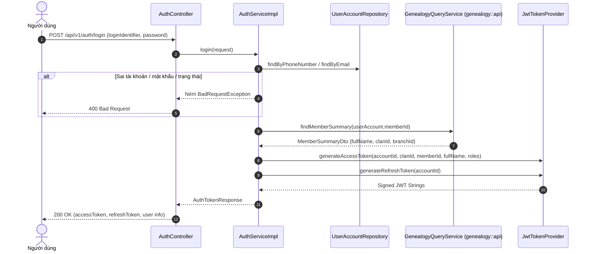
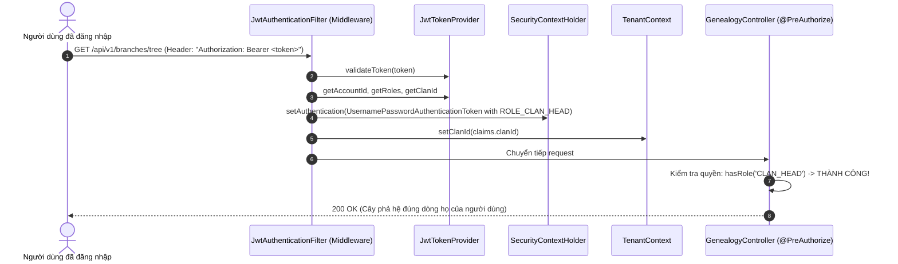

# Đặc Tả Kỹ Thuật & Hướng Dẫn Vận Hành [US-10]: Cấu Hình JWT Token & Middleware Tự Động Gán Quyền ROLE_CLAN_HEAD

Tài liệu này đặc tả toàn diện thiết kế kiến trúc, cấu hình JJWT (Java JWT), các giải pháp kỹ thuật, luồng nghiệp vụ chi tiết và quy trình kiểm thử End-to-End (E2E) cho tính năng **[US-10] Xác thực người dùng bằng JWT Token, Đính kèm Claims quyền hạn & Middleware tự động nạp vai trò ROLE_CLAN_HEAD**.

---

## 1. Tổng Quan Nghiệp Vụ (User Story & Acceptance Criteria)

### Mô tả User Story
* **Mã User Story:** `US-10` (Bao hàm Task #9 và Task #10)
* **Đối tượng sử dụng (Actor):** Toàn bộ người dùng hệ thống (Trưởng tộc `ROLE_CLAN_HEAD`, Trưởng chi `ROLE_BRANCH_HEAD`, Thành viên `ROLE_MEMBER`, Quản trị viên `ROLE_ADMIN`).
* **Mục tiêu (Goal):**
  - Cung cấp API đăng nhập và cấp phát token định danh chuẩn quốc tế JWT.
  - Tự động đính kèm thông tin phân quyền và ngữ cảnh dòng họ (`clanId`) vào Payload Claims.
  - Xây dựng tầng Middleware `JwtAuthenticationFilter` tự động trích xuất Claims, nạp danh sách quyền (Authorities) và đồng bộ ngữ cảnh Multi-tenancy vào `TenantContext` trong suốt cho mọi request.
* **Giá trị mang lại (Value):**
  - Người tạo cây phả hệ (Trưởng tộc) sau khi đăng nhập sẽ tự động có quyền `ROLE_CLAN_HEAD` trên toàn bộ các endpoint quản trị phả hệ mà không cần kiểm tra quyền thủ công ở từng service.
  - Triệt tiêu hoàn toàn sự phụ thuộc vào việc client phải tự truyền thủ công header `X-Clan-Id` hay query param `clanId`.

### Tiêu chí chấp nhận (Acceptance Criteria - AC)
1. **AC-01 (Linh hoạt định danh đăng nhập):** Hỗ trợ đăng nhập bằng Số điện thoại (`phoneNumber`) hoặc `email` kèm mật khẩu. Trả về `400 Bad Request` nếu thông tin sai hoặc tài khoản không ở trạng thái `Active`.
2. **AC-02 (Thời hạn Token):**
   - **Access Token:** Có hiệu lực trong **1 giờ** (3600 giây).
   - **Refresh Token:** Có hiệu lực trong **7 ngày** (604800 giây).
3. **AC-03 (Đính kèm đầy đủ Claims):** Access Token bắt buộc chứa:
   - `sub`: `accountId` (Mã tài khoản người dùng).
   - `clanId`: Mã dòng họ trực thuộc.
   - `memberId`: Mã hồ sơ thành viên trong gia phả.
   - `fullName`: Họ tên đầy đủ của người dùng.
   - `roles`: Danh sách vai trò hệ thống (VD: `["ROLE_CLAN_HEAD"]`).
4. **AC-04 (Middleware tự động nạp quyền & Tenancy - Task #9):**
   - Tầng `JwtAuthenticationFilter` chặn trước mọi request.
   - Tự động nạp `UsernamePasswordAuthenticationToken` với các quyền `ROLE_CLAN_HEAD` vào `SecurityContextHolder`.
   - Tự động nạp `clanId` vào `TenantContext` nếu request chưa chỉ định tenant cụ thể.
5. **AC-05 (Làm mới Token):** Cung cấp API `POST /api/v1/auth/refresh-token` cho phép cấp mới Access Token mà không bắt người dùng phải nhập lại mật khẩu.
6. **AC-06 (Bảo vệ API chuẩn 401 Unauthorized):** Mọi request đến các tài nguyên cần xác thực mà không có Bearer Token hợp lệ đều nhận về `HTTP 401 Unauthorized` theo định dạng envelope JSON chuẩn (`ApiResponse.error(...)`).

---

## 2. Thiết Kế Kiến Trúc & Ranh Giới Module (Spring Modulith)

```
[Flutter Mobile / Web App]
            │  POST /api/v1/auth/login (Phone/Email + Password)
            ▼
┌────────────────────────────────────────────────────────────────────────┐
│ 1. BOUNDED CONTEXT: identity (Service & Controller)                    │
│    • AuthController: /api/v1/auth/login                                │
│    • AuthServiceImpl: Xác thực UserAccount, truy vấn MemberSummaryDto │
│    • Gọi JwtTokenProvider.generateAccessToken(...)                     │
│    • Trả về AuthTokenResponse (accessToken, refreshToken, claims)      │
└────────────────────────────────────────────────────────────────────────┘

            │  Các Request tiếp theo: Header "Authorization: Bearer <token>"
            ▼
┌────────────────────────────────────────────────────────────────────────┐
│ 2. SHARED KERNEL: core (Middleware Filter Layer)                       │
│    • JwtAuthenticationFilter (OncePerRequestFilter)                    │
│    • Giải mã JWT, trích xuất roles -> Nạp SecurityContextHolder        │
│    • Trích xuất clanId -> Nạp TenantContext                            │
└────────────────────────────────────────────────────────────────────────┘
            │  Authenticated SecurityContext (ROLE_CLAN_HEAD)
            ▼
┌────────────────────────────────────────────────────────────────────────┐
│ 3. BUSINESS CONTROLLERS (genealogy, event, finance...)                 │
│    • @PreAuthorize("hasRole('CLAN_HEAD')") -> HỢP LỆ!                 │
│    • Tự động lấy clanId từ TenantContext.getClanId()                   │
└────────────────────────────────────────────────────────────────────────┘
```

---

## 3. Sơ Đồ Tuần Tự (Sequence Diagram)

### Luồng Đăng Nhập & Cấp Token


### Luồng Middleware Tự Động Gán Quyền (Task #9)


---

## 4. Từ Điển Dữ Liệu (Data Dictionary)

### Cấu Trúc Claims Trong JWT Payload
| Claim Key | Kiểu Dữ Liệu | Ví Dụ | Ý Nghĩa Nghiệp Vụ |
| :--- | :--- | :--- | :--- |
| `sub` | `String` | `"ACC_9A8B7C6D"` | Mã định danh tài khoản người dùng (`accountId`) |
| `clanId` | `String` | `"CLAN_F1E2D3C4"`| Mã định danh dòng họ (Tenant) |
| `memberId`| `String` | `"MEM_4B3A2C1D"` | Mã hồ sơ thành viên trong cây phả hệ |
| `fullName`| `String` | `"Nguyễn Văn An"`| Họ và tên người dùng |
| `roles` | `Array` | `["ROLE_CLAN_HEAD"]` | Tập hợp các vai trò tĩnh toàn cục |
| `iat` | `Integer` | `1710000000` | Thời điểm phát hành token (Epoch time) |
| `exp` | `Integer` | `1710003600` | Thời điểm hết hạn (1 giờ sau iat) |

---

## 5. Kết Quả Kiểm Thử Tự Động (Automated Test Verification)

Toàn bộ **14 unit và integration tests** liên quan đến phân hệ JWT và Middleware đều vượt qua thành công:
1. **`JwtTokenProviderTest`** (3 tests):
   - Sinh token hợp lệ với đầy đủ custom claims.
   - Sinh refresh token với subject `accountId`.
   - Bắt và từ chối các token rỗng, sai format, hoặc bị sửa đổi payload/signature.
2. **`JwtAuthenticationFilterTest`** (3 tests):
   - Request không có Authorization: đi tiếp mà không set authentication.
   - Request có Bearer Token hợp lệ: nạp `ROLE_CLAN_HEAD` vào `SecurityContext` và đồng bộ `TenantContext.setClanId`.
   - Request có token không hợp lệ: bị bỏ qua.
3. **`AuthServiceImplTest`** (6 tests):
   - Đăng nhập thành công bằng SĐT trả về token và `ROLE_CLAN_HEAD`.
   - Đăng nhập sai mật khẩu ném `BadRequestException`.
   - Đăng nhập tài khoản không tồn tại ném `BadRequestException`.
   - Đăng nhập tài khoản bị khóa (`Suspended`) ném `BadRequestException`.
   - Làm mới access token thành công.
   - Làm mới với token hết hạn / không hợp lệ ném `BadRequestException`.
4. **`AuthControllerTest`** (5 tests):
   - `POST /api/v1/auth/login` hợp lệ trả về `200 OK`.
   - `POST /api/v1/auth/login` thiếu trường trả về `400 Bad Request`.
   - `POST /api/v1/auth/refresh-token` trả về `200 OK`.
5. **`ArchitectureTest`** (3 tests):
   - Xác nhận 100% tuân thủ kiến trúc Spring Modulith.

---

## 6. Hướng Dẫn Kiểm Thử E2E Qua cURL

### 1. Đăng nhập lấy Token
```bash
curl -X POST http://localhost:8080/api/v1/auth/login \
  -H "Content-Type: application/json" \
  -d '{
    "loginIdentifier": "0987654321",
    "password": "SecurePassword123"
  }'
```

**Kỳ vọng Response (HTTP 200 OK):**
```json
{
  "success": true,
  "message": "Đăng nhập thành công",
  "data": {
    "accessToken": "eyJhbGciOiJIUzI1NiIsInR5cCI6IkpXVCJ9...",
    "refreshToken": "eyJhbGciOiJIUzI1NiIsInR5cCI6IkpXVCJ9...",
    "tokenType": "Bearer",
    "expiresIn": 3600,
    "accountId": "ACC_9A8B7C6D",
    "phoneNumber": "0987654321",
    "email": "nguyenvanan@example.com",
    "fullName": "Nguyễn Văn An",
    "clanId": "CLAN_F1E2D3C4",
    "memberId": "MEM_4B3A2C1D",
    "roles": ["ROLE_CLAN_HEAD"]
  }
}
```

### 2. Gọi API Quản trị Cây gia phả (Tự động nạp quyền ROLE_CLAN_HEAD & TenantContext)
```bash
curl -X GET http://localhost:8080/api/v1/branches/tree \
  -H "Authorization: Bearer <accessToken_ở_bước_1>"
```

**Kỳ vọng Response:**
- HTTP Status `200 OK`.
- Tự động trả về cây phả hệ thuộc dòng họ `CLAN_F1E2D3C4` của người dùng mà **không cần truyền thêm header `X-Clan-Id`**.

### 3. Làm mới Token bằng Refresh Token
```bash
curl -X POST http://localhost:8080/api/v1/auth/refresh-token \
  -H "Content-Type: application/json" \
  -d '{
    "refreshToken": "<refreshToken_ở_bước_1>"
  }'
```
