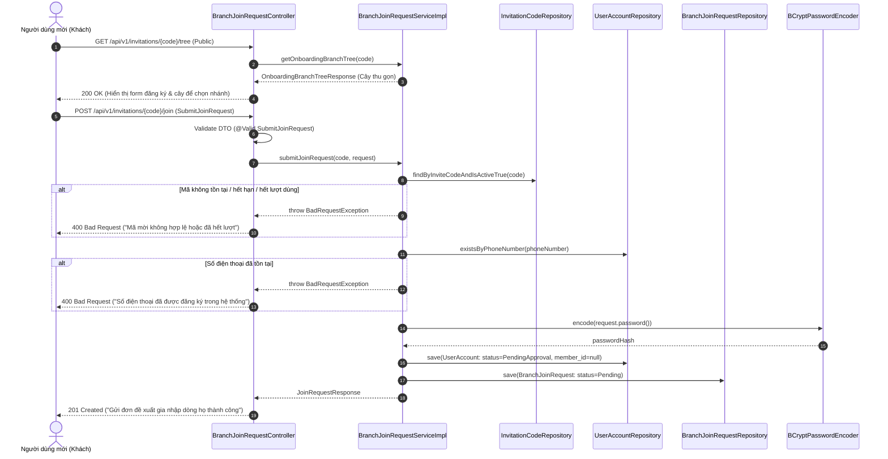
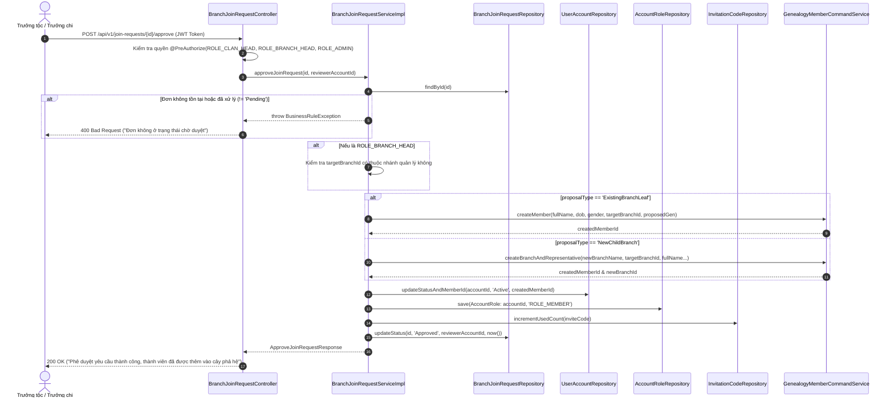

# Đặc Tả Kỹ Thuật & Hướng Dẫn Vận Hành US-17: Đăng Ký Tự Do Qua Mã Mời Chung (Luồng Onboarding Từ Bên Ngoài)

Tài liệu này đặc tả toàn diện thiết kế kiến trúc, mô hình dữ liệu, các giải pháp kỹ thuật, luồng nghiệp vụ chi tiết và quy trình kiểm thử End-to-End (E2E) cho tính năng **[US-17] Đăng ký tự do qua Mã mời chung (Luồng Onboarding từ bên ngoài)**.

---

## 1. Tổng Quan Nghiệp Vụ (User Story & Acceptance Criteria)

### Mô tả User Story
* **Mã User Story:** `US-17`
* **Đối tượng sử dụng (Actor):**
  * **Người dùng mới (Guest / Onboarding Member):** Con cháu họ hàng chưa có tài khoản hệ thống, nhận được mã mời chung (từ US-16).
  * **Trưởng tộc (`ROLE_CLAN_HEAD`):** Quản trị viên tối cao của dòng họ, có thẩm quyền phê duyệt mọi đề xuất gia nhập.
  * **Trưởng chi / nhánh (`ROLE_BRANCH_HEAD`):** Người đại diện chi nhánh, có thẩm quyền phê duyệt thành viên xin gia nhập vào nhánh của mình hoặc các nhánh con trực thuộc.
  * **Quản trị viên (`ROLE_ADMIN`):** Quản trị kỹ thuật hệ thống.
* **Mục tiêu (Goal):** Người dùng mới nhập mã mời chung, xem thông tin dòng họ và cây phân cấp thu gọn để chọn vị trí nhánh muốn gia nhập (hoặc đề xuất tạo nhánh con mới), điền thông tin cá nhân và tài khoản để gửi yêu cầu lên Ban quản trị dòng họ.
* **Giá trị mang lại (Value):** Tự động hóa hoàn toàn quy trình onboarding con cháu từ bên ngoài, số hóa việc tiếp nhận thành viên vào cây gia phả một cách minh bạch, an toàn, có phê chuẩn của cấp quản lý, đồng thời tự động kích hoạt tài khoản hệ thống khi được chấp thuận.
* **Mức độ ưu tiên:** Bắt buộc (Must-Have).

### Tiêu chí chấp nhận (Acceptance Criteria - AC)
1. **AC-01 (Xác thực mã mời & Công khai cây thu gọn):**
   * Cho phép khách vãng lai (Public access không cần JWT) xác thực tính hợp lệ của mã mời: mã đang hoạt động (`is_active = TRUE`), còn thời hạn (`expires_at > NOW()`) và chưa vượt quá số lượt dùng tối đa (`used_count < max_uses`).
   * Cung cấp dữ liệu cây phả hệ thu gọn (`Onboarding Branch Tree`) theo mã mời để người dùng trực quan bấm chọn vị trí nhánh. Cây thu gọn chỉ bao gồm thông tin chi nhánh và danh xưng đại diện, tuyệt đối bảo mật thông tin cá nhân riêng tư của các thành viên khác.
2. **AC-02 (Tạo tài khoản tạm khóa & Đơn yêu cầu gia nhập):**
   * Khi người dùng nộp đơn thành công, hệ thống khởi tạo tài khoản `user_accounts` với trạng thái `PendingApproval` (mật khẩu được mã hóa an toàn bằng BCrypt) và bản ghi `branch_join_requests` với trạng thái `Pending`.
   * Tài khoản ở trạng thái `PendingApproval` không được phép đăng nhập vào các phân hệ chính thức của ứng dụng cho đến khi được phê duyệt.
   * Chặn đăng ký trùng số điện thoại (`phone_number UNIQUE`).
3. **AC-03 (Phân định loại đề xuất vị trí - Proposal Type):**
   * `ExistingBranchLeaf`: Người dùng xin gia nhập làm thành viên của một chi nhánh đã có sẵn (`target_branch_id`) với đời thứ chỉ định (`proposed_generation`).
   * `NewChildBranch`: Người dùng đề xuất tách/thành lập một chi nhánh con mới trực thuộc `target_branch_id` với tên chi nhánh mới (`proposed_new_branch_name`).
4. **AC-04 (Phân quyền phê duyệt đa cấp - Scoped Authorization):**
   * `ROLE_CLAN_HEAD` và `ROLE_ADMIN` có quyền xem và phê duyệt/từ chối mọi yêu cầu trong toàn bộ dòng họ (`clan_id`).
   * `ROLE_BRANCH_HEAD` chỉ được xem và phê duyệt/từ chối các yêu cầu có `target_branch_id` thuộc chi nhánh mình làm đại diện hoặc các chi nhánh con cháu trực thuộc.
5. **AC-05 (Giao dịch phê chuẩn đồng nhất - Atomic Approval Transaction):**
   * Khi Trưởng tộc / Trưởng chi bấm phê duyệt (`Approved`), toàn bộ các thao tác sau phải thành công trọn vẹn trong một Database Transaction:
     1. Gọi sang module `genealogy` để tạo bản ghi `members` mới (hoặc tạo `family_branches` mới nếu là `NewChildBranch` rồi tạo `members` đại diện).
     2. Gắn kết 1-1 giữa hồ sơ phả hệ và tài khoản: `user_accounts.member_id = member.member_id`.
     3. Kích hoạt tài khoản: `user_accounts.account_status = 'Active'`.
     4. Cấp vai trò mặc định `ROLE_MEMBER` trong bảng `account_roles`.
     5. Tăng số lượt sử dụng của mã mời: `invitation_codes.used_count += 1`.
     6. Cập nhật `branch_join_requests.approval_status = 'Approved'`, lưu `reviewed_by_account_id` và `reviewed_at`.
6. **AC-06 (Từ chối an toàn & Vô hiệu hóa tài khoản tạm - Safe Rejection):**
   * Khi từ chối (`Rejected`), bắt buộc phải cung cấp lý do từ chối (`rejection_reason`).
   * Cập nhật `branch_join_requests.approval_status = 'Rejected'`.
   * Chuyển trạng thái `user_accounts.account_status = 'Deactivated'` để bảo toàn tính toàn vẹn dữ liệu kiểm toán và ngăn ngừa spam.
7. **AC-07 (Bảo toàn trạng thái - State Immutability):** Đơn đã ở trạng thái `Approved` hoặc `Rejected` thì không được phép thay đổi trạng thái lần thứ hai.

---

## 2. Thiết Kế Kiến Trúc & Ranh Giới Bounded Context (Architecture Design)

Hệ thống tuân thủ nghiêm ngặt mô hình **Modular Monolith** sử dụng **Spring Modulith 2.1.1**. Tính năng US-17 là cầu nối giao tiếp cốt lõi giữa hai Bounded Contexts:
* **`com.familyfund.identity` (Module sở hữu US-17):** Quản lý mã mời (`InvitationCode`), đơn gia nhập (`BranchJoinRequest`), tài khoản người dùng (`UserAccount`), phân quyền vai trò (`AccountRole`).
* **`com.familyfund.genealogy` (Module hỗ trợ):** Quản lý chi nhánh (`FamilyBranch`), thành viên phả hệ (`Member`), cung cấp Public Service Contract cho `identity` gọi sang.

```
┌─────────────────────────────────────────────────────────────────────────────────────────────┐
│ BOUNDED CONTEXT: identity                                                                   │
│                                                                                             │
│  [Guest / Onboarding User]                      [Clan Head / Branch Head]                   │
│             │                                               │                               │
│             ▼                                               ▼                               │
│  BranchJoinRequestController (Public API)       BranchJoinRequestController (Secured API)   │
│  • GET  /api/v1/invitations/{code}/tree         • GET  /api/v1/join-requests                │
│  • POST /api/v1/invitations/{code}/join         • POST /api/v1/join-requests/{id}/approve   │
│             │                                   • POST /api/v1/join-requests/{id}/reject    │
│             ▼                                               │                               │
│  BranchJoinRequestServiceImpl ──────────────────────────────┘                               │
│  • Validate InviteCode & Phone uniqueness                                                   │
│  • Create UserAccount (PendingApproval)                                                     │
│  • Create BranchJoinRequest (Pending)                                                       │
│             │                                                                               │
│             │ [Khi Approve đơn: Giao tiếp qua Public Contract Interface]                    │
│             ▼                                                                               │
│  GenealogyMemberCommandService (Interface in genealogy.api)                                │
└─────────────┼───────────────────────────────────────────────────────────────────────────────┘
              │ Calls via Spring Modulith Contract (Strictly Decoupled)
              ▼
┌─────────────────────────────────────────────────────────────────────────────────────────────┐
│ BOUNDED CONTEXT: genealogy                                                                  │
│                                                                                             │
│  GenealogyMemberCommandServiceImpl (internal)                                              │
│  • createMember(CreateMemberCommand)                                                        │
│  • createBranchAndRepresentative(CreateBranchCommand)                                       │
│  • Repositories: FamilyBranchRepository, MemberRepository                                   │
│  • Persistence: members table, family_branches table                                        │
└─────────────────────────────────────────────────────────────────────────────────────────────┘
```

### Danh mục các file mã nguồn cốt lõi:

#### 1. Module `identity`:
* **Controller:**
  * [`BranchJoinRequestController.java`](file:///d:/WorkSpace/Family-Management/family-management-backend/src/main/java/com/familyfund/identity/internal/controller/BranchJoinRequestController.java)
  * Mở rộng [`InvitationController.java`](file:///d:/WorkSpace/Family-Management/family-management-backend/src/main/java/com/familyfund/identity/internal/controller/InvitationController.java)
* **Service:**
  * Public Contract: [`BranchJoinRequestService.java`](file:///d:/WorkSpace/Family-Management/family-management-backend/src/main/java/com/familyfund/identity/api/BranchJoinRequestService.java)
  * Service Implementation: [`BranchJoinRequestServiceImpl.java`](file:///d:/WorkSpace/Family-Management/family-management-backend/src/main/java/com/familyfund/identity/internal/service/BranchJoinRequestServiceImpl.java)
* **Entities & Enums:**
  * [`BranchJoinRequest.java`](file:///d:/WorkSpace/Family-Management/family-management-backend/src/main/java/com/familyfund/identity/internal/entity/BranchJoinRequest.java)
  * [`UserAccount.java`](file:///d:/WorkSpace/Family-Management/family-management-backend/src/main/java/com/familyfund/identity/internal/entity/UserAccount.java)
  * [`AccountRole.java`](file:///d:/WorkSpace/Family-Management/family-management-backend/src/main/java/com/familyfund/identity/internal/entity/AccountRole.java)
  * [`AccountRoleId.java`](file:///d:/WorkSpace/Family-Management/family-management-backend/src/main/java/com/familyfund/identity/internal/entity/AccountRoleId.java)
  * [`JoinRequestApprovalStatus.java`](file:///d:/WorkSpace/Family-Management/family-management-backend/src/main/java/com/familyfund/identity/internal/entity/JoinRequestApprovalStatus.java)
  * [`ProposalType.java`](file:///d:/WorkSpace/Family-Management/family-management-backend/src/main/java/com/familyfund/identity/internal/entity/ProposalType.java)
  * [`AccountStatus.java`](file:///d:/WorkSpace/Family-Management/family-management-backend/src/main/java/com/familyfund/identity/internal/entity/AccountStatus.java)
* **Repositories:**
  * [`BranchJoinRequestRepository.java`](file:///d:/WorkSpace/Family-Management/family-management-backend/src/main/java/com/familyfund/identity/internal/repository/BranchJoinRequestRepository.java)
  * [`UserAccountRepository.java`](file:///d:/WorkSpace/Family-Management/family-management-backend/src/main/java/com/familyfund/identity/internal/repository/UserAccountRepository.java)
  * [`AccountRoleRepository.java`](file:///d:/WorkSpace/Family-Management/family-management-backend/src/main/java/com/familyfund/identity/internal/repository/AccountRoleRepository.java)
* **DTOs:**
  * [`SubmitJoinRequest.java`](file:///d:/WorkSpace/Family-Management/family-management-backend/src/main/java/com/familyfund/identity/api/dto/SubmitJoinRequest.java)
  * [`JoinRequestResponse.java`](file:///d:/WorkSpace/Family-Management/family-management-backend/src/main/java/com/familyfund/identity/api/dto/JoinRequestResponse.java)
  * [`RejectJoinRequest.java`](file:///d:/WorkSpace/Family-Management/family-management-backend/src/main/java/com/familyfund/identity/api/dto/RejectJoinRequest.java)
  * [`OnboardingBranchTreeResponse.java`](file:///d:/WorkSpace/Family-Management/family-management-backend/src/main/java/com/familyfund/identity/api/dto/OnboardingBranchTreeResponse.java)

#### 2. Module `genealogy` (Public Contracts & Commands):
* **Public Service Contract:**
  * [`GenealogyMemberCommandService.java`](file:///d:/WorkSpace/Family-Management/family-management-backend/src/main/java/com/familyfund/genealogy/api/GenealogyMemberCommandService.java)
  * [`CreateOnboardingMemberCommand.java`](file:///d:/WorkSpace/Family-Management/family-management-backend/src/main/java/com/familyfund/genealogy/api/dto/CreateOnboardingMemberCommand.java)
  * [`CreateOnboardingBranchCommand.java`](file:///d:/WorkSpace/Family-Management/family-management-backend/src/main/java/com/familyfund/genealogy/api/dto/CreateOnboardingBranchCommand.java)
* **Service Implementation:**
  * [`GenealogyMemberCommandServiceImpl.java`](file:///d:/WorkSpace/Family-Management/family-management-backend/src/main/java/com/familyfund/genealogy/internal/service/GenealogyMemberCommandServiceImpl.java)

---

## 3. Thiết Kế Cơ Sở Dữ Liệu (Database Schema)

### 3.1. Flyway Migration Mới: `V6__add_clan_id_to_branch_join_requests.sql`
Để đảm bảo tính nhất quán của kiến trúc Multi-Tenancy (V3/V5), bảng `branch_join_requests` được bổ sung cột `clan_id`:

```sql
-- V6__add_clan_id_to_branch_join_requests.sql
ALTER TABLE branch_join_requests
    ADD COLUMN IF NOT EXISTS clan_id VARCHAR(20) REFERENCES clans(clan_id) ON DELETE RESTRICT;

-- Cập nhật clan_id từ invitation_codes tương ứng
UPDATE branch_join_requests bjr
SET clan_id = ic.clan_id
FROM invitation_codes ic
WHERE bjr.invite_code = ic.invite_code AND bjr.clan_id IS NULL;

-- Gán mặc định CLAN_DEFAULT nếu còn sót
UPDATE branch_join_requests SET clan_id = 'CLAN_DEFAULT' WHERE clan_id IS NULL;

-- Áp đặt ràng buộc NOT NULL và đánh Index
ALTER TABLE branch_join_requests ALTER COLUMN clan_id SET NOT NULL;
CREATE INDEX IF NOT EXISTS idx_join_request_clan_status ON branch_join_requests(clan_id, approval_status);
```

### 3.2. Cấu Trúc Bảng `branch_join_requests`
```sql
CREATE TABLE IF NOT EXISTS branch_join_requests (
    request_id VARCHAR(20) PRIMARY KEY,
    clan_id VARCHAR(20) NOT NULL REFERENCES clans(clan_id) ON DELETE RESTRICT,
    account_id VARCHAR(20) UNIQUE NOT NULL REFERENCES user_accounts(account_id) ON DELETE CASCADE,
    invite_code VARCHAR(30) NOT NULL REFERENCES invitation_codes(invite_code) ON DELETE RESTRICT,
    full_name VARCHAR(100) NOT NULL,
    date_of_birth DATE,
    gender VARCHAR(10) NOT NULL CHECK (gender IN ('Male', 'Female', 'Other')),
    proposal_type VARCHAR(30) NOT NULL
        CHECK (proposal_type IN ('ExistingBranchLeaf', 'NewChildBranch')),
    target_branch_id VARCHAR(20) NOT NULL REFERENCES family_branches(branch_id) ON DELETE RESTRICT,
    proposed_new_branch_name VARCHAR(100),
    proposed_generation INT NOT NULL CHECK (proposed_generation >= 1),
    relationship_note VARCHAR(255),
    approval_status VARCHAR(20) NOT NULL DEFAULT 'Pending'
        CHECK (approval_status IN ('Pending', 'Approved', 'Rejected')),
    reviewed_by_account_id VARCHAR(20) REFERENCES user_accounts(account_id) ON DELETE SET NULL,
    rejection_reason TEXT,
    created_at TIMESTAMPTZ DEFAULT CURRENT_TIMESTAMP,
    reviewed_at TIMESTAMPTZ
);
```

### 3.3. Cấu Trúc Bảng `user_accounts` & `account_roles`
```sql
CREATE TABLE IF NOT EXISTS user_accounts (
    account_id VARCHAR(20) PRIMARY KEY,
    member_id VARCHAR(20) UNIQUE REFERENCES members(member_id) ON DELETE SET NULL,
    phone_number VARCHAR(15) UNIQUE NOT NULL,
    email VARCHAR(100) UNIQUE,
    password_hash VARCHAR(255) NOT NULL,
    account_status VARCHAR(25) NOT NULL DEFAULT 'Active'
        CHECK (account_status IN ('PendingApproval', 'Active', 'Suspended', 'Deactivated')),
    created_at TIMESTAMPTZ DEFAULT CURRENT_TIMESTAMP
);

CREATE TABLE IF NOT EXISTS account_roles (
    account_id VARCHAR(20) NOT NULL REFERENCES user_accounts(account_id) ON DELETE CASCADE,
    role_id VARCHAR(20) NOT NULL REFERENCES system_roles(role_id) ON DELETE CASCADE,
    PRIMARY KEY (account_id, role_id)
);
```

---

## 4. Luồng Nghiệp Vụ Chi Tiết (Detailed Business Flows)

### 4.1. Luồng Người Dưới Nộp Đơn Xin Gia Nhập (`POST /api/v1/invitations/{code}/join`)



---

### 4.2. Luồng Phê Duyệt Đề Xuất Gia Nhập (`POST /api/v1/join-requests/{requestId}/approve`)



---

## 5. Kế Hoạch Triển Khai Chi Tiết (Implementation Roadmap)

Quá trình phát triển US-17 được chia thành 7 tasks độc lập, tuân thủ nguyên tắc Modular Monolith và TDD:

```
┌────────────────────────────────────────────────────────────────────────┐
│ TASK 0: Data Persistence Foundation & Multi-Tenancy Migration V6      │
│ • V6__add_clan_id_to_branch_join_requests.sql                          │
│ • UserAccount, BranchJoinRequest, AccountRole Entities & Repositories  │
│ • PasswordEncoder Bean Configuration                                   │
└────────────────────────────────────┬───────────────────────────────────┘
                                     │
                                     ▼
┌────────────────────────────────────────────────────────────────────────┐
│ TASK 1: Invitation Verification & Public Landing API                   │
│ • Mở rộng GET /api/v1/invitations/{inviteCode}                         │
│ • Kiểm tra used_count < max_uses và trả về clanName                    │
└────────────────────────────────────┬───────────────────────────────────┘
                                     │
                                     ▼
┌────────────────────────────────────────────────────────────────────────┐
│ TASK 4: Public Onboarding Tree API (Data for Tree Screen)              │
│ • GET /api/v1/invitations/{inviteCode}/tree                           │
│ • Trả về cây chi nhánh thu gọn không lộ thông tin nhạy cảm             │
└────────────────────────────────────┬───────────────────────────────────┘
                                     │
                                     ▼
┌────────────────────────────────────────────────────────────────────────┐
│ TASK 2: Self-Service Join Submission API                               │
│ • POST /api/v1/invitations/{inviteCode}/join                           │
│ • Validate Phone, Mã hóa Password, lưu UserAccount(PendingApproval)    │
│ • Lưu BranchJoinRequest(Pending)                                       │
└────────────────────────────────────┬───────────────────────────────────┘
                                     │
                                     ▼
┌────────────────────────────────────────────────────────────────────────┐
│ TASK 5: Join Request Listing API for Approvers                         │
│ • GET /api/v1/join-requests?status=Pending                             │
│ • Phân trang Pageable, filter clan_id & scope chi nhánh                │
└────────────────────────────────────┬───────────────────────────────────┘
                                     │
                                     ▼
┌────────────────────────────────────────────────────────────────────────┐
│ TASK 3: Approval & Rejection Command Processing                        │
│ • GenealogyMemberCommandService (Public contract in genealogy.api)     │
│ • POST /api/v1/join-requests/{id}/approve (Atomic Transaction)         │
│ • POST /api/v1/join-requests/{id}/reject (with rejection reason)       │
└────────────────────────────────────┬───────────────────────────────────┘
                                     │
                                     ▼
┌────────────────────────────────────────────────────────────────────────┐
│ TASK 6: Automated Architecture & QA End-to-End Integration Test Suite  │
│ • Spring Modulith Architecture Verification Test                       │
│ • Complete E2E Integration Test: Code -> Join -> Approve -> On Tree    │
└────────────────────────────────────────────────────────────────────────┘
```

---

## 6. Hướng Dẫn Kiểm Thử (Testing & End-to-End Guide)

### 6.1. Kiểm thử Tự Động (Automated Tests)
Chạy bộ kiểm thử tự động của tính năng bằng Gradle:
```powershell
.\gradlew.bat test --tests "com.familyfund.identity.*"
```

| Tên Test Class | Số Test Cases | Mục Tiêu Kiểm Thử |
| :--- | :---: | :--- |
| `BranchJoinRequestValidationTest` | 4 | - Kiểm tra định dạng số điện thoại, ngày sinh, tên không được rỗng.<br/>- Bắt buộc điền `proposedNewBranchName` khi chọn `NewChildBranch`. |
| `BranchJoinRequestServiceTest` | 8 | - Nộp đơn thành công tạo `UserAccount` trạng thái `PendingApproval`.<br/>- Báo lỗi khi số điện thoại trùng lặp.<br/>- Báo lỗi khi mã mời hết lượt hoặc hết hạn.<br/>- Phê duyệt đơn kích hoạt tài khoản `Active` và gọi `GenealogyMemberCommandService`.<br/>- Từ chối đơn cập nhật lý do và khóa tài khoản `Deactivated`. |
| `BranchJoinRequestControllerTest` | 6 | - MockMvc kiểm tra quyền truy cập công khai cho `GET /tree` và `POST /join`.<br/>- Kiểm tra `@PreAuthorize` của API `approve`, `reject` và danh sách đơn. |
| `BranchJoinRequestE2EIntegrationTest` | 3 | - **Integration Test toàn diện**: Trưởng tộc tạo mã $\rightarrow$ Khách xem cây thu gọn $\rightarrow$ Khách nộp đơn $\rightarrow$ Trưởng tộc duyệt $\rightarrow$ Thành viên mới lập tức xuất hiện trên cây gia phả chính thức. |

---

### 6.2. Kịch Bản Kiểm Thử Thực Tế End-to-End (E2E Manual Testing)

#### Bước 1: Trưởng tộc tạo mã mời chung mới
```bash
curl -X POST http://localhost:8080/api/v1/invitations/general \
  -H "Content-Type: application/json" \
  -d '{"maxUses": 10, "validityDays": 7}'
```
*Kết quả trả về mã mời, ví dụ: `8K9P2X7N`.*

#### Bước 2: Người mới kiểm tra mã mời và xem cây thu gọn
```bash
curl -X GET http://localhost:8080/api/v1/invitations/8K9P2X7N/tree
```
*Kết quả trả về cây chi nhánh để người mới lựa chọn.*

#### Bước 3: Người mới nộp đơn xin gia nhập dòng họ
```bash
curl -X POST http://localhost:8080/api/v1/invitations/8K9P2X7N/join \
  -H "Content-Type: application/json" \
  -d '{
    "phoneNumber": "0987654321",
    "password": "Password123@",
    "fullName": "Nguyễn Văn An",
    "dateOfBirth": "1995-05-15",
    "gender": "Male",
    "proposalType": "ExistingBranchLeaf",
    "targetBranchId": "BR_ROOT_001",
    "proposedGeneration": 5,
    "relationshipNote": "Cháu nội cụ Nguyễn Văn Bình"
  }'
```
*HTTP 201 Created: Đơn được tạo với ID `REQ_...`, tài khoản ở trạng thái `PendingApproval`.*

#### Bước 4: Trưởng tộc xem danh sách đơn chờ duyệt
```bash
curl -X GET "http://localhost:8080/api/v1/join-requests?status=Pending" \
  -H "Authorization: Bearer <CLAN_HEAD_TOKEN>"
```

#### Bước 5: Trưởng tộc phê duyệt đơn
```bash
curl -X POST "http://localhost:8080/api/v1/join-requests/REQ_.../approve" \
  -H "Authorization: Bearer <CLAN_HEAD_TOKEN>"
```
*HTTP 200 OK: Thành viên chính thức được tạo trong CSDL, tài khoản chuyển sang `Active`.*

#### Bước 6: Xác minh thành viên mới xuất hiện trên cây phả hệ
```bash
curl -X GET http://localhost:8080/api/v1/branches/tree \
  -H "Authorization: Bearer <CLAN_HEAD_TOKEN>"
```
*Xác nhận trên cây chi nhánh `BR_ROOT_001` đã ghi nhận sự xuất hiện của thành viên mới `Nguyễn Văn An` ở thế hệ 5.*

