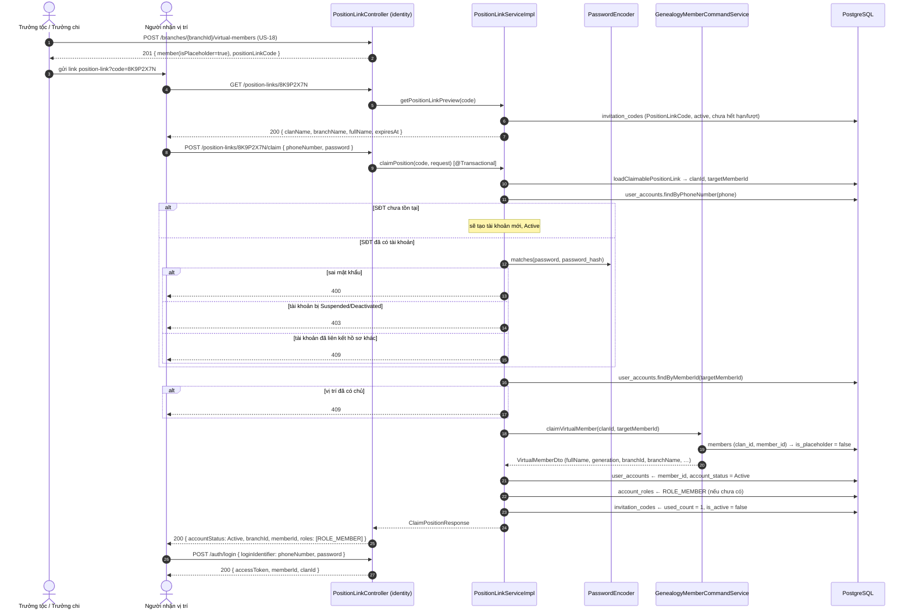

# Đặc Tả Kỹ Thuật & Hướng Dẫn Vận Hành US-19: Nhập mã liên kết vị trí (`PositionLinkCode`) khi đăng ký để tự động gia nhập đúng chi/nhánh

Tài liệu này đặc tả thiết kế, mô hình dữ liệu, giải pháp kỹ thuật, luồng nghiệp vụ và quy trình kiểm thử cho tính năng **[US-19] Người nhận vị trí nhập mã `PositionLinkCode` (do US-18 phát hành) ngay khi đăng ký, hệ thống tự động liên kết tài khoản vào đúng hồ sơ ảo - tức đúng chi/nhánh - và kích hoạt tài khoản (`Active`) mà không cần bất kỳ bước xác minh/phê duyệt nào**.

> **Điểm vào của API:**
> * `GET /api/v1/position-links/{inviteCode}` - xem trước vị trí mà mã đang trỏ tới (công khai).
> * `POST /api/v1/position-links/{inviteCode}/claim` - đăng ký tài khoản kèm mã và được nối vào cây ngay (công khai).
>
> **Nguyên tắc cốt lõi:** *mã đúng là bằng chứng sở hữu vị trí*. Vì vậy luồng này **không** đi qua đơn gia nhập (US-17), **không** chờ Trưởng tộc/Trưởng chi phê duyệt, và **không** tạo thêm một hồ sơ mới: nó chỉ "nhận" đúng hồ sơ ảo mà US-18 đã dựng sẵn trong đúng chi/nhánh.

---

## 1. Tổng Quan Nghiệp Vụ (User Story & Acceptance Criteria)

### Mô tả User Story
* **Mã User Story:** `US-19`
* **Đối tượng sử dụng (Actor):** Người được Trưởng tộc / Trưởng chi chỉ định vào một vị trí trên cây phả hệ (người đã có tài khoản hoặc người chưa từng dùng hệ thống).
* **Mục tiêu (Goal):** Là người nhận được link liên kết vị trí, tôi muốn mở link, điền thông tin đăng ký (số điện thoại + mật khẩu) cùng mã liên kết để được đưa vào **đúng chi/nhánh, đúng vị trí** của mình ngay lập tức.
* **Giá trị mang lại (Value):** Trưởng tộc không phải duyệt tay từng vị trí đã tự tay tạo ra; người nhận không phải gửi đơn gia nhập rồi chờ; dữ liệu phả hệ (sự kiện, đóng góp, tạm ứng đã ghi trên `member_id`) vẫn nguyên vẹn vì hồ sơ không bị tạo lại.
* **Mức độ ưu tiên:** Bắt buộc (Must-Have)
* **Phụ thuộc:** [US-18](./US-18-create-virtual-member-and-generate-position-link-code.md) (sinh hồ sơ ảo + mã dùng một lần), US-03 (bất biến hồ sơ), US-10 (JWT/đăng nhập sau khi kích hoạt).

### Tiêu chí chấp nhận (Acceptance Criteria - AC)
1. **AC-01 (Công khai, không cần token):** Hai endpoint nằm trong danh sách `permitAll` của `SecurityConfig` (`GET /api/v1/position-links/{inviteCode}`, `POST /api/v1/position-links/{inviteCode}/claim`). Người chưa có tài khoản vẫn gọi được - đó là toàn bộ mục đích của tính năng. Endpoint tạo vị trí ảo (`POST /api/v1/branches/{branchId}/virtual-members`) **vẫn** yêu cầu `CLAN_HEAD | BRANCH_HEAD | ADMIN`.
2. **AC-02 (Mã phải hợp lệ và còn dùng được):** Bản ghi `invitation_codes` phải có `invite_type = 'PositionLinkCode'` (mã mời chung ⇒ `404`), `is_active = true`, `expires_at` ở tương lai (hoặc `null`), `used_count < max_uses` và `target_member_id` khác rỗng. Mã rỗng ⇒ `400`; mã > 30 ký tự (`VARCHAR(30)`) ⇒ `400`; mã không tồn tại ⇒ `404`; mã đã dùng/hết hạn/bị vô hiệu hoá ⇒ `400`.
3. **AC-03 (Đăng ký mới ⇒ tài khoản `Active` ngay):** Số điện thoại chưa tồn tại ⇒ tạo `user_accounts` mới với `account_status = 'Active'` (không qua `PendingApproval`), `member_id` = vị trí ảo, `password_hash` = BCrypt, email chuẩn hoá (trim + lowercase, rỗng ⇒ `null`), và gán `ROLE_MEMBER`.
4. **AC-04 (Tài khoản đã tồn tại ⇒ liên kết, không nhân bản):** Nếu số điện thoại đã có tài khoản: mật khẩu **phải khớp** (`passwordEncoder.matches`, sai ⇒ `400`); không tạo thêm bản ghi `user_accounts`; tài khoản `PendingApproval` (sinh bởi luồng US-17) được **chuyển sang `Active`** và liên kết vị trí - chính là "thay thế bước xác minh"; tài khoản `Suspended`/`Deactivated` ⇒ `403`; tài khoản đã liên kết hồ sơ khác (`member_id` khác rỗng) ⇒ `409`.
5. **AC-05 (Một vị trí thuộc đúng một tài khoản):** Trước khi ghi, hệ thống kiểm tra `user_accounts.member_id = target_member_id` đã tồn tại chưa ⇒ `409`. DB bảo vệ lần hai bằng `UNIQUE (member_id)`.
6. **AC-06 (Vào đúng chi/nhánh của vị trí, không do client chọn):** Chi/nhánh được lấy từ `members.branch_id` của hồ sơ ảo (và `invitation_codes.target_branch_id` chỉ để tham chiếu). Payload **không** có `branchId`, `memberId`, `generation`, `fullName`, `isPlaceholder`, `accountStatus`, `roles` - các trường này do server quyết định.
7. **AC-07 (Hồ sơ ảo ⇒ hồ sơ thật):** `members.is_placeholder` chuyển `true → false`; mọi cột khác (`full_name`, `date_of_birth`, `gender`, `generation`, `status`, `death_date_lunar`, `branch_id`, `created_at`) giữ nguyên, nên lịch sử đã ghi trên `member_id` được bảo toàn.
8. **AC-08 (Mã dùng một lần):** Sau khi thành công: `used_count = used_count + 1` (= `1`) và `is_active = false`. Lần thứ hai ⇒ `400`. Không có mã dự phòng nào được phát hành ngầm.
9. **AC-09 (Dòng họ lấy từ mã, không từ tenant của request):** `clanId` dùng để tìm vị trí là `invitation_codes.clan_id`. Gửi `X-Clan-Id` khác cũng không làm liên kết sai dòng họ (được kiểm thử ở integration test `claimIgnoresRequestTenant`).
10. **AC-10 (Toàn vẹn giao dịch):** Toàn bộ (claim hồ sơ qua `genealogy::api`, ghi `user_accounts`, gán `ROLE_MEMBER`, tiêu mã) nằm trong **một** `@Transactional(rollbackFor = Exception.class)`. Mọi lỗi `400/403/404/409` đều xảy ra **trước** lần ghi đầu tiên hoặc rollback toàn bộ: không thể tồn tại trường hợp mã bị tiêu nhưng tài khoản chưa liên kết, hoặc tài khoản `Active` nhưng vị trí vẫn là placeholder.
11. **AC-11 (Đăng nhập được ngay):** Sau khi claim, `POST /api/v1/auth/login` với chính số điện thoại + mật khẩu vừa dùng trả `200` và JWT mang `memberId` + `clanId` của vị trí (được khẳng định trong integration test end-to-end).
12. **AC-12 (Hợp đồng OpenAPI):** Hai endpoint được đặc tả trong [`docker/swagger/openapi.yaml`](../../docker/swagger/openapi.yaml) (`/position-links/{inviteCode}`, `/position-links/{inviteCode}/claim`, các schema `ClaimPositionRequest`, `ClaimPositionResponse`, `PositionLinkPreviewResponse`, `ApiResponseClaimPosition`, `ApiResponsePositionLinkPreview`, mã `200/400/403/404/409`) và gọi thử được trên Swagger UI (`http://localhost:8082`).

---

## 2. Thiết Kế Kiến Trúc & Ranh Giới Bounded Context

### 2.1. Phân chia trách nhiệm

| Dữ liệu | Bảng | Module sở hữu | Thay đổi trong US-19 |
| :--- | :--- | :--- | :--- |
| Mã liên kết vị trí | `invitation_codes` | `com.familyfund.identity` | `used_count`, `is_active` |
| Tài khoản người dùng | `user_accounts`, `account_roles` | `com.familyfund.identity` | tạo mới hoặc `PendingApproval → Active`, thêm `ROLE_MEMBER` |
| Vị trí trên cây | `members` (+ `family_branches`) | `com.familyfund.genealogy` | `is_placeholder: true → false` |

`package-info.java` của `identity` khai báo phụ thuộc `{"core", "genealogy::api"}`, còn `genealogy` chỉ phụ thuộc `{"core"}`. Vì vậy service điều phối **bắt buộc** nằm ở `identity`; việc đổi `members.is_placeholder` được đưa vào hợp đồng công khai `genealogy::api` qua `GenealogyMemberCommandService#claimVirtualMember`, không để `identity` chạm vào repository/entity nội bộ của `genealogy`.

```
[Landing page của link chia sẻ]  position-link-base-url?code=8K9P2X7N
        │  GET  /api/v1/position-links/{inviteCode}            (công khai)
        │  POST /api/v1/position-links/{inviteCode}/claim      (công khai)
        ▼
┌────────────────────────────────────────────────────────────────────────────┐
│ 1. CONTROLLER (identity): PositionLinkController                           │
│    • @Valid ClaimPositionRequest                      400                  │
│    • 200 OK + ApiResponse<ClaimPositionResponse>                           │
└────────────────────────────────────────────────────────────────────────────┘
        ▼
┌────────────────────────────────────────────────────────────────────────────┐
│ 2. SERVICE (identity): PositionLinkServiceImpl#claimPosition                │
│    @Transactional(rollbackFor = Exception.class)                           │
│    a. loadClaimablePositionLink(code)                404/400               │
│       • invite_type = PositionLinkCode, is_active, chưa hết hạn, còn lượt   │
│    b. xác định người nhận: phone + password          400/403/409            │
│       • đã có tài khoản?  → matches(password), status, member_id rỗng       │
│       • chưa có            → sẽ tạo mới (Active)                            │
│       • vị trí đã bị tài khoản khác giữ?             409                    │
│    c. genealogyMemberCommandService.claimVirtualMember(clanId, memberId)   │
│       • placeholder → hồ sơ thật, các cột khác giữ nguyên                   │
│    d. user_accounts: tạo mới hoặc PendingApproval → Active, member_id = …   │
│    e. account_roles: ROLE_MEMBER (idempotent)                               │
│    f. invitation_codes: used_count + 1, is_active = false                   │
└────────────────────────────────────────────────────────────────────────────┘
        ▼ (cross-module, chỉ qua public contract genealogy::api)
┌────────────────────────────────────────────────────────────────────────────┐
│ 3. COMMAND SERVICE (genealogy): claimVirtualMember(ClaimVirtualMemberCommand) │
│    • findByBranch_ClanIdAndMemberId(clanId, memberId)  404 nếu không có      │
│    • is_placeholder = true                             409 nếu đã được nhận   │
│    • setIsPlaceholder(false) + saveAndFlush                                 │
│    • trả VirtualMemberDto (fullName, generation, branchId, branchName, …)    │
└────────────────────────────────────────────────────────────────────────────┘
        ▼
┌────────────────────────────────────────────────────────────────────────────┐
│ 4. PERSISTENCE: InvitationCodeRepository, UserAccountRepository,            │
│    AccountRoleRepository (identity) · MemberRepository (genealogy)          │
│    PostgreSQL / Flyway V1..V7 - KHÔNG thêm migration mới                     │
└────────────────────────────────────────────────────────────────────────────┘
```

### 2.2. Danh mục các file mã nguồn

| Lớp | File |
| :--- | :--- |
| Controller (identity) | `identity/internal/controller/PositionLinkController.java` (`getPositionLinkPreview`, `claimPosition`) |
| Service API (identity, public) | `identity/api/PositionLinkService.java` |
| Service Impl (identity) | `identity/internal/service/PositionLinkServiceImpl.java` (`claimPosition`, `getPositionLinkPreview`) |
| Request/Response DTO | `identity/api/dto/ClaimPositionRequest.java`, `ClaimPositionResponse.java`, `PositionLinkPreviewResponse.java` |
| Command API (genealogy, public) | `genealogy/api/ClaimVirtualMemberCommand.java`, `genealogy/api/GenealogyMemberCommandService.java` |
| Service Impl (genealogy) | `genealogy/internal/service/GenealogyMemberCommandServiceImpl.java#claimVirtualMember` |
| Repository (identity) | `InvitationCodeRepository`, `UserAccountRepository`, `AccountRoleRepository` |
| Security (core) | `core/config/SecurityConfig.java` (2 rule `permitAll`), `SystemRoles.ROLE_MEMBER` |
| Exception (core) | `core/exception/GlobalExceptionHandler.java` (`400/403/404/409`) |
| OpenAPI | `docker/swagger/openapi.yaml` |

(Các đường dẫn đều nằm dưới `src/main/java/com/familyfund/`.)

---

## 3. Thiết Kế Cơ Sở Dữ Liệu

**Không thêm migration mới.** Tính năng chỉ cập nhật các cột đã tồn tại.

### 3.1. `invitation_codes` (Flyway `V1`, `clan_id` bổ sung ở `V3`/`V5`)

| Cột | Trước khi claim | Sau khi claim | Ghi chú |
| :--- | :--- | :--- | :--- |
| `invite_type` | `PositionLinkCode` | không đổi | mã `GeneralClanInvite` bị từ chối `404` |
| `used_count` | `0` | `1` | `CHECK (used_count >= 0)`, so với `max_uses = 1` |
| `is_active` | `true` | `false` | chặn tái sử dụng ngay ở tầng truy vấn |
| `expires_at` | tương lai | không đổi | hết hạn ⇒ `400`, không tiêu mã |
| `target_member_id` | `MEM…` | không đổi | `UNIQUE` - một vị trí một mã |
| `target_branch_id` | `BR…` | không đổi | chi/nhánh mà người nhận được nối vào |
| `clan_id` | `CLAN…` | không đổi | **nguồn dòng họ duy nhất** khi claim (AC-09) |

### 3.2. `user_accounts` (Flyway `V1`)

| Cột | Ràng buộc DB | Trường hợp đăng ký mới | Trường hợp tài khoản đã có |
| :--- | :--- | :--- | :--- |
| `account_id` | `VARCHAR(20) PK` | `"ACC_" + 12 ký tự UUID` (`≤ 20`) | giữ nguyên |
| `member_id` | `VARCHAR(20) UNIQUE` | = `invitation_codes.target_member_id` | = vị trí (nếu chưa có), nếu khác ⇒ `409` |
| `phone_number` | `VARCHAR(15) NOT NULL UNIQUE` | từ payload (đã trim) | dùng để tra tài khoản |
| `email` | `VARCHAR(100) UNIQUE` | từ payload (trim + lowercase), rỗng ⇒ `null` | giữ nguyên, không ghi đè |
| `password_hash` | `VARCHAR(255) NOT NULL` | BCrypt của mật khẩu payload | phải `matches` mật khẩu payload |
| `account_status` | `CHECK (PendingApproval, Active, Suspended, Deactivated)` | ghi thẳng `Active` | `PendingApproval → Active`; `Suspended/Deactivated` ⇒ `403` |

### 3.3. `members` (Flyway `V1`)

| Cột | Trước claim | Sau claim |
| :--- | :--- | :--- |
| `is_placeholder` | `true` | **`false`** |
| `branch_id` | chi/nhánh do US-18 chọn | không đổi (đây là "đúng node" - AC-06) |
| `full_name`, `date_of_birth`, `gender`, `generation`, `status`, `death_date_lunar` | như US-18 đã tạo | không đổi (AC-07) |
| `created_at` | `DEFAULT CURRENT_TIMESTAMP` | không đổi |

### 3.4. `account_roles` (Flyway `V1`)

| Cột | Giá trị |
| :--- | :--- |
| `account_id` | tài khoản vừa liên kết |
| `role_id` | `ROLE_MEMBER` (seed `V2`) |
| `assigned_at` | thời điểm claim; bỏ qua nếu cặp `(account_id, role_id)` đã tồn tại (idempotent) |

---

## 4. Giải Pháp Kỹ Thuật

### 4.1. Vì sao "mã đúng" thay được bước xác minh
US-17 bắt buộc Trưởng tộc phê duyệt vì người tự gửi đơn có thể khai bất kỳ chi/nhánh nào. Ở US-19, **người quản lý đã tự tay tạo ra vị trí đó** (US-18) và chỉ gửi link cho đúng người: mã 8 ký tự Base32 CSPRNG là bí mật chia sẻ giữa hai bên. Vì vậy:

* Không có `branch_join_requests`, không có `PendingApproval`, không có endpoint duyệt nào được gọi.
* Vị trí không thể bị "giành" sang chi khác, vì `members.branch_id` đã cố định từ US-18 và payload không có trường chi/nhánh (AC-06).
* Một mã chỉ tiêu được một lần và chỉ gắn được một tài khoản (AC-05, AC-08) ⇒ không thể lợi dụng mã đã lộ để chiếm thêm vị trí.

### 4.2. Hai nhánh của "người nhập mã"
```
POST /position-links/{code}/claim  { phoneNumber, password, email? }
        │
        ├── findByPhoneNumber(phone) rỗng
        │      → tạo user_accounts mới: Active, member_id = target_member_id, ROLE_MEMBER
        │      → người chưa từng dùng hệ thống vẫn vào cây ngay sau khi đăng ký
        │
        └── findByPhoneNumber(phone) có tài khoản
               → matches(password)?          sai ⇒ 400
               → status ∈ {Suspended, Deactivated}?   ⇒ 403
               → member_id đã có?            có  ⇒ 409 (tài khoản đã thuộc hồ sơ khác)
               → PendingApproval             ⇒ Active + member_id = target_member_id
```
Cả hai nhánh dùng chung phần đuôi: claim hồ sơ (genealogy) → gán `ROLE_MEMBER` → tiêu mã (`used_count = 1`, `is_active = false`).

### 4.3. Thứ tự kiểm tra (không để lại dữ liệu rác)
`mã rỗng/quá dài (400)` → `không tồn tại / sai loại (404)` → `mã đã dùng / hết hạn (400)` → `thiếu target_member_id (400)` → `thiếu phone/password (400)` → `sai mật khẩu (400)` → `tài khoản bị khoá (403)` → `tài khoản đã có hồ sơ (409)` → `vị trí đã có chủ (409)` → `email trùng (409)` → **ghi**: claim hồ sơ → tài khoản → role → mã.

Toàn bộ nằm trong một transaction (AC-10): nếu bước claim hồ sơ ném `409` (người khác vừa nhận trong gang tấc), tài khoản chưa được tạo và mã chưa bị tiêu.

### 4.4. Đa dòng họ khi không có JWT
Request claim là ẩn danh nên `TenantContext` chỉ là `X-Clan-Id`/query param (mặc định `CLAN_DEFAULT`) - **không** dùng để quyết định dòng họ. `PositionLinkServiceImpl` lấy `clanId` từ chính bản ghi `invitation_codes`, rồi truyền tường minh vào `ClaimVirtualMemberCommand(clanId, memberId)`; phía genealogy tìm bằng `findByBranch_ClanIdAndMemberId(clanId, memberId)` nên không phụ thuộc `TenantContext` (khác với `createVirtualMember`, nơi tenant là bắt buộc vì người gọi có JWT).

### 4.5. Xem trước vị trí (landing page)
`GET /position-links/{inviteCode}` trả về `clanName`, `branchName`, `fullName` của vị trí cùng `expiresAt` - đủ để người nhận xác nhận "đúng vị trí của tôi" trước khi đăng ký, và **không** tiết lộ chi tiết khác của hồ sơ. Chỉ mã còn dùng được mới xem trước được, nên UI không phải tự diễn giải trạng thái mã.

---

## 5. Luồng Nghiệp Vụ Chi Tiết



### Bảng mã phản hồi

| HTTP | Nguyên nhân | Exception / Nguồn |
| :---: | :--- | :--- |
| `200` | Liên kết + kích hoạt thành công (cả preview) | - |
| `400` | Mã rỗng/quá 30 ký tự, mã đã dùng/hết hạn/hết lượt, mã không gắn vị trí, payload sai ràng buộc, sai mật khẩu | `MethodArgumentNotValidException`, `BadRequestException` |
| `403` | Tài khoản `Suspended`/`Deactivated` | `AccessDeniedException` |
| `404` | Mã không tồn tại, hoặc là `GeneralClanInvite` chứ không phải `PositionLinkCode`; hồ sơ không còn tồn tại | `ResourceNotFoundException` |
| `409` | Vị trí đã được nhận, số điện thoại đã liên kết hồ sơ khác, email đã đăng ký, vi phạm `UNIQUE` | `DuplicateResourceException`, `DataIntegrityViolationException` |

---

## 6. Hướng Dẫn Kiểm Thử

### 6.1. Kiểm thử tự động
```powershell
# Toàn bộ test của tính năng (unit + MockMvc + integration)
.\gradlew.bat test --tests "com.familyfund.identity.*" --tests "com.familyfund.genealogy.*"

# Riêng US-19
.\gradlew.bat test --tests "com.familyfund.identity.internal.service.PositionLinkServiceImplClaimTest" `
                   --tests "com.familyfund.identity.api.dto.ClaimPositionRequestTest" `
                   --tests "com.familyfund.identity.internal.controller.PositionLinkClaimControllerTest" `
                   --tests "com.familyfund.identity.internal.controller.PositionLinkClaimIntegrationTest" `
                   --tests "com.familyfund.genealogy.internal.service.GenealogyMemberCommandServiceImplTest"
```

| Test Class | Số test | Mục tiêu |
| :--- | :---: | :--- |
| `PositionLinkServiceImplClaimTest` | 24 | 7 test đăng ký/liên kết (tài khoản mới `Active`, dùng đúng `clanId` của mã chứ không phải tenant, tiêu mã + gán `ROLE_MEMBER`, claim hồ sơ qua genealogy, `PendingApproval → Active` không nhân bản, không gán trùng role, email rỗng), 2 test preview, 15 test thất bại (`400/404/409/403`) - mọi nhánh lỗi đều không ghi gì |
| `ClaimPositionRequestTest` | 6 | Bean Validation khớp `user_accounts` (SĐT `^(0|\+84)[0-9]{9,10}$`, mật khẩu 6..50, email hợp lệ) và payload **không** chứa trường hồ sơ/hệ thống (`fullName`, `branchId`, `memberId`, `accountStatus`, `roles`, …) |
| `PositionLinkClaimControllerTest` | 9 | MockMvc standalone: `200` + đúng cấu trúc `data` cho preview và claim; `400` (blank password, SĐT/email sai, JSON hỏng), `403`, `404`, `409` |
| `PositionLinkClaimIntegrationTest` | 10 | **Full context trên PostgreSQL thật**: E2E US-18 → preview → claim → kiểm tra DB (`is_placeholder = false`, `account_status = Active`, `account_roles`, `used_count = 1`, `is_active = false`) → **login trả `200`**; claim bỏ qua `X-Clan-Id` khác; tài khoản `PendingApproval` được kích hoạt; mã đã dùng ⇒ `400` và không tạo tài khoản; mã không tồn tại / `GeneralClanInvite` ⇒ `404`; mã hết hạn ⇒ `400`; sai mật khẩu ⇒ `400`; tài khoản đã có hồ sơ ⇒ `409`; payload sai ⇒ `400`; hồ sơ giữ đúng `branch_id` |
| `GenealogyMemberCommandServiceImplTest` (+4 test US-19) | 12 | `claimVirtualMember` đổi `is_placeholder` và trả DTO đầy đủ; hồ sơ không tồn tại ⇒ `404`; đã là hồ sơ thật ⇒ `409`; command `null`/thiếu id ⇒ `400` - mọi nhánh lỗi đều `never().saveAndFlush(...)` |
| `PositionLinkServiceImplTest` / `PositionLinkControllerTest` (US-18) | 20 | Không hồi quy: tạo hồ sơ ảo + mã vẫn hoạt động như trước khi thêm US-19 |
| `ArchitectureTest` | 3 | `identity → genealogy::api` một chiều, không phát sinh phụ thuộc vòng |

### 6.2. Kịch bản E2E thủ công
```bash
# 0. Đăng nhập Trưởng tộc (tài khoản seed V6)
TOKEN=$(curl -s -X POST http://localhost:8080/api/v1/auth/login \
  -H "Content-Type: application/json" \
  -d '{"loginIdentifier":"0901234567","password":"123456"}' | jq -r '.data.accessToken')

# 1. US-18: tạo hồ sơ ảo + mã liên kết vị trí, lấy inviteCode
CODE=$(curl -s -X POST http://localhost:8080/api/v1/branches/BR_CHI_2/virtual-members \
  -H "Content-Type: application/json" -H "Authorization: Bearer $TOKEN" \
  -H "X-Clan-Id: CLAN_DEFAULT" \
  -d '{"fullName":"Nguyễn Văn Út","dateOfBirth":"2015-03-08","gender":"Male","generation":4}' \
  | jq -r '.data.positionLinkCode.inviteCode')

# 2. Xem trước vị trí (không cần token)
curl -s http://localhost:8080/api/v1/position-links/$CODE | jq

# 3. Đăng ký kèm mã ⇒ liên kết + Active ngay (không cần token)
curl -s -X POST http://localhost:8080/api/v1/position-links/$CODE/claim \
  -H "Content-Type: application/json" \
  -d '{"phoneNumber":"0987654321","password":"123456","email":"ut@example.com"}' | jq

# 4. Đăng nhập bằng tài khoản vừa tạo ⇒ phải thành công (chứng minh "Active")
curl -s -X POST http://localhost:8080/api/v1/auth/login \
  -H "Content-Type: application/json" \
  -d '{"loginIdentifier":"0987654321","password":"123456"}' | jq '.data | {accountId, memberId, clanId, fullName}'

# 5. Dùng lại mã ⇒ 400
curl -s -X POST http://localhost:8080/api/v1/position-links/$CODE/claim \
  -H "Content-Type: application/json" \
  -d '{"phoneNumber":"0987654322","password":"123456"}' | jq '{message}'
```

**Kết quả kỳ vọng (bước 3):**
```json
{
  "success": true,
  "message": "Liên kết tài khoản với vị trí phả hệ thành công",
  "data": {
    "accountId": "ACC_7F3D9A0B1C2E",
    "phoneNumber": "0987654321",
    "email": "ut@example.com",
    "accountStatus": "Active",
    "roles": ["ROLE_MEMBER"],
    "memberId": "MEMK4F8ZQ1M7XB3QP",
    "fullName": "Nguyễn Văn Út",
    "generation": 4,
    "branchId": "BR_CHI_2",
    "branchName": "Chi 2 - Nhánh Giáp",
    "clanId": "CLAN_DEFAULT",
    "clanName": "Dòng Họ Mẫu Mặc Định",
    "inviteCode": "8K9P2X7N",
    "linkedAt": "2026-11-01T09:00:00Z"
  }
}
```

**Các kịch bản lỗi cần kiểm tra:**
| Kịch bản | Kỳ vọng |
| :--- | :--- |
| Dùng mã của `GeneralClanInvite` cho `/claim` | `404` |
| Mã không tồn tại | `404` |
| Mã đã dùng (lần 2) | `400` |
| Mã có `expires_at` ở quá khứ | `400` |
| `password: "   "` / SĐT `12345` / email sai định dạng | `400` + `errors.{password,phoneNumber,email}` |
| SĐT đã có tài khoản nhưng mật khẩu sai | `400` |
| SĐT thuộc tài khoản đã liên kết hồ sơ khác | `409` |
| Tài khoản `Deactivated` nhập mã | `403` |

**Kiểm tra trong DB (Adminer `:8088`):**
```sql
-- Vị trí đã là hồ sơ thật và đã có tài khoản
SELECT m.member_id, m.full_name, m.is_placeholder, m.branch_id,
       ua.account_id, ua.account_status
FROM members m
LEFT JOIN user_accounts ua ON ua.member_id = m.member_id
WHERE m.member_id = 'MEMK4F8ZQ1M7XB3QP';

-- Mã đã tiêu
SELECT invite_code, invite_type, used_count, max_uses, is_active, expires_at
FROM invitation_codes WHERE invite_code = '8K9P2X7N';

-- Vai trò đã cấp
SELECT account_id, role_id, assigned_at FROM account_roles
WHERE account_id = 'ACC_7F3D9A0B1C2E';
```
Kỳ vọng: `is_placeholder = false`, `account_status = 'Active'`, `used_count = 1`, `is_active = false`, có dòng `ROLE_MEMBER`.

### 6.3. Kiểm tra hợp đồng trên Swagger UI
1. Khởi động backend (`.\gradlew.bat bootRun`) và Swagger UI (`docker compose up -d swagger`).
2. Mở `http://localhost:8082`, nhóm **Invitations**:
   * `GET /position-links/{inviteCode}` - dán mã US-18, **Try it out** ⇒ `200`.
   * `POST /position-links/{inviteCode}/claim` - dán mã + body `{"phoneNumber":"0987654321","password":"123456"}` ⇒ `200` với `data.accountStatus = Active`.
3. Không cần bấm **Authorize**: hai endpoint này công khai (AC-01).

### 6.4. Ghi chú môi trường
Nếu chạy test tích hợp cục bộ gặp `FlywayValidateException: Migration checksum mismatch for migration version 7` thì đó là **lệch trạng thái giữa file migration V7 trong repo và `flyway_schema_history` trên database dùng chung** (đã ghi nhận ở [US-18 §6.4](./US-18-create-virtual-member-and-generate-position-link-code.md)), không liên quan tới US-19. Cách xử lý đúng là thống nhất lại migration trong repo hoặc chạy `flyway repair` trên database đó; **không** thêm migration mới để che lỗi. CI (`CI-01`) dùng container PostgreSQL mới nên không gặp lỗi này.

---

## 7. Phạm Vi & Các Bước Tiếp Theo

* **Đã có trong US-19:** xem trước vị trí theo mã; đăng ký kèm mã và tự động liên kết tài khoản (mới hoặc đã tồn tại) vào đúng hồ sơ/chi/nhánh; kích hoạt `Active` không cần phê duyệt; gán `ROLE_MEMBER`; tiêu mã một lần trong cùng một transaction; OpenAPI + test tự động.
* **Không thuộc phạm vi:** luồng chờ duyệt của US-17 (`branch_join_requests`, `PendingApproval` do Trưởng tộc xử lý) vẫn giữ nguyên cho mã mời chung; cấp lại/gia hạn mã khi `target_member_id` đã có mã (`UNIQUE`) - muốn cấp lại phải vô hiệu hoá mã cũ; đổi hồ sơ sang chi khác sau khi đã nhận vị trí (dùng nghiệp vụ điều chuyển của US-04).