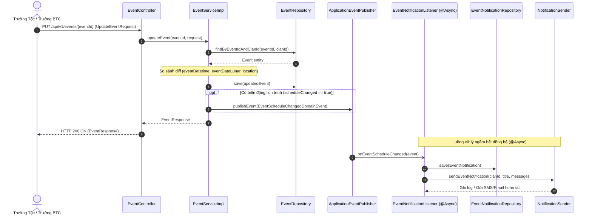

# Đặc Tả Kỹ Thuật & Hướng Dẫn Vận Hành US-22: Tích Hợp Dịch Vụ Thông Báo Khi Mở Sự Kiện & Cập Nhật Lịch Trình

Tài liệu này đặc tả thiết kế, mô hình dữ liệu, giải pháp kỹ thuật, luồng nghiệp vụ và quy trình kiểm thử cho tính năng **[US-22] Tích hợp dịch vụ ThongBao phát tin nhắn tới toàn thể thành viên khi mở sự kiện hoặc thay đổi lịch trình**.

> **Điểm vào API chính:**
> - `PUT /api/v1/events/{eventId}`: Cập nhật thông tin sự kiện & tự động phát hiện biến động lịch trình/địa điểm (`ROLE_CLAN_HEAD`, `ROLE_ADMIN`, hoặc `HeadOfOrganizer`).
> - `PATCH /api/v1/events/{eventId}/status`: Chuyển trạng thái sự kiện sang `RegistrationOpen` kích hoạt phát thông báo mở sự kiện.
> - `GET /api/v1/events/{eventId}/notifications`: Xem lịch sử thông báo đã phát của sự kiện (`isAuthenticated()`).
>
> Hợp đồng API được cập nhật trong [`docker/swagger/openapi.yaml`](../../docker/swagger/openapi.yaml) (Swagger UI cổng `8082`).

---

## 1. Tổng Quan Nghiệp Vụ (User Story & Acceptance Criteria)

### Mô tả User Story
* **Mã User Story:** `US-22`
* **Đối tượng sử dụng (Actor):** Trưởng tộc (`ROLE_CLAN_HEAD`), Quản trị viên (`ROLE_ADMIN`), Trưởng ban tổ chức sự kiện (`HeadOfOrganizer`), Toàn thể thành viên dòng họ.
* **Mục tiêu (Goal):** Khi sự kiện được mở cho con cháu đăng ký tham gia (`RegistrationOpen`), hoặc khi Ban tổ chức điều chỉnh ngày giờ/địa điểm tổ chức, hệ thống tự động phát tin nhắn thông báo (Notification) đến toàn thể thành viên dòng họ và lưu trữ lịch sử để mọi người nắm bắt kịp thời.
* **Giá trị mang lại (Value):** Đảm bảo truyền thông thông suốt trong dòng họ, hạn chế tình trạng bà con đi sai ngày giờ hoặc nhầm địa điểm giỗ tổ / lễ hội, đồng thời giảm tải thao tác thông báo thủ công cho Trưởng tộc và Ban tổ chức.

### Tiêu chí chấp nhận (Acceptance Criteria - AC)
1. **AC-01 (Thông báo mở sự kiện - Event Opened Notification):**
   - Khi sự kiện chuyển trạng thái sang `RegistrationOpen` qua API `PATCH /api/v1/events/{eventId}/status`:
   - Hệ thống tự động phát sinh domain event `EventOpenedDomainEvent`.
   - Xử lý bất đồng bộ (`@Async`): Lưu một bản ghi vào bảng `event_notifications` với:
     - `notification_id`: Mã tự sinh dạng `NTF` + 8 ký tự Base36 + 6 ký tự Base32 (độ dài $\le 20$).
     - `event_id`: Mã sự kiện tương ứng.
     - `title`: `Mở đăng ký tham gia sự kiện: {eventName}`.
     - `content_changes`: `Sự kiện đã mở đăng ký tham gia cho toàn thể thành viên dòng họ.`.
     - `sent_time`: Thời điểm phát thông báo (`Instant.now()`).
     - `triggered_by`: Mã người dùng thực hiện thao tác.
   - Gọi dịch vụ `NotificationSender` gửi tin thông báo đến toàn thể thành viên.

2. **AC-02 (Cập nhật sự kiện & Tự động phát hiện biến động lịch trình - Reschedule Notification):**
   - Cung cấp API `PUT /api/v1/events/{eventId}` tiếp nhận `UpdateEventRequest`.
   - Phân quyền: `@PreAuthorize("hasAnyRole('CLAN_HEAD', 'ADMIN') or @nhanSuSuKien.xacThucQuyenTheoNguCanh(#eventId, 'HeadOfOrganizer')")`.
   - Kiểm tra trạng thái: Không cho phép chỉnh sửa sự kiện đã `Closed` (ném `BusinessRuleException` HTTP `400 Bad Request`).
   - Tự động so sánh (diff) các trường lịch trình:
     - `eventDatetime`: Biến động ngày giờ dương lịch (ví dụ: `Ngày giờ dương lịch: 2026-12-01T08:00:00Z -> 2026-12-02T09:00:00Z`).
     - `eventDateLunar`: Biến động ngày giờ âm lịch (ví dụ: `Ngày giờ âm lịch: 23/10 Bính Ngọ -> 24/10 Bính Ngọ`).
     - `location`: Biến động địa điểm tổ chức (ví dụ: `Địa điểm: Nhà thờ họ -> Từ đường chi 2`).
   - Cập nhật thông tin sự kiện trong CSDL: `eventName`, `description`, `estimatedBudget`, `eventDatetime`, `eventDateLunar`, `location`.
   - Nếu có ít nhất một trường lịch trình thay đổi:
     - Phát sinh domain event `EventScheduleChangedDomainEvent` mang theo chuỗi tổng hợp các thay đổi (`content_changes`).
     - Xử lý bất đồng bộ: Lưu bản ghi vào bảng `event_notifications` với `title = "Thông báo thay đổi lịch trình sự kiện: {eventName}"` và `content_changes = "{các thay đổi}"`.
     - Gọi `NotificationSender` phát tin tới các thành viên.
   - Nếu không có thay đổi nào về lịch trình (chỉ đổi tên, mô tả hoặc ngân sách dự toán): Cập nhật thông tin bình thường và **không** phát thông báo làm phiền bà con.

3. **AC-03 (Truy vấn lịch sử thông báo):**
   - Cung cấp API `GET /api/v1/events/{eventId}/notifications`.
   - Trả về danh sách `EventNotificationResponse` sắp xếp theo `sentTime` giảm dần (thông báo mới nhất ở đầu).
   - Bảo mật: Yêu cầu đăng nhập (`@PreAuthorize("isAuthenticated()")`).

4. **AC-04 (Kiến trúc Bất đồng bộ & Mở rộng):**
   - Sử dụng cơ chế Event-Driven của Spring Framework kết hợp `@EnableAsync` và `@Async @EventListener`.
   - Luồng nghiệp vụ HTTP request trả về ngay lập tức cho client mà không bị nghẽn bởi thao tác gửi tin nhắn ra bên ngoài.
   - Khởi tạo interface `NotificationSender` với implementation mặc định `LoggingNotificationSender`, sẵn sàng mở rộng sang SMS, Email, FCM hoặc Zalo ZNS trong tương lai.

---

## 2. Thiết Kế Kiến Trúc & Ranh Giới Bounded Context

Tính năng thuộc Bounded Context: `com.familyfund.event`.
Giao tiếp bất đồng bộ được thực hiện qua các domain event được định nghĩa tại `com.familyfund.event.api.event` (Public API của module `event` theo chuẩn Spring Modulith).

```
[Client / Mobile / Web]
        │
        ├─▶ PATCH /api/v1/events/{eventId}/status (Chuyển trạng thái sang RegistrationOpen)
        ├─▶ PUT   /api/v1/events/{eventId}        (Cập nhật thông tin & lịch trình)
        └─▶ GET   /api/v1/events/{eventId}/notifications (Lịch sử thông báo)
        │
        ▼
┌────────────────────────────────────────────────────────────────┐
│ CONTROLLER: EventController                                    │
│   • PUT /api/v1/events/{eventId}                               │
│   • GET /api/v1/events/{eventId}/notifications                 │
└────────────────────────────────────────────────────────────────┘
        │
        ▼
┌────────────────────────────────────────────────────────────────┐
│ SERVICE: EventServiceImpl (@Transactional)                     │
│   • updateEvent(): So sánh diff ngày/giờ/địa điểm              │
│   • updateEventStatus(): Phát hiện RegistrationOpen            │
│   • eventPublisher.publishEvent(DomainEvent)                   │
└────────────────────────────────────────────────────────────────┘
        │
        ▼ (Spring ApplicationEventPublisher - In-Memory Event)
┌────────────────────────────────────────────────────────────────┐
│ LISTENER: EventNotificationListener (@Async @EventListener)    │
│   • Xử lý ngầm trên Worker Thread Pool riêng biệt              │
│   • Lưu bản ghi lịch sử vào event_notifications                │
│   • Gọi NotificationSender.sendEventNotification()             │
└────────────────────────────────────────────────────────────────┘
        │
        ├─────────────────────────────┐
        ▼                             ▼
┌───────────────────────────┐ ┌──────────────────────────────────┐
│ PERSISTENCE: PostgreSQL   │ │ SERVICE ADAPTER:                 │
│   • Table:                │ │ NotificationSender               │
│     event_notifications   │ │   • LoggingNotificationSender    │
│                           │ │   • [SMS/Email/FCM Adapter]      │
└───────────────────────────┘ └──────────────────────────────────┘
```

---

## 3. Mô Hình Dữ Liệu (Data Schema)

Bảng `event_notifications` được khởi tạo từ Flyway Migration `V1__init_clan_genealogy_and_events_schema.sql`:

```sql
CREATE TABLE event_notifications (
    notification_id VARCHAR(20) PRIMARY KEY,
    event_id        VARCHAR(20) NOT NULL REFERENCES events(event_id) ON DELETE CASCADE,
    title           VARCHAR(150) NOT NULL,
    content_changes TEXT,
    sent_time       TIMESTAMP WITH TIME ZONE NOT NULL DEFAULT NOW(),
    triggered_by    VARCHAR(20)
);

CREATE INDEX idx_event_notifications_event_id ON event_notifications(event_id);
```

### Entity JPA: `EventNotification`
```java
@Entity
@Table(name = "event_notifications")
@Getter
@Setter
@NoArgsConstructor
@AllArgsConstructor
@Builder
public class EventNotification {
    @Id
    @Column(name = "notification_id", length = 20, nullable = false)
    private String notificationId;

    @Column(name = "event_id", length = 20, nullable = false)
    private String eventId;

    @Column(name = "title", length = 150, nullable = false)
    private String title;

    @Column(name = "content_changes", columnDefinition = "TEXT")
    private String contentChanges;

    @Column(name = "sent_time", nullable = false)
    private Instant sentTime;

    @Column(name = "triggered_by", length = 20)
    private String triggeredBy;
}
```

---

## 4. Sequence Diagram: Luồng Thay Đổi Lịch Trình & Phát Thông Báo



---

## 5. Hướng Dẫn Kiểm Thử Tự Động (Automated Testing)

### 5.1. Chạy Unit & Integration Tests cho Module Event
```powershell
cd family-management-backend
.\gradlew.bat test --tests "com.familyfund.event.*"
```

### 5.2. Chạy Kiểm Thử Ranh Giới Kiến Trúc (Spring Modulith)
```powershell
cd family-management-backend
.\gradlew.bat test --tests "com.familyfund.ArchitectureTest"
```

### 5.3. Chạy Toàn Bộ Test Suite Dự Án
```powershell
cd family-management-backend
.\gradlew.bat test
```
*Kết quả xác minh:* **233/233 tests pass thành công 100%**.

---

## 6. Kịch Bản Kiểm Thử Thủ Công Qua cURL / REST Client

### Bước 1: Mở sự kiện sang `RegistrationOpen`
```bash
curl -X PATCH http://localhost:8080/api/v1/events/EVT1234567890/status \
  -H "Authorization: Bearer <JWT_CLAN_HEAD>" \
  -H "Content-Type: application/json" \
  -d '{"newStatus": "RegistrationOpen"}'
```
*Kết quả:* HTTP `200 OK`. Hệ thống ghi nhận 1 bản ghi vào `event_notifications` với tiêu đề `"Mở đăng ký tham gia sự kiện: ..."`.

### Bước 2: Thay đổi lịch trình & địa điểm sự kiện
```bash
curl -X PUT http://localhost:8080/api/v1/events/EVT1234567890 \
  -H "Authorization: Bearer <JWT_CLAN_HEAD>" \
  -H "Content-Type: application/json" \
  -d '{
    "eventName": "Lễ Giỗ Tổ Chi 1 Mùa Thu",
    "description": "Cập nhật lại thời gian dâng hương",
    "eventDatetime": "2026-11-15T08:30:00Z",
    "eventDateLunar": "07/10 Bính Ngọ",
    "location": "Từ đường Chi 1, Thôn Đông, Xã Tiên Phương",
    "estimatedBudget": 35000000.00
  }'
```
*Kết quả:* HTTP `200 OK`. Hệ thống phát hiện diff lịch trình và gửi tin thông báo ngầm.

### Bước 3: Xem lịch sử thông báo đã phát
```bash
curl -X GET http://localhost:8080/api/v1/events/EVT1234567890/notifications \
  -H "Authorization: Bearer <JWT_USER>"
```
*Kết quả:* HTTP `200 OK`:
```json
{
  "success": true,
  "data": [
    {
      "notificationId": "NTF1A2B3C4D5E6F",
      "eventId": "EVT1234567890",
      "title": "Thông báo thay đổi lịch trình sự kiện: Lễ Giỗ Tổ Chi 1 Mùa Thu",
      "contentChanges": "Ngày giờ dương lịch: 2026-11-14T08:00:00Z -> 2026-11-15T08:30:00Z; Ngày giờ âm lịch: 06/10 Bính Ngọ -> 07/10 Bính Ngọ; Địa điểm: Nhà văn hóa thôn -> Từ đường Chi 1, Thôn Đông, Xã Tiên Phương",
      "sentTime": "2026-10-27T08:30:00Z",
      "triggeredBy": "USR10001"
    },
    {
      "notificationId": "NTF0987654321A",
      "eventId": "EVT1234567890",
      "title": "Mở đăng ký tham gia sự kiện: Lễ Giỗ Tổ Chi 1 Mùa Thu",
      "contentChanges": "Sự kiện đã mở đăng ký tham gia cho toàn thể thành viên dòng họ.",
      "sentTime": "2026-10-27T08:00:00Z",
      "triggeredBy": "USR10001"
    }
  ]
}
```
