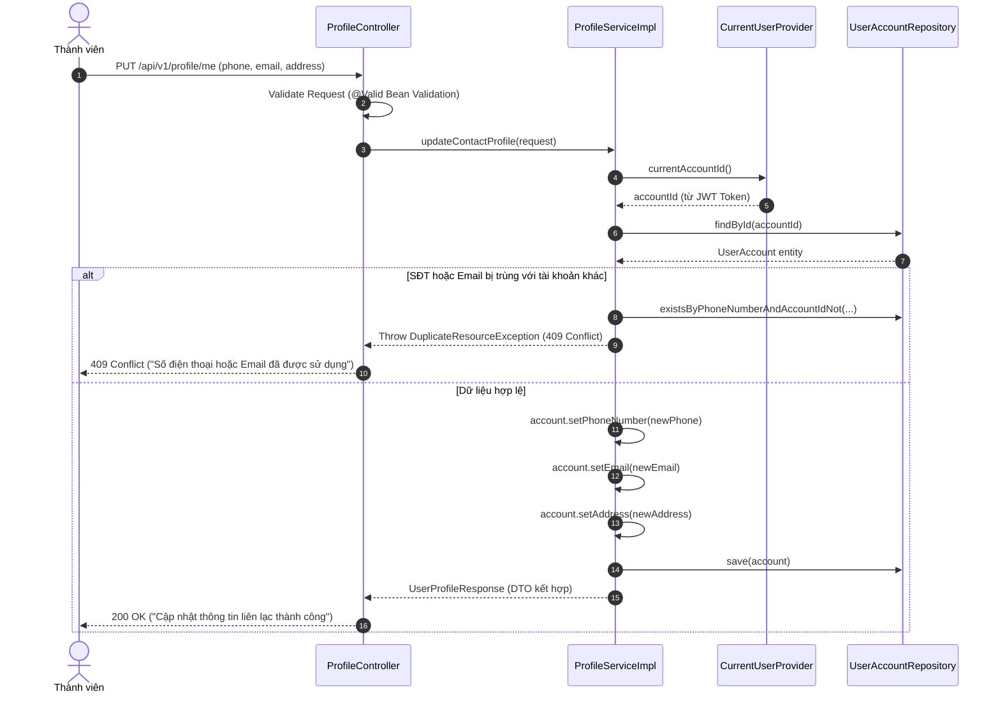
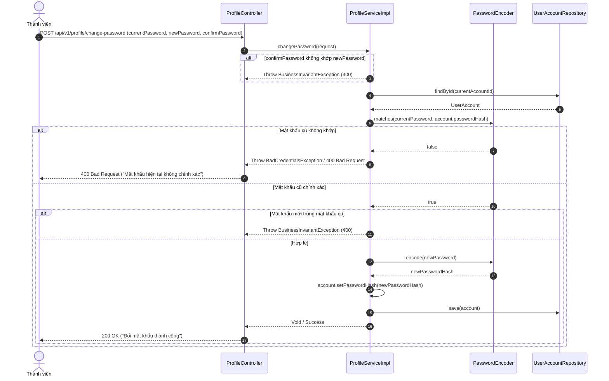

# Đặc Tả Kỹ Thuật & Hướng Dẫn Vận Hành US-22: Quản Lý Hồ Sơ Cá Nhân & Đổi Mật Khẩu

Trạng thái: **Đã hoàn thành Backend (Sẵn sàng triển khai Frontend)**. Ngày cập nhật: **11/11/2026**.

---

## 1. Nguồn Yêu Cầu & Tổng Quan Nghiệp Vụ

Nguồn chuẩn: [`UserStory_HeThongQuanLySuKienVaQuyDaiGiaDinh.xlsx`](../../../UserStory_HeThongQuanLySuKienVaQuyDaiGiaDinh.xlsx), sheet **User Story**, hàng **6**, vùng **A6:L6**.

### Mô tả User Story
* **Mã User Story:** `US-22`
* **Nhóm chức năng:** Tài khoản & phân quyền
* **Đối tượng sử dụng (Actor):** Thành viên dòng họ đã đăng nhập (`ROLE_MEMBER`, `ROLE_BRANCH_HEAD`, `ROLE_CLAN_HEAD`, `ROLE_ADMIN`).
* **Mong muốn (Goal):** Xem và cập nhật hồ sơ cá nhân (SĐT, email, địa chỉ) và đổi mật khẩu đăng nhập.
* **Lý do / Giá trị (Value):** Thông tin liên lạc luôn chính xác để nhận các thông báo, thư mời việc họ kịp thời; đồng thời thành viên chủ động bảo vệ an toàn tài khoản qua tính năng đổi mật khẩu tự phục vụ.
* **Mức độ ưu tiên:** Nên có; Đợt 1 – Nền tảng.
* **Given (Bối cảnh):** Thành viên đã đăng nhập thành công vào hệ thống.
* **When (Hành động):** Thành viên xem hồ sơ của mình, chỉnh sửa các thông tin cho phép và lưu, hoặc yêu cầu đổi mật khẩu.
* **Then (Kết quả):** Hệ thống lưu thay đổi thông tin liên lạc và cập nhật mật khẩu mới; riêng các thông tin phả hệ cốt lõi (**họ tên, ngày sinh, đời thứ, chi nhánh, giới tính**) được bảo vệ nghiêm ngặt ở chế độ Chỉ Xem (Read-only), chỉ Trưởng nhánh/Trưởng tộc mới có thẩm quyền chỉnh sửa theo quy định gia phả.

---

## 2. Tiêu Chí Chấp Nhận (Acceptance Criteria - AC)

### AC-01 — Xem hồ sơ cá nhân của chính mình (Profile View)
* **API:** `GET /api/v1/profile/me`
* **Quyền hạn:** Mọi thành viên đã xác thực (`isAuthenticated()`).
* **Dữ liệu trả về đầy đủ:**
  - Định danh tài khoản: `accountId`, `memberId`, `clanId`, `accountStatus`, `roles`.
  - Thông tin liên lạc (có thể cập nhật): `phoneNumber`, `email`, `address`.
  - Thông tin phả hệ nhân khẩu (chỉ xem): `fullName`, `dateOfBirth`, `gender`, `generation`, `branchId`, `branchName`.

### AC-02 — Cập nhật thông tin liên lạc cá nhân (Update Contact Info)
* **API:** `PUT /api/v1/profile/me`
* **Request Body:**
  ```json
  {
    "phoneNumber": "0912345678",
    "email": "tuan.le@familyfund.vn",
    "address": "Số 45 ngõ 12 đường Trần Phú, Phường Hà Cầu, Quận Hà Đông, Hà Nội"
  }
  ```
* **Ràng buộc & Bất biến:**
  - `phoneNumber`: Bắt buộc, không để trống, kiểm tra định dạng số điện thoại Việt Nam hợp lệ (10 chữ số bắt đầu bằng 03, 05, 07, 08, 09).
  - `email`: Tùy chọn, nếu có phải đúng định dạng email RFC 5322.
  - `address`: Tùy chọn, tối đa 255 ký tự.
  - **Chặn sửa phả hệ (Immutable Demographic Rule):** DTO cập nhật **chỉ** chứa các trường liên lạc. Mọi nỗ lực gửi kèm `fullName`, `dateOfBirth`, `generation`, `branchId` đều không được xử lý nhằm bảo vệ tính toàn vẹn phả hệ.
  - **Chống trùng số điện thoại & email:** Nếu `phoneNumber` hoặc `email` đã được đăng ký bởi tài khoản khác trong hệ thống $\rightarrow$ Trả về `409 Conflict`.

### AC-03 — Đổi mật khẩu tự phục vụ (Self-service Change Password)
* **API:** `POST /api/v1/profile/change-password`
* **Request Body:**
  ```json
  {
    "currentPassword": "OldPassword@123",
    "newPassword": "NewPassword@456",
    "confirmPassword": "NewPassword@456"
  }
  ```
* **Xác thực & Bảo mật:**
  - Đối chiếu mật khẩu hiện tại bằng `passwordEncoder.matches(currentPassword, account.getPasswordHash())`. Nếu không khớp $\rightarrow$ Trả về `400 Bad Request` kèm thông báo *"Mật khẩu hiện tại không chính xác"*.
  - Kiểm tra `confirmPassword` phải trùng khớp với `newPassword`.
  - Mật khẩu mới phải có độ dài tối thiểu 6 ký tự (khuyến nghị có chữ hoa, số).
  - Mật khẩu mới không được trùng với mật khẩu hiện tại (`400 Bad Request`).
  - Mật khẩu mới được băm bằng thuật toán an toàn `BCryptPasswordEncoder` trước khi lưu vào CSDL.

### AC-04 — Bảo mật ngữ cảnh (Context Scoping)
* Endpoint tự động trích xuất `accountId` từ `SecurityContextHolder` thông qua `CurrentUserProvider`.
* Người dùng không thể can thiệp hoặc sửa đổi hồ sơ của người khác qua API này.

---

## 3. Thiết Kế Cơ Sở Dữ Liệu (Database Schema)

### Kịch bản Migration Flyway: `V17__add_address_to_user_accounts.sql`

```sql
-- V17: Bổ sung trường địa chỉ liên lạc cho tài khoản thành viên (US-22)
ALTER TABLE user_accounts
    ADD COLUMN IF NOT EXISTS address VARCHAR(255);

COMMENT ON COLUMN user_accounts.address IS 'Địa chỉ liên lạc hoặc thường trú của thành viên để nhận thư mời việc họ (US-22)';
```

---

## 4. Thiết Kế Kiến Trúc & Spring Modulith

Tính năng thuộc bounded context: **`com.familyfund.identity`**, tích hợp dữ liệu với **`com.familyfund.genealogy`**.

```
┌────────────────────────────────────────────────────────────────────────┐
│                        CLIENT (Flutter Web / Mobile)                   │
└────────────────────────────────────┬───────────────────────────────────┘
                                     │  GET / PUT /api/v1/profile/me
                                     │  POST /api/v1/profile/change-password
                                     ▼
┌────────────────────────────────────────────────────────────────────────┐
│ MODULE: com.familyfund.identity                                        │
│                                                                        │
│  [ProfileController]                                                   │
│          │                                                             │
│          ▼                                                             │
│  [ProfileServiceImpl] ─── trích xuất accountId qua CurrentUserProvider │
│          │                                                             │
│          ├────────► [UserAccountRepository] (Đọc/Ghi phone, email,     │
│          │                                   address, password_hash)   │
│          │                                                             │
│          └────────► Giao tiếp qua Public Contract                      │
└────────────────────────────────────┬───────────────────────────────────┘
                                     │  findMemberProfileDetails(memberId)
                                     ▼
┌────────────────────────────────────────────────────────────────────────┐
│ MODULE: com.familyfund.genealogy::api                                  │
│                                                                        │
│  [GenealogyQueryService]                                               │
│          │                                                             │
│          ▼                                                             │
│  [MemberProfileDetailsDto] (fullName, dateOfBirth, gender, generation, │
│                             branchId, branchName)                      │
└────────────────────────────────────────────────────────────────────────┘
```

### Danh mục các file Backend dự kiến:
1. **Flyway Migration:** `src/main/resources/db/migration/V17__add_address_to_user_accounts.sql`
2. **Entity:** Cập nhật `UserAccount.java` bổ sung thuộc tính `private String address;`
3. **DTOs (identity):**
   - `UserProfileResponse`: thông tin đầy đủ gồm thông tin tài khoản và thông tin phả hệ.
   - `UpdateContactProfileRequest`: chỉ chứa `phoneNumber`, `email`, `address`.
   - `ChangePasswordRequest`: chứa `currentPassword`, `newPassword`, `confirmPassword`.
4. **Service Contract & Impl:**
   - `ProfileService` & `ProfileServiceImpl` trong `identity.internal.service`.
5. **Controller:**
   - `ProfileController` trong `identity.internal.controller` (`/api/v1/profile`).
6. **Genealogy API Contract Extension:**
   - DTO `MemberProfileDetailsDto` trong `genealogy.api.dto`.
   - Bổ sung phương thức `Optional<MemberProfileDetailsDto> findMemberProfileDetails(String memberId)` vào `GenealogyQueryService`.

---

## 5. Luồng Tuần Tự (Sequence Diagrams)

### Luồng 1: Cập nhật thông tin liên lạc (`PUT /api/v1/profile/me`)



### Luồng 2: Đổi mật khẩu (`POST /api/v1/profile/change-password`)



---

## 6. Thiết Kế Giao Diện Frontend (Flutter UI Spec)

### Màn hình: `MyProfileScreen` (`lib/features/auth/presentation/screens/my_profile_screen.dart` hoặc `profile_screen.dart`)
- **Route:** `/profile`
- **Menu Entry:** Truy cập từ PopupMenu tại thanh điều hướng `HeritageNavBar` (khi nhấn vào tên hoặc avatar người dùng).
- **Thiết kế Responsive Material 3:** `ConstrainedBox(maxWidth: 720)`.

```
┌────────────────────────────────────────────────────────────────────────┐
│ 🛡 HỒ SƠ CÁ NHÂN & TÀI KHOẢN (US-22)                                  │
├────────────────────────────────────────────────────────────────────────┤
│ ┌─ THÔNG TIN PHẢ HỆ (READ-ONLY) ─────────────────────────────────────┐ │
│ │ 🔒 Chỉ Trưởng tộc hoặc Trưởng nhánh mới có quyền sửa phả hệ        │ │
│ │ Họ và tên:   Lê Hữu Tuấn                   [Khóa]                  │ │
│ │ Ngày sinh:   15/08/1990                    [Khóa]                  │ │
│ │ Giới tính:   Nam                           [Khóa]                  │ │
│ │ Đời thứ:     Đời 5                         [Khóa]                  │ │
│ │ Chi nhánh:   Chi 2 (Nhánh Giáp)            [Khóa]                  │ │
│ └────────────────────────────────────────────────────────────────────┘ │
│                                                                        │
│ ┌─ THÔNG TIN LIÊN LẠC (CHO PHÉP CẬP NHẬT) ───────────────────────────┐ │
│ │ Số điện thoại:  [ 0912 345 678                     ]               │ │
│ │ Hòm thư email:  [ tuan.le@familyfund.vn            ]               │ │
│ │ Địa chỉ nơi ở:  [ Số 45 ngõ 12 đường Trần Phú...   ]               │ │
│ │                                                                    │ │
│ │                                       [ Lưu thông tin liên lạc ]   │ │
│ └────────────────────────────────────────────────────────────────────┘ │
│                                                                        │
│ ┌─ BẢO MẬT & ĐỔI MẬT KHẨU ───────────────────────────────────────────┐ │
│ │ Mật khẩu hiện tại: [ ••••••••••••   👁 ]                           │ │
│ │ Mật khẩu mới:      [ ••••••••••••   👁 ]                           │ │
│ │ Xác nhận mật khẩu: [ ••••••••••••   👁 ]                           │ │
│ │                                                                    │ │
│ │                                             [ Cập nhật mật khẩu ]  │ │
│ └────────────────────────────────────────────────────────────────────┘ │
└────────────────────────────────────────────────────────────────────────┘
```

---

## 7. Kế Hoạch Triển Khai Chi Tiết (Implementation Roadmap)

### Giai đoạn 1: Backend
1. **Migration Flyway:** Tạo `V17__add_address_to_user_accounts.sql`.
2. **Cập nhật Entity & DTO:**
   - Cập nhật `UserAccount` bổ sung trường `address`.
   - Tạo các record DTO: `UserProfileResponse`, `UpdateContactProfileRequest`, `ChangePasswordRequest`.
   - Tạo DTO `MemberProfileDetailsDto` trong `genealogy.api.dto`.
3. **Mở rộng Service & Repository:**
   - Thêm phương thức tra cứu trong `UserAccountRepository`: `existsByPhoneNumberAndAccountIdNot`, `existsByEmailAndAccountIdNot`.
   - Mở rộng `GenealogyQueryService` & `GenealogyQueryServiceImpl`: `findMemberProfileDetails(memberId)`.
   - Tạo `ProfileService` & `ProfileServiceImpl`.
4. **Xây dựng Controller:**
   - `ProfileController` với các endpoint: `GET /api/v1/profile/me`, `PUT /api/v1/profile/me`, `POST /api/v1/profile/change-password`.
5. **Kiểm thử tự động:**
   - Unit tests: `ProfileServiceImplTest`.
   - MockMvc tests: `ProfileControllerTest`.
   - Architecture test: `ArchitectureTest` đảm bảo ranh giới Spring Modulith nguyên vẹn.

### Giai đoạn 2: Frontend
1. **Models & DataSource:**
   - Tạo `profile_models.dart` (`UserProfileDto`, `UpdateContactProfileRequestDto`, `ChangePasswordRequestDto`).
   - Thêm các method gọi API trong `AuthRemoteDataSource` hoặc `ProfileRemoteDataSource`.
2. **Repository & Riverpod Provider:**
   - Tạo `profile_provider.dart` (`ProfileState`, `ProfileNotifier`).
3. **Giao diện người dùng:**
   - Tạo màn hình `MyProfileScreen` hiển thị các nhóm thông tin rõ ràng, Read-only cho phả hệ, editable cho liên lạc, và form đổi mật khẩu.
4. **Navigation & Router:**
   - Đăng ký route `/profile` trong `AppRouter`.
   - Liên kết menu item *Hồ sơ cá nhân* trong `HeritageNavBar`.
5. **Kiểm thử giao diện:**
   - Widget tests cho `MyProfileScreen`.
   - Chạy `dart analyze` đảm bảo 0 error, 0 warning.

---

## 8. Tiêu Chí Hoàn Thành (Definition of Done)

- [x] File migration Flyway `V17__add_address_to_user_accounts.sql` chạy thành công trên Neon PostgreSQL.
- [x] Endpoint `GET /api/v1/profile/me` trả về đầy đủ thông tin tài khoản và thông tin phả hệ.
- [x] Endpoint `PUT /api/v1/profile/me` cập nhật SĐT, email, địa chỉ và chặn tuyệt đối không cho sửa họ tên, ngày sinh, đời thứ.
- [x] Endpoint `POST /api/v1/profile/change-password` xác thực mật khẩu cũ chính xác và mã hóa mật khẩu mới bằng BCrypt.
- [x] Không rò rỉ bảo mật: Không thể sửa hồ sơ của tài khoản khác (trích xuất ID từ JWT SecurityContext).
- [x] Toàn bộ automated tests (`ProfileServiceImplTest`, `ProfileControllerTest`, `GenealogyQueryServiceImplTest`, `DatabaseMigrationTest`) và `ArchitectureTest` vượt qua 100% (`BUILD SUCCESSFUL`).
- [ ] Màn hình `MyProfileScreen` trên Frontend hiển thị đúng thiết kế, hỗ trợ responsive, validate form chặt chẽ.
