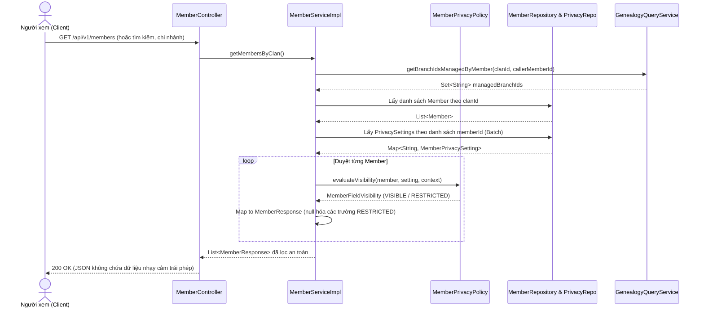

# Đặc Tả Kỹ Thuật US-25: Bảo Vệ Thông Tin Cá Nhân Thành Viên (Hybrid Privacy)

Trạng thái: **Đã hoàn thành (Backend & Frontend)**. Ngày cập nhật: **11/11/2026**.

---

## 1. Nguồn yêu cầu và phạm vi

Nguồn chuẩn: [`UserStory_HeThongQuanLySuKienVaQuyDaiGiaDinh.xlsx`](../../../UserStory_HeThongQuanLySuKienVaQuyDaiGiaDinh.xlsx), sheet **User Story**, hàng **9**, vùng **A9:L9**. Đã đối soát và làm rõ nghiệp vụ theo phản hồi người dùng.

- **Actor:** Thành viên dòng họ.
- **Mong muốn:** Số điện thoại, email, ngày sinh chỉ hiển thị cho người có quyền quản lý HOẶC khi được chính chủ đồng ý chia sẻ.
- **Giá trị:** Bảo vệ quyền riêng tư cá nhân theo nguyên tắc *Privacy by Default*, đồng thời tôn trọng quyền tự quyết (*Owner Consent*) của từng thành viên trong dòng họ.
- **Ưu tiên:** Nên có; Đợt 1 – Nền tảng.
- **Given:** Gia phả có hàng trăm thành viên thuộc nhiều chi/nhánh khác nhau.
- **When:** Một thành viên xem hồ sơ của người khác (danh sách, chi tiết nhánh, tìm kiếm).
- **Then:**
  - Mặc định chỉ hiển thị thông tin cơ bản: họ tên, đời thứ, chi/nhánh, giới tính, trạng thái sống/mất, ngày giỗ âm lịch (nếu đã mất).
  - Thông tin nhạy cảm (ngày sinh, SĐT, email) chỉ hiển thị khi:
    1. Người xem chính là thành viên đó (*Chính chủ*), HOẶC
    2. Chính chủ đã bật cấu hình cho phép chia sẻ công khai trong dòng họ (*Owner Consent*), HOẶC
    3. Người xem là Trưởng tộc, Trưởng nhánh (trong phạm vi nhánh quản lý), hoặc Ban tổ chức sự kiện khi cần.

---

## 2. Mô hình phân quyền kết hợp (Hybrid Privacy Matrix)

Mỗi trường thông tin nhạy cảm (`dateOfBirth`, `phoneNumber`, `email`) được đánh giá hiển thị độc lập theo ma trận điều kiện:

$$\text{CanViewField} = \text{IsSelf} \lor \text{IsOwnerConsented} \lor \text{IsClanHead} \lor \text{IsBranchManager} \lor \text{IsAuthorizedOrganizer}$$

| Người xem (Viewer) | Xem chính mình | Thành viên khác (Chính chủ BẬT chia sẻ trường) | Thành viên khác (Chính chủ TẮT chia sẻ trường) | Thành viên khác Clan |
| :--- | :---: | :---: | :---: | :---: |
| **Thành viên thường (`ROLE_MEMBER`)** | ✅ Đầy đủ | ✅ Hiển thị trường được chia sẻ | 🔒 Ẩn / Trả `null` (`RESTRICTED`) | ❌ Chặn truy cập |
| **Trưởng nhánh (`ROLE_BRANCH_HEAD`)** | ✅ Đầy đủ | ✅ Hiển thị trường được chia sẻ | ✅ Đầy đủ (nhánh mình quản lý & nhánh con)<br/>🔒 Ẩn / `null` (nhánh khác ngoài phạm vi) | ❌ Chặn truy cập |
| **Trưởng tộc (`ROLE_CLAN_HEAD`)** | ✅ Đầy đủ | ✅ Hiển thị trường được chia sẻ | ✅ Đầy đủ (toàn bộ dòng họ mình) | ❌ Chặn truy cập |
| **Hồ sơ ảo (`isPlaceholder = true`)** | N/A | N/A (Mặc định chưa kích hoạt tài khoản -> `isConsented = false`) | 🔒 Chỉ Trưởng nhánh/Trưởng tộc quản lý được xem | ❌ Chặn truy cập |

---

## 3. Tiêu chí chấp nhận (Acceptance Criteria - AC)

### Nhóm AC Nghiệp Vụ Cốt Lõi
- **AC-01 — Thông tin cơ bản luôn hiển thị:** Thành viên có quyền truy cập dòng họ luôn xem được họ tên, đời thứ, chi nhánh, giới tính, trạng thái sống/mất của mọi thành viên khác trong cùng dòng họ.
- **AC-02 — Bảo vệ dữ liệu nhạy cảm mặc định (Privacy by Default):** Nếu chính chủ chưa bật chia sẻ và người xem không có thẩm quyền quản lý, các trường `dateOfBirth`, `phoneNumber`, `email` trong JSON trả về bắt buộc phải là `null`, đồng thời `fieldVisibility` tương ứng mang trạng thái `RESTRICTED`.
- **AC-03 — Quyền tự quyết của chính chủ (Owner Consent):**
  - Khi chính chủ bật chia sẻ trường nào (ví dụ `shareDateOfBirth = true`), mọi thành viên trong cùng dòng họ đều xem được trường đó.
  - Từng trường nhạy cảm có cờ bật/tắt độc lập.
- **AC-04 — Thẩm quyền quản trị:**
  - Trưởng tộc xem được toàn bộ thông tin nhạy cảm của các thành viên trong dòng họ mình.
  - Trưởng nhánh xem được toàn bộ thông tin nhạy cảm của các thành viên thuộc nhánh mình đại diện và các nhánh con của nhánh đó.
  - Thành viên luôn xem được 100% thông tin cá nhân của chính mình.
- **AC-05 — Quản lý cấu hình quyền riêng tư cá nhân:**
  - Cung cấp API `GET /api/v1/members/me/privacy-settings` để chính chủ xem cấu hình chia sẻ hiện tại của mình.
  - Cung cấp API `PUT /api/v1/members/me/privacy-settings` để chính chủ cập nhật các cờ chia sẻ (`shareDateOfBirth`, `sharePhoneNumber`, `shareEmail`).

### Nhóm AC Kỹ Thuật & Bảo Mật
- **AC-06 — Áp dụng đồng nhất:** Chính sách kiểm tra quyền riêng tư phải được áp dụng nhất quán trên tất cả các endpoint:
  - `GET /api/v1/members` (Toàn dòng họ)
  - `GET /api/v1/branches/{branchId}/members` (Theo nhánh)
  - `GET /api/v1/members/search` và `GET /api/members/search` (Tìm kiếm)
  - `POST /api/v1/branches/{branchId}/members` (Phản hồi sau khi tạo thành viên)
- **AC-07 — Toàn vẹn dữ liệu gốc trong Database:** Bộ lọc quyền riêng tư chỉ áp dụng trên lớp DTO khi tuần tự hóa JSON gửi về client. Tuyệt đối không sửa đổi, xóa hoặc gán `null` vào database entity. Logic kiểm tra trùng lặp hồ sơ (`isDuplicateProfile`) vẫn sử dụng ngày sinh gốc.
- **AC-08 — Ngăn chặn rò rỉ gián tiếp:** Không tiết lộ năm sinh suy ra, số điện thoại hoặc email trong thông báo lỗi, audit log công khai hoặc các trường mô tả chung.
- **AC-09 — Cách ly đa dòng họ (Multi-tenancy):** Quyền xem chỉ có hiệu lực bên trong dòng họ được xác thực qua JWT. Mọi hành vi sửa header `X-Clan-Id` hoặc query param không thể mở quyền xem dữ liệu dòng họ khác.
- **AC-10 — Hiệu năng (Chống N+1 Query):** Khi trả danh sách thành viên lớn (hàng trăm thành viên), thông tin `member_privacy_settings` và danh sách nhánh quản lý của người xem phải được nạp theo lô (batch query), không query lặp lại theo từng dòng.

---

## 4. Thiết Kế Cơ Sở Dữ Liệu

Tạo bảng mới `member_privacy_settings` thông qua Flyway migration (`V16__create_member_privacy_settings.sql`):

```sql
CREATE TABLE IF NOT EXISTS member_privacy_settings (
    member_id VARCHAR(20) PRIMARY KEY REFERENCES members(member_id) ON DELETE CASCADE,
    share_date_of_birth BOOLEAN NOT NULL DEFAULT FALSE,
    share_phone_number BOOLEAN NOT NULL DEFAULT FALSE,
    share_email BOOLEAN NOT NULL DEFAULT FALSE,
    updated_at TIMESTAMPTZ DEFAULT CURRENT_TIMESTAMP
);

CREATE INDEX IF NOT EXISTS idx_member_privacy_settings_member_id ON member_privacy_settings(member_id);
```

*Lưu ý:*
- Khi thành viên mới được tạo hoặc chưa có bản ghi trong bảng này, hệ thống coi mặc định cả 3 cờ là `false`.
- Khóa ngoại `REFERENCES members(member_id) ON DELETE CASCADE` đảm bảo khi xóa thành viên (nếu có), cấu hình quyền riêng tư tự động dọn dẹp.

---

## 5. Hợp Đồng API (API Contracts)

### 5.1. DTO Cấu Hình Quyền Riêng Tư Của Chính Chủ

#### `GET /api/v1/members/me/privacy-settings`
**Response `200 OK`:**
```json
{
  "status": "success",
  "message": "Member privacy settings retrieved successfully",
  "data": {
    "memberId": "MEMK4F8ZQ1M7XB3QP",
    "shareDateOfBirth": true,
    "sharePhoneNumber": false,
    "shareEmail": false,
    "updatedAt": "2026-11-11T14:40:00Z"
  }
}
```

#### `PUT /api/v1/members/me/privacy-settings`
**Request Body:**
```json
{
  "shareDateOfBirth": true,
  "sharePhoneNumber": true,
  "shareEmail": false
}
```
**Response `200 OK`:**
```json
{
  "status": "success",
  "message": "Member privacy settings updated successfully",
  "data": {
    "memberId": "MEMK4F8ZQ1M7XB3QP",
    "shareDateOfBirth": true,
    "sharePhoneNumber": true,
    "shareEmail": false,
    "updatedAt": "2026-11-11T14:45:00Z"
  }
}
```

### 5.2. Cập nhật `MemberResponse` (Thêm Metadata `fieldVisibility`)

```java
public enum FieldVisibility {
    VISIBLE,
    RESTRICTED
}

public record MemberFieldVisibility(
    FieldVisibility dateOfBirth,
    FieldVisibility phoneNumber,
    FieldVisibility email
) {}
```

Cấu trúc JSON trả về khi một thành viên xem danh sách:
```json
{
  "memberId": "MEM99887766",
  "fullName": "Nguyen Van B",
  "dateOfBirth": null,
  "gender": "Male",
  "generation": 3,
  "status": "Living",
  "deathDateLunar": null,
  "branchId": "BR_BRANCH_2",
  "branchName": "Chi 2",
  "clanId": "CLAN001",
  "isPlaceholder": false,
  "createdAt": "2026-11-01T10:00:00Z",
  "fieldVisibility": {
    "dateOfBirth": "RESTRICTED",
    "phoneNumber": "RESTRICTED",
    "email": "RESTRICTED"
  }
}
```
*(Nếu chính chủ của `MEM99887766` bật `shareDateOfBirth = true`, trường `dateOfBirth` sẽ có giá trị `"1995-08-20"` và `visibility.dateOfBirth` là `"VISIBLE"`).*

---

## 6. Sơ Đồ Tuần Tự (Sequence Diagram)



---

## 7. Kế Hoạch Triển Khai Chi Tiết

1. **Bước 1 — Database Migration:**
   - Tạo file `V15__create_member_privacy_settings.sql` trong `src/main/resources/db/migration/`.
2. **Bước 2 — Backend Entity & Repository:**
   - Tạo entity `MemberPrivacySetting` và repository `MemberPrivacySettingRepository` trong `com.familyfund.genealogy.internal`.
3. **Bước 3 — Chính Sách Bảo Mật (`MemberPrivacyPolicy`):**
   - Xây dựng component `MemberPrivacyPolicy` với `PrivacyEvaluationContext` (chứa `callerMemberId`, `isClanHead`, `managedBranchIds`).
   - Đánh giá quyền cho từng trường nhạy cảm theo quy tắc Hybrid.
4. **Bước 4 — API Quản Lý Privacy Settings:**
   - Thêm `MemberPrivacyController` hoặc mở rộng `MemberController` với 2 endpoint:
     - `GET /api/v1/members/me/privacy-settings`
     - `PUT /api/v1/members/me/privacy-settings`
5. **Bước 5 — Tích Hợp Lọc Dữ Liệu Vào `MemberServiceImpl`:**
   - Cập nhật `MemberResponse` bổ sung `MemberFieldVisibility`.
   - Cập nhật các hàm `getMembersByClan`, `getMembersByBranch`, `searchMembers`, `createMember` để áp dụng policy.
6. **Bước 6 — Kiểm Thử Tự Động (Unit & Integration Tests):**
   - Unit test `MemberPrivacyPolicyTest`: Bao phủ 100% các nhánh điều kiện (Chính chủ, Consent, Trưởng tộc, Trưởng nhánh, Người ngoài).
   - Integration test: `MemberPrivacyIntegrationTest` và cập nhật `MemberControllerIntegrationTest`.
   - Kiểm tra `ArchitectureTest` đảm bảo ranh giới Spring Modulith không bị vi phạm.
7. **Bước 7 — Đồng Bộ Frontend:**
   - Cập nhật `branch_models.dart`: Đọc `fieldVisibility`, xử lý khi `dateOfBirth` là `null`.
   - Thêm giao diện quản lý chia sẻ thông tin cá nhân.

---

## 8. Kế Hoạch Kiểm Thử Backend

Các lệnh kiểm tra thực thi sau khi hoàn thành code:

```powershell
.\gradlew.bat test --tests "com.familyfund.genealogy.internal.security.MemberPrivacyPolicyTest"
.\gradlew.bat test --tests "com.familyfund.genealogy.internal.controller.MemberPrivacyControllerTest"
.\gradlew.bat test --tests "com.familyfund.genealogy.internal.controller.MemberControllerIntegrationTest"
.\gradlew.bat test --tests "com.familyfund.ArchitectureTest"
.\gradlew.bat test
```

---

## 9. Điều Kiện Hoàn Thành (Definition of Done)

- [x] File migration Flyway `V16__create_member_privacy_settings.sql` chạy thành công.
- [x] Endpoint `GET / PUT /api/v1/members/me/privacy-settings` hoạt động chuẩn xác, chỉ cho phép chính chủ sửa cấu hình của mình.
- [x] Mọi endpoint đọc dữ liệu thành viên (`/members`, `/branches/{branchId}/members`, `/members/search`) đều trả về `fieldVisibility` và che trường nhạy cảm nếu không thỏa mãn điều kiện.
- [x] Toàn bộ test suite liên quan đến `genealogy` và `ArchitectureTest` đều vượt qua (`BUILD SUCCESSFUL`).
- [x] Không có query N+1 khi duyệt danh sách thành viên (sử dụng batch query `findByMemberIdIn`).
- [x] Frontend Model, Remote DataSource, Repository và Riverpod Provider (`MemberPrivacyNotifier`) đã triển khai hoàn thiện.
- [x] Màn hình Cài đặt Quyền riêng tư (`PrivacySettingsScreen`) hỗ trợ Material 3, responsive mobile/desktop, 3 switch toggles, live preview thời gian thực và lưu cấu hình.
- [x] Sidebar chi nhánh (`BranchDetailSidebar`) tự động hiển thị icon ổ khóa 🔒 khi thông tin ngày sinh bị hạn chế.
- [x] Router (`/privacy-settings`) và thanh điều hướng `HeritageNavBar` liên kết đầy đủ.
- [x] `flutter analyze` đạt 0 error, 0 warning cho toàn bộ phân hệ genealogy.