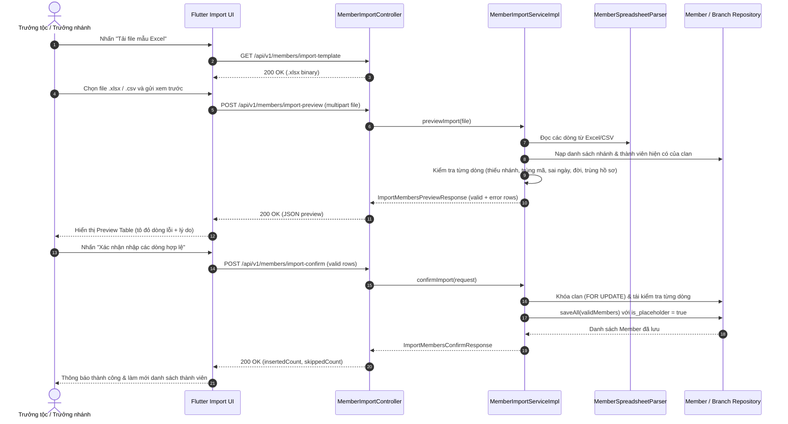

# Đặc Tả Kỹ Thuật & Hướng Dẫn Vận Hành US-31: Nhập Hàng Loạt Thành Viên Từ File Excel/CSV

Trạng thái: **Đã hoàn thành (Backend & Frontend)**. Ngày cập nhật: **12/11/2026**.

---

## 1. Tổng Quan Nghiệp Vụ (User Story & Acceptance Criteria)

### 1.1. Tóm tắt User Story
* **Mã User Story:** `US-31`
* **Nhóm chức năng:** Cây gia phả & Thành viên (`com.familyfund.genealogy`)
* **Đối tượng sử dụng (Actor):** Trưởng tộc (`ROLE_CLAN_HEAD`), Trưởng nhánh (`ROLE_BRANCH_HEAD`), Quản trị viên (`ROLE_ADMIN`).
* **Mong muốn (Goal):** Tải file mẫu Excel chuẩn, tải lên file Excel (`.xlsx`) hoặc CSV (`.csv`) chứa danh sách nhiều thành viên, xem trước kết quả kiểm tra hợp lệ từng dòng (nhận diện rõ dòng lỗi và nguyên nhân), và xác nhận nhập hàng loạt các dòng hợp lệ vào cơ sở dữ liệu.
* **Lý do / Giá trị (Value):** Rút ngắn thời gian số hóa gia phả truyền thống khi khởi tạo dòng họ hoặc bổ sung danh sách con cháu số lượng lớn, đồng thời ngăn ngừa dữ liệu rác, trùng mã hoặc sai nhánh nhờ bước xem trước (Preview) và kiểm tra ràng buộc trước khi ghi CSDL.
* **Mức độ ưu tiên:** Nên có (Should-Have).

### 1.2. Tiêu chí chấp nhận (Acceptance Criteria - AC)

1. **AC-01 — Phân quyền & Phạm vi nhánh (Dual-RBAC & Branch Scoping):**
   * Chỉ người dùng có vai trò `ROLE_CLAN_HEAD`, `ROLE_BRANCH_HEAD`, hoặc `ROLE_ADMIN` mới được gọi các API tải mẫu, xem trước (`import-preview`) và xác nhận nhập (`import-confirm`).
   * `ROLE_MEMBER` hoặc người dùng chưa đăng nhập bị từ chối (`403 Forbidden` / `401 Unauthorized`).
   * **Phạm vi chi/nhánh:**
     * `ROLE_CLAN_HEAD` và `ROLE_ADMIN` được phép nhập thành viên cho **mọi nhánh** thuộc dòng họ (`clanId` từ `TenantContext`).
     * `ROLE_BRANCH_HEAD` chỉ được phép nhập thành viên vào **nhánh mình làm đại diện** (`family_branches.representative_id`). Nếu một dòng trong file chỉ định `branch_id` thuộc nhánh khác (dù cùng dòng họ), dòng đó bị đánh dấu lỗi ở bước preview và bị từ chối ở bước confirm.

2. **AC-02 — Tải file mẫu Excel (`GET /api/v1/members/import-template`):**
   * Trả về file Excel `.xlsx` (`Content-Type: application/vnd.openxmlformats-officedocument.spreadsheetml.sheet`, `Content-Disposition: attachment; filename="mau-nhap-thanh-vien.xlsx"`).
   * File mẫu gồm:
     * **Sheet 1 (`Members`):** Hàng tiêu đề chuẩn (header row) + 2–3 dòng dữ liệu mẫu minh họa định dạng đúng (được chú thích rõ).
     * **Sheet 2 (`HuongDan`):** Bảng giải thích từng cột (bắt buộc/tùy chọn, định dạng ngày, giá trị hợp lệ của `gender`, `status`, mã nhánh `branch_id` hiện có của dòng họ nếu truy vấn được hoặc hướng dẫn lấy mã nhánh).

3. **AC-03 — Upload & Xem trước dữ liệu (`POST /api/v1/members/import-preview`):**
   * Chấp nhận `multipart/form-data` với tham số `file` định dạng `.xlsx` hoặc `.csv` (UTF-8, hỗ trợ cả UTF-8 BOM).
   * Giới hạn an toàn: dung lượng tối đa **5 MB**, số dòng dữ liệu tối đa **1.000 dòng/lần nhập** (bỏ qua dòng trống hoàn toàn). File rỗng, sai định dạng (`.txt`, `.pdf`, `.xls` cũ hoặc giả mạo đuôi) hoặc thiếu cột tiêu đề bắt buộc trả về `400 Bad Request`.
   * **Kiểm tra từng dòng (Row-level Validation — không dừng ở lỗi đầu tiên):**
     * **Thiếu / sai mã nhánh (`branch_id`):**
       * Bắt buộc không được để trống.
       * Phải tồn tại trong bảng `family_branches` thuộc `clanId` hiện tại.
       * Nếu actor là `ROLE_BRANCH_HEAD`, phải đúng nhánh người đó đại diện.
     * **Trùng mã thành viên (`member_id`):**
       * `member_id` là **tùy chọn** trong file (nếu để trống, hệ thống tự sinh mã `MEM...` theo `MemberIdGenerator` khi lưu).
       * Nếu có nhập `member_id`: độ dài tối đa 20 ký tự, không chứa khoảng trắng/ký tự điều khiển; không được trùng với `members.member_id` đã có trong CSDL **và** không được trùng với `member_id` ở dòng khác trong cùng file upload.
     * **Sai định dạng ngày (`date_of_birth`, `death_date`):**
       * Hỗ trợ chuẩn `yyyy-MM-dd` (ví dụ `1990-05-20`) hoặc `dd/MM/yyyy` (ví dụ `20/05/1990`) với kiểm tra lịch chặt chẽ (`ResolverStyle.STRICT`, từ chối ngày không tồn tại như `31/02/2000`).
       * Không được là ngày trong tương lai (`> LocalDate.now()`).
       * Nếu có cả `date_of_birth` và `death_date`: `death_date >= date_of_birth`.
     * **Ràng buộc các trường khác (đồng bộ bảng `members` & US-03 / US-27):**
       * `full_name`: bắt buộc, ≤ 100 ký tự.
       * `gender`: bắt buộc, giá trị hợp lệ `Male`, `Female`, `Other` (có thể chấp nhận map không phân biệt hoa thường như `Nam` → `Male`, `Nữ` → `Female`, `Khác` → `Other` hoặc báo lỗi rõ nếu ngoài danh sách).
       * `generation`: bắt buộc, số nguyên `>= 1`, đồng thời `generation >= branch.generation_level` (bất biến US-03: con cháu không thể ở đời lớn hơn đời gốc của nhánh).
       * `status`: tùy chọn (mặc định `Living`), chỉ nhận `Living` hoặc `Deceased`. Nếu `Deceased` và có `death_date`, tự động tính trước `death_date_lunar` (US-27) để hiển thị trên Preview Table; nếu `Deceased` mà thiếu `death_date`, báo lỗi thiếu ngày mất (nhất quán US-27).
       * `burial_place`: tùy chọn, ≤ 255 ký tự.
     * **Chống trùng hồ sơ (Duplicate Profile Guard — US-03):**
       * Kiểm tra trùng tổ hợp `(fullName [ignore case], gender, generation, dateOfBirth)` trong phạm vi dòng họ (so với CSDL **và** giữa các dòng hợp lệ trong cùng file).
   * Trả về `200 OK` kèm thống kê (`totalRows`, `validCount`, `errorCount`) và danh sách chi tiết từng dòng (`valid: true/false`, `errors: List<String>`). **Tuyệt đối chưa ghi vào CSDL ở bước này.**

4. **AC-04 — Xác nhận nhập các dòng hợp lệ (`POST /api/v1/members/import-confirm`):**
   * Nhận danh sách các dòng hợp lệ từ màn hình xem trước.
   * **Bất biến an toàn (Re-validation inside Transaction):** Backend khóa hàng `clans` (`SELECT ... FOR UPDATE` qua `clanRepository.findByIdForUpdate(clanId)`), **kiểm tra lại toàn bộ điều kiện hợp lệ** của từng dòng (phòng trường hợp dữ liệu thay đổi đồng thời giữa lúc preview và lúc confirm hoặc client gửi payload bị chỉnh sửa).
   * **Chỉ lưu các dòng hợp lệ** vào bảng `members` với `is_placeholder = true` (cho phép nhận vị trí sau qua US-19 nếu cần). Các dòng không hợp lệ (nếu có phát sinh) bị bỏ qua và trả về trong danh sách `skippedRows` kèm lý do.
   * Trả về `200 OK` (hoặc `201 Created` nếu toàn bộ mới; thống nhất dùng `200 OK` với `ApiResponse<ImportMembersConfirmResponse>` chứa `insertedCount`, `skippedCount`, `insertedMembers`, `skippedRows`).

5. **AC-05 — Giao diện Frontend (Flutter):**
   * Có màn hình / hộp thoại **Nhập hàng loạt thành viên (Excel/CSV)** mở từ danh sách thành viên hoặc cây gia phả (chỉ hiển thị nút khi user có quyền `CLAN_HEAD` / `BRANCH_HEAD` / `ADMIN`).
   * Hỗ trợ tải file mẫu Excel (`.xlsx`), chọn file `.xlsx`/`.csv` từ máy (`file_picker`).
   * Hiển thị **Bảng xem trước (Preview Table)** đầy đủ cột, **tô đỏ nổi bật các dòng bị lỗi** (nền đỏ nhạt + viền/badge trạng thái lỗi) kèm danh sách **nguyên nhân lỗi** cụ thể trên từng dòng; có bộ lọc nhanh (`Tất cả`, `Hợp lệ`, `Lỗi`).
   * Nút **"Xác nhận nhập các dòng hợp lệ"** chỉ kích hoạt khi có ít nhất 1 dòng hợp lệ (`validCount > 0`), hiển thị số lượng sẽ nhập, và tự động làm mới danh sách thành viên sau khi nhập thành công.

---

## 2. Thiết Kế Kiến Trúc & Ranh Giới Bounded Context (Architecture Design)

Tính năng thuộc Bounded Context: `com.familyfund.genealogy` (không phát sinh phụ thuộc vòng giữa các module Spring Modulith).

```text
[Client / Flutter Web & Mobile]
               │
               ├─ GET  /api/v1/members/import-template  (tải file .xlsx mẫu)
               ├─ POST /api/v1/members/import-preview   (multipart/form-data: file .xlsx/.csv)
               └─ POST /api/v1/members/import-confirm   (JSON: danh sách dòng hợp lệ)
               ▼
┌────────────────────────────────────────────────────────────────────────┐
│ 1. API BOUNDARY & CONTROLLER LAYER (genealogy.internal.controller)     │
│    • MemberImportController (hoặc bổ sung vào MemberController)        │
│    • Security: @PreAuthorize("hasAnyRole('CLAN_HEAD','BRANCH_HEAD','ADMIN')")
│    • Validation: kích thước file, đuôi file, @Valid ImportConfirmReq   │
└────────────────────────────────────────────────────────────────────────┘
               │
               ▼
┌────────────────────────────────────────────────────────────────────────┐
│ 2. APPLICATION & DOMAIN SERVICE LAYER (genealogy.internal.service)     │
│    • MemberImportService / MemberImportServiceImpl                     │
│    • MemberSpreadsheetParser (đọc .xlsx bằng Apache POI & .csv UTF-8)  │
│    • MemberImportTemplateGenerator (tạo .xlsx mẫu bằng Apache POI)     │
│    • Tái sử dụng: VietnameseLunarCalendarConverter (US-27),            │
│      MemberIdGenerator, CurrentUserProvider, TenantContext             │
└────────────────────────────────────────────────────────────────────────┘
               │
               ▼
┌────────────────────────────────────────────────────────────────────────┐
│ 3. PERSISTENCE & DATA LAYER (genealogy.internal.repository)            │
│    • ClanRepository (findByIdForUpdate)                                │
│    • FamilyBranchRepository (findByClanId)                             │
│    • MemberRepository (existsByMemberId, findByBranch_ClanId, saveAll) │
│    • Database: PostgreSQL 16+ (bảng `members`, `family_branches`)      │
└────────────────────────────────────────────────────────────────────────┘
```

### Thư viện đề xuất bổ sung vào `build.gradle.kts` (Backend)
* `org.apache.poi:poi-ooxml:5.4.0` (đọc & tạo file Excel `.xlsx` chuẩn OOXML, không dùng `.xls` cũ để giảm bề mặt lỗ hổng).
* `org.apache.commons:commons-csv:1.13.0` (hoặc parser CSV chuẩn RFC-4180 xử lý dấu phẩy trong ngoặc kép và UTF-8 BOM).

> **Lưu ý bảo mật XXE / Zip Bomb khi dùng Apache POI:**
> Giới hạn kích thước file upload (5 MB), kiểm tra magic bytes / content, và cấu hình `ZipSecureFile.setMinInflateRatio(0.01)` / `ZipSecureFile.setMaxEntrySize(...)` nếu cần để chống Zip Bomb khi parse `.xlsx`.

### Danh mục file mã nguồn dự kiến

#### Backend (`family-management-backend`)
* **Controller:** `src/main/java/com/familyfund/genealogy/internal/controller/MemberImportController.java`
* **Service:**
  * `src/main/java/com/familyfund/genealogy/internal/service/MemberImportService.java`
  * `src/main/java/com/familyfund/genealogy/internal/service/MemberImportServiceImpl.java`
  * `src/main/java/com/familyfund/genealogy/internal/service/MemberSpreadsheetParser.java`
  * `src/main/java/com/familyfund/genealogy/internal/service/MemberImportTemplateGenerator.java`
* **DTOs:**
  * `src/main/java/com/familyfund/genealogy/internal/dto/request/ConfirmMemberImportRequest.java`
  * `src/main/java/com/familyfund/genealogy/internal/dto/request/ImportMemberRowRequest.java`
  * `src/main/java/com/familyfund/genealogy/internal/dto/response/ImportMembersPreviewResponse.java`
  * `src/main/java/com/familyfund/genealogy/internal/dto/response/ImportMemberPreviewRow.java`
  * `src/main/java/com/familyfund/genealogy/internal/dto/response/ImportMembersConfirmResponse.java`
* **OpenAPI:** `docker/swagger/openapi.yaml`

#### Frontend (`family-management-frontend`)
* **Feature `member` (Clean Architecture):**
  * `lib/features/member/domain/entities/member_import_entities.dart`
  * `lib/features/member/domain/repositories/member_import_repository.dart`
  * `lib/features/member/data/models/member_import_models.dart` (Freezed + JsonSerializable)
  * `lib/features/member/data/datasources/member_import_remote_datasource.dart`
  * `lib/features/member/data/repositories/member_import_repository_impl.dart`
  * `lib/features/member/presentation/providers/member_import_provider.dart`
  * `lib/features/member/presentation/pages/member_import_page.dart` (hoặc dialog/sheet tích hợp từ danh sách thành viên)
  * `lib/features/member/presentation/widgets/member_import_preview_table.dart`

---

## 3. Thiết Kế Cơ Sở Dữ Liệu & Định Dạng File Mẫu

### 3.1. Bảng CSDL liên quan
Không cần thêm Flyway migration mới — tính năng ghi trực tiếp vào bảng `members` hiện có (Flyway V1) và đối chiếu `family_branches`:

| Cột trong `members` | Kiểu dữ liệu | Bắt buộc khi import? | Quy tắc & Ánh xạ |
| :--- | :--- | :---: | :--- |
| `member_id` | `VARCHAR(20) PK` | Không (tùy chọn) | Nếu trống → tự sinh `MEM...`. Nếu nhập → ≤ 20 ký tự, duy nhất toàn hệ thống & trong file. |
| `full_name` | `VARCHAR(100) NOT NULL` | **Có** | Chuỗi không rỗng, tối đa 100 ký tự. |
| `date_of_birth` | `DATE` | Không | `yyyy-MM-dd` hoặc `dd/MM/yyyy`, `<= today`. |
| `gender` | `VARCHAR(10) NOT NULL` | **Có** | `Male` / `Female` / `Other` (hỗ trợ map `Nam`/`Nữ`/`Khác`). |
| `generation` | `INT NOT NULL` | **Có** | Số nguyên `>= 1` và `>= branch.generation_level`. |
| `status` | `VARCHAR(20) NOT NULL` | Không (mặc định `Living`) | `Living` hoặc `Deceased`. |
| `death_date` | `DATE` | Bắt buộc nếu `Deceased` | `yyyy-MM-dd` hoặc `dd/MM/yyyy`, `<= today`, `>= date_of_birth`. |
| `death_date_lunar` | `VARCHAR(50)` | Tự động tính | Tự động suy ra từ `death_date` qua `VietnameseLunarCalendarConverter` (US-27). |
| `burial_place` | `VARCHAR(255)` | Không | Tối đa 255 ký tự (chỉ giữ khi `Deceased`, nếu `Living` bỏ qua/null). |
| `branch_id` | `VARCHAR(20) NOT NULL FK` | **Có** | Phải tồn tại trong `family_branches` của `clanId` và trong phạm vi quyền của actor. |
| `is_placeholder` | `BOOLEAN` | Server tự gán | Luôn đặt `true`. |

### 3.2. Cấu trúc cột File Excel / CSV chuẩn

| Thứ tự cột | Tên Header chuẩn | Bắt buộc | Ví dụ |
| :---: | :--- | :---: | :--- |
| 1 | `member_id` | Không | *(để trống)* hoặc `MEM001` |
| 2 | `full_name` | **Có** | `Nguyễn Văn An` |
| 3 | `date_of_birth` | Không | `1985-05-15` hoặc `15/05/1985` |
| 4 | `gender` | **Có** | `Male` (hoặc `Nam`, `Female`/`Nữ`, `Other`/`Khác`) |
| 5 | `generation` | **Có** | `3` |
| 6 | `branch_id` | **Có** | `BR_ROOT` |
| 7 | `status` | Không | `Living` (mặc định) hoặc `Deceased` |
| 8 | `death_date` | Khi `Deceased` | `2020-01-10` hoặc `10/01/2020` |
| 9 | `burial_place` | Không | `Nghĩa trang quê nhà` |

---

## 4. Hợp Đồng API (REST API Contract)

### 4.1. Tải file mẫu Excel
* **Endpoint:** `GET /api/v1/members/import-template` (alias: `GET /api/members/import-template`)
* **Quyền:** `CLAN_HEAD`, `BRANCH_HEAD`, `ADMIN`
* **Response:** `200 OK`
  * Header: `Content-Type: application/vnd.openxmlformats-officedocument.spreadsheetml.sheet`
  * Header: `Content-Disposition: attachment; filename="mau-nhap-thanh-vien.xlsx"`
  * Body: Binary `.xlsx`

### 4.2. Đọc & kiểm tra file (Preview)
* **Endpoint:** `POST /api/v1/members/import-preview` (alias: `POST /api/members/import-preview`)
* **Quyền:** `CLAN_HEAD`, `BRANCH_HEAD`, `ADMIN`
* **Request:** `multipart/form-data` với part `file` (`.xlsx` hoặc `.csv`, tối đa 5 MB).
* **Response (`200 OK`):**
```json
{
  "success": true,
  "message": "Kiểm tra file nhập thành viên hoàn tất",
  "data": {
    "fileName": "thanh-vien-chi-2.xlsx",
    "totalRows": 3,
    "validCount": 1,
    "errorCount": 2,
    "rows": [
      {
        "rowNumber": 2,
        "valid": true,
        "errors": [],
        "memberId": null,
        "fullName": "Nguyễn Văn Bình",
        "dateOfBirth": "1990-04-12",
        "gender": "Male",
        "generation": 4,
        "branchId": "BR_CHI2",
        "branchName": "Chi 2 - Hậu duệ",
        "status": "Living",
        "deathDate": null,
        "deathDateLunar": null,
        "burialPlace": null
      },
      {
        "rowNumber": 3,
        "valid": false,
        "errors": [
          "Mã thành viên 'MEM_EXIST_01' đã tồn tại trong hệ thống",
          "Sai định dạng ngày sinh '31/02/1988' (hỗ trợ yyyy-MM-dd hoặc dd/MM/yyyy)"
        ],
        "memberId": "MEM_EXIST_01",
        "fullName": "Nguyễn Thị Cúc",
        "dateOfBirth": null,
        "rawDateOfBirth": "31/02/1988",
        "gender": "Female",
        "generation": 4,
        "branchId": "BR_CHI2",
        "branchName": "Chi 2 - Hậu duệ",
        "status": "Living",
        "deathDate": null,
        "deathDateLunar": null,
        "burialPlace": null
      },
      {
        "rowNumber": 4,
        "valid": false,
        "errors": [
          "Thiếu mã nhánh (branch_id)"
        ],
        "memberId": null,
        "fullName": "Nguyễn Văn Dũng",
        "dateOfBirth": "1995-08-20",
        "gender": "Male",
        "generation": 5,
        "branchId": null,
        "branchName": null,
        "status": "Living",
        "deathDate": null,
        "deathDateLunar": null,
        "burialPlace": null
      }
    ]
  }
}
```

### 4.3. Xác nhận nhập các dòng hợp lệ
* **Endpoint:** `POST /api/v1/members/import-confirm` (alias: `POST /api/members/import-confirm`)
* **Quyền:** `CLAN_HEAD`, `BRANCH_HEAD`, `ADMIN`
* **Request (`application/json`):**
```json
{
  "rows": [
    {
      "rowNumber": 2,
      "memberId": null,
      "fullName": "Nguyễn Văn Bình",
      "dateOfBirth": "1990-04-12",
      "gender": "Male",
      "generation": 4,
      "branchId": "BR_CHI2",
      "status": "Living",
      "deathDate": null,
      "burialPlace": null
    }
  ]
}
```
* **Response (`200 OK`):**
```json
{
  "success": true,
  "message": "Đã nhập thành công 1 thành viên hợp lệ",
  "data": {
    "insertedCount": 1,
    "skippedCount": 0,
    "insertedMembers": [
      {
        "memberId": "MEM...",
        "fullName": "Nguyễn Văn Bình",
        "branchId": "BR_CHI2",
        "branchName": "Chi 2 - Hậu duệ",
        "generation": 4,
        "status": "Living"
      }
    ],
    "skippedRows": []
  }
}
```

---

## 5. Luồng Nghiệp Vụ Chi Tiết (Sequence Diagram)



---

## 6. Kế Hoạch Kiểm Thử (Testing Plan)

### 6.1. Backend Automated Tests
* `MemberSpreadsheetParserTest`: Đọc `.xlsx`, đọc `.csv` (UTF-8 BOM, dấu phẩy trong ngoặc kép), bỏ qua dòng trống, từ chối file rỗng / sai định dạng.
* `MemberImportServiceImplTest`:
  * Báo lỗi đầy đủ trên từng dòng: thiếu `branch_id`, `branch_id` không tồn tại / ngoài phạm vi `BRANCH_HEAD`, trùng `member_id` trong DB và trùng trong file, sai định dạng ngày (`31/02/2020`, ngày tương lai), `generation < branch.generationLevel`, `Deceased` thiếu `death_date` hoặc tính `death_date_lunar` tự động.
  * `confirmImport` khóa clan, chỉ lưu dòng hợp lệ (`is_placeholder = true`) và bỏ qua dòng lỗi nếu phát sinh trùng đồng thời.
* `MemberImportControllerTest` (MockMvc + Security): Kiểm tra phân quyền `401`/`403` cho `ROLE_MEMBER`, `200 OK` cho `CLAN_HEAD`/`BRANCH_HEAD`, header tải file mẫu `.xlsx`.
* `ArchitectureTest`: Đảm bảo `com.familyfund.genealogy` vẫn tuân thủ 100% ranh giới Spring Modulith.

### 6.2. Frontend Widget & Unit Tests
* Test `MemberImportPreviewTable`: Kiểm tra dòng `valid == false` được tô nền đỏ và hiển thị đầy đủ nguyên nhân lỗi; bộ lọc `Tất cả / Hợp lệ / Lỗi`.
* Test nút **"Xác nhận nhập các dòng hợp lệ"**: Bị vô hiệu hóa khi `validCount == 0`, gọi đúng API confirm khi `validCount > 0`.
