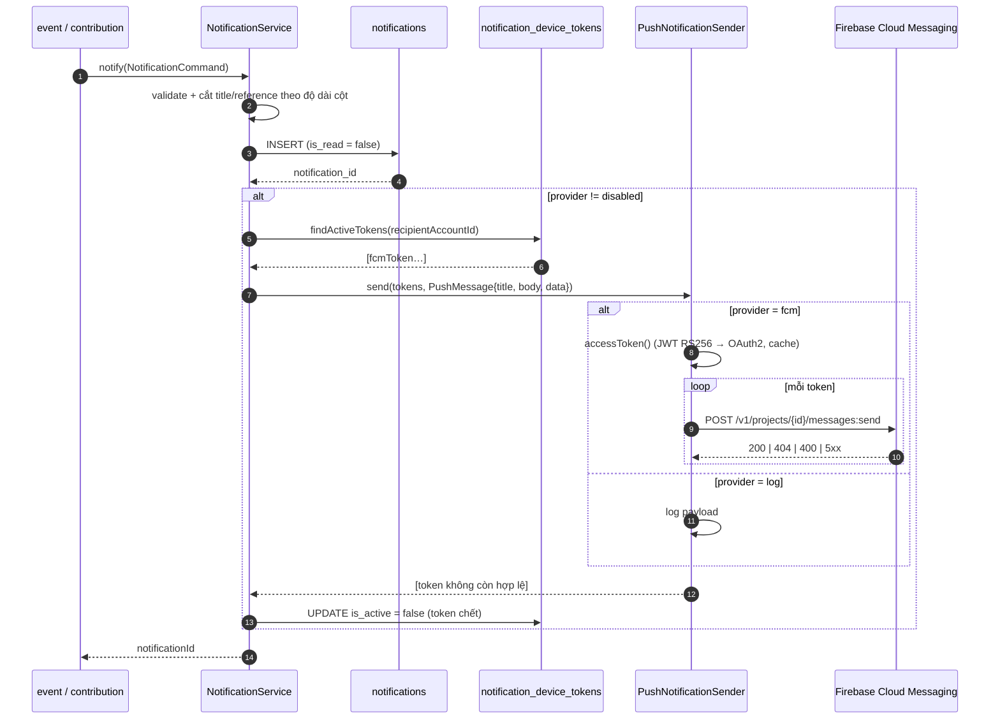
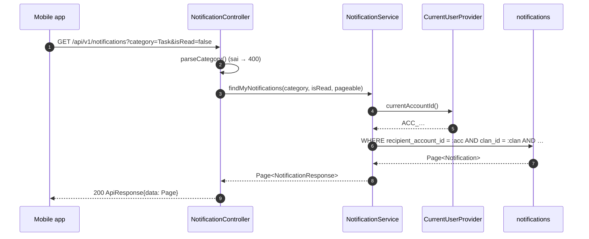

# Đặc Tả Kỹ Thuật & Hướng Dẫn Vận Hành US-39: NotificationService Đa Nhóm (Events / Tasks / Finance), Push FCM & API Đánh Dấu Đã Đọc

> **Trạng thái:** ✅ Đã hoàn thành (Backend)
> **Bounded Context sở hữu:** `com.familyfund.notification` (module mới)
> **Migration:** `V23__create_notifications_and_device_tokens.sql`
> **Số test tự động của tính năng:** **103** (xem §5.4) — toàn bộ suite: **980 test / 0 failure** (171 test class)

---

## 1. Tổng Quan Nghiệp Vụ (User Story & Acceptance Criteria)

### Mô tả User Story

Là một **thành viên dòng họ** dùng ứng dụng di động, tôi muốn có **một hộp thư thông báo duy nhất** được chia thành 3 nhóm rõ ràng — **Sự kiện (Events)**, **Công việc (Tasks)** và **Tài chính (Finance)** — để:

* xem lại mọi việc liên quan đến tôi ở một nơi, không phải mở từng màn hình sự kiện/công việc/quỹ;
* nhận **push notification** trên điện thoại khi có việc mới, kể cả khi ứng dụng đã đóng;
* **đánh dấu đã đọc** (`is_read = true`) từng thông báo hoặc toàn bộ, để badge số chưa đọc phản ánh đúng thực tế.

Trước US-39, hệ thống chỉ có hai bảng ghi vết rời rạc (`event_notifications`, `task_progress_alerts`) và một cổng gửi thông báo chỉ **ghi log** (`LoggingNotificationSender`). Không có khái niệm "hộp thư của tôi", không có phân nhóm, không có trạng thái đã đọc thống nhất và không có kênh push thật.

### Tiêu chí chấp nhận (Acceptance Criteria - AC)

| Mã | Tiêu chí | Cách kiểm chứng |
| :--- | :--- | :--- |
| **AC-01** | Tồn tại `NotificationService` công khai (gói `notification::api`) cho phép ghi một thông báo cho **đúng một tài khoản nhận** với **một trong ba nhóm** `Event` / `Task` / `Finance`. | `NotificationServiceImplTest#notify()` (15 test) |
| **AC-02** | Mỗi thông báo được lưu bền vào bảng `notifications` với `clan_id`, `recipient_account_id`, `category`, `title`, `content`, `reference_type`, `reference_id`, `is_read = false`, `created_at`. | `NotificationControllerIntegrationTest`, `DatabaseMigrationTest` |
| **AC-03** | Ba nhóm thông báo được ràng buộc ở tầng CSDL: `CHECK (category IN ('Event','Task','Finance'))`. Không thể ghi nhóm ngoài danh sách. | V23 + `NotificationCategory` enum |
| **AC-04** | Hộp thư có API đọc **chỉ của chính người gọi**: `GET /api/v1/notifications` (lọc `category`, `isRead`, phân trang, mới nhất trước). Không có tham số `accountId` — danh tính lấy từ JWT. | `NotificationControllerTest`, `NotificationControllerIntegrationTest#listIsScopedToCaller` |
| **AC-05** | Có API badge chưa đọc: `GET /api/v1/notifications/unread-count` trả `total` + `byCategory{event,task,finance}`. | `NotificationControllerIntegrationTest#unreadCountReflectsStoredRows` |
| **AC-06** | Có API đánh dấu đã đọc một thông báo: `PATCH /api/v1/notifications/{notificationId}/read` → `is_read = true`, `read_at = now`. | `NotificationControllerIntegrationTest#markAsReadPersistsState` |
| **AC-07** | Có API đánh dấu đã đọc tất cả: `PATCH /api/v1/notifications/read-all?category=` → trả `markedCount`; không đụng tới thông báo của tài khoản khác. | `markAllAsReadIsScopedToCaller`, `markAllAsReadByCategory` |
| **AC-08** | Đọc/ghi chéo tài khoản trả **404** (không phải 403) để không thể dò id thông báo của người khác. | `markAsReadForeignNotificationIsNotFound` (unit + integration) |
| **AC-09** | Tích hợp **Firebase Cloud Messaging (HTTP v1)**: mỗi thông báo được push tới **mọi device token đang hoạt động** của người nhận. | `FcmPushNotificationSenderTest` (15 test), `ServiceAccountAccessTokenProviderTest` (9 test) |
| **AC-10** | Client đăng ký/huỷ đăng ký thiết bị: `POST /api/v1/notifications/device-tokens`, `DELETE /api/v1/notifications/device-tokens?fcmToken=`. `fcm_token` là **UNIQUE** — đăng ký lại sẽ chuyển quyền sở hữu token sang tài khoản đăng nhập sau. | `NotificationControllerIntegrationTest#registerDeviceTokenPersistsRow`, `#unregisterDeviceTokenDeactivates` |
| **AC-11** | Push là **best effort**: lỗi push (mất mạng, 5xx, thiếu credential) **không** làm mất thông báo trong hộp thư và **không** làm fail request nghiệp vụ đã sinh ra nó. | `NotificationServiceImplTest#pushFailureIsSwallowed`, `FcmPushNotificationSenderTest#tokenProviderFailureSkipsPush` |
| **AC-12** | Token bị FCM báo `UNREGISTERED` / `INVALID_ARGUMENT` được **tự động vô hiệu hoá** (`is_active = false`) để không push lại. | `NotificationServiceImplTest#deactivatesInvalidTokens` |
| **AC-13** | Nguồn thông báo nghiệp vụ được nối vào hộp thư: mở đăng ký sự kiện, đổi lịch trình, phân công việc, cảnh báo tiến độ 24h (US-08), leo thang 12h (US-47), thay đổi vai trò, ghi nhận đóng góp tiền mặt. | `NotificationInboxListenerTest` (13 test), `CashContributionServiceImplTest` (+2 test) |
| **AC-14** | Module `notification` **không** bị phụ thuộc vòng: `event`/`contribution` không phụ thuộc `notification`, và `notification` chỉ dùng `event::api`, `identity::api`, `genealogy::api`, `core`. | `ArchitectureTest`, `docs/guidelines/modulith-rules.md` |
| **AC-15** | Chạy được **không cần** dự án Firebase: `app.notification.push.provider=log` (mặc định) ghi payload ra log, hộp thư vẫn hoạt động đầy đủ. | `LoggingPushNotificationSender`, `application.yaml` |

---

## 2. Thiết Kế Kiến Trúc & Ranh Giới Bounded Context

### Vì sao tạo module mới `com.familyfund.notification`?

Thông báo là **năng lực dùng chung** của ít nhất ba bounded context (sự kiện, công việc, tài chính). Nếu đặt `NotificationService` trong `event` thì `contribution`/`finance` buộc phải phụ thuộc `event::api` chỉ để gửi thông báo — sai ngữ nghĩa và tạo cạnh phụ thuộc giả. Module riêng giữ đúng hướng phụ thuộc và cho phép mọi module gọi qua `notification::api`.

### Đồ thị phụ thuộc (sau US-39)

```text
                 ┌──────────────────────────┐
                 │  notification            │  ← module mới (US-39)
                 │  api + internal          │
                 └───────┬──────────┬───────┘
        consumes event::api │          │ consumes identity::api, genealogy::api
                 ┌──────────▼───┐  ┌───▼────────────────────┐
                 │  event       │  │  identity / genealogy  │
                 └──────────────┘  └────────────────────────┘

  contribution ──► notification::api   (Finance: biên nhận đóng góp)
  event ──publish──► TaskProgressAlertIssuedDomainEvent ──► notification (listener)
```

**Điểm mấu chốt:** chiều `notification → event::api` **đã tồn tại**, nên `event → notification::api` sẽ là **chu trình** và bị `ArchitectureTest` chặn. Vì vậy:

* `event` **không** gọi trực tiếp `NotificationService`. Nó chỉ **công bố domain event** công khai (`TaskProgressAlertIssuedDomainEvent`, cùng các event đã có từ US-22/US-07/US-03).
* `notification` **lắng nghe** các event đó (`NotificationInboxListener`) và tự ghi hộp thư.
* `contribution` thì được phép gọi trực tiếp `notification::api` (một chiều, không vòng).

### `package-info.java` của module mới

```java
@org.springframework.modulith.ApplicationModule(
        allowedDependencies = {"core", "event::api", "identity::api", "genealogy::api"}
)
package com.familyfund.notification;
```

`contribution` được mở thêm đúng một quyền: `"notification::api"`.

### Danh Mục File Mã Nguồn

| Tầng | File | Vai trò |
| :--- | :--- | :--- |
| API | `notification/api/NotificationService.java` | Hợp đồng công khai: write path + read path + device token |
| API | `notification/api/NotificationCategory.java` | Enum 3 nhóm, trùng `CHECK` của CSDL |
| API | `notification/api/NotificationCommand.java` | Record lệnh ghi thông báo |
| API | `notification/api/dto/NotificationResponse.java` | Read model của hộp thư |
| API | `notification/api/dto/UnreadCountResponse.java` | Badge `total` + `byCategory` |
| API | `notification/api/dto/RegisterDeviceTokenRequest.java` | Payload đăng ký thiết bị (có Bean Validation) |
| API | `notification/api/dto/DeviceTokenResponse.java` | Kết quả đăng ký thiết bị |
| Internal | `notification/internal/entity/Notification.java` | Entity ⇄ bảng `notifications` |
| Internal | `notification/internal/entity/NotificationDeviceToken.java` | Entity ⇄ bảng `notification_device_tokens` |
| Internal | `notification/internal/repository/NotificationRepository.java` | Truy vấn hộp thư + bulk `markAllUnreadAsRead` |
| Internal | `notification/internal/repository/NotificationDeviceTokenRepository.java` | Token theo tài khoản, chỉ token `is_active` |
| Internal | `notification/internal/service/NotificationServiceImpl.java` | Cài đặt `NotificationService` (persist → push) |
| Internal | `notification/internal/controller/NotificationController.java` | 6 endpoint hộp thư |
| Internal | `notification/internal/listener/NotificationInboxListener.java` | Chuyển domain event → hộp thư (3 nhóm) |
| Internal | `notification/internal/push/PushNotificationSender.java` | Cổng push (port) |
| Internal | `notification/internal/push/LoggingPushNotificationSender.java` | Adapter mặc định (log, không cần Firebase) |
| Internal | `notification/internal/push/FcmPushNotificationSender.java` | Adapter FCM HTTP v1 |
| Internal | `notification/internal/push/ServiceAccountAccessTokenProvider.java` | JWT RS256 + đổi access token (không cần SDK) |
| Internal | `notification/internal/push/GoogleHttpClient.java` | Cổng HTTP nhỏ, test được không cần mạng |
| Internal | `notification/internal/push/PushProperties.java` | `@ConfigurationProperties(app.notification.push)` |
| Internal | `notification/internal/config/FcmPushConfig.java` | Chọn adapter theo `provider` |
| Internal | `notification/internal/util/NotificationKeyGenerator.java` | Sinh `NTC…` / `DVT…` (≤ 20 ký tự) |
| Sửa | `identity/api/IdentityRoleCommandService.java` | Thêm `findActiveAccountsByClan(clanId)` |
| Sửa | `identity/internal/repository/UserAccountRepository.java` | Thêm `findByMemberIdIn(...)` |
| Sửa | `event/api/event/TaskProgressAlertIssuedDomainEvent.java` | **Mới**: event công khai cho hộp thư |
| Sửa | `event/internal/service/TaskProgressWarningIssuer.java` | Publish event sau khi gửi cảnh báo 24h |
| Sửa | `event/internal/service/TaskOverdueEscalationIssuer.java` | Publish event sau khi leo thang 12h |
| Sửa | `contribution/internal/service/CashContributionServiceImpl.java` | Ghi biên nhận vào hộp thư `Finance` của người nộp |
| Sửa | `contribution/package-info.java` | Thêm `notification::api` |
| Sửa | `src/main/resources/application.yaml` | `app.notification.*` |

---

## 3. Thiết Kế Cơ Sở Dữ Liệu (Database Schema)

### Bảng `notifications` (Flyway V23)

| Cột | Kiểu | Ràng buộc | Ghi chú |
| :--- | :--- | :--- | :--- |
| `notification_id` | `VARCHAR(20)` | **PK** | Sinh bởi `NotificationKeyGenerator` (`NTC` + 8 Base36 + 6 Base32) |
| `clan_id` | `VARCHAR(20)` | **NOT NULL**, FK → `clans` `ON DELETE CASCADE` | Cách ly đa tenant |
| `recipient_account_id` | `VARCHAR(20)` | **NOT NULL**, FK → `user_accounts` `ON DELETE CASCADE` | **Chủ sở hữu** thông báo |
| `category` | `VARCHAR(20)` | **NOT NULL**, `CHECK IN ('Event','Task','Finance')` | 3 nhóm của US-39 |
| `title` | `VARCHAR(200)` | **NOT NULL** | Service cắt bớt nếu dài hơn 200 |
| `content` | `TEXT` | **NOT NULL** | Nội dung hiển thị |
| `reference_type` | `VARCHAR(30)` | NULL | `EVENT` / `TASK` / `CONTRIBUTION` / `ROLE` |
| `reference_id` | `VARCHAR(20)` | NULL | Id đối tượng nghiệp vụ (deep-link) |
| `is_read` | `BOOLEAN` | **NOT NULL DEFAULT FALSE** | Trạng thái đã đọc |
| `read_at` | `TIMESTAMPTZ` | NULL | Thời điểm đánh dấu đọc |
| `created_at` | `TIMESTAMPTZ` | **NOT NULL DEFAULT CURRENT_TIMESTAMP** | Sắp xếp hộp thư |

Index:

```sql
idx_notification_recipient_created   ON notifications(recipient_account_id, created_at DESC)
idx_notification_recipient_category  ON notifications(recipient_account_id, category)
idx_notification_clan                ON notifications(clan_id)
idx_notification_unread              ON notifications(recipient_account_id) WHERE is_read = FALSE
```

`idx_notification_unread` là **partial index**: badge chưa đọc là truy vấn nóng nhất và chỉ quan tâm `is_read = FALSE`, nên index chỉ chứa đúng các dòng đó.

### Bảng `notification_device_tokens` (Flyway V23)

| Cột | Kiểu | Ràng buộc | Ghi chú |
| :--- | :--- | :--- | :--- |
| `token_id` | `VARCHAR(20)` | **PK** | `DVT` + timestamp + suffix |
| `account_id` | `VARCHAR(20)` | **NOT NULL**, FK → `user_accounts` `ON DELETE CASCADE` | Chủ thiết bị hiện tại |
| `fcm_token` | `VARCHAR(255)` | **NOT NULL**, **UNIQUE** | Một thiết bị ⇄ một dòng |
| `platform` | `VARCHAR(20)` | **NOT NULL DEFAULT 'Android'**, `CHECK IN ('Android','IOS','Web')` | Đồng bộ với `RegisterDeviceTokenRequest` |
| `is_active` | `BOOLEAN` | **NOT NULL DEFAULT TRUE** | `false` khi logout hoặc FCM báo token chết |
| `created_at` | `TIMESTAMPTZ` | **NOT NULL DEFAULT CURRENT_TIMESTAMP** | |
| `last_seen_at` | `TIMESTAMPTZ` | NULL | Cập nhật mỗi lần đăng ký lại |

### Ánh Xạ Schema ⇄ Entity ⇄ DTO

| Cột CSDL | `Notification` (entity) | `NotificationResponse` (DTO) | Ghi chú |
| :--- | :--- | :--- | :--- |
| `notification_id` | `notificationId` | `notificationId` | |
| `clan_id` | `clanId` | `clanId` | Trả về để client biết tenant |
| `recipient_account_id` | `recipientAccountId` | *không trả* | Danh tính ngầm định của người gọi |
| `category` | `category` (`@Enumerated(STRING)`) | `category` | Enum ⇄ `CHECK` |
| `title` | `title` | `title` | |
| `content` | `content` (`columnDefinition = "TEXT"`) | `content` | |
| `reference_type` | `referenceType` | `referenceType` | |
| `reference_id` | `referenceId` | `referenceId` | |
| `is_read` | `isRead` (`Boolean`) | `isRead` | |
| `read_at` | `readAt` (`Instant`) | `readAt` | |
| `created_at` | `createdAt` (`Instant`) | `createdAt` | |

`ddl-auto: validate` bắt buộc entity khớp tuyệt đối với V23 (độ dài, nullability, `TEXT`) — đây là lý do mọi cột đều khai báo `length`/`columnDefinition` tường minh.

### Ánh Xạ Enum ⇄ Ràng Buộc CSDL

| `NotificationCategory` | Giá trị lưu | Nguồn phát sinh |
| :--- | :--- | :--- |
| `Event` | `'Event'` | Mở đăng ký sự kiện, đổi lịch trình, thay đổi vai trò trong sự kiện |
| `Task` | `'Task'` | Phân công việc, cảnh báo 24h (US-08), leo thang 12h (US-47) |
| `Finance` | `'Finance'` | Ghi nhận đóng góp tiền mặt / biên nhận điện tử (US-09) |

---

## 4. Luồng Nghiệp Vụ Chi Tiết

### 4.1. Ghi thông báo + push (write path)



**Thứ tự cố ý:** lưu trước, push sau. Hộp thư là **nguồn sự thật**; push chỉ là kênh phụ. Toàn bộ khối push nằm trong `try/catch` nên lỗi FCM không thể rollback thông báo (AC-11).

### 4.2. Đọc hộp thư (read path) — luôn tự giới hạn theo người gọi



Không endpoint nào nhận `accountId` từ client. `TenantContext` lấy `clan_id` từ JWT/`X-Clan-Id` do `TenantFilter` thiết lập.

### 4.3. Đánh dấu đã đọc

| Thao tác | Endpoint | Hành vi |
| :--- | :--- | :--- |
| Một thông báo | `PATCH /api/v1/notifications/{id}/read` | Tìm theo `(notification_id, recipient_account_id)`. Không thấy → **404**. Đã đọc rồi → **idempotent** (giữ nguyên `read_at`, không UPDATE). |
| Tất cả | `PATCH /api/v1/notifications/read-all` | Bulk `UPDATE … WHERE recipient_account_id = :acc AND is_read = false` → trả `markedCount`. |
| Tất cả theo nhóm | `PATCH …/read-all?category=Finance` | Như trên + `AND category = :category`. |

Bulk update dùng `@Modifying` thay vì load entity: hộp thư có thể vài nghìn dòng và "đọc tất cả" không được phụ thuộc kích thước dữ liệu.

### 4.4. Đăng ký / huỷ thiết bị nhận push

| Bước | Hành vi |
| :--- | :--- |
| Client lấy FCM registration token từ SDK | — |
| `POST /api/v1/notifications/device-tokens` | `fcm_token` UNIQUE → nếu đã tồn tại thì **chuyển chủ** sang tài khoản đang đăng nhập, set `is_active = true`, cập nhật `platform` + `last_seen_at`; nếu chưa có thì tạo mới. |
| Logout | `DELETE /api/v1/notifications/device-tokens?fcmToken=…` → `is_active = false`. Token của tài khoản khác bị **bỏ qua** (chỉ log WARN), không cho phép vô hiệu hoá thiết bị người khác. |
| FCM báo token chết | Service tự set `is_active = false` sau lần push đầu tiên thất bại với `UNREGISTERED`/`INVALID_ARGUMENT`. |

### 4.5. Nguồn phát sinh thông báo (ai ghi gì vào nhóm nào)

| Domain event / lời gọi | Nhóm | Người nhận |
| :--- | :--- | :--- |
| `EventOpenedDomainEvent` | `Event` | **Toàn bộ tài khoản đang hoạt động của dòng họ** (`findActiveAccountsByClan`) |
| `EventScheduleChangedDomainEvent` | `Event` | Như trên, nội dung là `contentChanges` |
| `TaskAssignedDomainEvent` | `Task` | Tài khoản của `assigned_member_id` + tài khoản của mọi thành viên `assigned_branch_id` (khử trùng lặp) |
| `TaskProgressAlertIssuedDomainEvent` (`Reminder24H`) | `Task` | Tài khoản đã nhận cảnh báo US-08 |
| `TaskProgressAlertIssuedDomainEvent` (`OverdueAlert12H`) | `Task` | Trưởng chi đại diện nhánh (US-47) |
| `RoleChangedDomainEvent` | `Event` | `target_account_id`, fallback tra theo `target_member_id` |
| `CashContributionServiceImpl#recordCashContribution` | `Finance` | Tài khoản của người nộp (bỏ qua nếu thành viên chưa có tài khoản) |

Mỗi thông báo được ghi **độc lập**: một người nhận lỗi không chặn những người còn lại (`notifyQuietly`).

### 4.6. Trạng thái `is_read`

```text
  (tạo)  is_read = FALSE, read_at = NULL
     │
     ├── PATCH /{id}/read ──────► is_read = TRUE, read_at = now   (idempotent)
     └── PATCH /read-all ───────► is_read = TRUE, read_at = now   (bulk, mọi dòng chưa đọc)
```

Không có chuyển ngược "đã đọc → chưa đọc" trong phạm vi US-39.

---

## 5. Cấu Hình Vận Hành & Hướng Dẫn Kiểm Thử

### 5.1. Cấu hình (`application.yaml`)

```yaml
app:
  notification:
    inbox:
      # Bật/tắt việc phản chiếu domain event vào hộp thư (test tắt để không ghi DB ngoài transaction)
      enabled: ${APP_NOTIFICATION_INBOX_ENABLED:true}
    push:
      # log = không cần Firebase (payload ghi ra log); fcm = Firebase Cloud Messaging HTTP v1
      provider: ${APP_NOTIFICATION_PUSH_PROVIDER:log}
      project-id: ${APP_NOTIFICATION_FCM_PROJECT_ID:}
      service-account-path: ${APP_NOTIFICATION_FCM_SERVICE_ACCOUNT_PATH:}
      token-uri: ${APP_NOTIFICATION_FCM_TOKEN_URI:https://oauth2.googleapis.com/token}
      base-url: ${APP_NOTIFICATION_FCM_BASE_URL:https://fcm.googleapis.com}
```

Bật push thật:

```bash
export APP_NOTIFICATION_PUSH_PROVIDER=fcm
export APP_NOTIFICATION_FCM_PROJECT_ID=<firebase-project-id>
export APP_NOTIFICATION_FCM_SERVICE_ACCOUNT_PATH=/run/secrets/firebase-service-account.json
```

File service account là JSON tải từ Firebase Console → *Project settings* → *Service accounts* → *Generate new private key* (chứa `client_email`, `private_key`, `token_uri`). **Không commit file này.**

Nếu `provider=fcm` nhưng thiếu `project-id` hoặc file không đọc được, adapter tự **degrade**: log WARN lúc khởi động, `isEnabled() = false`, thông báo vẫn được lưu vào hộp thư.

> **Vì sao không dùng `firebase-admin`?** Adapter FCM chỉ cần đúng hai việc: ký JWT RS256 và POST JSON. Làm bằng `java.security` + `HttpClient` của JDK giữ `build.gradle.kts` **không đổi** (không kéo theo gRPC/guava), và cho phép test toàn bộ luồng offline qua cổng `GoogleHttpClient`. Có thể thay bằng SDK chính thức sau này mà không đổi `PushNotificationSender`.

### 5.2. Ma trận HTTP (đã kiểm chứng trên server chạy thật)

| # | Request | Kỳ vọng |
| :--- | :--- | :--- |
| 1 | `GET /api/v1/notifications` (không token) | **401** |
| 2 | `GET /api/v1/notifications` (token hợp lệ) | **200** `{success:true, data:{content:[…], totalElements, …}}` |
| 3 | `GET /api/v1/notifications?category=Finance` | **200**, chỉ nhóm Finance |
| 4 | `GET /api/v1/notifications?category=Bogus` | **400** `Nhóm thông báo không hợp lệ: 'Bogus'…` |
| 5 | `GET /api/v1/notifications?size=500` | **200**, `size` bị chặn về **100** |
| 6 | `GET /api/v1/notifications/unread-count` | **200** `{total, byCategory:{event,task,finance}}` |
| 7 | `PATCH /api/v1/notifications/{id}/read` | **200** `isRead:true`, `readAt` khác null |
| 8 | `PATCH /api/v1/notifications/{id}/read` (id của tài khoản khác) | **404** |
| 9 | `PATCH /api/v1/notifications/read-all` | **200** `{markedCount:N}` |
| 10 | `POST /api/v1/notifications/device-tokens` `{fcmToken, platform}` | **201** `{tokenId, platform}` |
| 11 | `POST /api/v1/notifications/device-tokens` `{fcmToken:"   "}` | **400** (Bean Validation) |
| 12 | `POST /api/v1/notifications/device-tokens` `platform:"Symbian"` | **400** |
| 13 | `DELETE /api/v1/notifications/device-tokens?fcmToken=…` | **200**, `is_active = false` |
| 14 | `POST /api/v1/notifications` (sai verb) | **405** |

### 5.3. Kịch bản kiểm thử E2E bằng cURL

```bash
BASE=http://localhost:8080/api/v1

# 1) Đăng nhập (payload đúng: loginIdentifier + password)
TOKEN=$(curl -s -X POST "$BASE/auth/login" \
  -H 'Content-Type: application/json' \
  -d '{"loginIdentifier":"0901234567","password":"<mat-khau>"}' \
  | python -c 'import sys,json;print(json.load(sys.stdin)["data"]["accessToken"])')

# 2) Đăng ký thiết bị nhận push
curl -s -X POST "$BASE/notifications/device-tokens" \
  -H "Authorization: Bearer $TOKEN" -H 'Content-Type: application/json' \
  -d '{"fcmToken":"fcm-demo-token-001","platform":"Android"}'

# 3) Xem hộp thư (mới nhất trước)
curl -s "$BASE/notifications?size=10" -H "Authorization: Bearer $TOKEN"

# 4) Lọc nhóm + chưa đọc
curl -s "$BASE/notifications?category=Task&isRead=false" -H "Authorization: Bearer $TOKEN"

# 5) Badge chưa đọc
curl -s "$BASE/notifications/unread-count" -H "Authorization: Bearer $TOKEN"

# 6) Đánh dấu một thông báo đã đọc
curl -s -X PATCH "$BASE/notifications/<notificationId>/read" -H "Authorization: Bearer $TOKEN"

# 7) Đánh dấu tất cả (hoặc một nhóm)
curl -s -X PATCH "$BASE/notifications/read-all" -H "Authorization: Bearer $TOKEN"
curl -s -X PATCH "$BASE/notifications/read-all?category=Finance" -H "Authorization: Bearer $TOKEN"

# 8) Huỷ đăng ký thiết bị (logout)
curl -s -X DELETE "$BASE/notifications/device-tokens?fcmToken=fcm-demo-token-001" \
  -H "Authorization: Bearer $TOKEN"
```

**Ghi chú kiểm thử trên DB dev dùng chung:** các lời gọi `POST`/`PATCH` ở trên **có ghi dữ liệu thật**. Để kiểm chứng luồng thành công mà không để lại rác, dùng các test integration (`@Transactional` + rollback) trong §5.4; chỉ dùng cURL cho các nhánh lỗi (`401`, `400`, `404`) hoặc sau khi đã chấp nhận dữ liệu demo.

### 5.4. Kiểm thử tự động

```bash
# Toàn bộ tính năng US-39
./gradlew.bat test --tests "com.familyfund.notification.*"

# Phần đã sửa ở module khác
./gradlew.bat test --tests "com.familyfund.contribution.internal.service.CashContributionServiceImplTest"
./gradlew.bat test --tests "com.familyfund.event.internal.service.TaskProgressWarningIssuerTest"
./gradlew.bat test --tests "com.familyfund.event.internal.service.TaskOverdueEscalationIssuerTest"

# Kiến trúc module (không rò rỉ internal, không phụ thuộc vòng)
./gradlew.bat test --tests "com.familyfund.ArchitectureTest"
```

| Lớp test | Số test | Nội dung |
| :--- | :---: | :--- |
| `NotificationServiceImplTest` — `notify()` | 15 | Sinh id, ép `is_read=false`, cắt `title`/`reference` theo độ dài cột, validate 5 trường bắt buộc, push tới token đang hoạt động, bỏ push khi provider tắt, vô hiệu hoá token chết, nuốt lỗi push |
| `NotificationServiceImplTest` — `inbox queries` | 12 | 4 tổ hợp lọc, map DTO, badge theo nhóm, mark-as-read + idempotent, 404 chéo tài khoản, mark-all (có/không nhóm), chặn người gọi chưa xác thực |
| `NotificationServiceImplTest` — `device tokens` | 10 | Đăng ký mới, chuyển chủ token UNIQUE, mặc định `Android`, từ chối platform lạ / token > 255 / token rỗng, huỷ đăng ký (của mình / của người khác / không tồn tại), payload push không có reference |
| `NotificationControllerTest` | 13 | Hợp đồng 6 endpoint, phân trang mặc định + chặn `size=500`→100, lọc, 400 cho `category` lạ, 404 cho id lạ, validate `fcmToken`/`platform` |
| `NotificationControllerIntegrationTest` | 13 | Spring Security + `TenantFilter` + JPA + Flyway thật (PostgreSQL, rollback): cô lập theo tài khoản, lọc, badge, mark-read, 404 chéo, read-all theo nhóm, đăng ký/huỷ thiết bị, 401 |
| `NotificationInboxListenerTest` | 13 | Fan-out theo dòng họ, nội dung event mở/đổi lịch, phân công (member + branch, khử trùng), cảnh báo tiến độ, thay đổi vai trò (trực tiếp + fallback), cô lập lỗi từng người nhận |
| `FcmPushNotificationSenderTest` | 15 | Bật/tắt theo cấu hình, một request mỗi token, hình dạng payload (notification/data/android/apns), 404 + 400 → token chết, 5xx + mạng lỗi → giữ token, token provider lỗi → bỏ push |
| `ServiceAccountAccessTokenProviderTest` | 9 | Đọc service account, JWT 3 phần với `iss/scope/aud/iat/exp`, ký RS256 bằng khoá RSA sinh tại chỗ, cache token, 401 → `IllegalStateException`, thiếu `client_email` |
| `NotificationKeyGeneratorTest` | 3 | Tiền tố `NTC`/`DVT`, độ dài ≤ 20, 200 id liên tiếp không trùng |
| `CashContributionServiceImplTest` (bổ sung) | 2 | Ghi biên nhận vào hộp thư `Finance` của người nộp; bỏ qua khi thành viên chưa có tài khoản |
| **Tổng cộng** | **103** | |

> **Toàn bộ suite sau US-39: `./gradlew.bat test` → BUILD SUCCESSFUL, 171 test class, 980 test, 0 failure** (trước US-39 là 875 test).

### 5.5. Log kỳ vọng

```text
# provider=log (mặc định)
[ThongBao Push] provider=log devices=2 title="Bạn được giao việc: Chuẩn bị mâm cỗ" body="..." data={category=Task, ...}

# provider=fcm, token bị FCM từ chối
FCM rejected device token as unregistered (status 404); it will be deactivated
Deactivated invalid FCM token DVT… of account ACC…

# provider=fcm thiếu cấu hình
Push provider is 'fcm' but the configuration is incomplete (project-id / service-account-path); notifications will be persisted without push
```

---

## 6. Phạm Vi, Giới Hạn & Các Bước Tiếp Theo

### Trong phạm vi US-39

* Module `notification` với `NotificationService` (ghi + đọc + badge + đánh dấu đọc + device token).
* Bảng `notifications` + `notification_device_tokens` (V23) và toàn bộ index.
* Adapter FCM HTTP v1 (kèm JWT RS256 tự ký) và adapter log mặc định.
* Nối 7 nguồn thông báo nghiệp vụ hiện có vào hộp thư (Event / Task / Finance).
* 103 test tự động, kiến trúc module vẫn xanh.

### Giới hạn đã biết

| Giới hạn | Lý do / hướng xử lý |
| :--- | :--- |
| Push gửi **tuần tự từng token**, chưa batch/retry | FCM v1 không nhận danh sách token; số thiết bị mỗi người rất nhỏ. Có thể chuyển sang topic hoặc hàng đợi khi cần. |
| Chưa có "xoá thông báo" và "đánh dấu chưa đọc" | Không nằm trong AC của US-39; thêm endpoint + cột `deleted_at` nếu cần. |
| Fan-out sự kiện theo **toàn bộ dòng họ** | Dòng họ gia đình có quy mô nhỏ (hàng chục tài khoản) và chạy trên `@Async`. Nếu vượt vài nghìn, chuyển sang bảng `notification_broadcasts` + đọc lazy. |
| Thông báo đơn xin gia nhập (`identity`) **chưa** vào hộp thư | Nội dung không thuộc 3 nhóm của US-39; giữ nguyên `JoinRequestNotificationSender` hiện tại. |
| Chưa có UI | Đây là phạm vi backend; client chỉ cần 6 endpoint trong §5.2. |

### Bước tiếp theo đề xuất

1. **Frontend**: màn hình hộp thư 3 tab (Sự kiện / Công việc / Tài chính) + badge từ `unread-count`.
2. **US-26 (Finance)**: khi có phiếu tạm ứng/quyết toán, phát thêm thông báo `Finance` qua cùng `NotificationService`.
3. **Retry & dead-letter**: nếu cần đảm bảo push, đưa lời gọi FCM vào hàng đợi có retry + metric.
4. **Dọn dẹp định kỳ**: job xoá thông báo `is_read = true` cũ hơn N tháng để bảng không phình.
