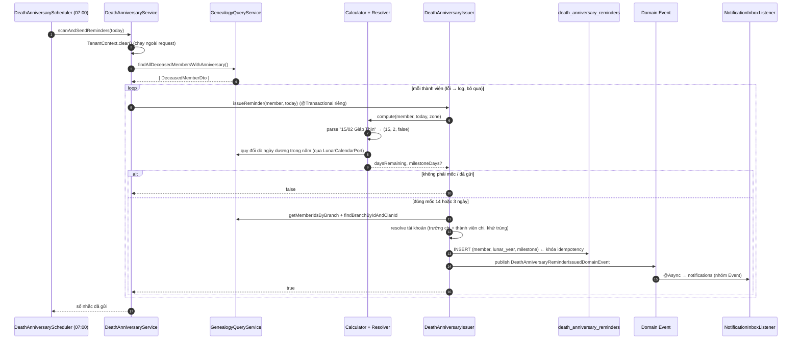

# Đặc Tả Kỹ Thuật & Hướng Dẫn Vận Hành US-40: Cron Job Hằng Ngày Đối Chiếu Ngày Giỗ Âm Lịch & Gợi Ý Sự Kiện "Đám Giỗ"

> **Trạng thái:** ✅ Đã hoàn thành (Backend)
> **Bounded Context sở hữu:** `com.familyfund.event` (job) — tiêu thụ `genealogy::api` (ngày giỗ, lịch âm), `identity::api` (tài khoản chi/nhánh)
> **Migration:** `V24__create_death_anniversary_reminders.sql`
> **Số test tự động của tính năng:** **94** (xem §5.5) — toàn bộ suite: **1057 test / 0 failure** (180 test class)

---

## 1. Tổng Quan Nghiệp Vụ (User Story & Acceptance Criteria)

### Mô tả User Story

Là **trưởng tộc / trưởng chi**, tôi muốn hệ thống **tự động nhắc ngày giỗ của các bậc tiền nhân** dựa trên ngày giỗ âm lịch đã ghi ở hồ sơ thành viên (US-27), để dòng họ có đủ thời gian chuẩn bị mâm cỗ và mời con cháu; và khi đến gần ngày giỗ, hệ thống **gợi ý sẵn payload tạo sự kiện "Đám giỗ"** để tôi chỉ cần xem lại và bấm tạo, không phải tự quy đổi âm–dương lịch.

Trước US-40, `death_date_lunar` chỉ là một chuỗi hiển thị (`"15/02 Giáp Thìn"`): không có gì quét nó hằng ngày, không có thông báo, và người dùng phải tự tra lịch để biết năm nay ngày giỗ rơi vào dương lịch nào.

### Tiêu chí chấp nhận (Acceptance Criteria - AC)

| Mã | Tiêu chí | Cách kiểm chứng |
| :--- | :--- | :--- |
| **AC-01** | Có **cron job chạy hằng ngày** (`app.death-anniversary.cron`, mặc định `0 0 7 * * *` = 07:00 mỗi ngày, giờ `Asia/Ho_Chi_Minh`) quét mọi thành viên `Deceased` có `death_date_lunar`. | `DeathAnniversarySchedulerTest`, `DeathAnniversaryJobIntegrationTest` |
| **AC-02** | Job **đối chiếu ngày giỗ âm lịch với lịch hiện tại**: parse `death_date_lunar` (`dd/MM [Nhuận] Can Chi`) và **quy đổi sang ngày Dương lịch của năm nay** bằng đúng thuật toán US-27. | `LunarAnniversaryResolverTest` (9), `DeathAnniversaryCalculatorTest` (14) |
| **AC-03** | Khi chạm **mốc cấu hình** `app.death-anniversary.milestones` (mặc định **trước 14 ngày** và **trước 3 ngày**), job gửi **thông báo nhắc giỗ**. | `DeathAnniversaryIssuerTest`, integration test |
| **AC-04** | Thông báo đi vào **hộp thư cá nhân** (US-39, nhóm `Event`) của **trưởng chi và toàn bộ thành viên có tài khoản trong chi**, không trùng người nhận. | `DeathAnniversaryIssuerTest#deduplicatesRecipients`, `NotificationInboxListenerTest` |
| **AC-05** | Job **sinh payload gợi ý tạo sự kiện "Đám giỗ"** (`EventSuggestionDto`) khớp định dạng `POST /api/v1/events`; **không tự tạo sự kiện**. | `DeathAnniversaryCalculatorTest#buildsSuggestion` |
| **AC-06** | **Idempotent**: mỗi mốc chỉ gửi **một lần** cho mỗi thành viên trong mỗi năm (`UNIQUE (member_id, lunar_year, milestone_days)`), kể cả khi job chạy lặp hoặc server khởi động lại. | `DeathAnniversaryJobIntegrationTest#scanIsIdempotent` |
| **AC-07** | Có API xem trước: `GET /api/v1/events/death-anniversaries?from=&days=` trả danh sách ngày giỗ trong cửa sổ, kèm `suggestion` và cờ `alreadyReminded`. | `DeathAnniversaryControllerTest`, integration test |
| **AC-08** | Có API tra lịch sử nhắc: `GET /api/v1/events/death-anniversaries/{memberId}/reminders`; thành viên dòng họ khác trả **404** (không phải 403). | `DeathAnniversaryServiceImplTest#remindersOfForeignMemberIsNotFound` |
| **AC-09** | Có API chạy bù: `POST /api/v1/events/death-anniversaries/scan?date=` chỉ cho `ROLE_CLAN_HEAD`/`ROLE_ADMIN`, dùng cùng code path với cron. | `DeathAnniversaryControllerTest`, integration (`403` cho `ROLE_MEMBER`) |
| **AC-10** | Khi sự kiện cho ngày giỗ đó **đã tồn tại** (trùng ngày dương hoặc trùng nhãn âm lịch trong năm), API **không gợi ý trùng** (`suggestion = null`). | `DeathAnniversaryServiceImplTest#upcomingSuppressesCoveredSuggestion` |
| **AC-11** | Một thành viên lỗi (chuỗi âm lịch hỏng, thiếu tài khoản, publish lỗi) **không làm hỏng cả lượt quét**; lỗi được log và bỏ qua. | `DeathAnniversaryServiceImplTest#scanIsolatesFailures` |
| **AC-12** | Job chạy **xuyên dòng họ**, không phụ thuộc `TenantContext` của request; API đọc thì **giới hạn theo dòng họ** hiện hành. | `DeathAnniversaryServiceImplTest#scanClearsTenant`, integration |
| **AC-13** | Có thể **tắt job** bằng `app.death-anniversary.enabled=false` (profile test tắt để không ghi DB ngoài transaction). | `application.yaml`, `src/test/resources/application.properties` |
| **AC-14** | Ranh giới module nguyên vẹn: `event` chỉ dùng `genealogy::api`/`identity::api`/`core`; lịch âm được expose qua **port công khai** `LunarCalendarService` thay vì rò rỉ `genealogy.internal`. | `ArchitectureTest` |

---

## 2. Thiết Kế Kiến Trúc & Ranh Giới Bounded Context

### Vì sao job nằm ở `event` mà dữ liệu nằm ở `genealogy`?

* `members.death_date_lunar` thuộc `genealogy` → chỉ đọc được qua `GenealogyQueryService` (`genealogy::api`).
* "Nhắc giỗ" tồn tại để **tạo sự kiện Đám giỗ** → nghiệp vụ và bảng của US-40 nằm ở `event`, nơi đã có `events`, scheduler và hạ tầng US-08/US-47.
* Chiều phụ thuộc `event → genealogy::api` **đã có sẵn**, nên đặt job ở `event` là chiều hợp lệ duy nhất nếu không muốn tạo vòng.

### Lịch âm được expose qua port, không rò rỉ internal

Thuật toán Hồ Ngọc Đức (US-27) nằm trong `genealogy.internal.util.VietnameseLunarCalendarConverter` — internal nên module khác **không** được tham chiếu. Vì vậy thêm:

```
genealogy::api
  LunarCalendarService            (port: convertSolarToLunar / canChiOfYear)
  dto.LunarDateDto                (port DTO: day, month, year, leap, canChi)
  dto.DeceasedMemberDto           (thành viên đã mất + nhãn giỗ, chỉ trường lễ nghi)
genealogy.internal
  LunarCalendarServiceImpl        (adapter mỏng quanh VietnameseLunarCalendarConverter)
  GenealogyQueryServiceImpl       (+ findDeceasedMembersWithAnniversary(clanId), + findAllDeceasedMembersWithAnniversary())
```

Trong `event`, `LunarAnniversaryResolver` nhận một **functional port** `LunarCalendarPort` (một lambda `LocalDate -> LunarDateDto`), nên phần toán âm lịch test được bằng converter thật mà không cần Spring context và không mở rộng phụ thuộc.

### Đăng ký thông báo: publish domain event, không gọi chéo

`notification` đã phụ thuộc `event::api` (US-39), nên `event → notification` sẽ là **vòng**. Do đó:

```
event (job) --publish--> DeathAnniversaryReminderIssuedDomainEvent (event::api.event)
                                        |
                              notification.NotificationInboxListener
                                        |
                              notifications (hộp thư nhóm Event)
```

### Danh Mục File Mã Nguồn

| Tầng | File | Vai trò |
| :--- | :--- | :--- |
| API | `event/api/DeathAnniversaryService.java` | Hợp đồng: `scanAndSendReminders`, `upcomingAnniversaries`, `remindersOfMember` |
| API | `event/api/dto/DeathAnniversaryDto.java` | Một ngày giỗ nhìn từ ngày mốc |
| API | `event/api/dto/EventSuggestionDto.java` | Payload gợi ý "Đám giỗ" (+ `requestBody` khớp `CreateEventRequest`) |
| API | `event/api/dto/DeathAnniversaryReminderDto.java` | Dòng sổ ghi vết nhắc giỗ |
| API | `event/api/dto/AnniversaryMilestone.java` | Enum mốc `BEFORE_14_DAYS` / `BEFORE_3_DAYS` |
| API | `event/api/event/DeathAnniversaryReminderIssuedDomainEvent.java` | Event công khai cho hộp thư US-39 |
| Internal | `event/internal/anniversary/DeathAnniversaryProperties.java` | `@ConfigurationProperties(app.death-anniversary)` |
| Internal | `event/internal/anniversary/DeathAnniversaryConfig.java` | Bật properties |
| Internal | `event/internal/anniversary/LunarAnniversaryResolver.java` | Parse `dd/MM [Nhuận] Can Chi` → `(day, month, leap)`, dò ngày dương trong năm |
| Internal | `event/internal/anniversary/LunarCalendarPort.java` | Functional port cho toán âm lịch |
| Internal | `event/internal/anniversary/DeathAnniversaryCalculator.java` | Toán mốc/ngày còn lại + dựng suggestion (thuần, không repository) |
| Internal | `event/internal/anniversary/DeathAnniversaryIssuer.java` | Một đơn vị công việc `@Transactional`: ghi sổ + publish event |
| Internal | `event/internal/anniversary/DeathAnniversaryServiceImpl.java` | Lượt quét + read side |
| Internal | `event/internal/anniversary/AnniversaryEventMatcher.java` | Kiểm tra sự kiện đã tồn tại cho ngày giỗ |
| Internal | `event/internal/scheduler/DeathAnniversaryScheduler.java` | `@Scheduled(cron = ...)`, bọc try/catch |
| Internal | `event/internal/controller/DeathAnniversaryController.java` | 3 endpoint (xem trước / lịch sử / chạy bù) |
| Internal | `event/internal/entity/DeathAnniversaryReminder.java` | Entity ⇄ bảng mới |
| Internal | `event/internal/repository/DeathAnniversaryReminderRepository.java` | Idempotency + lịch sử |
| Internal | `event/internal/util/AnniversaryKeyGenerator.java` | `GIO…` (sổ) / `GSU…` (suggestion) ≤ 20 ký tự |
| Sửa | `event/internal/repository/EventRepository.java` | `findEventsInWindow(clanId, from, to)` |
| Sửa | `genealogy/api/GenealogyQueryService.java` | + `findDeceasedMembersWithAnniversary`, + `findAllDeceasedMembersWithAnniversary` |
| Sửa | `genealogy/api/dto/LunarDateDto.java`, `DeceasedMemberDto.java`, `LunarCalendarService.java` | **Mới** (port công khai) |
| Sửa | `genealogy/internal/repository/MemberRepository.java` | `findAllByStatusAndDeathDateLunarIsNotNull` |
| Sửa | `genealogy/internal/service/GenealogyQueryServiceImpl.java`, `LunarCalendarServiceImpl.java` | Cài đặt port |
| Sửa | `notification/internal/listener/NotificationInboxListener.java` | `onDeathAnniversaryReminderIssued` |
| Sửa | `application.yaml`, `src/test/resources/application.properties` | `app.death-anniversary.*` |

---

## 3. Thiết Kế Cơ Sở Dữ Liệu (Database Schema)

### Bảng `death_anniversary_reminders` (Flyway V24)

| Cột | Kiểu | Ràng buộc | Ghi chú |
| :--- | :--- | :--- | :--- |
| `reminder_id` | `VARCHAR(20)` | **PK** | `GIO` + 8 Base36 + 6 Base32 |
| `clan_id` | `VARCHAR(20)` | **NOT NULL**, FK → `clans` `ON DELETE CASCADE` | Đa dòng họ |
| `member_id` | `VARCHAR(20)` | **NOT NULL**, FK → `members` `ON DELETE CASCADE` | Thành viên đã mất |
| `anniversary_year` | `INT` | **NOT NULL** | Năm dương lịch của lần giỗ |
| `lunar_year` | `INT` | **NOT NULL** | Năm âm lịch dùng để đối chiếu |
| `milestone_days` | `INT` | **NOT NULL**, `CHECK >= 0` | 14 hoặc 3 (cấu hình được) |
| `anniversary_date` | `DATE` | **NOT NULL** | Ngày dương của ngày giỗ năm nay |
| `trigger_date` | `DATE` | **NOT NULL** | Ngày job đã phát hiện & gửi |
| `recipient_count` | `INT` | **NOT NULL DEFAULT 0** | Số tài khoản đã ghi vào hộp thư |
| `created_at` | `TIMESTAMPTZ` | **NOT NULL DEFAULT CURRENT_TIMESTAMP** | |

Ràng buộc then chốt:

```sql
CONSTRAINT uq_death_anniversary_reminder UNIQUE (member_id, lunar_year, milestone_days)
```

Đây là **khóa idempotency**: cron chạy lại trong cùng ngày, hoặc chạy bù qua API `scan`, không thể gửi trùng.

Index:

```sql
idx_dar_member_lunar_year   ON death_anniversary_reminders(member_id, lunar_year)
idx_dar_clan_anniversary    ON death_anniversary_reminders(clan_id, anniversary_date)
idx_dar_trigger_date        ON death_anniversary_reminders(trigger_date)
idx_members_status_death_lunar ON members(status, death_date_lunar) WHERE death_date_lunar IS NOT NULL
```

### Ánh Xạ Schema ⇄ Entity ⇄ DTO

| Cột CSDL | `DeathAnniversaryReminder` | `DeathAnniversaryReminderDto` | Ghi chú |
| :--- | :--- | :--- | :--- |
| `reminder_id` | `reminderId` | `reminderId` | |
| `clan_id` | `clanId` | — | ngầm định theo tenant |
| `member_id` | `memberId` | `memberId` | |
| `anniversary_year` | `anniversaryYear` | `anniversaryYear` | |
| `lunar_year` | `lunarYear` | `lunarYear` | |
| `milestone_days` | `milestoneDays` | `milestoneDays` | ⇄ `AnniversaryMilestone` |
| `anniversary_date` | `anniversaryDate` (`LocalDate`) | `anniversaryDate` | |
| `trigger_date` | `triggerDate` | `triggerDate` | |
| `recipient_count` | `recipientCount` | `recipientCount` | |
| `created_at` | `createdAt` (`Instant`) | — | audit |

### Nguồn dữ liệu (không tạo bảng mới cho phần còn lại)

| Dữ liệu | Nguồn | Chỉ đọc/ghi |
| :--- | :--- | :--- |
| Ngày giỗ âm lịch | `members.death_date_lunar`, `members.status` (US-27) | đọc qua `genealogy::api` |
| Người nhận | `family_branches.representative_id` + `members.branch_id` → `user_accounts` | đọc qua `genealogy::api`, `identity::api` |
| Sự kiện đã tồn tại | `events.event_datetime`, `events.event_date_lunar` | `EventRepository.findEventsInWindow` |
| Thông báo | `notifications` (US-39) | ghi qua listener |

---

## 4. Luồng Nghiệp Vụ Chi Tiết

### 4.1. Lượt quét hằng ngày (cron)



**Vì sao `@Transactional` nằm ở `DeathAnniversaryIssuer` (bean riêng)?** Self-invocation không tạo proxy, nên nếu `ServiceImpl` gọi cùng class thì transaction không có tác dụng. Tách bean cho phép **mỗi thành viên một transaction**: một thành viên lỗi rollback riêng và cả lượt quét vẫn tiếp tục.

**Thứ tự có chủ đích:** compute → xác định người nhận → **ghi sổ** → publish. Ghi sổ trước khi publish để lần chạy sau (cùng ngày) thấy `existsByIdentity` và không gửi lại; nếu publish lỗi thì transaction rollback và lượt sau thử lại.

### 4.2. Quy đổi âm → dương (phần "đối chiếu lịch hiện tại")

```text
death_date_lunar = "15/02 Giáp Thìn"
        │  LunarAnniversaryResolver.parse
        ▼
(day=15, month=2, leap=false)
        │  duyệt từng ngày dương trong năm (dùng đúng converter US-27)
        ▼
anniversaryDate = ngày dương mà convertSolarToLunar(ngày) == (15, 2, false)
        │
        ▼
daysRemaining = between(today, anniversaryDate)   → 14 ? 3 ? khác ?
```

Vì sao **dò theo ngày** thay vì tính ngược bằng công thức: tháng âm có 29/30 ngày, có tháng nhuận, và Tết có thể rơi vào tháng 1 hoặc 2 dương — dò ngày bằng chính bộ converter của US-27 bảo đảm **không bao giờ lệch** so với nhãn đã lưu. Nếu ngày giỗ năm nay đã qua, hệ thống lấy **lần giỗ kế tiếp** (năm sau).

### 4.3. Payload gợi ý "Đám giỗ"

`EventSuggestionDto.requestBody` có **đúng tên trường** của `CreateEventRequest`, nên client:

```
GET /api/v1/events/death-anniversaries?days=30
  → data[0].suggestion.requestBody  →  POST /api/v1/events  (sau khi người dùng xem lại)
```

| Trường | Giá trị gợi ý | Cấu hình |
| :--- | :--- | :--- |
| `eventName` | `Đám giỗ {tên} ({nhãn âm})` | `app.death-anniversary.event-name-template` |
| `eventDatetime` | 08:00 (giờ VN) ngày giỗ | `app.death-anniversary.reminder-time` + `zone` |
| `eventDateLunar` | nhãn âm của năm nay, vd `15/02 Bính Ngọ` | tính từ converter |
| `location` | tên chi/nhánh, fallback `Nhà thờ họ` | — |
| `estimatedBudget` | để trống hoặc dự toán mặc định | `app.death-anniversary.default-budget` |
| `description` | tên, đời thứ, năm giỗ, nhãn âm, chi/nhánh | — |

Job **không tự tạo sự kiện**: một lượt nền không được phép làm rác danh sách sự kiện bằng các bản nháp không ai yêu cầu.

### 4.4. Trạng thái / idempotency

```text
(ngày mốc 14) ──► ghi sổ (member, 2026, 14) ──► đã nhắc (14)
      │
      ├─ chạy lại cùng ngày ──► exists(member,2026,14) = true ──► bỏ qua
      │
(ngày mốc 3) ──► ghi sổ (member, 2026, 3) ──► đã nhắc (3)
      │
(sang năm 2027) ──► khóa mới (member, 2027, 14) ──► nhắc lại như chu kỳ năm
```

### 4.5. Chống gợi ý trùng (`AnniversaryEventMatcher`)

Một ngày giỗ coi là **đã có sự kiện** khi trong dòng họ tồn tại event:

1. `event_datetime` rơi vào đúng **ngày dương của ngày giỗ** (khoảng nửa đêm → nửa đêm hôm sau, theo `zone`), hoặc
2. `event_date_lunar` (trim, không phân biệt hoa thường) **trùng nhãn âm lịch** của ngày giỗ trong cùng năm.

Khi đó API trả `suggestion = null` (không còn gì để tạo) nhưng vẫn hiển thị ngày giỗ và mốc/`alreadyReminded`.

---

## 5. Cấu Hình Vận Hành & Hướng Dẫn Kiểm Thử

### 5.1. Cấu hình (`application.yaml`)

```yaml
app:
  death-anniversary:
    enabled: ${APP_DEATH_ANNIVERSARY_ENABLED:true}
    cron: ${APP_DEATH_ANNIVERSARY_CRON:0 0 7 * * *}        # Spring BẮT BUỘC 6 trường: giây phút giờ ngày tháng thứ
    zone: ${APP_DEATH_ANNIVERSARY_ZONE:Asia/Ho_Chi_Minh}
    milestones: ${APP_DEATH_ANNIVERSARY_MILESTONES:14,3}   # số ngày trước ngày giỗ
    window-days: ${APP_DEATH_ANNIVERSARY_WINDOW_DAYS:30}   # cửa sổ mặc định của API xem trước
    reminder-time: ${APP_DEATH_ANNIVERSARY_REMINDER_TIME:08:00}
    default-budget: ${APP_DEATH_ANNIVERSARY_DEFAULT_BUDGET:}   # trống = không gợi ý dự toán
    event-name-template: "${APP_DEATH_ANNIVERSARY_EVENT_NAME:Đám giỗ {name} ({lunar})}"
```

* Đổi mốc nhắc (ví dụ thêm mốc 7 ngày): `APP_DEATH_ANNIVERSARY_MILESTONES=14,7,3` — `milestones` tự sắp giảm dần và bỏ trùng.
* Tắt job hoàn toàn: `APP_DEATH_ANNIVERSARY_ENABLED=false` (profile test đã tắt).
* Job dùng `@Scheduled` của Spring trên scheduler thread dùng chung (`core.SchedulingConfig`), không cần Redis/ShedLock: nếu chạy nhiều instance, khóa idempotency ở CSDL vẫn bảo đảm không gửi trùng (lượt thứ hai sẽ `exists=true` và bỏ qua).

### 5.2. Ma trận HTTP

| # | Request | Quyền | Kỳ vọng |
| :--- | :--- | :--- | :--- |
| 1 | `GET /api/v1/events/death-anniversaries` | CLAN_HEAD / BRANCH_HEAD / MEMBER / ADMIN | **200** danh sách + `suggestion` |
| 2 | `GET .../death-anniversaries?from=2026-03-20&days=30` | như trên | **200**, chỉ ngày giỗ trong cửa sổ |
| 3 | `GET .../death-anniversaries?from=20-03-2026` | như trên | **400** `Tham số 'from' phải có định dạng yyyy-MM-dd` |
| 4 | `GET .../death-anniversaries` (không token) | — | **401** |
| 5 | `GET .../death-anniversaries/{memberId}/reminders` | như trên | **200** lịch sử nhắc |
| 6 | `GET .../death-anniversaries/{memberId}/reminders` (member lạ / khác dòng họ) | như trên | **404** |
| 7 | `POST .../death-anniversaries/scan` | CLAN_HEAD / ADMIN | **200** `{remindersSent, referenceDate}` |
| 8 | `POST .../death-anniversaries/scan` | ROLE_MEMBER | **403** |
| 9 | `POST .../death-anniversaries/scan?date=khong-phai-ngay` | CLAN_HEAD | **400** |

### 5.3. Kịch bản kiểm thử E2E bằng cURL

```bash
BASE=http://localhost:8080/api/v1
TOKEN=$(curl -s -X POST "$BASE/auth/login" \
  -H 'Content-Type: application/json' \
  -d '{"loginIdentifier":"0901234567","password":"<mat-khau>"}' \
  | python -c 'import sys,json;print(json.load(sys.stdin)["data"]["accessToken"])')

# 1) Xem trước 30 ngày tới (kèm payload gợi ý Đám giỗ)
curl -s "$BASE/events/death-anniversaries?days=30" -H "Authorization: Bearer $TOKEN"

# 2) Chạy bù lượt đối chiếu cho một ngày cụ thể (idempotent)
curl -s -X POST "$BASE/events/death-anniversaries/scan?date=2026-03-20" -H "Authorization: Bearer $TOKEN"

# 3) Lịch sử nhắc giỗ của một thành viên
curl -s "$BASE/events/death-anniversaries/MEM_xxx/reminders" -H "Authorization: Bearer $TOKEN"

# 4) Dùng payload gợi ý để tạo sự kiện Đám giỗ (client gửi lại requestBody)
curl -s -X POST "$BASE/events" -H "Authorization: Bearer $TOKEN" \
  -H 'Content-Type: application/json' \
  -d '{"eventName":"Đám giỗ Cụ Nguyễn Văn An (15/02 Bính Ngọ)",
       "eventDatetime":"2026-04-02T01:00:00Z",
       "eventDateLunar":"15/02 Bính Ngọ",
       "location":"Chi Một"}'
```

> **Lưu ý với DB dev dùng chung:** `POST .../scan` **có ghi** bảng `death_anniversary_reminders` và hộp thư. Để kiểm chứng luồng thành công mà không để lại rác, dùng test integration (`@Transactional` + rollback) ở §5.5; cURL phù hợp cho các nhánh lỗi (`401/403/404/400`) hoặc khi chấp nhận dữ liệu demo.

### 5.4. Log kỳ vọng

```text
US-40 scan 2026-03-19: 1 candidate(s), 1 reminder(s) issued
US-40: reminded 14d before the anniversary of member [MEM_GIO_40] on 2026-04-02 (1 recipients)
US-40: reminder 14d for member [MEM_GIO_40] in 2026 already sent; skipped
US-40: member [MEM_X] has an unparsable lunar anniversary [không rõ]; skipped
US-40: cannot issue the anniversary reminder of member [MEM_X]: <lý do>
US-40 daily anniversary pass failed; the next run will retry
```

### 5.5. Kiểm thử tự động

```bash
# Toàn bộ tính năng US-40
./gradlew.bat test --tests "com.familyfund.event.internal.anniversary.*" \
                   --tests "com.familyfund.event.internal.scheduler.DeathAnniversarySchedulerTest" \
                   --tests "com.familyfund.event.internal.util.AnniversaryKeyGeneratorTest" \
                   --tests "com.familyfund.event.internal.controller.DeathAnniversaryControllerTest" \
                   --tests "com.familyfund.genealogy.internal.service.LunarCalendarServiceImplTest"

# Kiến trúc module
./gradlew.bat test --tests "com.familyfund.ArchitectureTest"
```

| Lớp test | Số test | Nội dung |
| :--- | :---: | :--- |
| `LunarAnniversaryResolverTest` | 9 | Parse `dd/MM [Nhuận] Can Chi`, dạng lỏng, chuỗi hỏng, ngày/tháng ngoài miền, quy đổi & round-trip với converter thật |
| `DeathAnniversaryCalculatorTest` | 14 | Mốc 14/3, ngày giỗ, ngày không phải mốc, qua năm → lần giỗ kế tiếp, suggestion + `requestBody`, template mặc định, đã có sự kiện, chuỗi hỏng, tháng nhuận, milestone tùy biến |
| `DeathAnniversaryIssuerTest` | 9 | Ghi sổ + publish, bỏ qua ngày thường/đã gửi/không quy đổi được, người nhận (trưởng chi + chi, khử trùng), chi không có tài khoản, member thiếu nhánh, zone truyền đúng |
| `DeathAnniversaryServiceImplTest` | 11 | Lượt quét (đếm, cô lập lỗi, không candidate, `TenantContext.clear`), cửa sổ API, chặn suggestion khi đã có event, sắp xếp, 404 chéo dòng họ |
| `DeathAnniversaryControllerTest` | 9 | Hợp đồng 3 endpoint, `from`/`days`, 400 cho ngày sai, 404, `403` không có test ở đây (thuộc integration) |
| `DeathAnniversarySchedulerTest` | 4 | Uỷ quyền cho service, nuốt lỗi, một trigger = một lượt, **cron phải là biểu thức 6 trường hợp lệ** |
| `AnniversaryKeyGeneratorTest` | 3 | Tiền tố `GIO`/`GSU`, ≤ 20 ký tự, duy nhất |
| `DeathAnniversaryJobIntegrationTest` | 12 | Spring context + PostgreSQL thật (rollback): lượt quét ghi sổ đúng, idempotent, mốc 3 ngày, ngày thường, `GET` + suggestion, 401, lịch sử, 404, `scan` 200/403, port lịch âm, DTO âm–dương |
| `LunarCalendarServiceImplTest` | 4 | Port khớp converter US-27, null-safe, Can Chi, nhãn DTO |
| `NotificationInboxListenerTest` (bổ sung) | +3 | Sự kiện US-40 → hộp thư nhóm `Event`, không người nhận, clan trống |
| **Tổng cộng** | **94** | |

> **Toàn bộ suite sau US-40: `./gradlew.bat test` → BUILD SUCCESSFUL, 180 test class, 1057 test, 0 failure** (trước US-40 là 980 test).

---

## 6. Phạm Vi, Giới Hạn & Các Bước Tiếp Theo

### Trong phạm vi US-40

* Cron job hằng ngày đối chiếu ngày giỗ âm lịch (US-27) với lịch hiện tại, mốc cấu hình được (14/3 ngày mặc định).
* Nhắc giỗ vào hộp thư cá nhân (US-39, nhóm `Event`) cho trưởng chi + thành viên chi.
* Sinh payload gợi ý tạo sự kiện "Đám giỗ" (không tự tạo), kèm API xem trước / lịch sử / chạy bù.
* Bảng `death_anniversary_reminders` + khóa idempotency, index hỗ trợ quét.
* 93 test tự động, `ArchitectureTest` xanh.

### Giới hạn đã biết

| Giới hạn | Lý do / hướng xử lý |
| :--- | :--- |
| Lượt quét nạp **toàn bộ** thành viên đã mất của mọi dòng họ rồi dò lịch trong bộ nhớ | Dòng họ gia đình có quy mô nhỏ. Nếu dữ liệu lớn: cache kết quả quy đổi theo `(day, month, leap, year)` (1 lần/năm) hoặc chuẩn bị sẵn bảng `lunar_to_solar(y)` |
| Ngày giỗ rơi vào **tháng nhuận** | Dò chính xác theo `leap` đã lưu; nếu năm đó không có tháng nhuận tương ứng, thành viên được bỏ qua (log debug) thay vì gửi sai ngày |
| Chưa nhắc qua **email/SMS**, chỉ hộp thư + push (US-39) | Đã có `PushNotificationSender`; thêm adapter nếu cần |
| Chưa có endpoint "tắt nhắc cho một thành viên" | Thêm cột `reminder_opt_out` + kiểm tra trong issuer nếu nghiệp vụ yêu cầu |
| Không tự tạo sự kiện | Chủ ý: nền tảng không được tạo nháp sự kiện thay người dùng |
| Ghép sự kiện ↔ ngày giỗ là **heuristic** (ngày dương hoặc nhãn âm trong năm) | `events` không có FK tới `members`; thêm `source_member_id` là thay đổi schema ngoài phạm vi US-40 |

### Bước tiếp theo đề xuất

1. **Frontend**: thẻ "Giỗ sắp tới" trên trang chủ dòng họ, nút *Tạo sự kiện Đám giỗ* nạp sẵn `suggestion.requestBody`.
2. **Email/SMS**: adapter thứ hai cho `PushNotificationSender`/`NotificationSender`.
3. **Cache lịch âm** theo năm để lượt quét còn O(#thành viên).
4. **Báo cáo**: thống kê "đã nhắc / đã tạo sự kiện" theo năm để đo hiệu quả tính năng.
