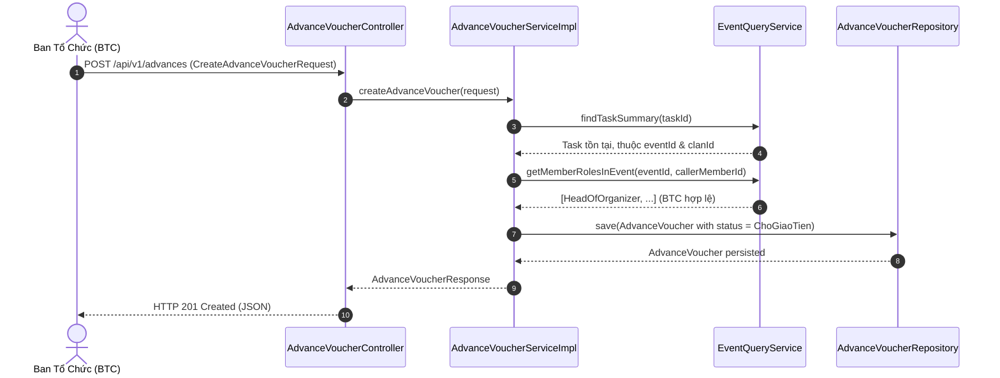
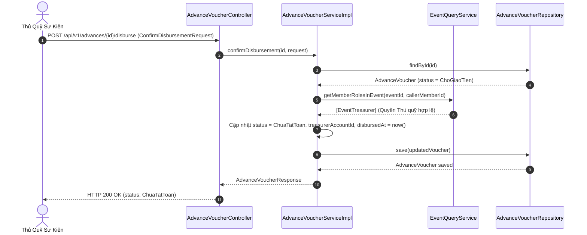

# Đặc Tả Kỹ Thuật & Hướng Dẫn Vận Hành [US-46]: Quản Lý Phiếu Tạm Ứng Sự Kiện (Lập Phiếu & Xác Nhận Giao Tiền)

Tài liệu này đặc tả toàn diện thiết kế kiến trúc, mô hình dữ liệu, các giải pháp kỹ thuật, luồng nghiệp vụ chi tiết và quy trình kiểm thử End-to-End (E2E) cho tính năng **[US-46] Viết API `POST /api/advances` cho BTC lập phiếu tạm ứng (`ADVANCE_VOUCHER`: mã phiếu, người nhận, số tiền, ngày nhận, hạn nộp chứng từ, nội dung cam kết) và API cho Thủ quỹ xác nhận đã giao tiền, đánh dấu trạng thái `ChuaTatToan`**.

---

## 1. Tổng Quan Nghiệp Vụ (User Story & Acceptance Criteria)

### Mô tả User Story
* **Mã User Story:** `US-46`
* **Đối tượng sử dụng (Actor):**
  * **Ban tổ chức sự kiện (BTC):** Trưởng ban tổ chức (`HeadOfOrganizer`), Thành viên ban tổ chức (`OrganizerMember`), Thủ quỹ sự kiện (`EventTreasurer`), hoặc người quản lý tối cao (`ROLE_CLAN_HEAD`, `ROLE_ADMIN`).
  * **Thủ quỹ sự kiện (Event Treasurer):** Người giữ vai trò Thủ quỹ trong ban tổ chức (`EventTreasurer`), hoặc Trưởng tộc/Admin (`ROLE_CLAN_HEAD`, `ROLE_ADMIN`).
  * **Thành viên nhận tạm ứng:** Thành viên dòng họ được giao hạng mục công việc và nhận tiền tạm ứng để chi tiêu cho sự kiện.
* **Mục tiêu (Goal):** Cung cấp API chuẩn cho phép BTC lập phiếu tạm ứng gắn với hạng mục công việc (`event_tasks`), tự động sinh mã phiếu định danh duy nhất (`ADV...`), và API chuyên biệt cho Thủ quỹ xác nhận bàn giao tiền mặt/chuyển khoản thực tế, cập nhật trạng thái phiếu sang `ChuaTatToan` và lưu vết thời điểm, ghi chú giao tiền.
* **Giá trị mang lại (Value):** Minh bạch hóa dòng tiền tạm ứng trong sự kiện dòng họ, phân định rõ ràng trách nhiệm giữa người lập đề xuất tạm ứng (BTC) và người xuất quỹ (Thủ quỹ), ngăn chặn thất thoát và phục vụ quyết toán (`US-47`, `US-37`).
* **Mức độ ưu tiên:** Bắt buộc (Must-Have).

### Tiêu chí chấp nhận (Acceptance Criteria - AC)
1. **AC-01 (Lập phiếu tạm ứng):**
   * Endpoint: `POST /api/v1/advances` (và alias `POST /api/advances`).
   * Dữ liệu đầu vào: `taskId` (bắt buộc), `recipientMemberId` (bắt buộc), `advanceAmount` (bắt buộc, > 0), `receivedDate` (bắt buộc), `settlementDeadline` (bắt buộc), `commitmentNotes` (tùy chọn).
   * Hệ thống tự động sinh `advanceVoucherId` theo format `ADV...` (tiền tố `ADV` + Base36 timestamp + Crockford Base32 ngẫu nhiên, độ dài tối đa 20 ký tự).
   * Khởi tạo trạng thái ban đầu là `ChoGiaoTien`.
   * Quyền hạn lập phiếu: Người gọi phải có vai trò BTC trong sự kiện chứa hạng mục (`HeadOfOrganizer`, `OrganizerMember`, `EventTreasurer`) hoặc có quyền toàn cục (`ROLE_CLAN_HEAD`, `ROLE_ADMIN`).
2. **AC-02 (Xác nhận đã giao tiền):**
   * Endpoint: `POST /api/v1/advances/{id}/disburse` (và các alias `POST /api/advances/{id}/disburse`, `confirm-disbursement`, `confirm`).
   * Quyền hạn xác nhận: Chỉ Thủ quỹ sự kiện (`EventTreasurer`) hoặc Trưởng tộc / Admin (`ROLE_CLAN_HEAD`, `ROLE_ADMIN`) mới có quyền thực hiện.
   * Ràng buộc nghiệp vụ: Phiếu tạm ứng phải đang ở trạng thái `ChoGiaoTien`. Nếu phiếu đã giao tiền (`ChuaTatToan`), đã quyết toán (`DaTatToan`) hoặc đã hủy (`DaHuy`), hệ thống từ chối với mã lỗi `400 Bad Request`.
   * Hệ thống ghi nhận `treasurerAccountId` là tài khoản thực hiện xác nhận, `disbursedAt` là thời điểm hiện tại (`Instant.now()`), và `disbursementNotes` tùy chọn.
   * Cập nhật trạng thái phiếu sang `ChuaTatToan`.
3. **AC-03 (Bảo toàn ranh giới Bounded Context Spring Modulith):**
   * Module `com.familyfund.finance` quản lý nghiệp vụ tài chính tạm ứng và quyết toán.
   * Tương tác với module `event` thông qua `EventQueryService` (public API contract của event module) để lấy thông tin hạng mục công việc và vai trò nhân sự sự kiện. Tuyệt đối không import các class nội bộ (`com.familyfund.event.internal.*`).
4. **AC-04 (Hỗ trợ truy vấn):**
   * `GET /api/v1/advances/{id}`: Tra cứu chi tiết phiếu tạm ứng, kèm tên người nhận và tên công việc.
   * `GET /api/v1/advances`: Danh sách phiếu tạm ứng có hỗ trợ lọc theo `eventId`, `taskId`, `recipientMemberId`, `status`.

---

## 2. Thiết Kế Kiến Trúc & Ranh Giới Bounded Context (Architecture Design)

Tính năng thuộc Bounded Context: `com.familyfund.finance`

```
[Client / Frontend Web & Mobile]
               │  HTTP Requests (JSON)
               ▼
┌────────────────────────────────────────────────────────────────────────┐
│ 1. API BOUNDARY & CONTROLLER LAYER                                     │
│    • Controller: AdvanceVoucherController                              │
│      - Mapped: /api/v1/advances và /api/advances                       │
│    • Validation: @Valid CreateAdvanceVoucherRequest,                   │
│                  @Valid ConfirmDisbursementRequest                     │
│    • Tenant Filter: TenantFilter.HEADER_CLAN_ID (X-Clan-Id)            │
└────────────────────────────────────────────────────────────────────────┘
               │  Validated DTO + Principal
               ▼
┌────────────────────────────────────────────────────────────────────────┐
│ 2. APPLICATION & DOMAIN SERVICE LAYER                                  │
│    • Domain Service: AdvanceVoucherService                             │
│    • Implementation: AdvanceVoucherServiceImpl                         │
│    • Public Query API: AdvanceVoucherQueryService                      │
│    • Cross-Module Calls:                                               │
│      - EventQueryService (event::api) -> findTaskSummary, getMemberRoles│
│      - NotificationService (notification::api) -> push alerts          │
│    • ID Generator: AdvanceVoucherIdGenerator (ADV...)                  │
└────────────────────────────────────────────────────────────────────────┘
               │  Entity State
               ▼
┌────────────────────────────────────────────────────────────────────────┐
│ 3. PERSISTENCE & DATA LAYER                                            │
│    • Repository: AdvanceVoucherRepository                              │
│    • Entity: AdvanceVoucher (table: advance_vouchers)                  │
│    • Status Enum: AdvanceVoucherStatus (ChoGiaoTien, ChuaTatToan...)   │
│    • Database: PostgreSQL 16+ / Flyway Migration V25                   │
└────────────────────────────────────────────────────────────────────────┘
```

### Danh mục các file mã nguồn cốt lõi:
* **Controller (internal):** [`AdvanceVoucherController.java`](file:///d:/Ja%20toc/family-management-backend/src/main/java/com/familyfund/finance/internal/controller/AdvanceVoucherController.java)
* **Domain Service (internal):** [`AdvanceVoucherService.java`](file:///d:/Ja%20toc/family-management-backend/src/main/java/com/familyfund/finance/internal/service/AdvanceVoucherService.java) & [`AdvanceVoucherServiceImpl.java`](file:///d:/Ja%20toc/family-management-backend/src/main/java/com/familyfund/finance/internal/service/AdvanceVoucherServiceImpl.java)
* **Public Service Contract (api):** [`AdvanceVoucherQueryService.java`](file:///d:/Ja%20toc/family-management-backend/src/main/java/com/familyfund/finance/api/AdvanceVoucherQueryService.java) & [`AdvanceVoucherQueryServiceImpl.java`](file:///d:/Ja%20toc/family-management-backend/src/main/java/com/familyfund/finance/internal/service/AdvanceVoucherQueryServiceImpl.java)
* **Repository (internal):** [`AdvanceVoucherRepository.java`](file:///d:/Ja%20toc/family-management-backend/src/main/java/com/familyfund/finance/internal/repository/AdvanceVoucherRepository.java)
* **Entity & Enums:** [`AdvanceVoucher.java`](file:///d:/Ja%20toc/family-management-backend/src/main/java/com/familyfund/finance/internal/entity/AdvanceVoucher.java) & [`AdvanceVoucherStatus.java`](file:///d:/Ja%20toc/family-management-backend/src/main/java/com/familyfund/finance/api/dto/AdvanceVoucherStatus.java)
* **DTOs:**
  * [`CreateAdvanceVoucherRequest.java`](file:///d:/Ja%20toc/family-management-backend/src/main/java/com/familyfund/finance/internal/dto/request/CreateAdvanceVoucherRequest.java)
  * [`ConfirmDisbursementRequest.java`](file:///d:/Ja%20toc/family-management-backend/src/main/java/com/familyfund/finance/internal/dto/request/ConfirmDisbursementRequest.java)
  * [`AdvanceVoucherResponse.java`](file:///d:/Ja%20toc/family-management-backend/src/main/java/com/familyfund/finance/internal/dto/response/AdvanceVoucherResponse.java)
  * [`AdvanceVoucherDto.java`](file:///d:/Ja%20toc/family-management-backend/src/main/java/com/familyfund/finance/api/dto/AdvanceVoucherDto.java)
  * [`EventTaskSummaryDto.java`](file:///d:/Ja%20toc/family-management-backend/src/main/java/com/familyfund/event/api/dto/EventTaskSummaryDto.java)
* **Flyway Migration:** [`V25__add_status_and_disbursement_to_advance_vouchers.sql`](file:///d:/Ja%20toc/family-management-backend/src/main/resources/db/migration/V25__add_status_and_disbursement_to_advance_vouchers.sql)

---

## 3. Thiết Kế Cơ Sở Dữ Liệu (Database Schema)

### Cấu trúc Bảng `advance_vouchers` (Flyway V25):
```sql
ALTER TABLE advance_vouchers
    ADD COLUMN IF NOT EXISTS clan_id VARCHAR(20) REFERENCES clans(clan_id) ON DELETE RESTRICT,
    ADD COLUMN IF NOT EXISTS status VARCHAR(25) NOT NULL DEFAULT 'ChoGiaoTien'
        CHECK (status IN ('ChoGiaoTien', 'ChuaTatToan', 'DaTatToan', 'DaHuy')),
    ADD COLUMN IF NOT EXISTS treasurer_account_id VARCHAR(20) REFERENCES user_accounts(account_id) ON DELETE SET NULL,
    ADD COLUMN IF NOT EXISTS disbursed_at TIMESTAMPTZ,
    ADD COLUMN IF NOT EXISTS disbursement_notes TEXT,
    ADD COLUMN IF NOT EXISTS created_at TIMESTAMPTZ NOT NULL DEFAULT CURRENT_TIMESTAMP,
    ADD COLUMN IF NOT EXISTS updated_at TIMESTAMPTZ NOT NULL DEFAULT CURRENT_TIMESTAMP;

-- Backfill clan_id từ event_tasks -> events
UPDATE advance_vouchers av
SET clan_id = e.clan_id
FROM event_tasks et
JOIN events e ON et.event_id = e.event_id
WHERE av.task_id = et.task_id AND av.clan_id IS NULL;

-- Indexes phục vụ tra cứu
CREATE INDEX IF NOT EXISTS idx_advance_vouchers_clan_id ON advance_vouchers (clan_id);
CREATE INDEX IF NOT EXISTS idx_advance_vouchers_task_id ON advance_vouchers (task_id);
CREATE INDEX IF NOT EXISTS idx_advance_vouchers_recipient ON advance_vouchers (recipient_member_id);
CREATE INDEX IF NOT EXISTS idx_advance_vouchers_status ON advance_vouchers (status);
```

---

## 4. Luồng Nghiệp Vụ Chi Tiết (Detailed Business Flows)

### 4.1. Lập Phiếu Tạm Ứng


### 4.2. Thủ Quỹ Xác Nhận Đã Giao Tiền


---

## 5. Hướng Dẫn Kiểm Thử (Testing & End-to-End Guide)

### 5.1. Kiểm thử Tự Động (Automated Tests)
Chạy bộ kiểm thử tự động của tính năng bằng Gradle:
```powershell
.\gradlew.bat test --tests "com.familyfund.finance.*"
```

| Tên Test Class | Số Test Cases | Mục Tiêu Kiểm Thử |
| :--- | :---: | :--- |
| `AdvanceVoucherIdGeneratorTest` | 5 | Kiểm tra định dạng `ADV...`, độ dài `<= 20`, tính đơn điệu và tính duy nhất |
| `AdvanceVoucherServiceImplTest` | 8 | Kiểm thử logic nghiệp vụ lập phiếu, xác nhận giao tiền, kiểm tra quyền BTC & Thủ quỹ, chặn trạng thái không hợp lệ |
| `AdvanceVoucherControllerTest` | 3 | MockMvc kiểm tra validation HTTP status (201, 200, 400), header X-Clan-Id |
| `AdvanceVoucherIntegrationTest` | 3 | Kiểm thử tích hợp E2E trên cơ sở dữ liệu PostgreSQL thực tế: chu trình trọn vẹn lập phiếu -> xác nhận giao tiền -> chuyển `ChuaTatToan`, bảo đảm RBAC 403 khi không đủ quyền |

Kiểm tra tuân thủ kiến trúc Spring Modulith:
```powershell
.\gradlew.bat test --tests "com.familyfund.ArchitectureTest"
```

### 5.2. Kịch Bản Kiểm Thử Thực Tế (E2E Manual Testing)

#### Bước 1: Lập phiếu tạm ứng mới (BTC thực hiện)
```bash
curl -X POST http://localhost:8080/api/v1/advances \
  -H "Authorization: Bearer <BTC_JWT_TOKEN>" \
  -H "X-Clan-Id: CLAN_DEMO_01" \
  -H "Content-Type: application/json" \
  -d '{
    "taskId": "TSK_001",
    "recipientMemberId": "MEM_002",
    "advanceAmount": 5000000.00,
    "receivedDate": "2026-04-01T08:00:00Z",
    "settlementDeadline": "2026-04-10T17:00:00Z",
    "commitmentNotes": "Tạm ứng mua thực phẩm mâm cỗ"
  }'
```

**Kết quả kỳ vọng (HTTP 201 Created):**
```json
{
  "success": true,
  "data": {
    "advanceVoucherId": "ADV123...",
    "taskId": "TSK_001",
    "recipientMemberId": "MEM_002",
    "advanceAmount": 5000000.00,
    "status": "ChoGiaoTien",
    "receivedDate": "2026-04-01T08:00:00Z",
    "settlementDeadline": "2026-04-10T17:00:00Z",
    "commitmentNotes": "Tạm ứng mua thực phẩm mâm cỗ",
    "treasurerAccountId": null,
    "disbursedAt": null
  }
}
```

#### Bước 2: Thủ quỹ xác nhận đã giao tiền
```bash
curl -X POST http://localhost:8080/api/v1/advances/ADV123.../disburse \
  -H "Authorization: Bearer <TREASURER_JWT_TOKEN>" \
  -H "X-Clan-Id: CLAN_DEMO_01" \
  -H "Content-Type: application/json" \
  -d '{
    "notes": "Đã giao tiền mặt 5.000.000đ tại từ đường"
  }'
```

**Kết quả kỳ vọng (HTTP 200 OK):**
```json
{
  "success": true,
  "data": {
    "advanceVoucherId": "ADV123...",
    "status": "ChuaTatToan",
    "treasurerAccountId": "ACC_TREASURER",
    "disbursedAt": "2026-04-01T08:30:00Z",
    "disbursementNotes": "Đã giao tiền mặt 5.000.000đ tại từ đường"
  }
}
```
