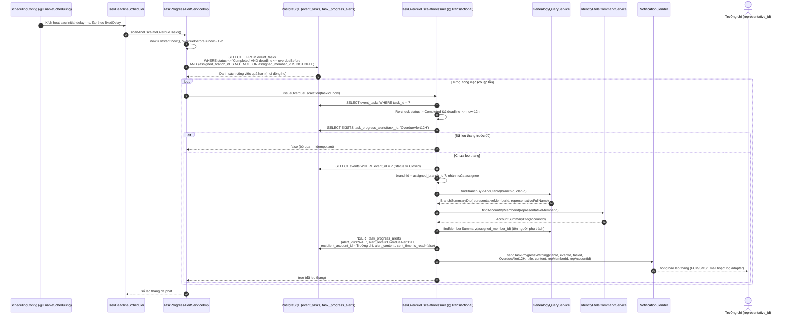

# Đặc Tả Kỹ Thuật & Hướng Dẫn Vận Hành US-47: Leo Thang Cảnh Báo Công Việc Quá Hạn 12 Giờ (Overdue Escalation)

Tài liệu này đặc tả thiết kế kiến trúc, mô hình dữ liệu, luồng nghiệp vụ và kịch bản kiểm thử cho tính năng **[US-47] Background worker phát hiện các hạng mục công việc đã trôi qua hạn chót từ 12 giờ trở lên, xác định Trưởng chi (`representative_id`) của nhánh phụ trách, ghi vết cảnh báo `OverdueAlert12H` và gửi **một** thông báo leo thang nêu rõ công việc, người phụ trách và số giờ đã quá hạn**.

> **Điểm vào hệ thống (không có HTTP endpoint):**
> - Tính năng chạy như **lượt quét nền thứ hai** của bean `TaskDeadlineScheduler` (được bật bởi `@EnableScheduling` trong `com.familyfund.core.config.SchedulingConfig`), cạnh lượt nhắc 24h của US-08.
> - Chu kỳ quét cấu hình qua `app.task.deadline-overdue.interval-ms` (mặc định `900000` ms = 15 phút) và `app.task.deadline-overdue.initial-delay-ms` (mặc định `120000` ms).
> - Vết leo thang ghi vào bảng có sẵn `task_progress_alerts` với `alert_level = 'OverdueAlert12H'`; **không** mở API công khai nên `docker/swagger/openapi.yaml` không thay đổi.
> - **Không sửa hành vi US-08**: lượt nhắc 24h (`Reminder24H`) giữ nguyên thiết kế, idempotency và người nhận.

---

## 1. Tổng Quan Nghiệp Vụ (User Story & Acceptance Criteria)

### Mô tả User Story
* **Mã User Story:** `US-47`
* **Phân hệ:** Phân Công & Tiến Độ Công Việc (Event Tasks & Progress Tracking)
* **Đối tượng sử dụng (Actors):** Hệ thống (Scheduler/Background Worker). Người thụ hưởng là **Trưởng chi** (`family_branches.representative_id`) của nhánh phụ trách công việc; người phụ trách (`assigned_member_id`) được nêu tên trong nội dung cảnh báo; Ban tổ chức sự kiện và Trưởng tộc giám sát tiến độ.
* **Mục tiêu (Goal):** Với vai trò Trưởng chi, tôi muốn **được báo ngay khi một công việc của nhánh mình đã trễ hạn quá 12 giờ**, kèm tên công việc, người phụ trách và số giờ trễ, để kịp can thiệp thay vì chỉ biết khi sự kiện đã cận kề.
* **Giá trị mang lại (Value):** Nhắc 24h (US-08) chỉ tác động tới người trực tiếp làm việc; khi người đó không phản hồi thì cần một kênh **leo thang lên cấp quản lý**. US-47 đóng khoảng trống đó: mọi công việc trễ hạn đều có người chịu trách nhiệm ở cấp chi nhánh biết được tình trạng, có vết kiểm toán trong `task_progress_alerts`, và không sinh thông báo trùng lặp.
* **Mức độ ưu tiên:** Bắt buộc (Must-Have).
* **Tiền điều kiện (Preconditions):**
  1. Công việc tồn tại trong `event_tasks` (US-07) và **chưa** hoàn thành (`status <> 'Completed'`).
  2. Công việc có nơi nhận trách nhiệm: `assigned_branch_id` hoặc `assigned_member_id` khác rỗng.
  3. Nhánh phụ trách **đã có Trưởng chi** (`family_branches.representative_id`) và Trưởng chi đó **có tài khoản người dùng liên kết** (`user_accounts.member_id`) — `task_progress_alerts.recipient_account_id` là `NOT NULL`.
  4. Ứng dụng đã bật `@EnableScheduling` và không tắt worker (`app.task.deadline-warning.enabled` khác `false`).

### Tiêu chí chấp nhận (Acceptance Criteria - AC)
1. **AC-01 (Cơ chế quét nền định kỳ):**
   - Worker chạy theo `fixedDelay` độc lập với lượt nhắc 24h của US-08; không phụ thuộc bất kỳ request HTTP nào.
   - Lượt quét đầu tiên bị trễ có chủ đích (`initial-delay-ms`) để không cạnh tranh tài nguyên với giai đoạn khởi động ứng dụng.
   - Chạy trên scheduler thread nên **không có `TenantContext`**: truy vấn quét **toàn bộ các dòng họ** và phân giải `clan_id` từ sự kiện của từng công việc trước khi phát thông báo.
   - Mọi ngoại lệ trong một lượt quét đều bị bắt và ghi log; một công việc lỗi không làm dừng cả lượt, và không làm chết scheduled task.
   - Công tắc `app.task.deadline-warning.enabled=false` tắt cả hai lượt quét (dùng chung bean).

2. **AC-02 (Điều kiện xác định công việc quá hạn 12 giờ):** Một công việc là ứng viên khi **đồng thời**:
   - `event_tasks.status <> 'Completed'`.
   - `event_tasks.deadline <= now - 12 giờ` — biên **đúng 12 giờ được tính là quá hạn**; công việc mới trễ 11 giờ 59 phút **chưa** bị leo thang.
   - `assigned_branch_id` hoặc `assigned_member_id` khác rỗng.
   - Sự kiện của công việc **chưa** `Closed` (nhất quán bất biến "sự kiện khóa sổ là read-only" của US-21).

3. **AC-03 (Người nhận = Trưởng chi của nhánh phụ trách):**
   - Nhánh phụ trách xác định theo thứ tự: `event_tasks.assigned_branch_id` → nếu trống thì lấy **nhánh của thành viên được phân công** (`members.branch_id` qua `GenealogyQueryService.findMemberSummary`).
   - Người nhận là `family_branches.representative_id` của nhánh đó (`GenealogyQueryService.findBranchByIdAndClanId`), rồi phân giải tài khoản qua `IdentityRoleCommandService.findAccountByMemberId`.
   - `recipient_account_id` trong vết cảnh báo **phải là** tài khoản của Trưởng chi, **không phải** của người được phân công. Người được phân công chỉ xuất hiện trong nội dung.
   - Nhánh không tồn tại trong dòng họ, nhánh chưa có Trưởng chi, hoặc Trưởng chi chưa có tài khoản liên kết ⇒ **bỏ qua, log `WARN`**, công việc được xét lại ở lượt sau.

4. **AC-04 (Ghi vết `OverdueAlert12H`):** Mỗi cảnh báo tạo **một** bản ghi append-only trong `task_progress_alerts`:
   - `alert_id`: sinh tự động dạng `PWA` + 8 ký tự Base36 (timestamp) + 6 ký tự Crockford Base32 (CSPRNG), độ dài ≤ 20 (`AlertIdGenerator`).
   - `alert_level = 'OverdueAlert12H'` — khớp `CHECK` constraint của Flyway V1.
   - `recipient_account_id` = tài khoản Trưởng chi (AC-03).
   - `alert_content` = nội dung leo thang (AC-05).
   - `sent_time` = thời điểm quét, `is_read = false`.

5. **AC-05 (Nội dung leo thang nêu đủ 3 thông tin bắt buộc):**
   - **Công việc** và sự kiện chứa nó.
   - **Người phụ trách:** họ tên + `member_id` (ví dụ `Nguyen Van Em (MEM_ASSIGNEE_001)`); nếu công việc chỉ giao cho nhánh, ghi `Chưa phân công cá nhân`.
   - **Số giờ quá hạn:** ví dụ `15 giờ 0 phút`, kèm hạn chót gốc, nhánh phụ trách và Trưởng chi nhận cảnh báo.
   - Tiêu đề `Cảnh báo quá hạn 12h: <task_name>`, bị cắt còn ≤ 200 ký tự (kèm `...`).

6. **AC-06 (Chỉ một lần cho mỗi công việc):** Vết `(task_id, 'OverdueAlert12H')` là khóa idempotency: kiểm tra `existsByTaskIdAndAlertLevel()` trước khi ghi, nên công việc trễ nhiều ngày vẫn chỉ bị leo thang **đúng một lần** (không có cảnh báo lặp ở mốc 24h, 36h…).

7. **AC-07 (Toàn vẹn transaction & chịu lỗi):** Mỗi công việc chạy trong một transaction riêng (`TaskOverdueEscalationIssuer#issueOverdueEscalation`): **ghi vết trước – gửi sau**. Nếu bước gửi ném ngoại lệ ⇒ rollback, không đánh dấu "đã leo thang", lượt quét sau thử lại (at-least-once, không mất cảnh báo).

8. **AC-08 (Không phát sinh migration mới):** Dùng lại bảng `task_progress_alerts` và index `idx_task_deadline` của Flyway V1; không thêm cột, không thêm version schema.

9. **AC-09 (Ranh giới module):** Chỉ gọi chéo module qua public contract: `GenealogyQueryService` (`genealogy::api`) và `IdentityRoleCommandService` (`identity::api`); không truy cập repository/entity của module khác, không phát sinh phụ thuộc vòng (`ArchitectureTest`, `TaskArchitectureTest`).

---

## 2. Thiết Kế Kiến Trúc & Ranh Giới Bounded Context

Tính năng thuộc Bounded Context: `com.familyfund.event` (worker được bật bởi Shared Kernel `com.familyfund.core`), và **tái sử dụng hạ tầng của US-08** thay vì dựng worker riêng:

| Thành phần dùng lại từ US-08 | Vai trò trong US-47 |
| :--- | :--- |
| `TaskDeadlineScheduler` (bean `@Scheduled`) | Thêm phương thức `scanOverdueTaskDeadlines()` với chu kỳ riêng |
| `TaskProgressAlertService` | Thêm lượt `scanAndEscalateOverdueTasks()` |
| Bảng `task_progress_alerts` + `AlertIdGenerator` + `TaskProgressAlertRepository` | Ghi vết `OverdueAlert12H` (cùng khóa idempotency theo `alert_level`) |
| `NotificationSender.sendTaskProgressWarning()` + `LoggingNotificationSender` | Kênh gửi thông báo (chỉ đổi người nhận sang Trưởng chi) |

```
┌──────────────────────────────────────────────────────────────────────┐
│ SCHEDULER THREAD (không có TenantContext, không có HTTP request)     │
│   core.config.SchedulingConfig  → @EnableScheduling                  │
└──────────────────────────────────────────────────────────────────────┘
        │ fixedDelay = app.task.deadline-overdue.interval-ms
        ▼
┌──────────────────────────────────────────────────────────────────────┐
│ TaskDeadlineScheduler#scanOverdueTaskDeadlines()   (US-47)           │
│   • try/catch toàn lượt: lỗi được log, scheduled task vẫn sống       │
└──────────────────────────────────────────────────────────────────────┘
        │
        ▼
┌──────────────────────────────────────────────────────────────────────┐
│ TaskProgressAlertService#scanAndEscalateOverdueTasks()               │
│   • now = Instant.now(); overdueBefore = now - 12h                   │
│   • EventTaskRepository.findUnfinishedTasksOverdueBefore(...)        │
│   • Lặp từng công việc, cô lập lỗi từng công việc                    │
└──────────────────────────────────────────────────────────────────────┘
        │ (1 transaction / công việc)
        ▼
┌──────────────────────────────────────────────────────────────────────┐
│ TaskOverdueEscalationIssuer#issueOverdueEscalation(taskId, now)      │
│   • Re-check: status != Completed && deadline <= now - 12h           │
│   • Idempotency: existsByTaskIdAndAlertLevel(taskId, OverdueAlert12H)│
│   • Sự kiện chưa Closed                                              │
│   • branchId = assigned_branch_id ?: nhánh của assignee              │
│   • Người nhận = family_branches.representative_id của branchId      │
│   • INSERT task_progress_alerts (OverdueAlert12H)                    │
│   • NotificationSender.sendTaskProgressWarning(... → Trưởng chi)     │
└──────────────────────────────────────────────────────────────────────┘
        │                     │                        │
        ▼                     ▼                        ▼
┌───────────────┐  ┌───────────────────────┐  ┌──────────────────────┐
│ PERSISTENCE   │  │ GENEALOGY::API        │  │ IDENTITY::API        │
│ event_tasks   │  │ findBranchByIdAndClanId│  │ findAccountByMemberId│
│ task_progress_│  │ findMemberSummary     │  │ (Trưởng chi → account)│
│ alerts        │  └───────────────────────┘  └──────────────────────┘
└───────────────┘             │
                              ▼
                 ┌──────────────────────────┐
                 │ NOTIFICATION PORT        │
                 │ NotificationSender       │
                 │ ↳ LoggingNotif.Sender    │
                 └──────────────────────────┘
```

### Danh Mục File Mã Nguồn
| Lớp / Vai trò | File |
| :--- | :--- |
| Background worker (`@Scheduled`) | `src/main/java/com/familyfund/event/internal/scheduler/TaskDeadlineScheduler.java` (`scanOverdueTaskDeadlines`) |
| Service Interface | `src/main/java/com/familyfund/event/internal/service/TaskProgressAlertService.java` (`scanAndEscalateOverdueTasks`) |
| Service Implementation (lượt quét) | `src/main/java/com/familyfund/event/internal/service/TaskProgressAlertServiceImpl.java` |
| **Issuer leo thang (1 transaction / công việc)** | `src/main/java/com/familyfund/event/internal/service/TaskOverdueEscalationIssuer.java` |
| Truy vấn quét (JPQL) | `src/main/java/com/familyfund/event/internal/repository/EventTaskRepository.java` (`findUnfinishedTasksOverdueBefore`) |
| JPA Entity / Repository vết cảnh báo | `src/main/java/com/familyfund/event/internal/entity/TaskProgressAlert.java`, `internal/repository/TaskProgressAlertRepository.java` |
| Public Enum | `src/main/java/com/familyfund/event/api/dto/TaskAlertLevel.java` (`OverdueAlert12H`) |
| ID Generator | `src/main/java/com/familyfund/event/internal/util/AlertIdGenerator.java` |
| Notification Port | `src/main/java/com/familyfund/event/internal/notification/NotificationSender.java`, `LoggingNotificationSender.java` |
| Public contract dùng chéo module | `genealogy/api/GenealogyQueryService.java` (+ `dto/BranchSummaryDto`, `dto/MemberSummaryDto`), `identity/api/IdentityRoleCommandService.java` (`dto/AccountSummaryDto`) |
| Cấu hình chạy | `src/main/resources/application.yaml` (`app.task.deadline-overdue.*`) |
| Flyway Migration | Không cần — bảng `task_progress_alerts` đã có từ `V1__init_clan_genealogy_and_events_schema.sql` |

---

## 3. Thiết Kế Cơ Sở Dữ Liệu (Database Schema)

### Bảng ghi vết `task_progress_alerts` (Flyway V1 — không thay đổi)
```sql
CREATE TABLE IF NOT EXISTS task_progress_alerts (
    alert_id VARCHAR(20) PRIMARY KEY,
    task_id VARCHAR(20) NOT NULL REFERENCES event_tasks(task_id) ON DELETE CASCADE,
    alert_level VARCHAR(25) NOT NULL
        CHECK (alert_level IN ('Reminder24H', 'OverdueAlert12H')),
    recipient_account_id VARCHAR(20) NOT NULL REFERENCES user_accounts(account_id) ON DELETE CASCADE,
    alert_content TEXT NOT NULL,
    sent_time TIMESTAMPTZ DEFAULT CURRENT_TIMESTAMP,
    is_read BOOLEAN DEFAULT FALSE
);
```

### Nguồn dữ liệu để xác định "ai phụ trách" và "ai nhận leo thang"
```sql
-- công việc quá hạn
SELECT task_id, event_id, task_name, deadline, status, assigned_branch_id, assigned_member_id
FROM event_tasks;

-- Trưởng chi của nhánh phụ trách
SELECT branch_id, branch_name, representative_id
FROM family_branches;

-- nhánh của người được phân công (fallback khi task không có assigned_branch_id)
SELECT member_id, full_name, branch_id FROM members;

-- kênh gửi: tài khoản liên kết của Trưởng chi
SELECT account_id, member_id, account_status FROM user_accounts;
```

### Ánh Xạ Enum ↔ Ràng Buộc CSDL
| Giá trị Java (`TaskAlertLevel`) | `alert_level` trong CSDL | Ý nghĩa | Story |
| :--- | :--- | :--- | :--- |
| `Reminder24H` | `Reminder24H` | Nhắc tiến độ khi hạn chót ≤ 24 giờ | US-08 |
| `OverdueAlert12H` | `OverdueAlert12H` | **Leo thang khi hạn chót đã trôi qua ≥ 12 giờ, gửi tới Trưởng chi** | **US-47** |

> **Khóa idempotency không nằm ở CSDL:** bảng không có `UNIQUE (task_id, alert_level)`, nên tính "chỉ một lần" được bảo đảm ở tầng service bằng `existsByTaskIdAndAlertLevel()`. Hệ quả: khi chạy **nhiều instance** cùng bật worker, hai lượt quét chồng lấn có thể cùng ghi một vết (at-least-once). Với triển khai một instance, hành vi đúng như mô tả.

---

## 4. Luồng Nghiệp Vụ Chi Tiết



### Bảng quyết định của issuer
| Tình huống | Kết quả | Mức log |
| :--- | :--- | :--- |
| `taskId` rỗng / không tồn tại | bỏ qua | `DEBUG` |
| `status = Completed` | bỏ qua | `DEBUG` |
| `deadline > now - 12h` | bỏ qua | `DEBUG` |
| Không có `assigned_branch_id` và `assigned_member_id` | bỏ qua | `DEBUG` |
| Đã có vết `(task_id, OverdueAlert12H)` | bỏ qua | `DEBUG` |
| Sự kiện `Closed` / không tồn tại | bỏ qua | `DEBUG` |
| Nhánh không thuộc dòng họ của sự kiện | bỏ qua | `WARN` |
| Nhánh chưa có `representative_id` | bỏ qua | `WARN` |
| Trưởng chi chưa có tài khoản liên kết | bỏ qua | `WARN` |
| Hợp lệ | ghi vết + gửi thông báo | `INFO` |
| Lỗi bất kỳ khi ghi/gửi | rollback, lượt sau thử lại | `ERROR` |

### Máy trạng thái vết leo thang
```
[Chưa có vết] --deadline ≤ now-12h & status != Completed--> [OverdueAlert12H đã ghi + đã gửi tới Trưởng chi]
[OverdueAlert12H đã ghi] --quét lại (kể cả trễ nhiều ngày)--> (bỏ qua: chỉ leo thang 1 lần)
[Ghi vết] --NotificationSender ném lỗi--> (rollback) --> [Chưa có vết] (lượt quét sau thử lại)
```

---

## 5. Cấu Hình Vận Hành & Hướng Dẫn Kiểm Thử

### 5.1. Cấu hình worker (`application.yaml`)
```yaml
app:
  task:
    deadline-warning:
      # US-08: lượt nhắc trước hạn 24h (không thuộc phạm vi US-47)
      enabled: ${APP_TASK_DEADLINE_WARNING_ENABLED:true}          # công tắc chung cho cả bean
      interval-ms: ${APP_TASK_DEADLINE_WARNING_INTERVAL_MS:900000}
      initial-delay-ms: ${APP_TASK_DEADLINE_WARNING_INITIAL_DELAY_MS:60000}
    deadline-overdue:
      # US-47: lượt leo thang quá hạn 12h
      interval-ms: ${APP_TASK_DEADLINE_OVERDUE_INTERVAL_MS:900000}      # 15 phút
      initial-delay-ms: ${APP_TASK_DEADLINE_OVERDUE_INITIAL_DELAY_MS:120000}  # 120 giây
```

Rút ngắn chu kỳ khi kiểm thử E2E:
```bash
APP_TASK_DEADLINE_OVERDUE_INTERVAL_MS=15000 \
APP_TASK_DEADLINE_OVERDUE_INITIAL_DELAY_MS=5000 \
  ./gradlew.bat bootRun
```

> **Lưu ý:** `src/test/resources/application.properties` đặt `app.task.deadline-warning.enabled=false`, nên **cả hai** lượt quét đều không tự chạy trong test (các test dùng chung CSDL PostgreSQL thật). Test US-47 gọi trực tiếp service/issuer để kiểm chứng logic.

### 5.2. Kiểm chứng thủ công trên môi trường chạy thật
US-07 chỉ cho tạo công việc với `deadline` ở **tương lai**, nên muốn thấy leo thang ngay phải đẩy hạn chót về quá khứ bằng SQL (Adminer `:8088`):

```sql
-- 1. Chọn một công việc chưa xong thuộc nhánh có Trưởng chi, rồi đẩy hạn chót về 13 giờ trước
UPDATE event_tasks
SET deadline = NOW() - INTERVAL '13 hours'
WHERE task_id = 'TSK_XXXX';

-- 2. Sau lượt quét kế tiếp, kiểm tra vết leo thang: recipient phải là Trưởng chi
SELECT a.alert_id, a.task_id, a.alert_level, a.recipient_account_id,
       ua.member_id AS recipient_member_id, a.sent_time, a.alert_content
FROM task_progress_alerts a
LEFT JOIN user_accounts ua ON ua.account_id = a.recipient_account_id
WHERE a.alert_level = 'OverdueAlert12H'
ORDER BY a.sent_time DESC;

-- 3. Bất biến: mỗi công việc tối đa 1 vết leo thang (kỳ vọng: 0 dòng)
SELECT task_id, COUNT(*) FROM task_progress_alerts
WHERE alert_level = 'OverdueAlert12H'
GROUP BY task_id HAVING COUNT(*) > 1;
```

Danh sách ứng viên mà worker sẽ xét:
```sql
SELECT t.task_id, t.task_name, t.deadline, t.assigned_member_id, t.assigned_branch_id,
       b.representative_id AS branch_representative
FROM event_tasks t
LEFT JOIN family_branches b ON b.branch_id = COALESCE(t.assigned_branch_id,
        (SELECT m.branch_id FROM members m WHERE m.member_id = t.assigned_member_id))
WHERE t.status <> 'Completed'
  AND t.deadline <= NOW() - INTERVAL '12 hours'
  AND (t.assigned_branch_id IS NOT NULL OR t.assigned_member_id IS NOT NULL);
```

### 5.3. Log kỳ vọng
```
US-47 escalation scan: 1 unfinished task(s) overdue by more than 12h
US-47 escalation: alert [PWA...] issued for overdue task [TSK...] (15 giờ 0 phút late) to branch [BR...] representative [MEM...]
[ThongBao ProgressWarning] Cảnh báo tiến độ [OverdueAlert12H] công việc [TSK...] sự kiện [EVT...] tới thành viên [MEM_REP...] (tài khoản [ACC_REP...]) | Nội dung: "..."
US-47 escalation scan: issued 1 overdue escalation(s)
```
Các log bỏ qua hợp lệ (`DEBUG`/`WARN`):
```
US-47 escalation: task [TSK...] deadline [...] is not overdue by 12h yet, skipping
US-47 escalation: task [TSK...] already escalated, skipping
US-47 escalation: task [TSK...] is completed, skipping
US-47 escalation: task [TSK...] has no assigned branch or member, nothing to escalate
US-47 escalation: branch [BR...] of task [TSK...] has no representative, cannot escalate
US-47 escalation: representative [MEM...] of branch [BR...] has no linked user account, cannot escalate
```

### 5.4. Kiểm thử tự động
```powershell
# Unit test issuer leo thang (ngưỡng 12h, chọn Trưởng chi, nội dung, idempotency)
.\gradlew.bat test --tests "com.familyfund.event.internal.service.TaskOverdueEscalationIssuerTest"

# Lượt quét + scheduled entry point
.\gradlew.bat test --tests "com.familyfund.event.internal.service.TaskProgressAlertServiceImplTest" `
                   --tests "com.familyfund.event.internal.scheduler.TaskDeadlineSchedulerTest"

# Integration (Spring context + PostgreSQL thật, rollback)
.\gradlew.bat test --tests "com.familyfund.event.internal.service.TaskProgressAlertWorkerIntegrationTest"

# Kiến trúc module (không rò rỉ internal, không phụ thuộc vòng)
.\gradlew.bat test --tests "com.familyfund.event.TaskArchitectureTest" --tests "com.familyfund.ArchitectureTest"
```

| Test Class | Số Test của US-47 | Mục Tiêu Kiểm Thử |
| :--- | :---: | :--- |
| `TaskOverdueEscalationIssuerTest` | **14** (mới toàn bộ) | Ghi vết `OverdueAlert12H` và gửi tới **Trưởng chi** (không phải assignee); nội dung có tên công việc, người phụ trách (họ tên + `member_id`) và số giờ quá hạn; biên đúng 12h được tính; bỏ qua 11h59, `Completed`, sự kiện `Closed`, task không có nhánh/người phụ trách, nhánh ngoài dòng họ, nhánh chưa có Trưởng chi, Trưởng chi chưa có tài khoản; fallback nhánh của assignee khi thiếu `assigned_branch_id`; task chỉ giao cho nhánh; `taskId` rỗng/không tồn tại; cắt tiêu đề ≤ 200 ký tự |
| `TaskProgressAlertServiceImplTest` | **+3** (tổng 7, 4 test cũ thuộc US-08) | Lượt leo thang đếm đúng số vết phát sinh; ngưỡng quét = `now - 12h`; một công việc lỗi không chặn cả lượt |
| `TaskDeadlineSchedulerTest` | **+2** (tổng 4) | Phương thức `scanOverdueTaskDeadlines()` ủy quyền cho service và nuốt ngoại lệ để scheduled task tiếp tục chạy |
| `TaskProgressAlertWorkerIntegrationTest` | **+3** (tổng 7) | Trên PostgreSQL thật (rollback): `recipient_account_id` là tài khoản Trưởng chi chứ không phải người được phân công; nội dung chứa tên người phụ trách và số giờ trễ; chỉ leo thang một lần; lượt quét bỏ qua task < 12h, `Completed` và nhánh không có Trưởng chi |
| `TaskArchitectureTest`, `ArchitectureTest` | 3 + 3 | Ranh giới module: `event` chỉ phụ thuộc `core`, `identity::api`, `genealogy::api` |

**Kết quả lần chạy gần nhất:** `./gradlew.bat test --tests "com.familyfund.event.*"` → **BUILD SUCCESSFUL**, toàn bộ test của module `event` xanh (gồm 22 test mới/điều chỉnh cho US-47: 14 issuer + 3 service pass + 2 scheduler + 3 integration). Chạy toàn bộ suite (sau khi nhánh được cập nhật `main` mới nhất): `./gradlew.bat test` → **875 tests, 0 failures** (gồm `DatabaseMigrationTest` xác minh bảng `task_progress_alerts` tồn tại sau migrate).

---

## 6. Phạm Vi, Giới Hạn & Các Bước Tiếp Theo

* **Trong phạm vi US-47:** quét nền định kỳ, xác định công việc quá hạn ≥ 12h, phân giải Trưởng chi của nhánh phụ trách, ghi vết `OverdueAlert12H`, gửi đúng **một** thông báo leo thang.
* **Không thay đổi US-08:** lượt nhắc 24h (`Reminder24H`) giữ nguyên người nhận (`assigned_member_id`), nội dung, idempotency và cấu hình. Hai lượt quét dùng chung bean nhưng độc lập về chu kỳ, truy vấn và khóa idempotency.
* **Ngoài phạm vi (chưa làm):**
  - Leo thang lặp theo mốc (24h, 36h…) hoặc leo thang tiếp lên Trưởng tộc khi Trưởng chi không phản hồi.
  - Chuyển trạng thái công việc sang `TaskStatus.Overdue` một cách tự động — worker chỉ ghi nhận và báo cáo, không đổi nghiệp vụ của US-07.
  - Đánh dấu `is_read`/API đọc danh sách cảnh báo cho Trưởng chi (hiện chỉ tra cứu trực tiếp bảng `task_progress_alerts`).
  - Chống trùng tuyệt đối khi chạy **nhiều instance** (cần `UNIQUE (task_id, alert_level)` hoặc khóa phân tán — sẽ phát sinh migration mới).
